# 4일차 · **1교시** — 개발 환경 구축: 내 컴퓨터에 "진짜 주방"을 차린다
## 성격: **왜 필요한지 알고 → 한 단계씩 설치하고 → 그 도구들이 왜 Next.js로 모이는지 이해하는 시간**

> **앞 시간(3일차)에 한 것** — 🍽️ 웹사이트 = 식당 비유로 **홀(프론트) · 주방(서버) · 냉장고(DB) · 웨이터(API)** 를 배우고, **v0 안에서만** 화면을 만들어 Publish 했습니다. 남의 주방(v0)을 **빌려 쓴** 거예요.
> **이 시간에 하는 것** — 이번에는 **내 컴퓨터(Windows)에 내 주방을 직접 차립니다.** 도구 하나하나가 **왜 필요한지** 비유로 이해하고, **한 단계씩** 설치하고 확인합니다. 마지막에는 이 도구들이 왜 **React → Next.js → Vercel** 로 이어지는지 **역사 이야기**로 정리합니다.
> **다음 시간(2교시)** — `4일차_2교시_askback_클론_v0_Vercel_ClaudeCode.md` · 실제 서비스 **askback**을 분석해 **v0로 레이아웃**을 잡고, **GitHub + Vercel로 자동 배포(CI/CD)** 를 만들고, **Claude Code**를 연결하며 끝납니다.

| 항목 | 내용 |
|---|---|
| **대상** | 초등 5~6학년 · 중학생 · 3인 1팀 (팀당 Windows 노트북 1대) |
| **시간** | **45분** — 2교시와 연속 운영 (45분 + 쉬는 시간 + 45분) |
| **설치할 것 (순서대로)** | ① **Node.js + npm** → ② **VS Code** → ③ **Git** → ④ **GitHub Desktop 설치 · 로그인** → ⑤ **첫 Next.js 프로젝트 실행** |
| **핵심 비유** | 🍳 **개발 환경 = 요리사의 주방** (이 비유 하나로 1교시를 끝까지 갑니다) |
| **이 시간의 결과물** | ✅ 설치 확인 5줄 (`node` · `npm` · `npx` · `git` · `code`) ✅ 로그인된 GitHub Desktop (VS Code와 짝 맺기) ✅ 내 컴퓨터에서 돌아가는 **첫 Next.js 페이지** (`localhost:3000`) ✅ "왜 Next.js인가" 한 줄 정리 |

---

## 0. 한눈에 보는 1교시

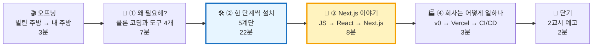

| 파트 | 시간 | 핵심 질문 | 핵심 비유 |
|---|:---:|---|---|
| 🎬 오프닝 | 0~3분 | "어제는 남의 주방, 오늘은 내 주방!" | 🏠 공유 주방 → 내 가게 주방 |
| 🤔 ① 왜 필요해? | 3~10분 | 화면 하나 만드는데 왜 도구가 4개나 필요해? | 🍳 주방 설비 4종 |
| 🛠️ ② 한 단계씩 설치 | 10~32분 | 어떤 순서로, 어떻게 확인하며 깔까? | 🪜 주방 공사 5단계 |
| 📜 ③ Next.js 이야기 | 32~40분 | 왜 그냥 JavaScript가 아니라 React, 그리고 Next.js야? | 🚗 엔진 → 자동차 |
| 🏭 ④ 회사의 일하는 법 | 40~43분 | 진짜 회사는 v0 · Vercel을 어떻게 써? | 🏭 공장 컨베이어 벨트 |
| 🔗 닫기 | 43~45분 | 2교시에 무엇을 하나? | 🎫 |

> **⏱ 시간이 밀리면** — ③ 역사 이야기의 연표를 **3장면(옛날 · React · Next.js)** 으로 줄입니다. **② 설치의 "확인하기"는 절대 건너뛰지 마세요.** 확인 안 한 설치는 2교시에 반드시 터집니다.

> **🧑‍🏫 운영 팁** — 다운로드가 돌아가는 동안 **기다리는 시간**에 ① · ③의 비유 설명을 끼워 넣으면 시간이 훨씬 넉넉해집니다. 설치 파일은 **USB로 미리 나눠 주면** 10분을 벌 수 있어요.

---

## 🧰 수업 전 준비 (선생님용 · 전날까지)

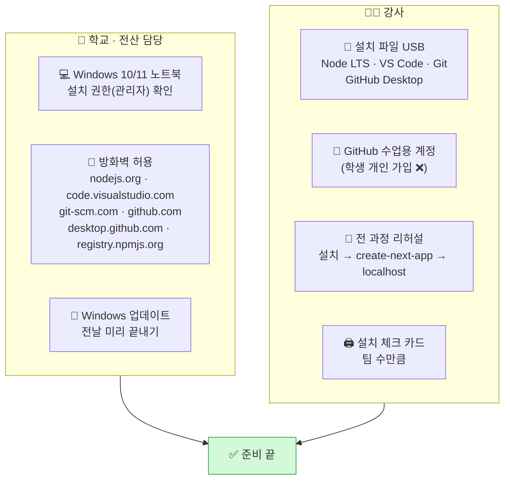

| # | 체크 | 왜 | 담당 |
|:---:|---|---|:---:|
| 1 | ☐ 노트북 **관리자 권한** 확인 (설치 시 비밀번호는 선생님이 직접) | 학교 PC는 설치가 막혀 있는 경우가 많아요 | 🏫 |
| 2 | ☐ **`registry.npmjs.org`** 접속 허용 | 막혀 있으면 `npm install`이 영원히 안 끝나요 | 🏫 |
| 3 | ☐ 설치 파일 4개(+ GitHub Desktop) **USB 백업** | 30명 동시 다운로드 = Wi-Fi 마비 | 🧑‍🏫 |
| 4 | ☐ **GitHub 수업용 계정**(또는 Organization) | 초등학생은 가입 연령 제한 · 개인정보 보호 | 🧑‍🏫 |
| 5 | ☐ `npx create-next-app` **리허설** (질문 화면 순서 캡처) | 버전마다 질문 순서가 조금씩 달라요 | 🧑‍🏫 |
| 6 | ☐ 노트북 **사용자 폴더 이름이 한글인지** 확인 | 한글 경로는 일부 도구에서 오류 → 작업 폴더를 `C:\dev`로 | 🧑‍🏫 |

---

# 🎬 오프닝 (0~3분) — "빌린 주방에서 내 주방으로"

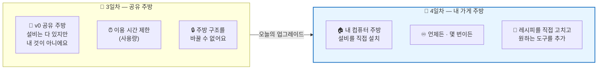

> **🗣️ 선생님 대사**
> "어제 v0는 **공유 주방**이었어요. 가스레인지, 냄비, 칼이 다 있어서 바로 요리할 수 있었죠. 그런데 **내 주방이 아니라서** 시간이 다 되면 나가야 하고, 마음대로 구조를 바꿀 수 없어요.
> 진짜 요리사가 되려면 언젠가 **내 가게에 내 주방**을 차려야 해요. 오늘이 바로 그날이에요.
> 주방을 차리는 걸 개발자들은 **'개발 환경 구축'** 이라고 불러요."

| | 🏢 공유 주방 (v0만 쓰기) | 🏠 내 주방 (개발 환경) |
|---|---|---|
| 시작 속도 | ⚡ 바로 시작 | 🛠️ 처음에 설치가 필요 |
| 이용 제한 | 사용량 · 시간 제한 | **제한 없음** |
| 레시피(코드) | v0 안에 있음 | **내 컴퓨터 + GitHub에 내 것으로** |
| 고치기 | AI에게 부탁만 | **직접 열고 고칠 수 있음** |
| 다른 AI 도구 | v0만 | **Claude Code 등 무엇이든 연결** (2교시 마지막!) |

---

# 🤔 ① 왜 이 도구들이 필요할까? (3~10분) — "주방 설비 4종"

## 1-1. 클론 코딩이 뭐고, 왜 내 주방이 필요해?

> **클론 코딩(clone coding)** = 이미 있는 서비스를 **똑같이 따라 만들어 보며** 배우는 방법이에요.
> 🍜 **비유** — 유명한 맛집의 라면을 먹어 보고 **"이건 어떻게 만들었을까?"** 를 거꾸로 알아내서 **내 주방에서 똑같이** 끓여 보는 것.

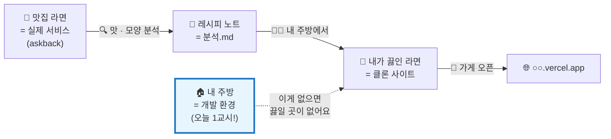

| 질문 | 답 | 비유 |
|---|---|---|
| 왜 따라 만들어요? | 잘 만든 서비스엔 **이유 있는 배치**가 숨어 있어요 | 🎨 명화 따라 그리면 붓질이 보여요 |
| v0만으로는 안 돼요? | 만들 수는 있어요. 하지만 **코드를 내 것으로 가져와 고치려면** 내 주방이 필요해요 | 🍱 배달 음식 vs 직접 요리 |
| 베끼는 거 아니에요? | **공부용**이에요. 이름 · 로고 · 글은 **우리 것으로 바꿔요** | 📚 교과서 예제 풀기 |

## 1-2. 주방 설비 4종 — 각각 무슨 일을 하나?

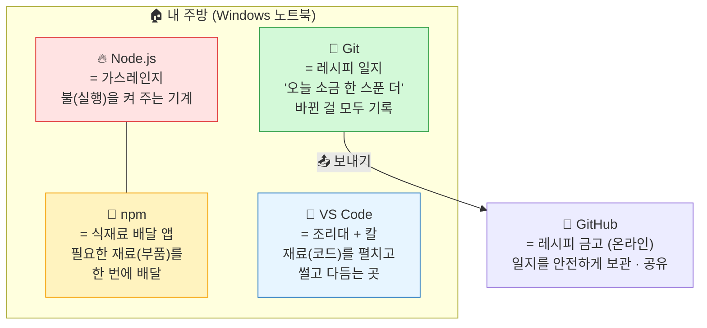

| 도구 | 🍳 주방 비유 | 진짜로 하는 일 | **없으면 어떻게 돼요?** |
|---|---|---|---|
| 🔥 **Node.js** | **가스레인지** | JavaScript를 **브라우저 밖, 내 컴퓨터에서** 실행해요 | 불이 없어요 → 아무 요리도 못 해요. Next.js가 **아예 안 켜져요** |
| 🛵 **npm** | **식재료 배달 앱** | `npm install` 한 줄로 **부품(라이브러리) 수백 개**를 받아와요 | 밀가루부터 직접 빻아야 해요 → React를 **손으로 구할 수 없어요** |
| 🔪 **VS Code** | **조리대 + 칼** | 폴더를 열고, 코드를 보고, 고치고, **터미널(가스레인지 스위치)** 도 여기 | 바닥에서 요리하기 → 메모장으로 파일 수십 개를 열어야 해요 |
| 📒 **Git** | **레시피 일지** | "언제, 무엇을, 왜 바꿨는지" **세이브 포인트**를 찍어요 | 망친 요리를 되돌릴 수 없어요 · GitHub로 못 보내요 |
| 🏦 **GitHub** | **레시피 금고 (온라인)** | Git 일지를 인터넷에 보관 · 팀과 공유 · **Vercel과 연결** | 노트북이 고장 나면 레시피가 사라져요 · **자동 배포가 안 돼요** |

> **🗣️ 선생님 대사**
> "요리사에게 **가스레인지(Node.js)** 가 없으면? 요리를 못 해요. **배달 앱(npm)** 이 없으면? 재료를 하나하나 농장에 가서 구해야 해요. **조리대(VS Code)** 가 없으면? 바닥에서 칼질해야 하죠. **레시피 일지(Git)** 가 없으면? 어제 맛있게 된 방법을 잊어버려요.
> 그래서 **넷 다** 있어야 주방이 돌아가요."

## 1-3. 왜 "이 순서"로 설치할까? — 주방 공사 순서

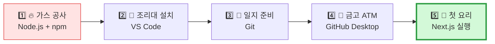

| 순서 | 왜 이 순서? (비유) |
|:---:|---|
| 1️⃣ Node.js 먼저 | 🔥 **가스가 먼저** 들어와야 다른 기계를 시험해 볼 수 있어요. npm도 Node.js와 **같이 따라와요** |
| 2️⃣ VS Code | 🔪 조리대에 **터미널(스위치)** 이 달려 있어서, 이후 설치 확인을 **여기서** 해요 |
| 3️⃣ Git | 📒 Git을 깔 때 **"편집기는 VS Code로"** 를 고르려면 VS Code가 먼저 있어야 해요 |
| 4️⃣ GitHub | 🏦 일지(Git)가 있어야 **금고(GitHub)** 에 넣을 수 있어요 |
| 5️⃣ Next.js | 🍳 가스 · 조리대 · 일지 · 금고가 **모두 준비된 뒤** 첫 요리! |

## 1-4. 프론트 페이지 하나에 이게 다 필요한 이유 — 한 장 그림

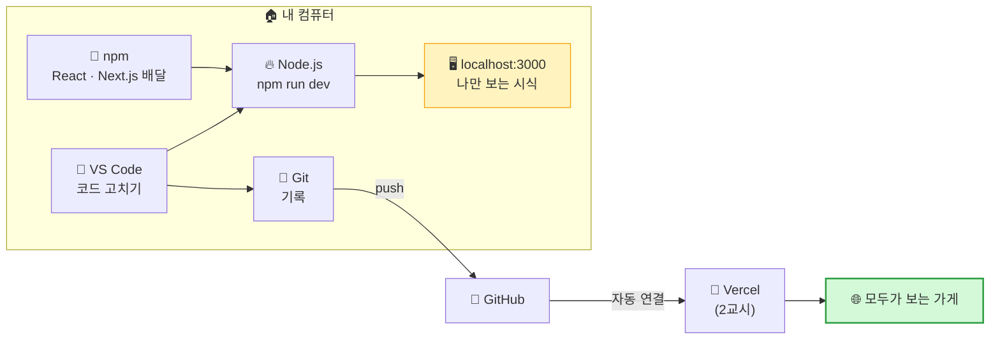

> **핵심 한 줄** — **VS Code에서 고치고 → Node.js로 맛보고(localhost) → Git으로 기록하고 → GitHub에 넣으면 → Vercel이 가게를 연다.**
> 오늘 1교시는 이 그림의 **왼쪽 상자(내 컴퓨터)** 를 완성하고, 2교시는 **오른쪽(GitHub · Vercel)** 을 이어요.

---

# 🛠️ ② 한 단계씩 설치하기 (10~32분) — "주방 공사 5계단"

> **규칙 — 설치 1개 = 확인 1개.** 한 계단 오를 때마다 **"불이 들어왔는지"** 꼭 확인하고 다음으로 가요.
> 🧑‍🏫 **선생님 신호** — 팀이 확인을 끝내면 **설치 체크 카드에 도장 ✅** 을 받고 다음 계단으로!

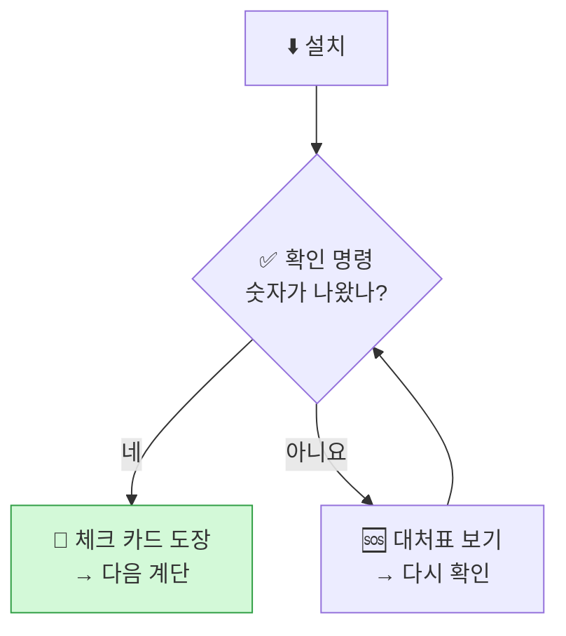

## 🎫 설치 체크 카드 (팀당 1장 · 인쇄용)

```
┌──────────────────────────────────────────────────────────┐
│ 🏠 우리 주방 공사 체크 카드              팀: ______      │
├──────────────────────────────────────────────────────────┤
│ 1️⃣ 🔥 Node.js  node -v  → v_______        [ 도장 ]      │
│    🛵 npm      npm -v   → ________        [ 도장 ]      │
│ 2️⃣ 🔪 VS Code  code -v  → ________        [ 도장 ]      │
│ 3️⃣ 📒 Git      git -v   → ________        [ 도장 ]      │
│ 4️⃣ 🏧 GitHub Desktop  Options → Accounts 계정 표시 [ 도장 ] │
│ 5️⃣ 🍳 Next.js  localhost:3000 화면 열림   [ 도장 ]      │
└──────────────────────────────────────────────────────────┘
```

## 2-0. 공사 전 점검 (1분)

| 확인 | 어디서 | 필요한 값 |
|---|---|---|
| Windows 버전 | `⊞ 시작 → 설정 → 시스템 → 정보` | Windows 10 / 11 · **64비트** |
| 저장 공간 | `파일 탐색기 → 내 PC` | **3GB 이상** 여유 |
| 작업 폴더 | `C:` 드라이브에 **`dev`** 폴더 만들기 | 영어 이름 · 짧은 경로 |

> **❓ 왜 `C:\dev`?** — 바탕화면 · 문서 폴더는 **OneDrive 동기화**나 **한글 사용자 이름** 때문에 오류가 잦아요. 🏠 **비유** — 주방은 **현관 앞 복도(바탕화면)** 가 아니라 **전용 공간**에 차리는 거예요.

---

## 1️⃣ 계단 — 🔥 Node.js + 🛵 npm (가스 공사) · 6분

### 왜 필요해?

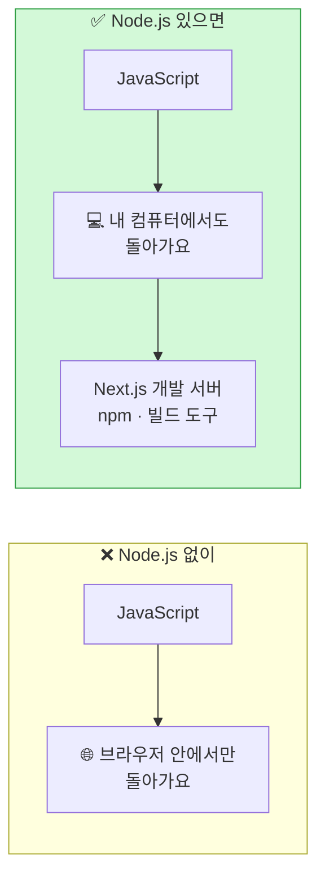

> **🔥 비유** — JavaScript는 원래 **브라우저라는 식당 안에서만** 요리할 수 있었어요. **Node.js**는 JavaScript를 **식당 밖, 내 주방(컴퓨터)** 에서도 요리할 수 있게 해 준 **휴대용 가스레인지**예요.
> **🛵 npm**은 Node.js를 설치하면 **선물처럼 같이 따라오는 배달 앱**이에요.

### 설치 순서

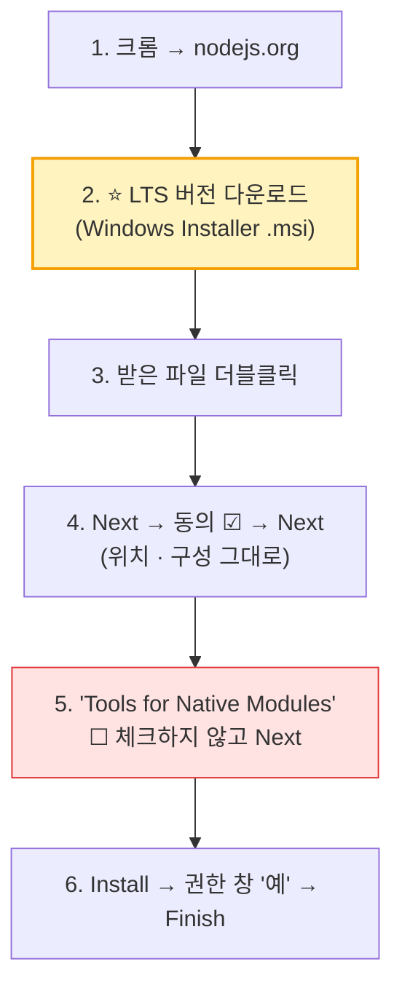

| 화면 | 고를 것 | 주의 |
|---|---|---|
| nodejs.org 첫 화면 | **LTS** | ❌ Current(최신 실험판) 아님 |
| License | ☑ I accept | — |
| Destination / Custom Setup | **그대로 Next** | npm이 여기 함께 들어 있어요 ✅ |
| Tools for Native Modules | **☐ 체크 안 함** | 체크하면 추가 설치가 20분 넘게 걸려요 |
| 권한 창 | **예** | 비밀번호를 물으면 🙋 선생님 |

> **❓ LTS가 뭐예요?** — **Long Term Support** = "오래 고장 수리해 주는 버전". 🎮 게임의 **정식판** = LTS, **베타판** = Current. 수업은 무조건 **정식판**!

### ✅ 확인하기 (설치 후 **열려 있던 창을 다 닫고**, `⊞ 시작` → `cmd` → **명령 프롬프트** 열기)

```bash
node -v
```

```bash
npm -v
```

```bash
npx -v
```

| 명령 | 질문 (비유) | ✅ 성공 모습 | ❌ 실패 모습 |
|---|---|---|---|
| `node -v` | "🔥 가스레인지야, 몇 년형이니?" | `v22.○○.○` 같은 숫자 | `'node'은(는) 내부 또는 외부 명령…` |
| `npm -v` | "🛵 배달 앱아, 버전이 뭐니?" | `10.○.○` | 같은 메시지 |
| `npx -v` | "🧑‍🍳 일회용 요리사 호출기야, 있니?" | `10.○.○` | 같은 메시지 |

> **❓ npx는 또 뭐예요?** — **npm으로 부품을 영구 설치하지 않고 한 번만 불러 쓰는** 호출기예요. 🧑‍🍳 **비유** — 출장 요리사를 **한 번만 불러서** 주방 기초 공사를 맡기는 것. 5계단에서 `npx create-next-app` 으로 씁니다.

---

## 2️⃣ 계단 — 🔪 VS Code (조리대 설치) · 4분

### 왜 필요해?

> **🔪 비유** — 코드는 **파일 수십 개**로 되어 있어요. 메모장으로 하나씩 열면 **바닥에 재료를 늘어놓고 요리하는 것**과 같아요. VS Code는 **재료를 한눈에 펼치고(탐색기), 썰고(편집기), 불을 켜는 스위치(터미널)까지** 한 곳에 모은 **조리대**예요.

### 설치 순서

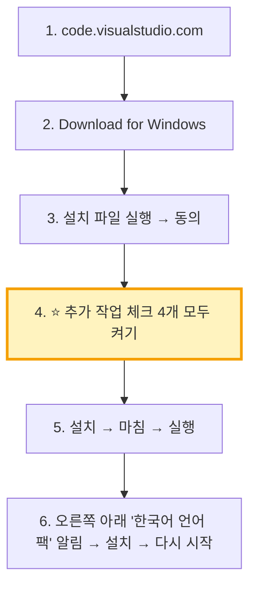

| ⭐ 추가 작업 체크박스 | 왜 켜요? |
|---|---|
| ☑ 바탕 화면 바로 가기 | 찾기 쉬워요 |
| ☑ "Code(으)로 열기" — **파일** 오른쪽 클릭 메뉴 | 파일을 바로 열어요 |
| ☑ "Code(으)로 열기" — **폴더** 오른쪽 클릭 메뉴 | ⭐ 프로젝트는 **폴더째** 열어요 |
| ☑ **PATH에 추가** | ⭐ 터미널에서 `code .` 명령을 쓰려면 필수 |

### VS Code 주방 지도 — 다섯 구역

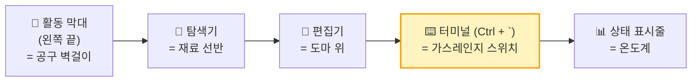

| 구역 | 🍳 비유 | 단축키 | 오늘 쓰나? |
|---|---|---|:---:|
| 🧭 활동 막대 | 공구 벽걸이 | — | ✅ |
| 📂 탐색기 | 재료 선반 | `Ctrl + Shift + E` | ✅ |
| 📝 편집기 | 도마 위 | — | ✅ |
| ⌨️ **터미널** | **가스레인지 스위치** | **`Ctrl + `` `** (숫자 1 왼쪽) | ⭐ ✅ |
| 🔀 소스 제어 | 레시피 일지 펼치기 | `Ctrl + Shift + G` | ✅ (4계단) |
| 🧩 확장 | 추가 주방 도구 상점 | `Ctrl + Shift + X` | ✅ |

### 🧩 추천 확장 (선택 · 1분)

| 확장 | 🍳 비유 | 하는 일 |
|---|---|---|
| Korean Language Pack | 🌏 한국어 메뉴판 | 메뉴를 한국어로 |
| ES7+ React snippets | ✂️ 모양 틀 | React 코드 틀 자동 입력 |
| Tailwind CSS IntelliSense | 🎨 양념 이름 자동 완성 | 디자인 글자 자동 완성 |
| Markdown Preview Mermaid Support | 🖼️ 레시피 그림 보기 | `.md` 안의 도식을 그림으로 (2교시 분석.md) |

### ✅ 확인하기 — **VS Code 안에서** 터미널 열기 (`Ctrl + `` `)

```bash
code -v
```

| 성공 | 실패하면 |
|---|---|
| `1.○○.○` 숫자 3줄 | VS Code를 **완전히 닫고 다시 열기** → 그래도 안 되면 설치 때 **PATH 체크**를 안 한 것 → 다시 설치 |

> **💡 이제부터 모든 명령은 VS Code 터미널에서** 입력해요. 🔥 가스레인지 스위치가 **조리대에 달린** 셈이에요.

---

## 3️⃣ 계단 — 📒 Git (레시피 일지 준비) · 4분

### 왜 필요해?

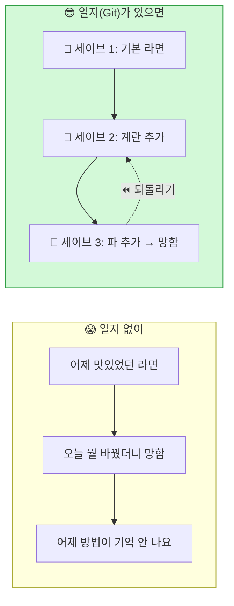

> **📒 비유** — Git은 **요리할 때마다 "무엇을 바꿨는지" 사진과 메모를 남기는 레시피 일지**예요. 🎮 게임의 **세이브 포인트**처럼, 망치면 **어제 버전으로 돌아갈 수** 있어요.

### 설치 순서

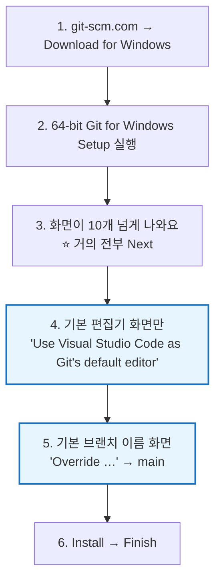

| 화면 | 고를 것 | 왜 |
|---|---|---|
| **Choosing the default editor** | **Use Visual Studio Code …** | 기본값(Vim)은 처음 쓰는 사람이 **빠져나오기 어려워요** 😵 |
| **Adjusting the name of the initial branch** | **Override … → `main`** | GitHub · Vercel이 쓰는 이름과 맞춰요 |
| 나머지 전부 | **Next** | 기본값이 가장 안전해요 |

### ✅ 확인하기 — VS Code를 **완전히 닫고 다시 열어** 터미널에서

```bash
git -v
```

| 성공 | 실패하면 |
|---|---|
| `git version 2.○○.○.windows.1` | VS Code 재시작 → 그래도 안 되면 컴퓨터 재시작 |

### 📛 일지에 이름표 달기 (선생님이 노트북마다 1회)

> **왜?** — 일지의 모든 기록에 **"누가 썼는지"** 가 남아요. 이름표가 없으면 Git이 **기록을 거부**해요.

```bash
git config --global user.name "team-03"
```

```bash
git config --global user.email "수업용계정@example.com"
```

| 칸 | ✅ 넣을 값 | ❌ 넣지 않을 값 | 이유 |
|---|---|---|---|
| `user.name` | `team-03` 같은 **팀 이름** | 학생 실명 | 기록은 **영원히** 남아요 |
| `user.email` | **수업용 계정 이메일** | 학생 · 부모님 개인 이메일 | 공개 저장소면 **누구나** 봐요 |

---

## 4️⃣ 계단 — 🏧 GitHub Desktop (레시피 금고 ATM) · 4분

### 왜 필요해?

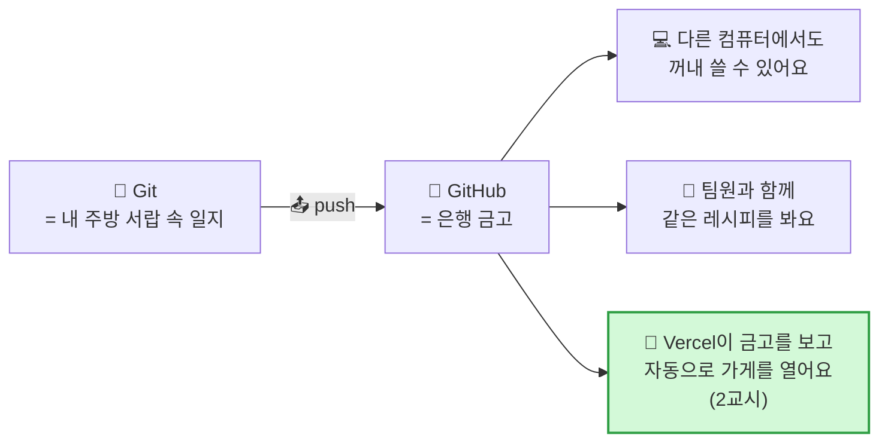

| | 📒 Git | 🏦 GitHub |
|---|---|---|
| 비유 | 내 서랍 속 **일지 공책** | 은행의 **금고 서비스** |
| 어디에? | 내 컴퓨터 | 인터넷 |
| 만든 곳 | 리누스 토르발스 (2005) | GitHub 회사 (2008, 지금은 Microsoft) |
| 없으면? | 기록을 못 해요 | 노트북 고장 = 레시피 증발 · **자동 배포 불가** |

### 🖥️ 우리는 **GitHub Desktop**으로 금고를 다룹니다

> **왜 GitHub Desktop?** — Git은 원래 `git add` · `git commit` · `git push` 같은 **명령어**로 써요. 처음 배우는 친구들에겐 **영어 주문을 외워서 외치는** 것과 같아요.
> **🏧 비유** — GitHub Desktop은 은행의 **ATM 화면**이에요. 금고(GitHub)에 넣고 빼는 일을 **버튼으로** 해요. 속에서는 똑같이 Git이 일하고, 우리는 **화면만 보고 누르면** 돼요.

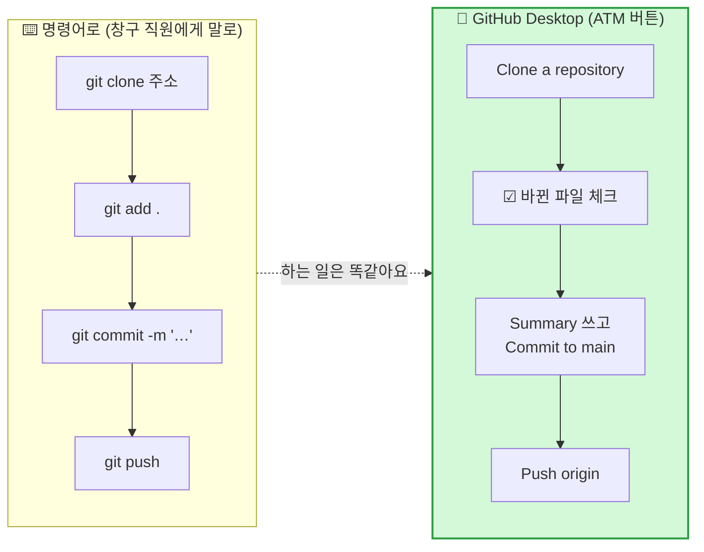

| | ⌨️ Git 명령어 | 🏧 GitHub Desktop |
|---|---|---|
| 비유 | 창구 직원에게 **말로** 주문 | **ATM 버튼** |
| 바뀐 내용 보기 | `git status` · `git diff` | 왼쪽 목록 + **빨강/초록 줄**로 바로 보임 |
| 기록 남기기 | `git add .` → `git commit -m "…"` | 체크 ☑ → **Summary** → **Commit to main** |
| 금고에 넣기 | `git push` | **Push origin** 버튼 |
| 가져오기 | `git clone` · `git pull` | **Clone repository** · **Fetch / Pull origin** |
| Git 설치 필요? | ✅ | Desktop 안에 Git이 들어 있어요 (3계단 Git은 **Claude Code**가 써요) |

### 설치 순서 (3분)

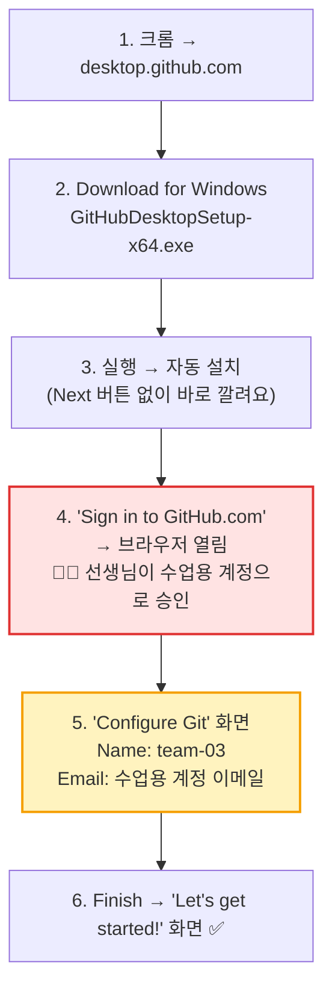

| 화면 | 할 것 | 주의 |
|---|---|---|
| 설치 파일 실행 | 기다리기 (선택 화면 없음) | — |
| **Sign in to GitHub.com** | 🧑‍🏫 **선생님이** 브라우저에서 수업용 계정 승인 → "Open GitHub Desktop" 허용 | 학생 개인 계정 ❌ |
| **Configure Git** | Name = **팀 이름**, Email = **수업용 계정 이메일** | 실명 · 개인 이메일 ❌ (3계단 `git config`와 같은 일 — 둘 중 하나만 해도 OK) |
| 사용 통계 동의 | ☐ 체크 해제 권장 | — |
| Let's get started! | ✅ 완료 | — |

**🔗 VS Code와 짝 맺기 (30초)** — 상단 메뉴 `File → Options → Integrations`

| 칸 | 고를 것 | 왜 |
|---|---|---|
| **External Editor** | **Visual Studio Code** | Desktop에서 버튼 하나로 VS Code가 열려요 |
| **Shell** | **Command Prompt** | PowerShell 보안 오류를 피해요 |

### GitHub Desktop 화면 지도 — 네 구역

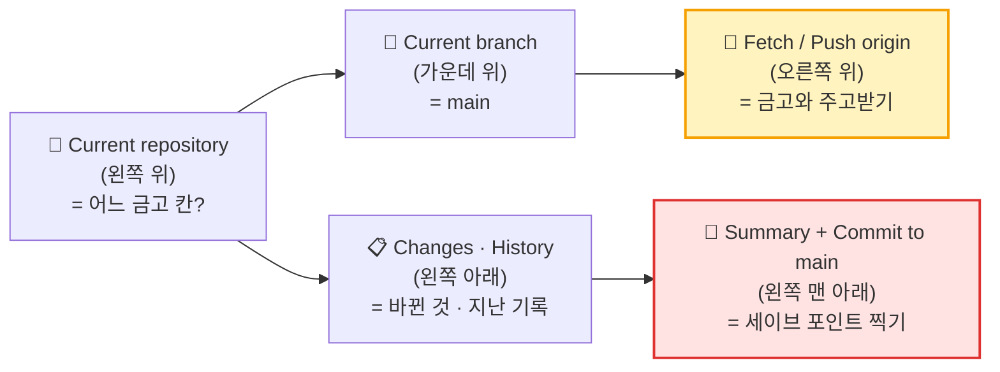

| 구역 | 🏧 비유 | 오늘 |
|---|---|:---:|
| 📁 Current repository | 내 금고 칸 고르기 | ✅ |
| 🌳 Current branch | 통장 종류 (main 하나) | 👀 |
| 🔄 Fetch / **Push origin** | **입금 · 조회 버튼** | ✅ |
| 📋 Changes / History | 오늘 거래 내역 / 지난 거래 내역 | ✅ |
| 📝 Summary · **Commit to main** | 거래 메모 + **확인 버튼** | ✅ |

> **🔒 약속** — GitHub 비밀번호 · 인증 코드는 **학생이 입력하지 않아요.** 선생님이 직접 승인합니다.

### ✅ 확인하기

| 확인 | 어디서 | O / X |
|---|---|:---:|
| `File → Options → Accounts` 에 **수업용 계정 이름**이 보인다 | GitHub Desktop | |
| `Options → Git` 의 Name이 **팀 이름**이다 | GitHub Desktop | |
| `Options → Integrations` 의 External Editor가 **Visual Studio Code** | GitHub Desktop | |

---

## 5️⃣ 계단 — 🍳 첫 요리: Next.js 프로젝트 실행 · 5분

> **드디어 첫 요리!** 출장 요리사(`npx`)를 불러서 **Next.js 주방 기초 공사**를 맡기고, 가스레인지를 켜서(`npm run dev`) 맛을 봐요.

### 왜 이 명령인가?

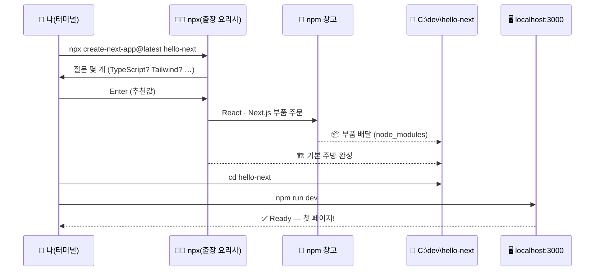

### 따라 치기 (VS Code 터미널 · 한 줄씩 `Enter`)

**1) 작업 폴더로 이동**

```bash
cd C:\dev
```

**2) 출장 요리사 부르기** — 질문이 나오면 **그냥 `Enter`** (추천값 사용)

```bash
npx create-next-app@latest hello-next
```

| 질문 (영어로 나와요) | 뜻 | 오늘 답 |
|---|---|:---:|
| Need to install create-next-app? (y) | 출장 요리사 불러도 돼? | `y` → `Enter` |
| Would you like to use the recommended defaults? | 추천 설정으로 할래? | **Yes** (`Enter`) |
| (따로 물으면) TypeScript? | 철자 검사기 달린 JavaScript 쓸래? | **Yes** |
| (따로 물으면) ESLint? | 맞춤법 선생님 둘래? | **Yes** |
| (따로 물으면) Tailwind CSS? | 양념(디자인) 세트 쓸래? | **Yes** ⭐ v0와 같아요 |
| (따로 물으면) `src/` directory? | 재료를 `src` 서랍에 넣을래? | No |
| (따로 물으면) App Router? | 새 방식 길 안내 쓸래? | **Yes** ⭐ |
| (따로 물으면) Turbopack? | 빠른 가스 버너 쓸래? | Yes |
| (따로 물으면) import alias? | 재료 별명 바꿀래? | No |

> **💡** 버전에 따라 질문 순서 · 개수가 달라요. **모르면 `Enter`** 가 정답이에요.

**3) 만들어진 주방으로 들어가 VS Code로 열기**

```bash
cd hello-next
```

```bash
code .
```

**4) 새로 열린 VS Code 창에서 터미널(`Ctrl + `` `) → 가스레인지 켜기**

```bash
npm run dev
```

**5) 터미널의 `http://localhost:3000` 을 `Ctrl + 클릭`** → 🎉 Next.js 첫 화면!

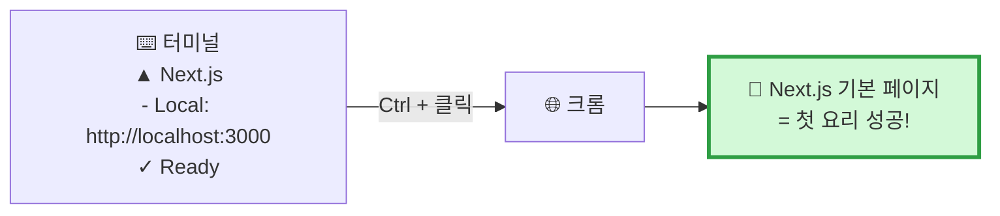

### 🍳 맛 바꿔 보기 (1분) — 내 손으로 한 글자

```mermaid
flowchart LR
    A["📂 app/page.tsx 열기"] --> B["✏️ 화면에 보이는 영어 문장 하나를<br/>'안녕! 우리 팀 주방이야 🍳' 로 바꾸기"]
    B --> C["💾 Ctrl + S"]
    C --> D["⚡ 크롬이 저절로 바뀜<br/>(핫 리로드)"]
    style D fill:#fff3bf,stroke:#f59f00,stroke-width:2px
```

> **⚡ 핫 리로드(Hot Reload)** — 저장하는 순간 화면이 **저절로** 바뀌어요. 🍲 **비유** — 국에 소금을 넣고 **바로 한 숟갈 맛보기**. 오븐에 다시 넣고 기다릴 필요가 없어요.

> **🛑 끄는 법** — 터미널에서 `Ctrl + C` → `Y` (일괄 작업을 끝내시겠습니까? → Y). 🔥 **가스 불 끄기**.

### 📂 첫 주방 둘러보기 — 무엇이 생겼나?

```mermaid
flowchart TB
    ROOT["📁 hello-next"]
    ROOT --> APP["📂 app/<br/>🚪 방(페이지)"]
    APP --> P1["📄 page.tsx = 정문 (첫 화면)"]
    APP --> P2["📄 layout.tsx = 건물 뼈대"]
    APP --> P3["📄 globals.css = 기본 양념"]
    ROOT --> PUB["📂 public/<br/>🖼️ 사진 창고"]
    ROOT --> NM["📂 node_modules/<br/>🛵 배달 온 재료<br/>(건드리지 않기)"]
    ROOT --> PK["📄 package.json<br/>📋 재료 주문서 + 요리 버튼"]
    ROOT --> GI["📄 .gitignore<br/>🙈 일지에 안 적을 목록"]
    style P1 fill:#fff3bf,stroke:#f59f00
    style NM fill:#f1f3f5,stroke:#868e96
```

| 파일 · 폴더 | 🍳 비유 | 하는 일 | 오늘 |
|---|---|---|:---:|
| `app/page.tsx` | 🚪 정문 | `localhost:3000` 첫 화면 | ✏️ 고쳐 봄 |
| `app/layout.tsx` | 🏢 건물 뼈대 | 모든 페이지가 공유하는 틀 | 👀 |
| `app/globals.css` | 🧂 기본 양념 | 전체 디자인 | 👀 |
| `public/` | 🖼️ 사진 창고 | 이미지 · 아이콘 | 👀 |
| `node_modules/` | 🛵 배달 온 재료 창고 | React · Next.js 등 부품 | ❌ 손대지 않기 |
| `package.json` | 📋 재료 주문서 | 어떤 부품을 쓰는지 + `dev` · `build` 버튼 | 👀 |
| `.gitignore` | 🙈 비밀 목록 | `node_modules`는 일지에 안 적어요 | 👀 |

> **❓ `node_modules`는 왜 일지(Git)에 안 적어요?** — 재료는 **주문서(`package.json`)만 있으면 언제든 다시 배달**받을 수 있으니까요. 📋 레시피에는 "밀가루 200g"이라고만 적지, **밀가루 자체를 공책에 붙이진 않죠?**

---

## 2-6. 🆘 설치 막혔을 때 — 통합 대처표

```mermaid
flowchart TD
    E{"무슨 메시지?"}
    E -->|"'node'/'git'/'code'은(는)<br/>내부 또는 외부 명령이 아닙니다"| E1["🔄 VS Code · 터미널<br/>완전히 닫고 다시 열기<br/>→ 그래도면 재부팅"]
    E -->|"npm.ps1 … 스크립트를<br/>실행할 수 없으므로"| E2["⌨️ 터미널 + 옆 ∨<br/>→ Command Prompt 선택"]
    E -->|"npx 질문 화면에서 멈춤"| E3["⏳ 1~2분 기다리기<br/>→ 화살표 · Enter"]
    E -->|"npm install이<br/>5분 넘게 안 끝남"| E4["📶 Wi-Fi · 방화벽<br/>(registry.npmjs.org)<br/>→ 🙋 선생님"]
    E -->|"EPERM · 권한 오류"| E5["📁 C:\\dev 에서 했는지 확인<br/>OneDrive 폴더 ❌"]
    E -->|"Port 3000 is in use"| E6["터미널에 나온<br/>3001 주소로 열기"]
    style E2 fill:#fff3bf,stroke:#f59f00,stroke-width:2px
```

| 증상 | 원인 (🍳 비유) | 해결 |
|---|---|---|
| `'node'은(는) 내부 또는 외부 명령…` | 📞 주방 전화번호부(PATH)에 아직 안 적힘 | 창 **모두** 닫고 다시 열기 → 재부팅 |
| `npm.ps1 파일을 로드할 수 없습니다` | 🛡️ PowerShell 경비원이 막음 | 터미널 `+` 옆 `∨` → **Command Prompt** (보안 설정은 바꾸지 않아요) |
| `v16` 처럼 오래된 숫자 | 🧓 예전에 깔린 낡은 가스레인지 | 🙋 선생님과 제어판에서 제거 → LTS 재설치 |
| `EPERM` · `EACCES` | 🔐 잠긴 방에서 공사 | `C:\dev` 처럼 내 폴더에서 · OneDrive 폴더 ❌ |
| 한글 경로 오류 | 🔤 출장 요리사가 한글 주소를 못 읽음 | 작업 폴더를 **영어 경로**로 |
| `create-next-app` 도중 멈춤 | 🛵 배달 지연 | 기다리기 → `Ctrl + C` 후 다시 |
| `Port 3000 is in use` | 🅿️ 주차 자리 찼음 | **3001** 주소로 열기 |
| `Missing script: "dev"` | 🚪 다른 방에서 스위치를 찾음 | `cd hello-next` 로 들어갔는지 확인 |

> **💡 터미널은 무섭지 않아요** — 검은 화면은 **컴퓨터와 채팅하는 창**이에요. 틀려도 **컴퓨터는 고장 나지 않아요.** `↑` 키로 방금 쓴 명령을 다시 불러와 고치면 돼요.

---

# 📜 ③ Next.js 이야기 (32~40분) — "엔진에서 자동차까지"

> **왜 역사를 배워요?** — "왜 하필 Next.js야?"라는 질문의 답이 **역사 속에** 있어요. 도구는 **불편함을 해결하려고** 태어나요. 그 불편함을 알면 도구를 **왜 쓰는지** 알게 돼요.

## 3-1. 큰 연표 — 웹 화면 만들기의 30년

```mermaid
timeline
    title 웹 화면을 만드는 방법은 어떻게 바뀌었나
    1995 : JavaScript 탄생 : 브라우저 안 작은 움직임
    2006 : jQuery : 쉽게 움직이는 도구
    2009 : Node.js : 브라우저 밖에서도 JS
    2010 : npm : 부품 배달 시스템
    2013 : React (Facebook) : 레고 블록(컴포넌트)
    2015 : VS Code (Microsoft) : 무료 조리대
    2016 : Next.js (ZEIT → 지금의 Vercel) : React 완성차
    2020 : ZEIT → Vercel 이름 변경 : 배포 회사 + Next.js
    2023 : App Router · v0 : 새 길 안내 · AI 화면 디자이너
    2025 : Claude Code 등 AI 코딩 도구 : 내 주방의 AI 요리사
```

## 3-2. 다섯 장면으로 보는 이야기

### 🎬 장면 1 — 순수 JavaScript 시대 (1995~): "맨손으로 모래성 쌓기"

```mermaid
flowchart LR
    H["🧱 HTML<br/>뼈대"] --> C["🎨 CSS<br/>옷"]
    C --> J["⚡ JavaScript<br/>움직임"]
    J --> P["😵 화면이 커질수록<br/>코드가 엉킴"]
    style P fill:#ffe3e3,stroke:#e03131
```

| 좋은 점 | 불편한 점 | 🍳 비유 |
|---|---|---|
| 브라우저만 있으면 됨 | 화면이 커지면 **어디가 어딘지 엉망** · 같은 코드를 **복사-붙여넣기** 반복 | 🏖️ 맨손으로 모래성 — 작은 건 되지만 큰 성은 무너져요 |

### 🎬 장면 2 — Node.js · npm (2009~2010): "휴대용 가스레인지와 배달 앱"

> 라이언 달(Ryan Dahl)이 **JavaScript를 브라우저 밖에서도** 돌아가게 만들었어요(Node.js). 곧이어 **부품을 나눠 쓰는 배달 시스템(npm)** 이 생겼어요.
> 🍳 **결과** — 전 세계 개발자가 만든 **부품을 한 줄로 받아 쓰는** 시대가 열렸어요. 오늘 우리가 1계단에서 깐 바로 그것!

### 🎬 장면 3 — React (2013, Facebook): "레고 블록의 발명"

```mermaid
flowchart TB
    subgraph OLD["😵 예전 방식"]
        o1["페이지 전체를<br/>하나의 큰 덩어리로"]
    end
    subgraph REACT["🧱 React 방식"]
        r1["🔘 Button 블록"]
        r2["🃏 Card 블록"]
        r3["🔍 SearchBar 블록"]
        r1 --> pg["📄 페이지 = 블록 조립"]
        r2 --> pg
        r3 --> pg
    end
    OLD -->|"Facebook 개발자들이<br/>'너무 복잡해!'"| REACT
    style REACT fill:#e7f5ff,stroke:#1971c2,stroke-width:2px
```

> **왜 태어났나?** — Facebook 화면은 **좋아요 수 · 댓글 · 알림**이 쉴 새 없이 바뀌어요. 예전 방식으로는 하나 바꾸면 다른 곳이 망가졌어요.
> **🧱 비유** — React는 화면을 **레고 블록(컴포넌트)** 으로 나눠요. 블록 틀 하나를 만들면 **100번 찍어** 쓸 수 있고, **데이터가 바뀌면 그 블록만** 새로 그려져요.

| React의 핵심 아이디어 | 🧱 비유 | 2교시 askback에서는? |
|---|---|---|
| **컴포넌트** | 레고 블록 틀 | 질문 카드 1개 틀 → 20번 찍기 |
| **props** | 블록에 붙이는 이름표 | 카드마다 다른 질문 글 |
| **state** | 블록의 기분 (켜짐/꺼짐) | 답 카드 접힘 / 펼침 |
| **JSX** | 블록 조립 설명서 (HTML처럼 생긴 JS) | `<QuestionCard text="…" />` |

> **❓ 그럼 React만 쓰면 되지 않아요?** — 장면 4로!

### 🎬 장면 4 — Next.js (2016, ZEIT → 지금의 Vercel): "엔진에 차체를 씌우다"

```mermaid
flowchart LR
    subgraph R["🔧 React만 = 자동차 엔진"]
        r1["강력한 엔진<br/>(화면 블록 그리기)"]
        r2["❓ 바퀴는?<br/>(페이지 이동 · 주소)"]
        r3["❓ 핸들은?<br/>(검색엔진 · 첫 화면 속도)"]
        r4["❓ 차고는?<br/>(배포)"]
    end
    subgraph N["🚗 Next.js = 완성된 자동차"]
        n1["React 엔진 그대로"]
        n2["🛞 폴더 = 주소<br/>(파일 기반 라우팅)"]
        n3["⚡ 서버에서 미리 그리기<br/>(SSR · 빠른 첫 화면)"]
        n4["🖼️ 이미지 · 글꼴 최적화"]
        n5["🏁 build 한 번으로<br/>배포 준비 끝"]
    end
    R -->|"'매번 바퀴 · 핸들을<br/>직접 달기 힘들어!'"| N
    style N fill:#d3f9d8,stroke:#2f9e44,stroke-width:3px
```

> **왜 태어났나?** — React는 **강력한 엔진**이지만, 진짜 웹사이트를 만들려면 **페이지 이동, 주소 만들기, 빠른 첫 화면, 검색엔진 노출, 배포 준비**를 **매번 직접** 조립해야 했어요.
> 2016년, **ZEIT**라는 회사(지금의 **Vercel**)의 기예르모 라우치(Guillermo Rauch) 팀이 **"엔진에 바퀴 · 핸들 · 차체까지 씌운 완성차"** 를 내놨어요. 그게 **Next.js**예요.

| | 🔧 React만 | 🚗 Next.js |
|---|---|---|
| 비유 | 엔진 | **완성된 자동차** |
| 페이지 주소 | 따로 부품(라우터)을 골라 조립 | 📁 **폴더를 만들면 주소가 생김** (`app/about/page.tsx` → `/about`) |
| 첫 화면 속도 | 브라우저가 다 받은 뒤 그림 (느릴 수 있음) | ⚡ **서버가 미리 그려서** 보냄 |
| 검색엔진(구글) | 빈 화면으로 보일 수 있음 | 🔍 내용이 **이미 들어간** 화면 |
| 이미지 | 직접 크기 조절 | 🖼️ 자동 최적화 |
| 배포 | 방법을 직접 고민 | 🏁 `npm run build` → **Vercel에 바로** |
| 오늘 1교시 | — | ✅ `create-next-app` 으로 이미 만들어 봄! |

**📁 폴더 = 주소 — Next.js의 가장 쉬운 마법 (App Router)**

```mermaid
flowchart LR
    subgraph FOLDER["📂 app/ 폴더"]
        f1["page.tsx"]
        f2["about/page.tsx"]
        f3["p/[id]/page.tsx"]
    end
    subgraph URL["🌐 주소"]
        u1["/"]
        u2["/about"]
        u3["/p/prj_example_turtle-neck"]
    end
    f1 --> u1
    f2 --> u2
    f3 --> u3
    style f3 fill:#fff3bf,stroke:#f59f00
    style u3 fill:#fff3bf,stroke:#f59f00
```

> **🏠 비유** — 아파트에 **방을 하나 만들면 자동으로 호수(주소)가 붙는** 것과 같아요. 2교시에 클론할 askback 주소 `/p/prj_example_turtle-neck` 도 이렇게 **`app/p/[id]/page.tsx`** 한 파일로 만들어요. `[id]`는 **"여기에 아무 이름이나 들어와도 돼"** 라는 빈칸이에요.

### 🎬 장면 5 — 한 회사의 세 가지 도구 (2020~): "자동차 회사가 정비소와 디자인 스튜디오까지"

```mermaid
flowchart TB
    VC["🏢 Vercel 회사<br/>(2020년 ZEIT에서 이름 변경)"]
    VC --> NX["🚗 Next.js<br/>= 자동차 (설계 · 제작)<br/>무료 공개"]
    VC --> V0["🎨 v0<br/>= AI 디자인 스튜디오<br/>Next.js + Tailwind 코드를<br/>말로 만들어 줌 (2023~)"]
    VC --> HOST["🏢 Vercel 호스팅<br/>= 전용 주차장 · 정비소<br/>Next.js를 가장 잘 돌리는 곳"]
    V0 -->|"만든 코드는"| NX
    NX -->|"올리는 곳은"| HOST
    style VC fill:#fff3bf,stroke:#f59f00,stroke-width:3px
```

| 도구 | 🚗 비유 | 하는 일 | 왜 같이 쓰면 좋아요? |
|---|---|---|---|
| 🚗 **Next.js** | 자동차 | React 기반 웹 프레임워크 | — |
| 🎨 **v0** | AI 자동차 디자인 스튜디오 | 말로 **Next.js 화면 코드**를 만들어 줌 | 만든 결과가 **처음부터 Next.js** |
| 🏢 **Vercel** | 전용 주차장 + 정비소 | Next.js 사이트를 **인터넷에 올려 줌** | 같은 회사라 **설정 없이 바로** 맞물림 |

> **🗣️ 선생님 대사**
> "자동차 회사가 차도 만들고, **디자인 스튜디오**도 차리고, **전용 정비소**까지 만들었다고 생각해 봐요. 그 회사 차를 그 회사 정비소에 맡기면 **제일 잘 맞겠죠?**
> v0로 만든 화면은 **Next.js 자동차**고, 그걸 **Vercel 정비소**에 넣으면 버튼 몇 번으로 가게가 열려요. 그래서 오늘 우리가 이 세 개를 같이 쓰는 거예요."

## 3-3. 한 줄로 정리 — "왜 Next.js인가?"

```mermaid
flowchart LR
    A["⚡ JavaScript<br/>= 웹의 언어"] --> B["🧱 React<br/>= 레고 블록으로<br/>화면 만들기"]
    B --> C["🚗 Next.js<br/>= 블록 + 주소 + 속도 + 배포<br/>를 다 갖춘 완성차"]
    C --> D["🎨 v0가 만들고<br/>🏢 Vercel이 올린다"]
    style C fill:#d3f9d8,stroke:#2f9e44,stroke-width:3px
```

> ### 💬 "프론트 화면은 **JavaScript**로 만들고, 그걸 **레고 블록(React)** 으로 나누고, 블록에 **바퀴 · 핸들 · 차고(주소 · 속도 · 배포)** 까지 달린 **완성차(Next.js)** 를 쓴다. 그 완성차는 **v0가 디자인하고 Vercel이 몰아 준다.**"

| ✍️ 팀 한 줄 정리 (체크 카드 뒷면) |
|---|
| React는 ______ 이고, Next.js는 ______ 이다. 우리가 Next.js를 쓰는 이유는 ______ 때문이다. |

---

# 🏭 ④ 회사는 어떻게 일할까? (40~43분) — "공장의 컨베이어 벨트"

> **왜 알아야 해?** — 2교시에 우리가 할 일이 **실제 회사의 일하는 순서**와 똑같아요. 미리 지도를 보고 가면 길을 안 잃어요.

## 4-1. 회사의 프론트 개발 컨베이어 벨트

```mermaid
flowchart LR
    P["📝 1. 기획 · 분석<br/>무엇을 · 왜<br/>(분석.md)"] --> V["🎨 2. v0<br/>기본 레이아웃을<br/>빠르게 잡기"]
    V --> G["🏦 3. GitHub<br/>코드를 금고에<br/>팀이 함께"]
    G --> L["🔪 4. 내 주방<br/>VS Code · AI 코딩 도구<br/>(Claude Code)로 다듬기"]
    L -->|"git push"| G
    G -->|"🔔 자동"| CI["🏭 5. Vercel CI/CD<br/>자동 검사 · 빌드 · 배포"]
    CI --> PR["👀 미리보기 주소<br/>(Preview)"]
    CI --> PD["🌐 진짜 가게<br/>(Production)"]
    style V fill:#fff3bf,stroke:#f59f00,stroke-width:2px
    style CI fill:#d3f9d8,stroke:#2f9e44,stroke-width:3px
```

| 단계 | 회사에서는 | 🏭 공장 비유 | 2교시에 우리는 |
|---|---|---|---|
| 📝 기획 · 분석 | 디자이너 · 기획자가 화면 구조 정리 | 📐 설계도 | askback 분석 → `분석.md` |
| 🎨 v0 | **기본 레이아웃**을 몇 분 만에 | 🏗️ 뼈대 조립 로봇 | 분석.md로 v0 주문 |
| 🏦 GitHub | 모든 코드 · 기록을 한 금고에 | 🗄️ 부품 창고 | v0 → GitHub 저장소 |
| 🔪 내 주방 | 개발자가 **세부를 다듬고** 버그 수정 | 🔧 장인의 마무리 손질 | VS Code + **Claude Code** |
| 🏭 CI/CD | push하면 **자동 검사 · 빌드 · 배포** | 🏭 **자동 컨베이어 벨트** | Vercel 연결 → 자동 배포 |

## 4-2. CI/CD가 뭐예요? — "자동 포장 · 자동 배달"

```mermaid
flowchart LR
    subgraph HAND["😓 손으로 할 때"]
        h1["코드 고침"] --> h2["직접 빌드"] --> h3["직접 서버에 올림"] --> h4["실수하면 가게 고장"]
    end
    subgraph AUTO["😎 CI/CD"]
        a1["코드 고침"] --> a2["git push"]
        a2 --> a3["🤖 CI: 자동 검사 · 빌드<br/>(Continuous Integration)"]
        a3 --> a4["🤖 CD: 자동 배포<br/>(Continuous Deployment)"]
        a4 --> a5["🌐 가게가 저절로 새 모습"]
    end
    style AUTO fill:#d3f9d8,stroke:#2f9e44
```

| 글자 | 뜻 | 🏭 비유 |
|---|---|---|
| **CI** (Continuous Integration · 지속적 통합) | 코드를 넣을 때마다 **자동으로 합치고 검사** | 🔍 공장 입구의 **자동 품질 검사기** |
| **CD** (Continuous Deployment · 지속적 배포) | 검사를 통과하면 **자동으로 가게에 올림** | 🚚 검사 끝난 상자를 **자동 배달 트럭**이 가게로 |

> **🗣️ 선생님 대사** — "회사 개발자들은 가게에 직접 가서 진열하지 않아요. **금고(GitHub)에 넣기만** 하면, **컨베이어 벨트(Vercel)** 가 알아서 검사하고 포장해서 가게에 진열해요. 2교시에 우리가 이 벨트를 **직접 설치**해요."

## 4-3. 그리고 마지막 퍼즐 — 내 주방의 AI 요리사 (Claude Code)

```mermaid
flowchart LR
    subgraph OUT["🏢 밖의 AI"]
        V0["🎨 v0<br/>= 디자인 스튜디오<br/>뼈대를 빠르게"]
    end
    subgraph IN["🏠 내 주방 안의 AI"]
        CC["🤖 Claude Code<br/>= 내 주방에 온 AI 요리사<br/>내 폴더의 코드를 읽고<br/>고치고 · 명령도 실행"]
    end
    V0 -->|"뼈대 코드"| GH["🏦 GitHub"]
    GH -->|"clone"| IN
    CC -->|"commit · push"| GH
    GH -->|"CI/CD"| VC["🚀 Vercel"]
    style CC fill:#e7f5ff,stroke:#1971c2,stroke-width:3px
```

| | 🎨 v0 | 🤖 Claude Code |
|---|---|---|
| 어디서 일해요? | v0 웹사이트 (밖) | **내 컴퓨터 터미널** (내 주방 안) |
| 잘하는 것 | 처음 **레이아웃 · 디자인** 빠르게 | 이미 있는 코드를 **읽고 · 고치고 · 명령 실행** |
| 🍳 비유 | 인테리어 디자인 스튜디오 | 내 주방에 **출근하는 AI 요리사** |
| 2교시 | 🥇 첫 화면 만들기 | 🏁 마지막에 연결해서 고치기 → push → 자동 배포 |

> **❓ 왜 내 주방(개발 환경)이 꼭 필요했는지 이제 보이죠?** — Claude Code 같은 AI 요리사는 **내 주방에 와서** 일해요. **가스레인지(Node.js) · 조리대(VS Code) · 일지(Git) · 금고(GitHub)** 가 없으면 AI 요리사도 **요리할 곳이 없어요.** 오늘 1교시가 그 주방을 차린 시간이에요.

---

# 🔗 닫기 (43~45분) — 1교시 → 2교시

```mermaid
flowchart LR
    A["🏠 1교시 결과<br/>내 주방 완성<br/>node · npm · git · code ✅<br/>GitHub Desktop ✅<br/>첫 Next.js ✅"] --> B["📝 2교시 ①<br/>askback 분석<br/>→ 분석.md"]
    B --> C["🎨 2교시 ②<br/>v0 레이아웃"]
    C --> D["🏦🚀 2교시 ③<br/>GitHub + Vercel<br/>CI/CD"]
    D --> E["🤖 2교시 ④<br/>Claude Code 연결<br/>= 수업 끝!"]
    style A fill:#e7f5ff,stroke:#1971c2,stroke-width:2px
    style E fill:#d3f9d8,stroke:#2f9e44,stroke-width:3px
```

> **🗣️ 선생님 대사 (마무리 30초)**
> "오늘 여러분은 **빌린 주방에서 나와 내 주방**을 차렸어요. 가스레인지(Node.js)를 들이고, 배달 앱(npm)을 깔고, 조리대(VS Code)를 놓고, 레시피 일지(Git)와 금고(GitHub)까지 준비했어요. 그리고 **첫 요리(Next.js)** 도 맛봤죠.
> 왜 Next.js인지도 알았어요 — **React라는 엔진에 바퀴와 핸들을 단 완성차**니까요.
> 쉬는 시간 뒤에는 이 주방에서 **진짜 서비스(askback)** 를 따라 만들고, **자동 컨베이어 벨트(CI/CD)** 를 설치하고, 마지막으로 **AI 요리사(Claude Code)** 를 주방에 초대할 거예요."

## 📌 쉬는 시간 전 체크

| # | 체크 | 왜 |
|:---:|---|---|
| 1 | ☐ 체크 카드 **도장 5개** | 2교시는 이 주방 위에서 돌아가요 |
| 2 | ☐ `npm run dev` **끄기** (`Ctrl + C`) | 3000번 자리를 비워 둬요 |
| 3 | ☐ GitHub Desktop **로그인 유지** | 2교시 Clone · Commit · Push 버튼 |
| 4 | ☐ 팀 한 줄 정리 (React는 __, Next.js는 __) | 2교시 첫 질문 |

---

## 📎 부록 A. 용어 비유 사전 (4일차 1교시)

| 용어 | 🍳 비유 | 한 줄 뜻 |
|---|---|---|
| 개발 환경 | 🏠 내 주방 | 코드를 만들고 돌리는 도구 모음 |
| 클론 코딩 | 🍜 맛집 라면 따라 끓이기 | 있는 서비스를 따라 만들며 배우기 |
| Node.js | 🔥 휴대용 가스레인지 | JavaScript를 내 컴퓨터에서 실행 |
| LTS | 🏷️ 정식판 | 오래 안정적으로 지원하는 버전 |
| npm | 🛵 식재료 배달 앱 | 부품(라이브러리)을 설치 · 관리 |
| npx | 🧑‍🍳 출장 요리사 호출기 | 부품을 설치하지 않고 한 번 실행 |
| 라이브러리 · 패키지 | 🥫 반조리 식품 | 남이 만들어 둔 코드 묶음 |
| `package.json` | 📋 재료 주문서 | 쓰는 부품 목록 + 실행 버튼 |
| `node_modules` | 📦 배달 온 재료 창고 | 설치된 부품들 |
| VS Code | 🔪 조리대 + 칼 | 코드 편집기 |
| 터미널 | 🎛️ 가스레인지 스위치 · 컴퓨터 채팅창 | 명령을 글자로 입력 |
| PATH | 📞 주방 전화번호부 | 명령 이름으로 프로그램 찾는 목록 |
| Git | 📒 레시피 일지 · 세이브 포인트 | 바뀐 기록 저장 |
| GitHub | 🏦 레시피 금고 | Git 기록을 온라인에 보관 · 공유 |
| GitHub Desktop | 🏧 금고 ATM | 명령어 대신 버튼으로 Clone · Commit · Push |
| `localhost` | 🍲 주방에서 맛보기 | 내 컴퓨터에서만 보이는 주소 |
| 핫 리로드 | 🥄 바로 한 숟갈 | 저장하면 화면이 즉시 바뀜 |
| JavaScript | 🗣️ 웹의 언어 | 화면을 움직이게 하는 언어 |
| React | 🧱 레고 블록 | 화면을 컴포넌트로 나눠 만드는 라이브러리 |
| 컴포넌트 | 🧱 블록 틀 | 반복해서 쓰는 화면 부품 |
| props / state | 🏷️ 이름표 / 😊 기분 | 부품에 넣는 내용 / 부품의 현재 상태 |
| Next.js | 🚗 완성차 | React + 주소 · 속도 · 배포를 갖춘 프레임워크 |
| App Router | 🏠 방 = 호수 | 폴더 구조가 곧 주소 |
| SSR | 🍱 미리 담아 둔 도시락 | 서버가 화면을 미리 그려서 보냄 |
| Vercel | 🏢 전용 정비소 · 상가 | Next.js를 만든 회사 + 배포 서비스 |
| v0 | 🎨 AI 디자인 스튜디오 | 말로 Next.js 화면 코드를 만드는 AI |
| CI/CD | 🏭 자동 검사 · 자동 배달 컨베이어 | push하면 자동 빌드 · 배포 |
| Claude Code | 🤖 내 주방의 AI 요리사 | 터미널에서 코드를 읽고 고치는 AI |

## 📎 부록 B. 터미널 명령 치트시트

| 명령 | 뜻 | 🍳 비유 |
|---|---|---|
| `cd 폴더` | 폴더 안으로 | 🚪 방에 들어가기 |
| `cd ..` | 한 칸 위로 | 🚪 방에서 나오기 |
| `dir` | 목록 보기 | 👀 선반 둘러보기 |
| `mkdir 이름` | 새 폴더 | 📦 새 선반 |
| `cls` | 화면 지우기 | 🧽 |
| `code .` | 지금 폴더를 VS Code로 | 🔪 조리대에 올리기 |
| `node -v` · `npm -v` · `npx -v` · `git -v` · `code -v` | 버전 확인 | 🔍 설비 점검 |
| `npx create-next-app@latest 이름` | Next.js 기본 주방 만들기 | 🧑‍🍳 출장 요리사 기초 공사 |
| `npm install` | 재료 배달 | 🛵 |
| `npm run dev` | 개발 서버 켜기 | 🔥 불 켜기 |
| `Ctrl + C` | 멈추기 | 🔥 불 끄기 |
| `↑` / `Tab` | 이전 명령 / 자동 완성 | ⏪ / ✏️ |

## 📎 부록 C. 슬라이드 구성안 (Gamma용 · 약 24장)

| # | 제목 | 레이아웃 | 핵심 |
|:---:|---|---|---|
| S01 | 내 컴퓨터에 진짜 주방을 | 표지 | 🏠🍳 |
| S02 | 오늘의 길 | 6단계 흐름 | 0장 |
| S03 | 공유 주방 vs 내 주방 | 2열 비교 | 오프닝 |
| S04 | 클론 코딩 = 맛집 라면 따라 끓이기 | 흐름 | 1-1 |
| S05 | 주방 설비 4종 + 금고 | 아이콘 5칸 | ⭐ 1-2 |
| S06 | 왜 이 순서로? | 계단 | 1-3 |
| S07 | 한 장 그림 | 흐름도 | 1-4 |
| S08 | 설치 1개 = 확인 1개 | 규칙 | 2장 |
| S09 | 1계단 Node.js · npm | 단계 + 확인 | LTS 강조 |
| S10 | 2계단 VS Code | 체크 4개 · 주방 지도 | |
| S11 | 3계단 Git | 편집기 · main | |
| S12 | 4계단 GitHub Desktop | ATM 비유 · 화면 지도 | 명령어 대신 버튼 |
| S13 | 5계단 첫 요리 | 시퀀스 · 질문표 | create-next-app |
| S14 | 맛 바꿔 보기 | 핫 리로드 | |
| S15 | 막혔을 때 | 대처 사다리 | |
| S16 | 30년 연표 | timeline | ⭐ 3-1 |
| S17 | 맨손 모래성 → 레고 블록 | 장면 1 · 3 | React |
| S18 | 엔진 vs 완성차 | 2열 비교 | ⭐ Next.js |
| S19 | 폴더 = 주소 | 매핑 | App Router |
| S20 | 한 회사의 세 도구 | 트리 | Vercel · v0 · Next.js |
| S21 | 왜 Next.js인가 한 줄 | 큰 글씨 | 3-3 |
| S22 | 회사의 컨베이어 벨트 | 흐름 | 4-1 |
| S23 | CI/CD · AI 요리사 | 2분할 | 4-2 · 4-3 |
| S24 | 2교시 예고 | 흐름 | 닫기 |

> **🎨 이미지 프롬프트 공통 꼬리말** — `friendly flat vector illustration, Korean students (age 11-14), cozy kitchen-workshop metaphor, navy and teal with warm yellow accent, white background, no text`
> - S05 예: `a small cozy kitchen with a portable gas stove, a delivery scooter at the window, a wooden cutting board counter, a recipe notebook, and a bank vault on the wall, ` + 꼬리말
> - S18 예: `left side a bare car engine on a stand, right side a finished shiny car with wheels and steering wheel, ` + 꼬리말
