# 4일차 · **2교시** — v0로 뼈대를 세우고, GitHub 버튼으로 옮기고, **Claude Desktop을 내 개발실로 세팅**해 조금씩 다듬는다
## 성격: **바이브 코딩 개발환경 구축** — 코드는 AI가, 버튼은 사람이, **판단은 우리 팀이**

> **앞 시간(1교시)에 한 것** — 🏠 내 주방(Node.js · npm · Git · GitHub 연결)을 차리고, Next.js 첫 요리를 맛봤습니다.
> **이 시간의 핵심 한 줄** — **🎨 v0로 만들고 → 🏦 GitHub에 올리고 → 🤖 Claude Desktop에 연결해 → 💬 말로 조금씩 다듬는다.**
> **⬅️ 앞 문서** — `4일차_1교시_개발환경_구축과_Nextjs의_탄생.md` · **📚 상세판(분석 · v0 · Vercel 실험 전체)** — `4일차_2교시_askback_클론_v0_Vercel_ClaudeCode.md`
>
> **🎯 클론 대상** — [askback · 거북목 감시 웹캠 예시 프로젝트](https://askback-omega.vercel.app/p/prj_example_turtle-neck) · **프론트 페이지만** (AI 답변 · 로그인 · 서버는 JSON 가짜 데이터)

| 항목 | 내용 |
|---|---|
| **대상** | 초등 5~6학년 · 중학생 · 3인 1팀 (팀당 Windows 노트북 1대 + 확인용 휴대폰 1대) |
| **시간** | **45분** — 1교시와 연속 운영 |
| **도구** | 🎨 v0 · 🏦 GitHub (+ 🏧 GitHub Desktop) · 🚀 Vercel · 🤖 **Claude Desktop (Code 탭)** |
| **계정** | 모두 **학교/강사 계정** · 로그인 · 인증은 **선생님이 직접** (학생 개인 가입 ❌) |
| **핵심 비유** | 🎨 v0 = **모델하우스 시공팀** · 🏦 GitHub = **창고** · 🤖 Claude Desktop = **우리 집에 상주하는 AI 인테리어 장인** |
| **이 시간의 결과물** | ✅ v0 뼈대 ✅ GitHub 저장소 ✅ **Claude Desktop에 연결된 프로젝트** ✅ `CLAUDE.md`(AI 작업 규칙) ✅ 미리보기 창에서 확인 ✅ Claude로 다듬은 commit 2개 이상 → Vercel 자동 반영 |

---

## 0. 한눈에 보는 2교시

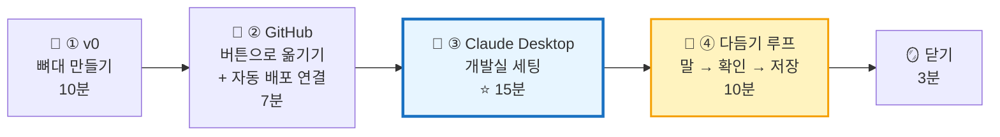

| 단계 | 시간 | 사람이 하는 일 | 자동으로 되는 일 | 비유 |
|---|:---:|---|---|---|
| 🎨 ① v0 | 0~10분 | 분석.md 붙이고 **주문 3번** | 화면 코드 생성 | 🏗️ 모델하우스 시공 |
| 🏦 ② GitHub | 10~17분 | **버튼 4번** (v0 Git 연결 · Clone · Vercel Import) | 저장소 생성 · 배포 벨트 | 🗄️ 창고 입고 |
| 🤖 ③ Claude Desktop | 17~32분 | 폴더 열기 · 규칙 정하기 · 첫 부탁 | 설치 · 서버 켜기 · 미리보기 | 🔑 장인에게 집 열쇠 주기 |
| 🔁 ④ 다듬기 | 32~42분 | **한 번에 하나** 부탁 → 눈으로 확인 → 저장 | 코드 수정 · 검사 · push · 배포 | 🪚 조금씩 손질 |
| 🪞 닫기 | 42~45분 | 회고 | — | 📒 작업 일지 |

> **⏱ 시간이 밀리면** — ① v0는 **주문 ①만**, ② Vercel 연결은 **선생님이 대신**. **③ Claude Desktop 세팅과 ④ 다듬기 1바퀴는 꼭 지킵니다.** 오늘의 진짜 목표는 "**AI와 함께 일하는 개발실**"을 갖는 것이에요.

## 0-1. 오늘 깔 길 — "한 방향 원칙"

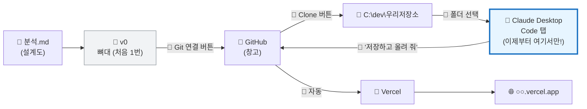

> **⚠️ 한 방향 원칙** — **v0는 뼈대까지만.** GitHub로 옮긴 다음부터는 **Claude Desktop에서만 고쳐요.** v0와 Claude가 같은 파일을 동시에 고치면 🧱 **두 시공팀이 같은 벽을 따로 칠하는 것**처럼 충돌이 나요.

> **🗣️ 선생님 대사**
> "v0는 **모델하우스를 하루 만에 지어 주는 시공팀**이에요. 멋지지만 우리 집은 아니죠. 그 집을 **우리 땅(GitHub · 내 컴퓨터)** 으로 옮기고, **우리 집에 사는 AI 장인(Claude Desktop)** 에게 열쇠를 줄 거예요. 그다음부턴 '여기 좀 바꿔 줘' **말로만** 집을 다듬어요. 이게 **바이브 코딩**이에요."

---

## 🧰 수업 전 준비 (선생님용 · 전날까지)

| # | 체크 | 왜 | 담당 |
|:---:|---|---|:---:|
| 1 | ☐ GitHub · Vercel · v0 **수업용 계정** 연결 확인 | 학생 개인 가입 ❌ | 🧑‍🏫 |
| 2 | ☐ 노트북마다 **Claude Desktop 앱 설치** (claude.ai/download) | 설치 대기 시간 줄이기 | 🧑‍🏫 |
| 3 | ☐ Claude Desktop에 **수업용 계정 로그인** → 왼쪽 위 **Code** 탭이 보이는지 | Code 탭은 사용 가능한 요금제에서만 열려요 | 🧑‍🏫 |
| 4 | ☐ **Git for Windows** 설치 확인 (1교시 ✅) | Windows에서 Code 탭이 Git을 써요 | 🧑‍🏫 |
| 4-1 | ☐ **설정 화면 세팅** — 메모리 끄기 · 수업 스킬 업로드 · Claude Code 권한/worktree (👉 3-0) | 모든 팀이 같은 환경 · 같은 규칙 | 🧑‍🏫 |
| 4-2 | ☐ **첫 push 로그인** — 노트북마다 아무 저장소에서 한 번 push 해 보기 | Claude가 처음 push할 때 GitHub 로그인 창이 뜰 수 있어요 → 수업 전에 미리 | 🧑‍🏫 |
| 5 | ☐ **GitHub Desktop** 로그인 · 기본 Clone 위치 `C:\dev` | 한글 사용자 이름 · OneDrive 경로 피하기 | 🧑‍🏫 |
| 6 | ☐ **전체 리허설 1회** — v0 → GitHub → Clone → Claude Desktop → 미리보기 → push → Vercel | 메뉴 이름은 업데이트로 자주 바뀌어요 → **스크린샷** | 🧑‍🏫 |
| 7 | ☐ **플랜 B 저장소** (완성 클론 + `CLAUDE.md` 포함) | v0가 늦은 팀은 ③부터 시작 | 🧑‍🏫 |
| 8 | ☐ 사용량 확인 — 팀 수만큼 **동시에** 쓸 수 있는지 | 수업 중 사용량 제한 방지 | 🧑‍🏫 |

---

# 🎨 ① v0로 뼈대 만들기 (0~10분)

> **분석은 짧게** — 상세판 1장의 `분석.md` 템플릿에서 **1 · 3 · 6 · 8번 칸만** 채워요 (한 줄 요약 · 레이아웃 · 강조 · 데이터). 이 `분석.md`는 **v0에도, Claude에게도** 똑같이 줄 **공통 설계도**예요.

| 주문 | 내용 (상세판 2-2 ~ 2-4 프롬프트 그대로) | 확인 |
|:---:|---|---|
| 🥇 ① | 분석.md 첨부 + **6구역 전체 틀 + 디자인** | 구역이 제자리에 · 남색 우주 · 노랑 강조 |
| 🥇 ② | `data/projects.json` + `lib/repo.ts` + 5단계 카드 + 타임라인 | 데이터가 **JSON 파일**에 있다 |
| 🥈 ③ | 되물음 강조 + 되묻기 카드 | 시간 없으면 → **Claude에게 넘기기** |

> **💡 v0에서 완벽하게 만들지 마세요.** 80%면 충분해요. 나머지 20%는 **Claude Desktop에서 조금씩** 다듬는 게 오늘의 연습이에요. v0 사용량도 아낄 수 있어요.

> **⭐ v0 마지막 주문 (꼭!)** — 아래 한 줄을 넣으면 나중에 Claude가 읽기 편해져요.
> ```text
> 데이터는 data/projects.json, 데이터 통로는 lib/repo.ts, 화면 부품은 components/ 폴더로 정리해 줘. 다른 화면은 바꾸지 마.
> ```

---

# 🏦 ② GitHub — 버튼으로 옮기기 + 자동 배포 연결 (10~17분)

## 2-1. GitHub는 딱 이것만 알면 돼요 (1분 설명)

| 말 | 🗄️ 비유 | 오늘 누가 해 줘요? |
|---|---|---|
| **저장소 (repo)** | 프로젝트 한 개를 넣는 **창고 한 칸** | 🔘 v0 버튼 |
| **clone** | 창고 물건을 **우리 집으로 통째로 복사** | 🔘 GitHub Desktop 버튼 |
| **commit** | 📸 **세이브 포인트** 한 장 | 🤖 Claude ("저장해 줘") |
| **push** | 세이브 포인트를 **창고로 보내기** | 🤖 Claude ("올려 줘") |
| **자동 배포** | 창고에 들어오면 **가게 간판이 저절로 바뀜** | 🚀 Vercel (자동) |

> **🗣️ 선생님 대사** — "명령어는 외우지 않아요. **세이브 포인트(commit)** 와 **창고로 보내기(push)** 두 단어만 기억해요. 나머지는 버튼과 AI가 해 줘요."

## 2-2. 🔘 버튼 4번이면 끝

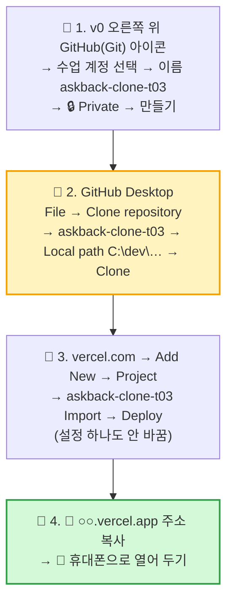

| # | 버튼 | 성공 신호 | 막히면 |
|:---:|---|---|---|
| 1 | v0 **Git 연결** | github.com에 저장소가 생김 | 메뉴가 없으면 **Download ZIP** → `C:\dev`에 압축 풀기 → GitHub Desktop **Add local repository → Publish** (☑ Private) |
| 2 | GitHub Desktop **Clone** | `C:\dev\askback-clone-t03` 폴더 · "No local changes" | Local path가 `Documents\GitHub`면 **`C:\dev`로 바꾸기** |
| 3 | Vercel **Import → Deploy** | 1~2분 뒤 🎉 Congratulations | 목록에 저장소가 없으면 **Adjust GitHub App Permissions** (🙋 선생님) |
| 4 | 📱 주소 열기 | v0에서 본 화면 | — |

> **❓ v0가 `main`이 아닌 다른 가지(branch)로 올렸다면?** — github.com 저장소에 노란 **Compare & pull request** 버튼 → **Create pull request → Merge** (🔘 버튼 2번). Vercel 진짜 가게는 `main`만 봐요.

> **❓ 터미널 명령(`npm install` · `npm run dev`)은요?** — 오늘은 **Claude가 대신** 해 줘요. ③에서 확인!

---

# 🤖 ③ Claude Desktop — 우리 개발실 세팅 (17~32분) · ⭐ 오늘의 핵심

> **왜 Claude Desktop?** — VS Code 터미널 대신, **앱 하나 안에서** 대화 · 파일 수정 · 명령 실행 · 미리보기 · 바뀐 내용 확인 · 저장(commit · push)까지 다 돼요. 🏠 **비유** — 공구가 여기저기 흩어진 창고 대신, **장인이 쓰는 작업실 한 칸**에 다 모아 둔 것.

## 3-0. ⚙️ 설정 화면 세팅 (🧑‍🏫 선생님 · 수업 전 1회)

> **어디서?** — Claude Desktop 왼쪽 아래 **프로필(이름) → 설정** (macOS `⌘ ,` · Windows `Ctrl ,`).
> 수업용 계정 **하나를 여러 노트북이 같이 쓰기** 때문에, 계정 단위 설정(메모리 · Skills · 커넥터)은 **한 번만** 하면 모든 노트북에 적용돼요. 노트북 단위 설정(이 컴퓨터 · Claude Code)은 **노트북마다** 확인해요.

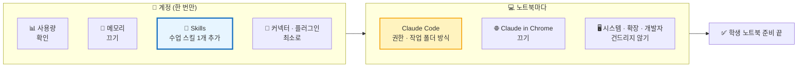

### ① 설정 메뉴별 체크표

| 메뉴 (설정 왼쪽) | 할 일 | 수업 권장값 | 왜 |
|---|---|---|---|
| 💳 **결제** | 요금제 확인만 | Code 탭을 쓸 수 있는 요금제 | Code 탭이 안 보이면 여기부터 |
| 📊 **사용량** | 수업 전 남은 양 확인 | 팀 수 × 약 1시간 여유 | 수업 중 제한에 걸리면 진행이 멈춰요 |
| 🎛️ **기능** | 켜진 기능 훑어보기 | 기본값 유지 | 리허설 화면과 같게 맞추기 |
| 🧠 **메모리** | **끄기** (또는 수업 전 비우기) | ⛔ 끔 | 여러 팀이 한 계정을 같이 써서, A팀 이야기가 B팀 대화에 섞일 수 있어요. 팀 규칙은 메모리 대신 **저장소의 `CLAUDE.md`** 에 둬요 |
| 🎨 디자인 시스템 · 회고 · 시간 및 집중 | 건드리지 않기 | 기본값 | 오늘 수업과 무관 |
| `</>` **Claude Code** | ②번 표대로 | — | ⭐ 바이브 코딩 핵심 설정 |
| 🌐 **Claude in Chrome** | **끄기 / 연결 안 함** | ⛔ | 학생이 실제 브라우저를 AI에게 맡기지 않게. 미리보기는 Code 탭 안에서 충분해요 |
| 🖥️ 시스템 · 🧩 확장 프로그램 · 🔧 개발자 | **건드리지 않기** | 기본값 | 고급 설정 (MCP 서버 · 개발자 모드). 바꾸면 리허설 화면과 달라져요 |
| 📚 **Skills** | **수업 스킬 1개 추가** (③번) | `vibe-class-coach` ✅ | 모든 팀이 **같은 규칙 · 같은 말투**로 AI와 일하게 |
| 🔌 **커넥터** | 연결하지 않기 | 없음 | GitHub · Drive 등 외부 연결이 없어도 오늘 수업은 돼요. 계정 정보가 노출될 길을 줄여요 |
| 🧩 **플러그인** | 수업에 안 쓰는 것은 **끄기** | 최소 | 위 화면의 Engineering 같은 플러그인 스킬이 학생 부탁에 엉뚱하게 끼어들 수 있어요 |
| 🔑 **API 키** | 만들지 않기 | ⛔ | 학생 수업에 필요 없음 · 비밀 키 노출 위험 |

### ② `</>` Claude Code 설정 — 바이브 코딩 핵심

| 항목 (이름은 버전마다 조금씩 달라요) | 수업 권장값 | 왜 |
|---|---|---|
| **기본 권한 모드** | **매번 묻기** (Ask permissions) | 허락 버튼을 누르는 것이 학생의 일 (3-2 ③) |
| **작업 폴더 방식 · worktree(작업 복사본)** | **끄기 → 고른 폴더에서 바로 작업** | ⚠️ 켜져 있으면 Claude가 **별도 가지(branch) · 복사 폴더**에서 일해요. 그러면 push가 `main`이 아니라 다른 가지로 가서 **Vercel 진짜 가게가 안 바뀌고**, 미리보기도 다른 폴더를 봐요 |
| 가지 이름 앞말 (branch prefix) | 비워 두기 | worktree를 끄면 쓰이지 않아요 |
| 기본 모델 | 기본값 | 리허설과 같은 모델로 |
| 알림 | 켜기 | 오래 걸리는 설치가 끝나면 알려 줘요 |
| 자동 보관 (auto-archive) | 끄기 | 수업 중 세션이 사라지지 않게 |
| 화면 꺼짐 방지 (keep awake) | 켜기 | 설치 · 빌드 중 노트북이 잠들지 않게 |
| 원격 조작 (Remote Control) | 끄기 | 다른 기기에서 이 노트북 세션을 조작하지 않게 |

> **🧪 리허설에서 꼭 확인** — 세션을 하나 열고 `지금 어느 폴더 · 어느 가지(branch)에서 일하고 있어?` 라고 물어보세요. 답이 **`C:\dev\askback-clone-t03` · `main`** 이면 성공이에요.

### ③ 📚 Skills — 수업 스킬 `vibe-class-coach` 추가

> **Skill이 뭐예요?** — AI에게 주는 **업무 매뉴얼 한 권**이에요. `CLAUDE.md` 가 **각 팀 집**에 붙은 규칙이라면, Skill은 **모든 팀이 같이 쓰는 수업 매뉴얼**이에요. 🧑‍🍳 **비유** — 가게마다 붙은 메뉴판(CLAUDE.md) vs 본사 요리 매뉴얼(Skill).

| | 📜 CLAUDE.md | 📚 Skill (`vibe-class-coach`) |
|---|---|---|
| 어디에 | 각 팀 **저장소 안** 파일 | **계정 설정** (한 번 올리면 모든 노트북) |
| 담는 것 | 이 프로젝트의 폴더 지도 · 디자인 · 강조 | 수업 공통 규칙 · 말투 · "시작 / 고쳐 / 저장 / 되돌려" 진행 순서 |
| 누가 만들어요 | 팀 + Claude (3-2 ④) | 🧑‍🏫 선생님 (미리 만들어 둠) |
| 바뀌면 | 팀 저장소에만 반영 | 모든 팀에 한 번에 반영 |

**올리는 법 (위 화면 그대로)**

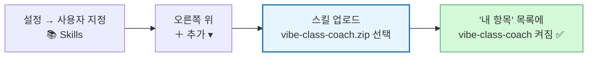

| 파일 | 위치 |
|---|---|
| 📦 업로드용 zip | `ppt/4일차/skills/vibe-class-coach.zip` |
| 📄 내용 (고치고 싶을 때) | `ppt/4일차/skills/vibe-class-coach/SKILL.md` → 고친 뒤 다시 zip → 목록에서 기존 것 삭제 후 다시 업로드 |

**스킬이 하는 일 (요약)**

| 학생이 하는 말 | 스킬이 시키는 진행 |
|---|---|
| `시작` · `서버 켜 줘` | CLAUDE.md · 분석.md 읽기 → `npm install` → 개발 서버 → 미리보기 → 최근 commit 3개 요약 |
| `구경시켜 줘` | 아무것도 안 고치고 구역 ↔ 파일 표 + **분석.md와 다른 곳 3개** |
| `○○ 고쳐 줘` | 흐릿하면 **보기 2~3개로 되묻기** → 큰 일이면 계획 먼저 → 고치기 → `npm run build` 검사 → 확인할 곳 안내 |
| `저장하고 올려 줘` | 바뀐 내용 3줄 → 한국어 commit 메시지 → `main`에 push → "휴대폰 새로고침해 봐" |
| `되돌려 줘` | 저장 전이면 되돌리기, 저장 후면 되돌리는 세이브 포인트 (강제 push ❌) |
| `규칙 만들어 줘` | 실제 폴더를 보고 CLAUDE.md 틀 채우기 |

**스킬을 준비하는 3가지 길**

| 길 | 방법 | 언제 | 적용 범위 |
|---|---|---|---|
| 🅰️ **zip 업로드** (추천) | Skills → **＋ 추가 → 업로드** → `vibe-class-coach.zip` | 이 문서의 스킬을 그대로 쓸 때 | 계정 전체 (모든 노트북) |
| 🅱️ **skill-creator로 만들기** | 위 화면 목록의 **skill-creator** 가 켜진 상태에서 새 대화에 부탁 ↓ | 우리 반에 맞게 **새로 만들거나 고칠 때** | 계정 전체 |
| 🅲 **저장소 안에 넣기** | 저장소에 `.claude/skills/vibe-class-coach/SKILL.md` | 계정 스킬이 Code 탭에 안 보일 때 · 플랜 B 저장소 | 그 프로젝트만 |

🅱️ skill-creator에게 하는 부탁 예시:

```text
초·중학생 3인 팀이 Claude Desktop Code 탭에서 v0로 만든 Next.js 클론을 말로 다듬는 수업용 스킬을 만들어 줘.
이름은 vibe-class-coach. 첨부한 SKILL.md 를 바탕으로 하되 아래를 바꿔 줘:
- (예) 답은 3줄 이내, 끝에 항상 "미리보기에서 확인할 곳" 한 줄
- (예) 색을 바꿀 땐 반드시 보기 3개를 먼저 보여 주기
완성되면 설명(description)이 수업 중 부탁에 잘 걸리는지 예시 부탁 5개로 시험해 줘.
```

**스킬 관리 규칙**

| # | 규칙 | 왜 |
|:---:|---|---|
| 1 | 수업용 스킬은 **1개만** 켜기 (+ skill-creator는 선생님만) | 스킬이 여러 개면 AI가 엉뚱한 매뉴얼을 꺼낼 수 있어요 |
| 2 | 수업에 안 쓰는 플러그인 스킬(Engineering 등)은 **플러그인 메뉴에서 끄기** | `code-review` · `debug` 같은 개발자용 매뉴얼이 학생 부탁에 끼어들지 않게 |
| 3 | 스킬을 고치면 **리허설 노트북 1대에서 먼저** `/vibe-class-coach 시작` 시험 | 모든 팀에 한 번에 퍼지니까요 |
| 4 | 팀마다 다른 내용은 스킬이 아니라 **각 저장소의 CLAUDE.md** 에 | 스킬 = 반 공통, CLAUDE.md = 팀 전용 |
| 5 | 스킬 안에 **비밀번호 · 키 · 학생 실명**을 넣지 않기 | 계정 전체에 공유되는 파일이에요 |

**학생이 부르는 법** — 입력창에 `/vibe-class-coach 시작` (`/` 를 치면 목록이 나와요). 부탁이 수업 상황과 맞으면 이름을 안 불러도 Claude가 알아서 꺼내 써요.

> **🧪 리허설 확인** — Code 탭 새 세션에서 `/` 를 쳤을 때 **vibe-class-coach** 가 목록에 보이는지 확인하세요. 안 보이면 앱을 다시 시작하거나, 플랜 B로 **저장소 안 `.claude/skills/vibe-class-coach/SKILL.md`** 에 같은 파일을 넣어 두면 그 프로젝트에서는 반드시 읽혀요.

### ④ ✅ 노트북별 최종 점검 (1대당 1분)

| # | 확인 | O / X |
|:---:|---|:---:|
| 1 | Code 탭이 보이고 수업 계정으로 로그인됨 | |
| 2 | 설정 → 메모리 **꺼짐** | |
| 3 | 설정 → Skills **vibe-class-coach 켜짐** | |
| 4 | 설정 → Claude Code: 권한 **매번 묻기** · worktree **끔** | |
| 5 | Claude in Chrome · 커넥터 **연결 없음** | |
| 6 | 새 세션 → 폴더 `C:\dev\…` → `/vibe-class-coach 시작` → 미리보기에 화면 | |

## 3-1. Claude Desktop 화면 지도

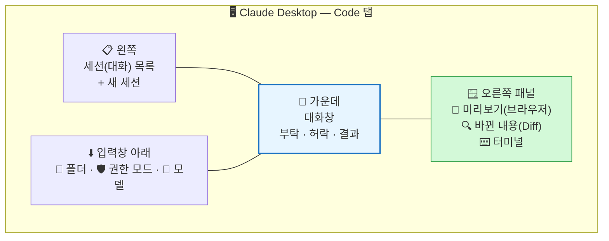

| 자리 | 하는 일 | 🏠 비유 |
|---|---|---|
| 📋 세션 목록 | 일 하나 = 대화 하나. 큰 일이 바뀌면 **새 세션** | 📒 작업 노트 한 권씩 |
| 💬 대화창 | 부탁하고, AI의 계획 · 허락 요청 · 결과를 읽어요 | 🗣️ 장인과 대화 |
| 👀 **미리보기** | `localhost:3000` 화면을 앱 안에서 바로 보기 | 🪟 작업실 창문 |
| 🔍 **Diff(바뀐 내용)** | 빨강(지운 줄) · 초록(새 줄) | 🧾 공사 내역서 |
| 📂 폴더 | **AI가 일할 수 있는 범위** = 이 폴더 안만 | 🔑 열쇠 준 방 |
| 🛡️ 권한 모드 | AI가 **얼마나 묻고** 일할지 | 🚦 신호등 |

> (메뉴 이름 · 위치는 업데이트로 바뀔 수 있어요 → 선생님 리허설 스크린샷을 따르세요)

## 3-2. 세팅 5단계

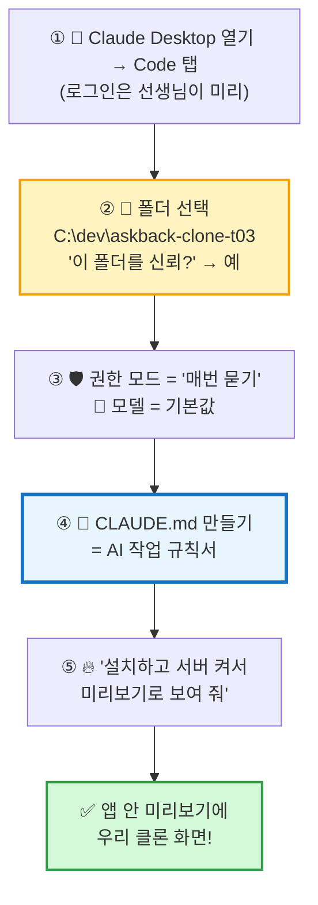

### ② 📂 폴더 선택 — 가장 중요한 클릭

| 확인 | 왜 |
|---|---|
| **`C:\dev\askback-clone-t03`** (저장소 폴더 자체) | `C:\dev`를 고르면 AI가 **다른 팀 폴더**까지 봐요 |
| 폴더 안에 `package.json` · `app` · `data` 가 보임 | 진짜 프로젝트 폴더라는 증거 |
| 바탕화면 · 문서 · `C:\` 전체 ❌ | 🔑 **집 전체 열쇠**를 주면 안 돼요 |

### ③ 🛡️ 권한 모드 — 오늘은 "매번 묻기"

| 모드 (이름은 바뀔 수 있음) | AI가 하는 것 | 🚦 | 오늘 |
|---|---|:---:|:---:|
| **매번 묻기** (Ask permissions) | 파일 수정 · 명령 실행 **전마다 허락** 요청 | 🔴 | ✅ **수업 기본** |
| **수정 자동 허락** (Accept edits) | 파일 수정은 바로, 명령은 물어봄 | 🟡 | 익숙해지면 |
| **계획 모드** (Plan mode) | **아무것도 안 바꾸고 계획만** 세움 | 🔵 | 큰 일 전에 |
| 묻지 않고 전부 | 다 알아서 | ⚫ | ❌ 사용 금지 |

> **🧑‍⚖️ 왜 "매번 묻기"?** — 바이브 코딩은 **코드를 직접 안 쓰는 대신 "허락 버튼"이 우리의 일**이에요. 허락 창이 뜨면 **팀이 함께 읽고** → 괜찮으면 허락, 모르겠으면 거절하고 `이게 무슨 뜻이야?` 라고 물어요.

### ④ 📜 CLAUDE.md — AI 장인에게 주는 "작업 규칙서"

> **CLAUDE.md가 뭐예요?** — 프로젝트 폴더 맨 위에 두는 파일이에요. Claude는 **새 대화를 시작할 때마다 이 파일을 먼저 읽어요.** 🏠 **비유** — 장인이 출근하면 냉장고에 붙은 **"우리 집 공사 규칙"** 메모부터 읽는 것. 매번 같은 말을 반복하지 않아도 돼요.

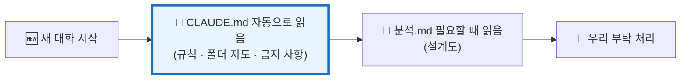

**💬 부탁 ① — 규칙서 만들기** (분석.md를 저장소 폴더에 먼저 넣어 두세요)

```text
분석.md 와 이 프로젝트 폴더를 읽고, 프로젝트 맨 위에 CLAUDE.md 를 만들어 줘.
아래 틀을 그대로 쓰고, ____ 칸과 [폴더 지도]는 실제 폴더를 보고 채워 줘.
CLAUDE.md 말고 다른 파일은 바꾸지 마.

(아래 틀 붙여 넣기)
```

**📜 CLAUDE.md 틀**

```markdown
# CLAUDE.md — 우리 프로젝트 작업 규칙

## 1. 이 프로젝트는
- askback 프로젝트 페이지를 따라 만든 **교육용 클론** (초·중학생 팀 작품)
- 우리 서비스 이름: ____ / 예시 프로젝트: ____
- 기술: Next.js App Router + TypeScript + Tailwind. **프론트 화면만.**
- 설계도: `분석.md` (구역 · 강조 · 데이터 칸 이름은 여기를 따른다)

## 2. 폴더 지도
- `data/projects.json` — 모든 데이터 (프로젝트 · 단계 · 질문 · 되묻기)
- `lib/repo.ts` — 데이터 통로. 화면은 **여기서만** 데이터를 가져온다
- `app/p/[id]/page.tsx` — 프로젝트 페이지
- `components/` — 화면 부품 (사이드바 · 상단 바 · 단계 카드 · 타임라인 · 입력창)

## 3. 꼭 지킬 것
1. **한 번에 하나만** 고친다. 부탁하지 않은 파일 · 구역은 바꾸지 않는다.
2. 고치기 전에 **무엇을 어떻게 바꿀지 짧게 먼저** 말한다.
3. 데이터 칸 이름은 `분석.md [8. 데이터]` 그대로. 새 칸이 필요하면 먼저 묻는다.
4. 서버 · 로그인 · 진짜 AI · 환경 변수 · API 키는 **만들지 않는다**.
5. 원래 서비스의 이름 · 로고 · 글은 **복사하지 않는다**.
6. 고친 뒤 `npm run build` 로 검사하고 결과를 알려 준다.
7. 설명은 **초등학생도 알게 쉽게, 한국어로**, 3줄 이내.
8. commit · push 는 사람이 **"저장해 줘 / 올려 줘"** 라고 할 때만 한다.

## 4. 디자인 규칙
- 진한 남색 우주 배경 · 살짝 밝은 남색 카드 · 노랑-주황 강조 · 흰 글씨
- 모서리 16px · 알약 버튼 · 아이콘은 이모지
- 휴대폰(768px 이하)에서도 깨지지 않게

## 5. 강조 순위
1. 🙋 "하나만 되물을게" — 가장 눈에 띄게
2. 🪜 5단계 카드
3. 답의 결론 첫 줄 (굵게)
```

| 확인 | O / X |
|---|:---:|
| 폴더 맨 위에 `CLAUDE.md` 가 생겼다 (🔍 Diff에서 초록 줄) | |
| [폴더 지도]가 **실제 파일 이름**과 맞다 | |
| 서비스 이름 칸이 **우리 팀 이름**이다 | |

> **💡 규칙서는 자라요** — 수업 중 AI가 같은 실수를 두 번 하면 `이 규칙을 CLAUDE.md 3번에 추가해 줘: ____` 라고 부탁하세요. 회사 개발팀도 이렇게 규칙서를 키워요.

### ⑤ 🔥 설치하고 불 켜기 — 명령어 대신 부탁

**💬 부탁 ② — 개발 서버 + 미리보기**

```text
이 프로젝트에 필요한 것을 설치하고 개발 서버를 켜서, 오른쪽 미리보기 창에 화면을 보여 줘.
에러가 나면 원인을 쉽게 설명하고 고쳐도 되는지 먼저 물어봐.
```

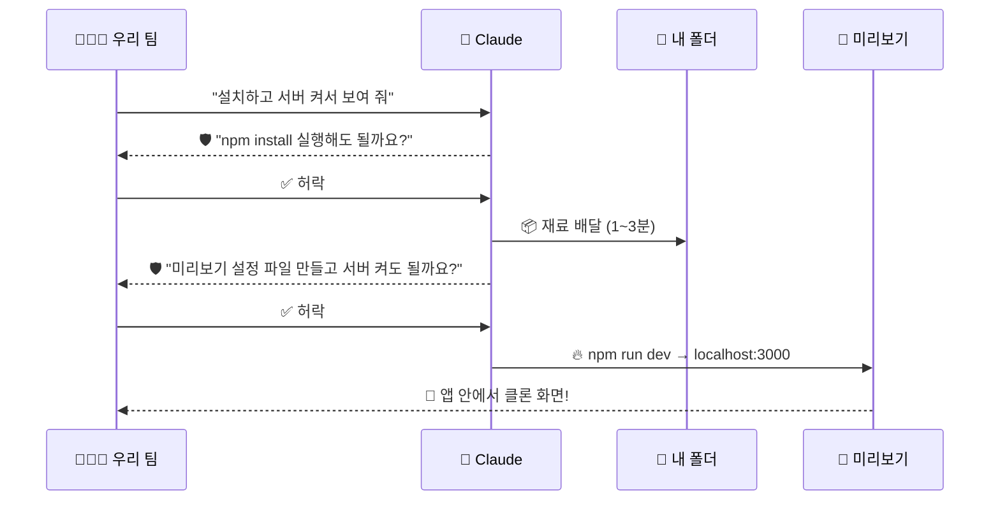

| 허락 창에 뜨는 것 (예) | 뜻 | 허락? |
|---|---|:---:|
| `npm install` | 📦 재료(부품) 설치 | ✅ |
| `.claude/launch.json` 만들기 | 🪟 미리보기 창 설정 파일 | ✅ |
| `npm run dev` | 🔥 개발 서버 켜기 | ✅ |
| 모르는 사이트 주소 · `rm` · `del` · 폴더 밖 경로 | ⚠️ 이상한 것 | ❌ 거절 → 🙋 선생님 |

> **🎉 여기까지 오면 개발실 완성!** — 이제부터는 **말 → 미리보기로 확인 → 저장** 루프만 돌면 돼요.

## 3-3. 🔍 첫 부탁은 "구경만" — AI가 무엇을 이해했나 확인

**💬 부탁 ③ — 집 구경**

```text
이 프로젝트를 초등학생도 알게 설명해 줘.
1) 6구역(사이드바 · 상단 바 · 알림 · 5단계 카드 · 타임라인 · 입력창)은 각각 어느 파일에 있어?
2) 데이터는 어디서 와?
3) 미리보기 화면과 분석.md 를 비교해서 다른 곳 3개를 목록으로만 알려 줘.
아직 아무것도 고치지 마.
```

> **💡 3번이 오늘의 "할 일 목록"이 돼요.** AI가 찾은 차이 3개 + 우리 눈으로 찾은 것 = ④ 다듬기 재료.

## 3-4. 📘 Claude Desktop 사용 지침 — "이렇게 쓰면 헷갈리지 않아요"

### ① 세션 시작 의식 (매번 30초)

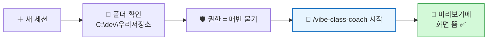

| 순서 | 확인 | 잘못되면 |
|:---:|---|---|
| 1 | 입력창 아래 **폴더 이름**이 우리 저장소인가 | 다른 팀 폴더면 → 세션 닫고 다시 |
| 2 | **권한 모드**가 매번 묻기인가 | 입력창 아래에서 바꾸기 |
| 3 | `/vibe-class-coach 시작` → 미리보기 화면 | 3-0 ③ 리허설 확인 · 🆘 표 |

### ② 입력창 도구 5가지

| 도구 | 쓰는 법 | 예시 | 🏠 비유 |
|---|---|---|---|
| `/` 슬래시 | `/` 치고 스킬 · 명령 고르기 | `/vibe-class-coach 저장하고 올려 줘` | 📚 매뉴얼 펼치기 |
| `@` 파일 지목 | `@` 치고 파일 이름 고르기 | `@components/StageCards.tsx 의 화살표만 키워 줘` | 👉 "이 벽이요!" 손가락질 |
| 📎 스크린샷 첨부 | 미리보기 · 휴대폰 화면 캡처를 붙여 넣기 (`Ctrl V`) | `이 사진에서 빨간 동그라미 친 곳이 잘려. 고쳐 줘.` | 📸 사진 보여 주며 설명 |
| ⏹ 멈춤 버튼 · `Esc` | AI가 엉뚱하게 가면 **바로 멈추기** | 멈춘 뒤 `잠깐, 그 파일 말고 ○○만 고쳐 줘` | 🛑 "스톱!" |
| 🛡️ 권한 모드 전환 | 큰 일 전 **계획 모드** → 계획 OK → 다시 **매번 묻기** | 4-3 ⭐⭐⭐ | 🚦 신호 바꾸기 |

> **💡 `@` 와 스크린샷이 가장 강력해요** — "어디"를 말로 설명하는 것보다 **파일을 찍거나 사진을 보여 주는 게** 정확해요. 부탁 공식의 **[어디]** 를 이 두 개로 채우세요.

### ③ 허락 창 읽는 법 — 3초 체크

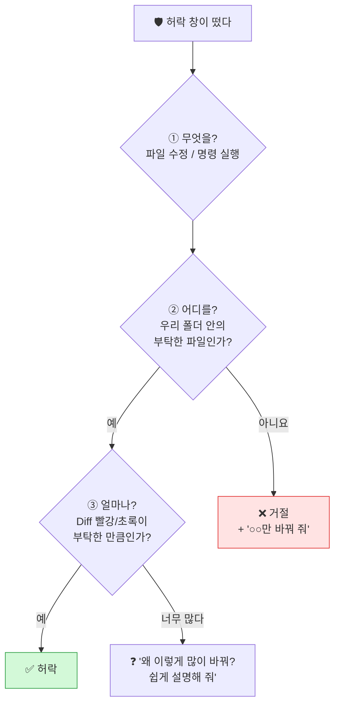

| 허락 버튼 종류 (예) | 뜻 | 수업에서 |
|---|---|---|
| **허락 (이번만)** | 이번 한 번만 | ✅ 기본 |
| **이 세션 동안 계속 허락** | 같은 종류는 다시 안 물음 | `npm run build` · `npm run dev` 처럼 안전한 명령만 |
| **거절** | 하지 않음 + 이유를 말할 수 있음 | 이상하면 망설이지 말고 |

### ④ 오른쪽 패널 쓰는 법

| 패널 | 언제 열어요 | 확인할 것 |
|---|---|---|
| 👀 **미리보기** | 고친 직후 매번 | 바뀐 곳 · **다른 곳이 깨지지 않았나** · 폭을 좁혀 휴대폰 모양 |
| 🔍 **Diff (바뀐 내용)** | 저장하고 올리기 **전** | 부탁한 파일만 바뀌었나 · 빨강/초록 줄 수 |
| ⌨️ **터미널 · 로그** | 미리보기가 빈 화면 · 에러일 때 | 빨간 글씨 → 복사해서 Claude에게 |

### ⑤ 하지 않을 것

| ❌ | 왜 | 대신 |
|---|---|---|
| 한 세션에서 하루 종일 | 대화가 길면 AI가 앞을 헷갈려요 | 큰 일 하나 끝 + 저장 → **새 세션** |
| v0 · VS Code에서 같은 파일 동시 수정 | 🧱 한 방향 원칙 위반 → 충돌 | Claude Desktop에서만 |
| 허락 창을 안 읽고 연속 클릭 | 지휘자가 악보를 안 보는 것 | 3초 체크 |
| "다 알아서 해 줘" | 무엇이 바뀌었는지 아무도 모름 | 부탁 공식 · 한 번에 하나 |
| 대화창에 이름 · 학교 · 비밀번호 | 🔒 개인정보 | 가짜 이름 · 예시 데이터 |
| 노트북 덮기 전 서버 방치 | 다음 시간에 포트 충돌 | `서버 꺼 줘` → 세션 닫기 |

### ⑥ 끝내는 의식 (매 수업 마지막 1분)

| # | 💬 부탁 / 행동 |
|:---:|---|
| 1 | `/vibe-class-coach 저장하고 올려 줘` (바뀐 게 있으면) |
| 2 | `오늘 한 일을 3줄로 정리하고, 다음에 할 일 3개를 CLAUDE.md 맨 아래 "다음 할 일"에 적어 줘.` → 다음 시간 첫 세션이 이어서 시작 |
| 3 | `개발 서버 꺼 줘.` → 세션 닫기 |

---

# 🔁 ④ 다듬기 루프 — 조금씩, 한 번에 하나 (32~42분)

## 4-1. 바이브 코딩 한 바퀴

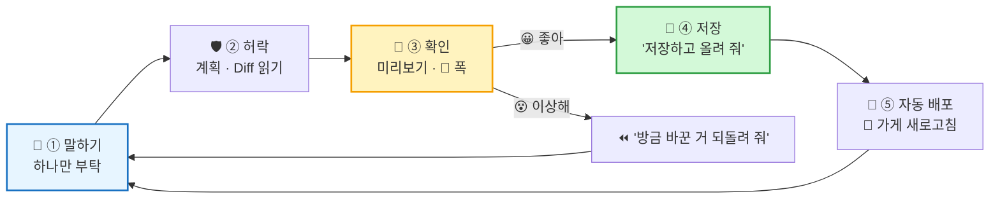

| 단계 | 팀 역할 | 체크 |
|---|---|---|
| 💬 말하기 | 🎩 기획자가 **부탁 공식**으로 말하기 | 한 번에 **하나**인가? |
| 🛡️ 허락 | 🎩 탐정이 **Diff 빨강/초록** 읽기 | 부탁한 파일만 바뀌나? |
| 👀 확인 | 🎩 실행자가 미리보기 · 좁은 폭 확인 | 원하던 대로? 다른 데 안 깨졌나? |
| 💾 저장 | 모두 동의 → "저장하고 올려 줘" | commit 메시지가 무슨 일을 했는지 말하나? |

## 4-2. 💬 부탁 공식

> **"[어디]의 [무엇]이 지금 [이래]. [이렇게] 바꿔 줘. 다른 건 바꾸지 마."**

| ❌ 흐릿한 부탁 | ⭕ 공식 부탁 |
|---|---|
| `더 예쁘게 해 줘` | `5단계 카드의 화살표가 너무 작아. 카드 사이 화살표를 2배 크게, 노란색으로 바꿔 줘. 다른 건 바꾸지 마.` |
| `되물음 강조해 줘` | `답 카드의 "하나만 되물을게"가 다른 글과 똑같아 보여. 노란 왼쪽 굵은 띠 + 연노랑 배경 + 한 단계 큰 글씨로 바꿔 줘. 다른 건 바꾸지 마.` |
| `휴대폰 고쳐 줘` | `폭이 375px일 때 5단계 카드가 잘려. 카드 줄만 가로로 밀어서 보게 해 줘. 다른 건 바꾸지 마.` |

## 4-3. 📋 다듬기 메뉴판 — 쉬운 것부터 하나씩

| 난이도 | 💬 부탁 | 고치는 곳 |
|:---:|---|---|
| ⭐ | `data/projects.json 첫 프로젝트 제목을 "____"로 바꿔 줘. 다른 건 바꾸지 마.` | 데이터 |
| ⭐ | `알림 배너 글을 "____"로 바꿔 줘. 다른 건 바꾸지 마.` | ③ 알림 |
| ⭐⭐ | (4-2 표) 되물음 강조 · 화살표 키우기 · 휴대폰 가로 스크롤 | ④ ⑤ |
| ⭐⭐ | `첫 프로젝트에 우리 팀 아이템으로 질문 · 답 1개를 추가해 줘. 칸 이름은 기존과 똑같이.` | 데이터 |
| ⭐⭐⭐ | **🔵 계획 모드로 바꾼 뒤** `입력창에 글을 보내면 타임라인 맨 아래에 질문 카드, 1초 뒤 "🤖 (데모) 좋은 질문이야!" 답 카드가 나오게 하고 싶어. 저장은 안 해. 어떻게 할지 계획만 먼저 보여 줘.` → 계획을 읽고 OK면 **매번 묻기 모드**로 돌아와 `계획대로 해 줘.` | ⑥ 입력창 |

> **🔵 계획 모드는 언제?** — 파일 **2개 이상**이 바뀔 것 같은 큰 일. 🏗️ **비유** — 벽을 허물기 전에 **설계도부터** 보여 달라고 하기.

## 4-4. 💾 저장 · 올리기 — 버튼 대신 한 마디

**💬 부탁 ④ — 저장하고 올리기**

```text
지금까지 바뀐 파일 목록과 무엇을 바꿨는지 3줄로 보여 줘.
그다음 "되물음 카드 강조" 처럼 한 일을 알 수 있는 한국어 메시지로 commit 하고 push 해 줘.
```

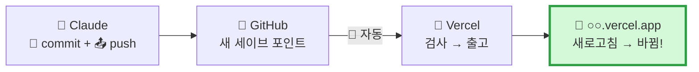

| 확인 | 어디서 | O / X |
|---|---|:---:|
| 새 commit 메시지가 보인다 | github.com 저장소 (또는 🏧 GitHub Desktop **History**) | |
| Deployments 상태 **Ready** 🟢 | vercel.com | |
| 📱 가게에 **바뀐 내용** | `○○.vercel.app` | |

> **🏧 사람이 직접 하고 싶다면** — GitHub Desktop **Changes** 탭에서 빨강/초록 확인 → **Commit to main → Push origin** (🔘 2번). 누가 push하든 벨트는 똑같이 돌아요.

> **🛡️ Vercel이 🔴 Error면?** — 가게는 **예전 그대로** 안전해요. Vercel 로그의 빨간 줄을 복사해서 `이 에러를 쉽게 설명하고 고쳐 줘` → 다시 저장 · 올리기.

---

# 🧭 ⑤ 전체 프롬프트를 어떻게 가지고 가나 — "프롬프트 3층 집"

> **핵심** — 프롬프트를 **매번 길게** 쓰는 게 아니에요. **변하지 않는 것은 파일에 한 번**, **그때그때 바뀌는 것만 짧게** 말해요.

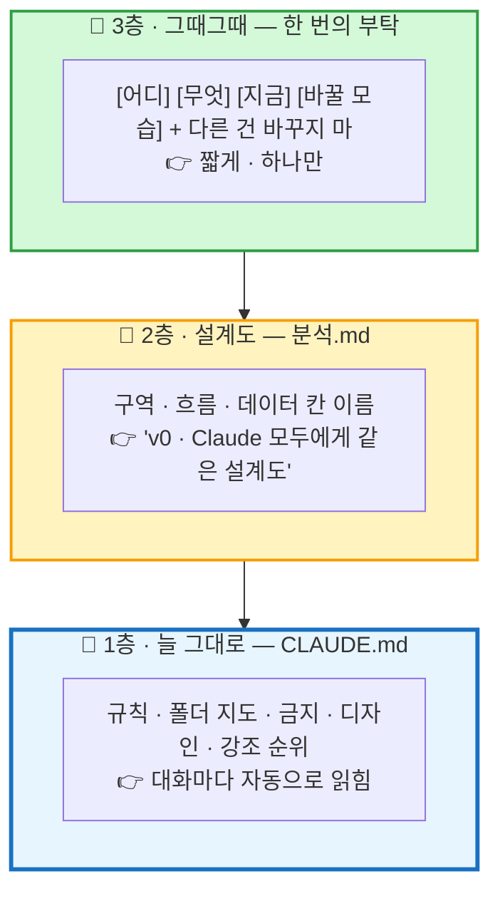

| 층 | 어디에 | 언제 바꾸나 | 🏠 비유 |
|---|---|---|---|
| 🧱 CLAUDE.md | 저장소 맨 위 파일 | AI가 **같은 실수를 반복할 때** 규칙 추가 | 냉장고에 붙은 공사 규칙 |
| 📐 분석.md | 저장소 안 파일 | 화면 구조 · 데이터 모양이 **바뀔 때** | 집 설계도 |
| 💬 부탁 | 대화창 | **매번** | "여기 이 벽만 칠해 주세요" |

## 5-1. 전체 프롬프트 흐름 (처음부터 끝까지)

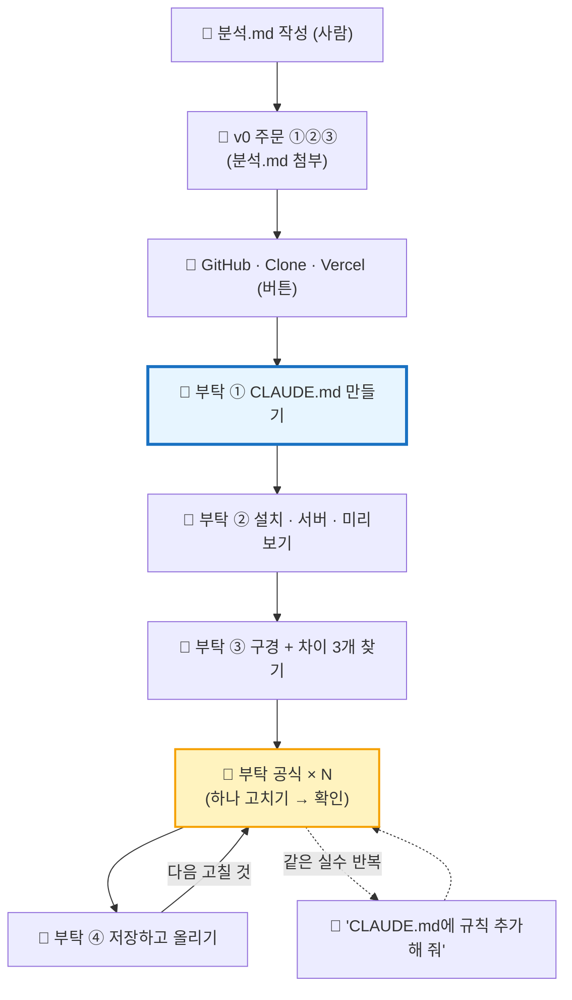

| 순서 | 어디서 | 프롬프트 | 한 번? 반복? |
|:---:|---|---|:---:|
| P0 | 사람 | `분석.md` (1 · 3 · 6 · 8칸) | 한 번 |
| P1 | 🎨 v0 | 주문 ①②③ (상세판 2장) + 폴더 정리 한 줄 | 한 번 |
| P3 | 🤖 Claude | **CLAUDE.md 만들기** (3-2 ④) | 한 번 |
| P4 | 🤖 Claude | **설치 · 서버 · 미리보기** (3-2 ⑤) | 수업 시작마다 |
| P5 | 🤖 Claude | **구경 + 차이 찾기** (3-3) | 새 세션마다 |
| 🔁 | 🤖 Claude | **부탁 공식** (4-2) | 계속 |
| P6 | 🤖 Claude | **저장하고 올리기** (4-4) | 하나 끝날 때마다 |

## 5-2. 🧰 상황별 짧은 프롬프트 모음

| 상황 | 💬 부탁 |
|---|---|
| 🔍 검사 | `npm run build 해서 에러가 있으면 쉽게 설명하고, 고쳐도 되는지 물어봐.` |
| ⏪ 되돌리기 | `방금 바꾼 걸 되돌려 줘.` |
| ❓ 이해 안 됨 | `방금 바꾼 걸 초등학생도 알게 3줄로 설명해 줘.` |
| 🎯 범위 줄이기 | `components/StageCards.tsx 만 바꿔 줘. 다른 파일은 건드리지 마.` |
| 📱 휴대폰 확인 | `미리보기를 휴대폰 폭으로 바꿔서 깨진 곳이 있는지 알려 줘. 고치지는 마.` |
| 🐞 Vercel 에러 | `Vercel 로그에 이 에러가 났어: (붙여 넣기). 원인을 쉽게 설명하고 고쳐 줘.` |
| 📜 규칙 추가 | `"부탁 안 한 색은 바꾸지 않는다"를 CLAUDE.md 3번에 추가해 줘.` |
| 🆕 다음 시간 시작 | `CLAUDE.md 와 분석.md 를 읽고, 지난번 commit 3개가 무엇을 했는지 알려 줘. 그리고 서버 켜서 미리보기 보여 줘.` |

## 5-3. 🗂️ 세션(대화) 나누는 법

| 언제 새 세션? | 왜 |
|---|---|
| 큰 일 하나가 **끝나고 저장 · 올리기까지 했을 때** | 🧹 대화가 길어지면 AI가 앞부분을 헷갈려요 |
| AI가 **같은 곳을 계속 잘못** 고칠 때 | 🔄 새 마음으로 다시 (규칙은 CLAUDE.md에 남아 있어요) |
| 다음 수업 날 | 📒 새 작업 노트 |

> **💡 그래서 CLAUDE.md가 중요해요** — 대화는 새로 시작해도 **규칙서는 그대로** 남아서, AI가 우리 집 규칙을 잊지 않아요.

---

## 🛡️ AI 장인과 일하는 약속 5가지

| # | 약속 | 왜 |
|:---:|---|---|
| 1 | **한 번에 하나만** 부탁 | 🍳 주문 10개를 한꺼번에 외치면 하나는 빠져요 |
| 2 | **허락 창 · Diff를 팀이 함께 읽기** | 🧑‍⚖️ 결정은 사람이 해요 |
| 3 | 바꾼 뒤 **미리보기 · 휴대폰 폭으로 확인** | 🥄 맛보고 내보내기 |
| 4 | **개인정보 · 비밀번호 · 키는 대화창에 쓰지 않기** | 🔒 공사 일지에 금고 번호를 적지 않아요 |
| 5 | 이상하면 **되돌리기** | 💾 세이브 포인트가 있으니 겁낼 필요 없어요 |

## 🆘 막혔을 때

| 증상 | 해결 |
|---|---|
| Code 탭이 안 보임 | 🙋 선생님 (계정 · 요금제 · 앱 업데이트 확인) |
| 폴더를 골랐는데 파일이 안 보임 | `C:\dev` 가 아니라 **`C:\dev\askback-clone-t03`** 을 골랐는지 |
| `npm install` 에러 `ERESOLVE` | `--legacy-peer-deps 옵션으로 다시 설치해 줘.` |
| 미리보기가 빈 화면 | `개발 서버 로그를 확인해서 왜 화면이 안 나오는지 알려 줘.` |
| 엉뚱한 파일을 바꾸려 함 | **거절** → 🎯 범위 줄이기 프롬프트 |
| push 실패 (권한 · 로그인) | GitHub Desktop **Push origin** 버튼으로 대신 → 그래도 안 되면 🙋 선생님 |
| v0에서 또 고치고 싶어짐 | ⚠️ **한 방향 원칙!** v0 대신 Claude에게 같은 주문을 하기 |
| 사용량 제한 | 옆 팀과 화면 같이 보기 · 메뉴판 ⭐ 부탁만 |

---

# 🪞 닫기 (42~45분)

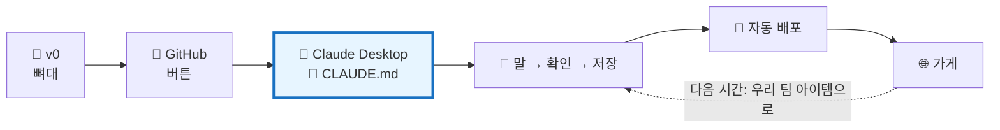

```
┌──────────────────────────────────────────────────────────────┐
│ 🪞 오늘의 개발실 일지                      팀: ______         │
├──────────────────────────────────────────────────────────────┤
│ 🌐 가게 주소   : https://________________.vercel.app        │
│ 🏦 저장소      : github.com/________/________ (🔒 Private)   │
│ 📜 CLAUDE.md에 우리가 넣은 규칙 하나 : ___________________   │
│ 💬 가장 잘 먹힌 부탁 : ___________________________________   │
│ 📸 Claude로 만든 commit 수 : ____ 개                         │
├──────────────────────────────────────────────────────────────┤
│ 😵 가장 막힌 곳 : ☐ v0 ☐ GitHub ☐ 폴더 ☐ 미리보기 ☐ 저장      │
│ 🔁 다음에 고칠 것 3개 : ________________________________     │
├──────────────────────────────────────────────────────────────┤
│ 💬 "바이브 코딩에서 사람이 하는 일"을 한 줄로 :               │
│    ________________________________________________         │
└──────────────────────────────────────────────────────────────┘
```

> **🗣️ 선생님 대사 (마무리)**
> "오늘 여러분은 코드를 한 줄도 직접 안 썼어요. 대신 **설계도를 그리고, 규칙서를 쓰고, 하나씩 부탁하고, 허락하고, 눈으로 확인**했어요. 이게 바이브 코딩에서 **사람이 하는 일**이에요. 다음 시간엔 이 개발실에 **우리 팀 아이템**을 넣을 거예요. 폴더 열고 `서버 켜서 보여 줘` 한 마디면 바로 시작이에요."

## 📌 수업 안에서 끝낼 것 vs 과제

| 구분 | 내용 |
|---|---|
| ✅ **반드시** | GitHub 저장소 · Vercel 주소 · **Claude Desktop 폴더 연결 · CLAUDE.md · 미리보기** |
| ✅ **반드시** | 다듬기 루프 **1바퀴** (부탁 → 확인 → 저장 · 올리기 → 📱 반영) |
| 📝 과제 1 | 메뉴판 ⭐⭐ 2개 더 → 각각 commit |
| 📝 과제 2 | AI가 반복한 실수 1개를 **CLAUDE.md 규칙**으로 추가 |
| 📝 과제 3 | 친구 3명에게 주소 보내기 → "가장 먼저 눈에 띈 곳" 묻기 |

## 🏗️ 부록. 용어 비유 사전

| 용어 | 비유 | 한 줄 뜻 |
|---|---|---|
| 바이브 코딩 | 🗣️ 말로 하는 인테리어 | 코드를 직접 쓰지 않고 AI에게 말로 만들기 |
| Claude Desktop (Code 탭) | 🤖 우리 집 상주 AI 장인 | 내 폴더에서 읽고 · 고치고 · 실행하고 · 저장하는 앱 |
| CLAUDE.md | 📜 냉장고에 붙은 공사 규칙 | 대화마다 AI가 먼저 읽는 규칙 파일 |
| 권한 모드 | 🚦 신호등 | AI가 얼마나 자주 허락을 물을지 |
| 계획 모드 | 🏗️ 설계도 먼저 | 바꾸지 않고 계획만 보여 주기 |
| 미리보기 | 🪟 작업실 창문 | 앱 안에서 보는 `localhost` 화면 |
| Diff | 🧾 공사 내역서 | 빨강 = 지운 줄 · 초록 = 새 줄 |
| 세션 | 📒 작업 노트 한 권 | 대화 하나 |
| commit / push | 📸 / 📤 | 세이브 포인트 / 창고로 보내기 |
| 한 방향 원칙 | 🧱 시공팀은 하나만 | GitHub로 옮긴 뒤엔 Claude에서만 고치기 |
