# 4일차 · **1교시** — 바이브 코딩 실전 ①: 내 컴퓨터에 작업실을 차리고, 클론할 가게를 설계도로 그린다
## 성격: **준비하고 분석하는 시간** — Windows에 개발 도구를 설치하고, 실제 서비스를 뜯어 보며 `분석.md` 한 장을 완성합니다

> **앞 시간(3일차)에 한 것** — 🍽️ 웹사이트 = 식당 비유로 **프론트(홀) · 서버(주방) · DB(냉장고) · API(웨이터)** 를 배우고, **v0 안에서만** 화면을 만들어 **Publish**로 가게 문을 열었습니다.
> **이 시간에 하는 것** — 이번에는 **진짜 개발자처럼** 내 컴퓨터(Windows)에 작업실을 차립니다. 그리고 실제로 돌아가는 서비스 하나를 골라 **"어떻게 생겼는지"를 글과 그림(.md)으로 분석**합니다.
> **다음 시간(2교시)** — `4일차_2교시_v0_GitHub_Vercel_배포.md` · 오늘 쓴 `분석.md`를 v0에 넣어 **클론 화면**을 만들고, **GitHub → 내 컴퓨터(VS Code) → Vercel** 로 올립니다.
>
> **🎯 실전 클론 대상** — [틴스파크AI · 거북목 감시 웹캠 예시 프로젝트](https://askback-omega.vercel.app/p/prj_example_turtle-neck)
> **범위** — **프론트 페이지(화면)만** 만듭니다. AI 답변 · 로그인 · 서버는 **모두 가짜 데이터(JSON)로 흉내** 냅니다.

| 항목 | 내용 |
|---|---|
| **대상** | 초등 5~6학년 · 중학생 · 3인 1팀 (팀당 Windows 노트북 1대) |
| **시간** | **45분** (설치 20분 + 분석 25분) — 2교시와 **연속 운영**(45분 + 쉬는 시간 + 45분) |
| **준비물** | Windows 10/11 노트북 · 인터넷 · 크롬 브라우저 · A4 분석 시트 · 포스트잇 · 네임펜 |
| **설치 도구** | **Node.js (LTS)** · **npm** (Node.js에 함께 들어 있음) · **Visual Studio Code** · **Git** |
| **핵심 비유** | 🛠️ **개발 환경 = 내 작업실** / 🔍 **클론 분석 = 맛집의 레시피를 거꾸로 알아내기** |
| **이 시간의 결과물** | ✅ `node -v` · `npm -v` · `git -v` 세 줄 성공 화면 ✅ VS Code로 연 `my-clone` 폴더 ✅ **`분석.md` 1장** (레이아웃 · 흐름도 · 유저 시나리오 · 강조점 · 데이터 모양) |

---

## 0. 한눈에 보는 1교시

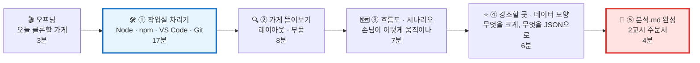

| 파트 | 시간 | 핵심 질문 | 핵심 비유 | 결과물 |
|---|:---:|---|---|---|
| 🎬 오프닝 | 0~3분 | "진짜 서비스를 우리가 똑같이 만들 수 있을까?" | 🍳 맛집 레시피 따라하기 | 목표 공유 |
| 🛠️ ① 작업실 차리기 | 3~20분 | 개발자의 컴퓨터에는 무엇이 깔려 있나? | 🛠️ 작업실 · 공구함 | 설치 확인 3줄 |
| 🔍 ② 가게 뜯어보기 | 20~28분 | 이 화면은 어떤 방(구역)으로 나뉘어 있나? | 🏠 집 평면도 | 레이아웃 그림 |
| 🗺️ ③ 흐름도 · 시나리오 | 28~35분 | 손님은 어디로 들어와서 무엇을 누르나? | 🚶 동선 그리기 | flowchart · 시나리오 |
| ⭐ ④ 강조점 · 데이터 | 35~41분 | 무엇이 가장 눈에 띄어야 하나? 어떤 정보가 반복되나? | 🔦 무대 조명 · 🍱 진열장 | 강조표 · JSON 모양 |
| 📝 ⑤ 분석.md 완성 | 41~45분 | 이걸 AI에게 어떻게 넘기나? | 📐 건축 설계도 | `분석.md` |

> **⏱ 시간이 밀리면** — 설치가 오래 걸리는 팀은 **Git 설치를 2교시 초반으로** 미룹니다(GitHub 웹에서 먼저 진행 가능). **② 레이아웃과 ③ 흐름도는 절대 줄이지 마세요.** 2교시 v0 주문서가 이 두 개로 만들어집니다.

> **🧑‍🏫 운영 팁** — 설치(①)는 **기다리는 시간**이 많습니다. 다운로드가 돌아가는 동안 **②의 사이트 둘러보기를 동시에** 시작하면 10분을 벌 수 있어요.

```mermaid
gantt
    title 1교시 45분 병렬 운영 (설치하는 동안 분석 시작)
    dateFormat mm
    axisFormat %M분
    section 팀원 A (실행자)
    Node.js 다운로드·설치      :a1, 03, 7m
    VS Code 설치              :a2, after a1, 5m
    Git 설치 · 확인 명령       :a3, after a2, 5m
    section 팀원 B (기획자)
    사이트 둘러보기 · 구역 나누기 :b1, 05, 10m
    레이아웃 그림 그리기          :b2, after b1, 8m
    section 팀원 C (탐정)
    눌러 보기 · 동선 기록        :c1, 05, 10m
    흐름도 · 시나리오            :c2, after c1, 10m
    section 팀 전체
    강조점 · 데이터 모양         :d1, 35, 6m
    분석.md 완성               :d2, 41, 4m
```

---

## 🧰 수업 전 준비 (선생님용 · 전날까지)

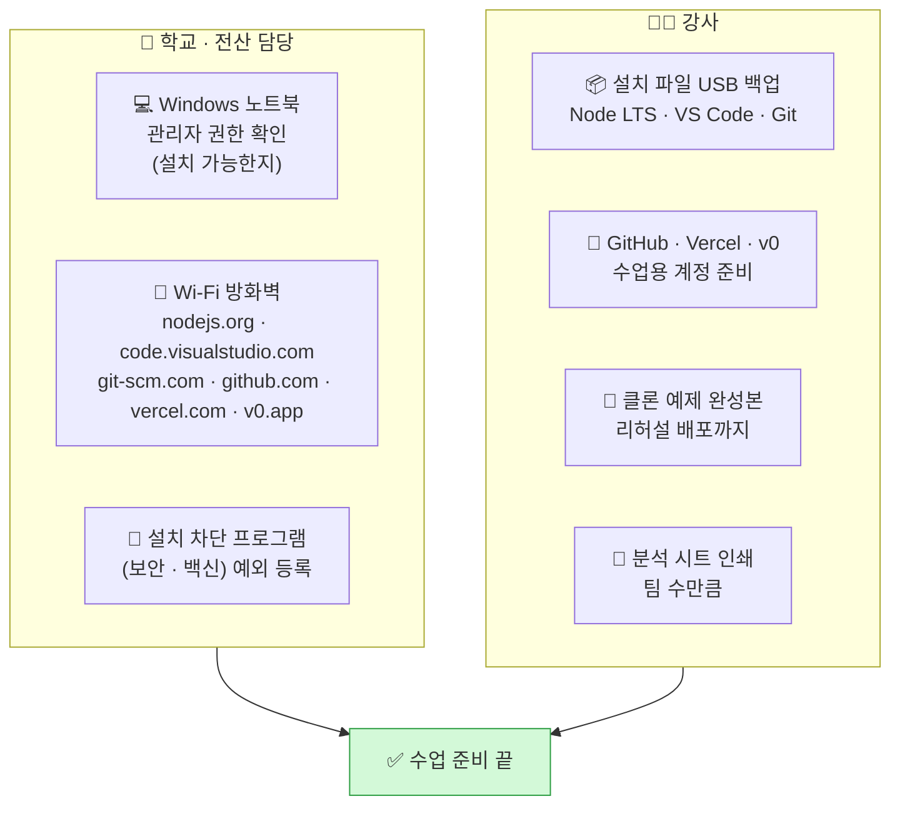

| # | 체크 | 왜 | 담당 |
|:---:|---|---|:---:|
| 1 | ☐ 노트북에 **프로그램 설치 권한(관리자)** 이 있는지 확인 | 학교 PC는 설치가 막혀 있는 경우가 많아요. 막혀 있으면 수업 전체가 멈춰요 | 🏫 |
| 2 | ☐ 아래 6개 사이트 접속 테스트 | 학교 방화벽이 개발 사이트를 막는 경우가 있어요 | 🏫 |
| 3 | ☐ **설치 파일 3개를 USB에 백업** (Node.js LTS `.msi`, VS Code `.exe`, Git `.exe`) | 30명이 동시에 다운로드하면 Wi-Fi가 느려져요 | 🧑‍🏫 |
| 4 | ☐ **GitHub · Vercel · v0** 계정을 **학교/강사 계정**으로 준비 (학생 직접 가입 ❌) | 서비스 이용 연령 · 약관 · 개인정보 보호 | 🧑‍🏫 |
| 5 | ☐ 강사가 **전 과정을 한 번 리허설** (설치 → v0 → GitHub → clone → `npm run dev` → Vercel) | 메뉴 이름 · 버튼 위치는 업데이트로 자주 바뀌어요 | 🧑‍🏫 |
| 6 | ☐ 노트북 **Windows 업데이트**를 전날 미리 해 두기 | 수업 중 "업데이트 후 재시작"이 뜨면 10분 날아가요 | 🏫 |
| 7 | ☐ 분석 시트 · 포스트잇 · 네임펜 팀별 세트 | 손으로 먼저 그리고 나중에 `.md`로 옮겨요 | 🧑‍🏫 |

**접속 확인할 사이트 6개**

| 사이트 | 용도 | 오늘 쓰나? |
|---|---|:---:|
| `nodejs.org` | Node.js · npm 설치 | ✅ 1교시 |
| `code.visualstudio.com` | VS Code 설치 | ✅ 1교시 |
| `git-scm.com` | Git 설치 | ✅ 1교시 |
| `askback-omega.vercel.app` | 클론 대상 사이트 | ✅ 1교시 |
| `v0.app` | 화면 만들기 AI | ✅ 2교시 |
| `github.com` · `vercel.com` | 코드 창고 · 가게 오픈 | ✅ 2교시 |

---

## 🎬 오프닝 (0~3분) — "맛집 레시피를 거꾸로 알아내자"

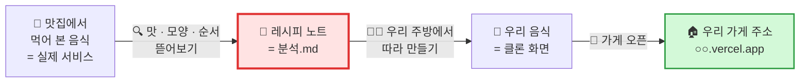

> **🗣️ 선생님 대사**
> "요리사들은 맛있는 집에 가면 그냥 먹지 않아요. **'이건 뭘 먼저 넣었지? 왜 이 그릇에 담았지?'** 하고 거꾸로 생각해요. 그걸 적은 게 **레시피 노트**예요.
> 오늘 우리도 똑같이 해요. 진짜 사람들이 쓰는 서비스를 하나 골라서 **'이건 왜 여기 있지? 왜 이건 크지?'** 를 적을 거예요.
> 이걸 **클론 코딩(clone coding)** 이라고 해요. 클론은 **'똑같이 따라 만든 것'** 이라는 뜻이에요."

## 0-1. 클론 코딩이 뭐예요? 왜 해요?

| 질문 | 답 | 비유 |
|---|---|---|
| 클론 코딩이 뭐예요? | 이미 있는 서비스를 **똑같이 따라 만들어 보는** 연습 | 🎨 명화 따라 그리기 |
| 왜 따라 만들어요? | 잘 만든 서비스엔 **이유가 있는 배치**가 있어요. 따라 하면 그 이유가 보여요 | 🎹 좋아하는 곡 따라 치기 |
| 베끼는 거 아니에요? | **연습용**으로만 써요. 공모전에 낼 때는 **우리 아이템으로 바꿔요** | 📚 교과서 예제 풀기 |
| 무엇을 따라 해요? | **화면 구성 · 순서 · 강조 방법**만. 글자 · 로고 · 이름은 **우리 것으로** | 🏠 집 구조는 같게, 가구는 내 것 |

> **⚠️ 약속** — 클론은 **공부용**이에요. 원래 서비스의 **이름 · 로고 · 글 · 사진을 그대로 복사해 올리지 않아요.** 2교시에 우리 서비스 이름(예: `우리반 질문 코치`)으로 바꿔서 만들어요.

## 0-2. 3일차와 4일차는 무엇이 다른가?

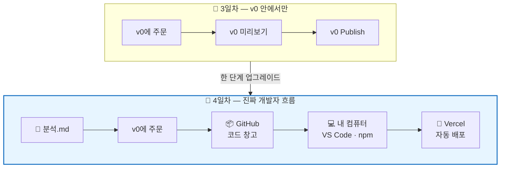

| | 📅 3일차 | 📅 4일차 (오늘) |
|---|---|---|
| 아이디어 출발 | 우리 손그림 | **실제 서비스 분석 → `분석.md`** |
| 코드가 사는 곳 | v0 안 | **GitHub 창고 + 내 컴퓨터** |
| 코드를 열어 보는 곳 | v0 코드 탭 (구경) | **VS Code** (직접 열고 글자 하나 바꿔 보기) |
| 실행 | v0 미리보기 | **내 컴퓨터에서 `npm run dev`** |
| 배포 | v0 Publish 버튼 | **GitHub에 올리면 Vercel이 자동 배포** |
| 배우는 것 | 주문하는 법 | **분석하는 눈 + 개발자 도구 흐름** |

---

# 🛠️ ① 작업실 차리기 (3~20분) — "개발자의 공구함"

> **왜 설치해요?** — 3일차에는 v0라는 **남의 작업실**을 빌려 썼어요. 오늘은 **내 컴퓨터에 내 작업실**을 차려요. 그래야 코드를 직접 열고, 고치고, 내 마음대로 올릴 수 있어요.

## 1-1. 공구 4개 한눈에

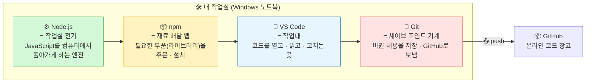

| 공구 | 비유 | 하는 일 | 없으면? | 설치 순서 |
|---|---|---|---|:---:|
| ⚙️ **Node.js** | 🔌 작업실 전기 | 웹 프로그램(Next.js)을 **내 컴퓨터에서 실행** | 전기 없는 작업실 — 아무 기계도 안 돌아요 | 1 |
| 📦 **npm** | 🛵 재료 배달 앱 | `npm install` 한 줄로 **부품 수백 개를 한 번에 배달** | 부품을 하나하나 손으로 구해야 해요 | (Node에 포함) |
| 📝 **VS Code** | 🪵 작업대 | 폴더를 열고, 코드를 보고, **터미널**도 열어요 | 메모장으로 코드 보기 — 너무 힘들어요 | 2 |
| 💾 **Git** | 💾 게임 세이브 | 바뀐 내용을 **저장(commit)** 하고 **GitHub로 보내기(push)** | 망치면 되돌릴 수 없어요 · Vercel 자동 배포가 안 돼요 | 3 |

> **🗣️ 선생님 대사**
> "레고 공장을 생각해 봐요. **Node.js는 공장 전기**, **npm은 레고 부품 배달 트럭**, **VS Code는 조립 책상**, **Git은 '여기까지 조립했음' 사진을 찍어 두는 카메라**예요.
> 네 개가 다 있어야 공장이 돌아가요."

## 1-2. 설치 전 체크 — 내 컴퓨터는 준비됐나?

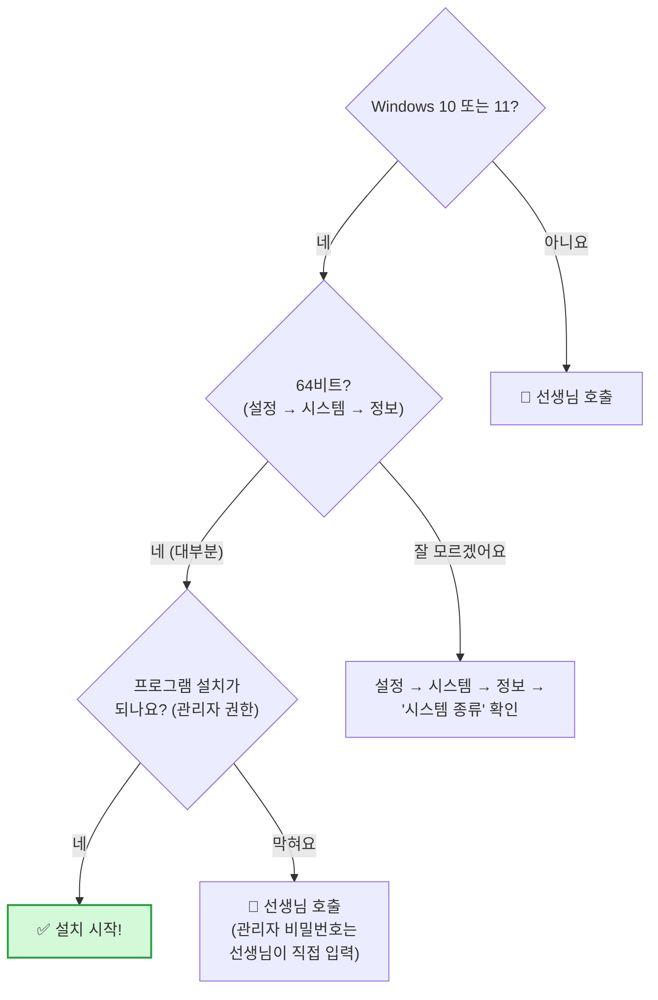

| 확인 항목 | 어디서 보나요? | 필요한 값 |
|---|---|---|
| Windows 버전 | `⊞ 시작` → `설정` → `시스템` → `정보` | Windows 10 / 11 |
| 시스템 종류 | 같은 화면 `시스템 종류` | **64비트 운영 체제** |
| 남은 저장공간 | `파일 탐색기` → `내 PC` | **최소 3GB 이상** |
| 인터넷 | 크롬에서 `nodejs.org` 열어 보기 | 열려야 해요 |

> **🔒 관리자 비밀번호** — 설치할 때 "이 앱이 디바이스를 변경하도록 허용하시겠어요?" 창이 뜨면 **예**를 누릅니다. **비밀번호를 물으면 학생이 아니라 선생님이 직접 입력**해요.

## 1-3. ⚙️ Node.js + 📦 npm 설치 (5분)

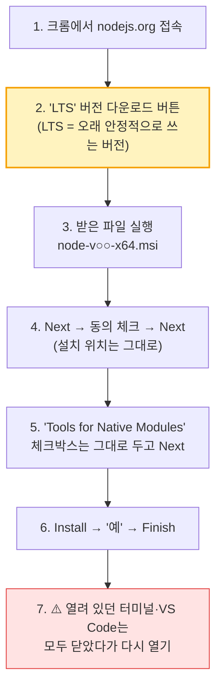

| 단계 | 화면에 보이는 것 | 누를 것 | 주의 |
|:---:|---|---|---|
| 1 | nodejs.org 첫 화면 | **LTS** 라고 쓰인 다운로드 | ❌ "Current(최신)"는 고르지 않아요 |
| 2 | 다운로드 완료 | 크롬 아래/오른쪽 위 다운로드 아이콘 → 파일 열기 | 파일 이름 `.msi` |
| 3 | Welcome to Node.js Setup | **Next** | — |
| 4 | License Agreement | ☑ I accept → **Next** | — |
| 5 | Destination Folder | **Next** (그대로) | 위치 바꾸지 않기 |
| 6 | Custom Setup | **Next** (그대로) | npm이 여기 같이 들어 있어요 ✅ |
| 7 | Tools for Native Modules | **체크하지 않고 Next** | 체크하면 설치가 20분 이상 걸려요 |
| 8 | Ready to install | **Install** → 권한 창 **예** | — |
| 9 | Completed | **Finish** | 🎉 |

> **❓ LTS가 뭐예요?** — **Long Term Support** = "오랫동안 고장 수리를 해 주는 버전". 게임으로 치면 **정식판**, Current는 **베타판**이에요. 수업은 무조건 **정식판(LTS)**.

> **❓ npm은 따로 안 깔아요?** — Node.js를 깔면 **npm이 선물처럼 함께 들어와요.** 🎁

## 1-4. 📝 Visual Studio Code 설치 (4분)

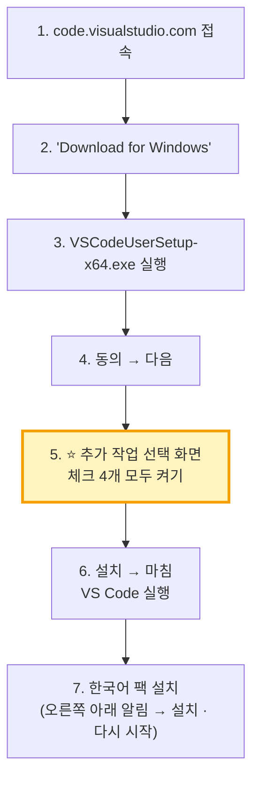

**⭐ 5번 화면 — 이 4개는 꼭 체크!**

| 체크박스 | 뜻 | 왜 켜요? |
|---|---|---|
| ☑ 바탕 화면 바로 가기 만들기 | 바탕화면 아이콘 | 찾기 쉬워요 |
| ☑ **"Code(으)로 열기" 작업을 Windows 탐색기 파일의 상황에 맞는 메뉴에 추가** | 파일 오른쪽 클릭 메뉴 | 파일을 바로 열 수 있어요 |
| ☑ **"Code(으)로 열기" 작업을 Windows 탐색기 디렉터리의 상황에 맞는 메뉴에 추가** | 폴더 오른쪽 클릭 메뉴 | ⭐ **폴더째 여는 게 가장 많이 쓰여요** |
| ☑ **PATH에 추가** | 터미널에서 `code .` 명령 사용 | ⭐ 2교시에 씁니다 |

**VS Code 첫 화면 — 다섯 구역만 알면 됩니다**

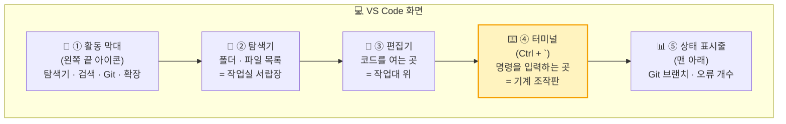

| 구역 | 비유 | 단축키 | 오늘 쓰나? |
|---|---|---|:---:|
| ① 활동 막대 | 🧭 공구 벽걸이 | — | ✅ |
| ② 탐색기 | 🗄️ 서랍장 | `Ctrl + Shift + E` | ✅ |
| ③ 편집기 | 🪵 작업대 | — | ✅ |
| ④ **터미널** | 🎛️ 기계 조작판 | **`Ctrl + ` `** (숫자 1 왼쪽 키) | ⭐ ✅ |
| ⑤ 상태 표시줄 | 📊 계기판 | — | 구경 |

**추천 확장 프로그램 (선택 · 2분)** — 왼쪽 `확장(Ctrl + Shift + X)`에서 검색해 설치

| 확장 | 하는 일 | 비유 | 필수? |
|---|---|---|:---:|
| **Korean Language Pack** | 메뉴를 한국어로 | 🌏 번역기 | ✅ |
| **Markdown Preview Mermaid Support** | `.md` 안의 **도식(mermaid)** 을 그림으로 보여 줌 | 🖼️ 설계도 미리보기 | ⭐ 오늘 분석.md에 필요 |
| Tailwind CSS IntelliSense | 디자인 글자 자동 완성 | ✏️ 자동 완성 연필 | 선택 |
| Prettier | 코드 줄 맞춤 | 🧹 정리 정돈 | 선택 |

## 1-5. 💾 Git 설치 (4분)

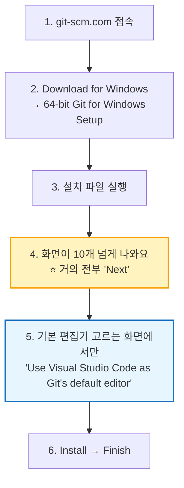

| 화면 | 고를 것 | 메모 |
|---|---|---|
| Select Components | 그대로 Next | — |
| **Choosing the default editor** | **Use Visual Studio Code as Git's default editor** | 기본값(Vim)은 초보자가 빠져나오기 어려워요 😵 |
| Adjusting the name of the initial branch | **Override … → `main`** | GitHub 기본 이름과 맞춰요 |
| PATH environment | 그대로 (Git from the command line and also from 3rd-party software) | — |
| 나머지 전부 | Next | — |

## 1-6. ✅ 설치 확인 — "세 줄 성공 화면"

> **왜 확인해요?** — 설치했다고 끝이 아니에요. 컴퓨터가 **"응, 나 알아!"** 라고 대답해야 진짜 설치된 거예요. 전기 콘센트에 꽂고 **불이 들어오는지** 보는 것과 같아요.

**VS Code를 완전히 껐다가 다시 열고** → `Ctrl + `` ` 로 터미널을 열고 → 한 줄씩 입력 후 `Enter`

```bash
node -v
```

```bash
npm -v
```

```bash
git -v
```

| 명령 | 뜻 | ✅ 성공하면 이렇게 나와요 (숫자는 달라도 OK) | ❌ 실패하면 |
|---|---|---|---|
| `node -v` | "Node야, 너 몇 살(버전)이니?" | `v22.○○.○` 같은 숫자 | `'node'은(는) 내부 또는 외부 명령…이 아닙니다` |
| `npm -v` | "npm아, 너 몇 살이니?" | `10.○.○` 같은 숫자 | 빨간 글씨 `… 스크립트를 실행할 수 없습니다` |
| `git -v` | "Git아, 너 몇 살이니?" | `git version 2.○○.○.windows.1` | `'git'은(는) … 아닙니다` |

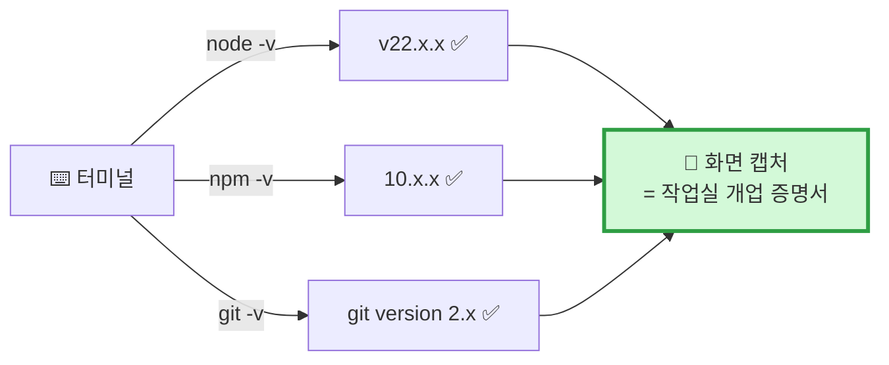

## 1-7. 🆘 설치 막혔을 때 대처표 (Windows 단골 문제)

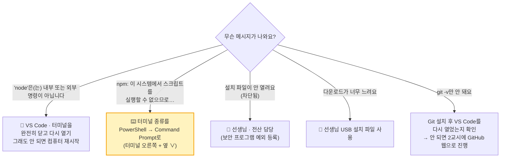

| 증상 | 원인 (비유) | 해결 |
|---|---|---|
| `'node'은(는) 내부 또는 외부 명령…` | 📞 전화번호부(PATH)에 새 번호가 아직 안 적힘 | VS Code **완전히 종료** 후 다시 열기 → 안 되면 **재부팅** |
| `npm.ps1 파일을 로드할 수 없습니다… 스크립트를 실행할 수 없으므로` | 🛡️ PowerShell 보안 경비원이 막음 | 터미널 오른쪽 `+` 옆 `∨` → **Command Prompt** 선택 후 다시 입력 (보안 설정은 바꾸지 않아요) |
| 설치 중 "이 앱은 차단되었습니다" | 🚧 학교 보안 프로그램 | 선생님 · 전산 담당 호출 |
| `v16` 처럼 숫자가 너무 낮음 | 🧓 예전에 깔린 옛날 Node | 선생님과 함께 **제어판 → 프로그램 제거** 후 LTS 다시 설치 |
| 한글 사용자 폴더(`C:\Users\김민준`) 때문에 오류 | 🔤 일부 도구가 한글 경로를 못 읽음 | 작업 폴더를 **`C:\dev`** 처럼 영어 경로에 만들기 |
| 설치는 됐는데 VS Code 터미널이 안 열림 | — | 상단 메뉴 `터미널` → `새 터미널` |

> **💡 터미널은 무서운 게 아니에요** — 검은 화면은 **컴퓨터와 채팅하는 창**이에요. 우리가 한 줄 쓰면 컴퓨터가 한 줄 대답해요. **틀려도 컴퓨터는 고장 나지 않아요.** 다시 쓰면 돼요.

## 1-8. 📂 작업 폴더 만들기 — 영어 이름, 짧은 경로

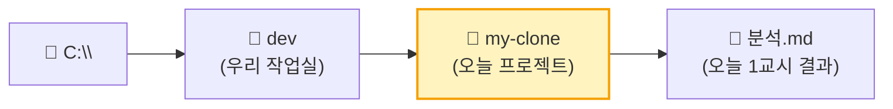

| 순서 | 행동 | 왜 |
|:---:|---|---|
| 1 | 파일 탐색기 → `C:` 드라이브 → 새 폴더 **`dev`** | 바탕화면 · 문서 폴더는 **OneDrive 동기화**로 충돌이 잦아요 |
| 2 | `dev` 안에 새 폴더 **`my-clone`** | **영어 · 소문자 · 띄어쓰기 대신 `-`** |
| 3 | `my-clone` 폴더 **오른쪽 클릭 → Code(으)로 열기** | 1-4에서 체크한 메뉴 ✅ |
| 4 | "이 폴더의 작성자를 신뢰하시겠습니까?" → **예, 작성자를 신뢰합니다** | 내가 만든 폴더니까요 |
| 5 | 탐색기에서 📄+ 아이콘 → **`분석.md`** 파일 만들기 | 이제 분석을 여기에 적어요 |

**폴더 이름 규칙 — 개발자 세계의 약속**

| 😵 나쁜 이름 | 😎 좋은 이름 | 이유 |
|---|---|---|
| `내 프로젝트` | `my-project` | 한글 · 띄어쓰기는 일부 도구가 못 읽어요 |
| `MyClone Final 최종` | `my-clone` | 짧고 소문자 |
| `바탕화면\새 폴더 (3)` | `C:\dev\my-clone` | 경로가 짧을수록 오류가 적어요 |

> **✅ ① 작업실 체크포인트** — ☐ 세 줄 성공 화면 캡처 ☐ VS Code로 `C:\dev\my-clone` 열림 ☐ `분석.md` 빈 파일 생성

---

# 🔍 ② 가게 뜯어보기 (20~28분) — "클론할 서비스의 평면도 그리기"

> **설치가 아직 안 끝난 팀** — 다운로드는 계속 돌려 두고 **기획자 · 탐정은 지금 바로** 이 파트를 시작하세요.

## 2-1. 오늘의 클론 대상 — 틴스파크AI · 🐢 거북목 감시 웹캠 예시 프로젝트

| 항목 | 내용 |
|---|---|
| **주소** | https://askback-omega.vercel.app/p/prj_example_turtle-neck |
| **서비스 한 줄** | 학생이 **자기 프로젝트를 AI 코치에게 질문**하면, 코치가 **코드 대신 순서도 · 규칙표 · 비교표**로 답하고 **"되묻기"** 로 생각을 넓혀 주는 서비스 |
| **이 페이지** | 중학생 '서연'의 **거북목 감시 웹캠** 프로젝트 — 질문 20개가 **5단계**로 쌓인 **예시 페이지** |
| **슬로건** | "답은 끝까지, 질문은 넓게" |
| **배포** | `○○.vercel.app` → **Vercel에 올라간 Next.js 사이트** (우리가 2교시에 만들 것과 같은 구조!) |
| **클론 범위** | ✅ 화면 배치 · 단계 카드 · 질문/답 카드 · 사이드바 · 입력창 모양 ❌ 진짜 AI 답변 · 로그인 · 저장 |

> **🗣️ 선생님 대사**
> "이 사이트 주소 끝을 보세요. **`vercel.app`** — 어제 우리가 연 가게랑 **같은 상가 건물**이에요!
> 즉, 이 서비스도 우리가 배운 **Next.js + Vercel**로 만들어졌을 가능성이 커요. 우리도 충분히 따라 만들 수 있다는 뜻이에요."

## 2-2. 3분 탐험 미션 — 탐정은 눌러 보고, 기획자는 그린다

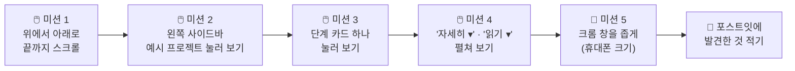

| 미션 | 확인할 것 | 탐정 메모 칸 |
|---|---|---|
| 1. 끝까지 스크롤 | 화면이 **몇 덩어리**로 나뉘나? 반복되는 모양은? | |
| 2. 사이드바 프로젝트 | 다른 예시(🌱 스마트 화분 · 🐶 반려동물 · 🚸 등굣길)로 바뀌나? | |
| 3. 단계 카드 클릭 | 누르면 **어디로 이동**하나? | |
| 4. 접기/펼치기 | 처음엔 **숨어 있다가** 누르면 보이는 것은? | |
| 5. 휴대폰 크기 | **사이드바는 어디로** 가나? 카드는 몇 줄? | |

## 2-3. 🏠 레이아웃 평면도 — 화면은 5개 구역

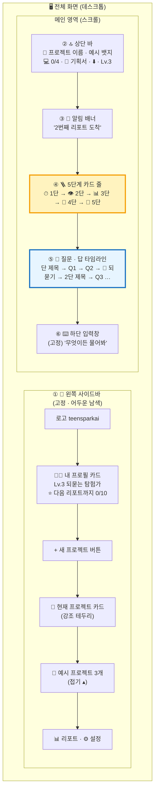

| # | 구역 | 비유 | 위치 · 크기 | 안에 들어 있는 것 | 클론 난이도 |
|:---:|---|---|---|---|:---:|
| ① | 🧭 **사이드바** | 🗂️ 서랍장 · 학생증 | 왼쪽 고정 · 폭 약 260px | 로고, 프로필(레벨), 새 프로젝트, 프로젝트 목록, 리포트 · 설정 | ⭐⭐ |
| ② | 🔝 **상단 바** | 🪧 가게 간판 | 메인 맨 위 · 한 줄 | 프로젝트 이모지 + 이름, `예시` 뱃지, 진행도 `💻 0/4`, 📝 기획서 버튼, 다운로드, 레벨 | ⭐ |
| ③ | 🎉 **알림 배너** | 📣 전광판 | 상단 바 아래 · 가로 꽉 | "🎉 ○번째 리포트 도착 — 보고 싶을 때 열어봐" | ⭐ |
| ④ | 🪜 **5단계 카드 줄** | 🪜 계단 · 지하철 노선도 | 가로 5칸 · 화살표로 연결 | 아이콘 · `1단` · 단 이름 · `Q1–2 ›` · 한 줄 설명 | ⭐⭐ |
| ⑤ | 💬 **질문 · 답 타임라인** | 📒 대화 일기장 | 메인 대부분 · 세로로 길게 | 단 구분 제목, 🙋 내 질문 카드, 코치 답 카드(표 · 순서도), 🧭 되묻기 카드 | ⭐⭐⭐ |
| ⑥ | ⌨️ **하단 입력창** | 🛎️ 주문 벨 | 화면 맨 아래 고정 | `+` 버튼, 입력칸, 보내기 버튼 | ⭐ |

> **🗣️ 선생님 대사**
> "집을 지으려면 먼저 **평면도**가 필요해요. 거실이 어디고, 방이 몇 개인지요.
> 이 화면도 **방 6개**예요. 이걸 알면 AI에게 '왼쪽에 서랍장, 위에 간판, 가운데 일기장'처럼 정확히 주문할 수 있어요."

## 2-4. 📱 휴대폰에서는 어떻게 바뀌나? — 반응형(Responsive)

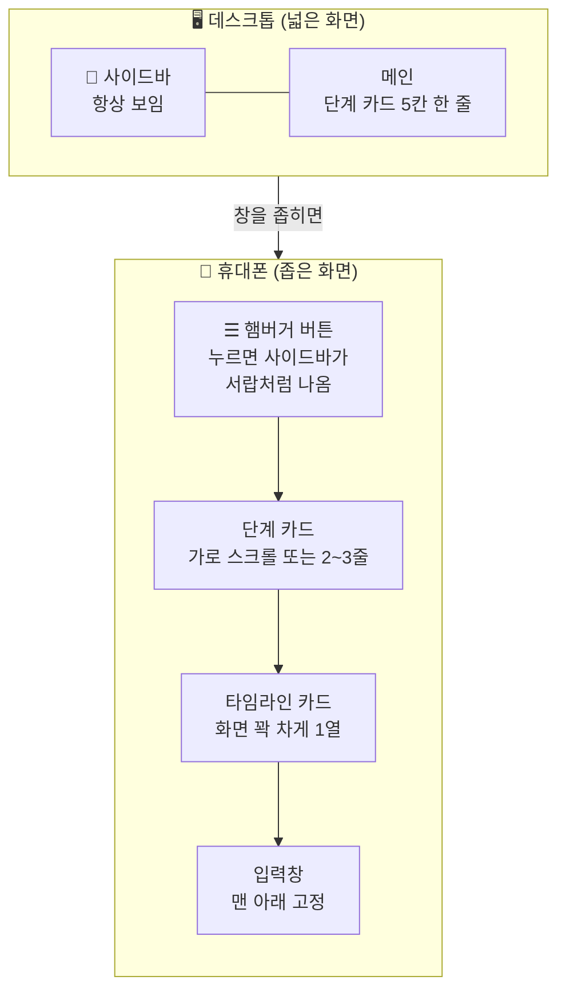

| 부품 | 🖥️ 넓은 화면 | 📱 좁은 화면 | 주문할 때 쓸 말 |
|---|---|---|---|
| 사이드바 | 왼쪽에 항상 | **숨김 → ☰ 버튼으로 열기** | "휴대폰에서는 사이드바를 햄버거 메뉴로" |
| 5단계 카드 | 5칸 한 줄 | **가로로 밀어서 보기** | "휴대폰에서는 단계 카드를 가로 스크롤로" |
| 표 (규칙표 · 비교표) | 그대로 | **표만 가로 스크롤** | "표가 넘치면 표 안에서만 가로 스크롤" |
| 입력창 | 메인 아래 | 화면 맨 아래 고정 | "입력창은 항상 맨 아래에 붙어 있게" |

## 2-5. 🧩 부품(컴포넌트) 목록 — 레고 블록으로 나누기

> **왜 부품으로 나눠요?** — 질문 카드는 **20번** 나와요. 20번 따로 만들면 힘들어요. **한 번 만든 블록을 20번 찍어** 쓰는 게 컴포넌트예요. 🧱 레고 블록 틀 하나로 블록 20개 찍기!

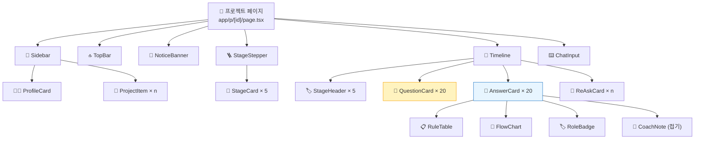

| 부품 이름 | 비유 | 몇 번 반복? | 들어가는 정보 (props) | 2교시 우선순위 |
|---|---|:---:|---|:---:|
| `Sidebar` | 🗂️ 서랍장 | 1 | 프로필, 프로젝트 목록 | 🥈 |
| `ProfileCard` | 🪪 학생증 | 1 | 이름, 레벨, 다음 리포트까지 진행도 | 🥉 |
| `ProjectItem` | 📁 서류철 | 4 | 이모지, 제목, 학생 · 학년, 질문 수, 선택됨 여부 | 🥈 |
| `TopBar` | 🪧 간판 | 1 | 이모지, 제목, 예시 여부, 레벨 | 🥈 |
| `NoticeBanner` | 📣 전광판 | 1 | 알림 문장 | 🥉 |
| `StageStepper` / `StageCard` | 🪜 계단 | 5 | 아이콘, 단 번호, 단 이름, 질문 범위, 한 줄 설명 | 🥇 |
| `StageHeader` | 🏷️ 책갈피 | 5 | 아이콘, 단 이름, `여기서부터 · n/5단` | 🥇 |
| `QuestionCard` | 🙋 손 든 학생 | 20 | 번호(Q1), 질문 글, 칩(넓히기/좁히기) | 🥇 |
| `AnswerCard` | 🧑‍🏫 선생님 답 | 20 | 결론, 표, 순서도, 확인하는 법, 🙋 되물음, 역할 | 🥇 |
| `RoleBadge` | 🎩 모자 | 20 | 👨‍💻 코더 / 🛠 엔지니어 / 🏛 아키텍트 / 📚 백과사전 | 🥈 |
| `ReAskCard` | 🧭 쪽지 시험 | 몇 번 | 되묻기 질문, 내 답, 코치 피드백 | 🥈 |
| `CoachNote` | 📎 포스트잇 | 20 | 제목, 펼치면 보이는 설명 | 🥉 |
| `ChatInput` | 🛎️ 주문 벨 | 1 | 입력칸, 보내기 | 🥈 |

> **🥇 오늘 반드시** · 🥈 시간 되면 · 🥉 나중에 — 2교시에 **🥇부터 순서대로** 주문합니다.

## 2-6. 🎨 디자인 토큰 — 색 · 글씨 · 모양 뽑아내기

> **디자인 토큰** = 디자인의 **양념 통**. 같은 양념을 쓰면 어느 화면이나 **같은 맛(느낌)** 이 나요.

| 토큰 | 관찰한 값 (눈으로 본 느낌) | 주문할 때 쓸 말 |
|---|---|---|
| 🎨 배경 | **아주 진한 남색 · 우주 느낌** (밤하늘, 작은 별 점) | "진한 남색(#0b1026 근처) 우주 배경, 작은 별 점" |
| 🎨 카드 | 배경보다 **조금 밝은 남색**, 얇은 테두리 | "카드는 살짝 밝은 남색, 1px 반투명 테두리" |
| 🎨 강조 1 | **노랑 · 주황** (레벨 뱃지, 현재 프로젝트 테두리, 보내기 버튼) | "강조색은 따뜻한 노랑-주황" |
| 🎨 강조 2 | 단계마다 다른 색 아이콘 원 (초록 · 보라 · 분홍 · 노랑 · 하늘) | "단계 아이콘은 단마다 다른 파스텔 원" |
| 🔤 글씨 | 흰색 / 연회색, 둥근 고딕 | "글씨는 흰색, 보조 글은 연회색, Pretendard 같은 고딕" |
| 🔵 모서리 | **크게 둥근** 카드 · 알약 모양 버튼 | "카드 모서리 16px, 버튼은 알약 모양" |
| 😀 이모지 | 아이콘 대신 **이모지를 아주 많이** | "아이콘은 이모지로" |
| 🏷️ 뱃지 | `예시` · `Lv.3` · `💻 0/4` 같은 작은 알약 | "작은 알약 뱃지" |

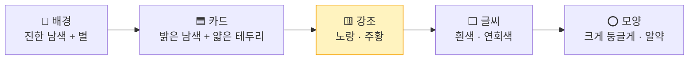

> **💡 색 고르는 법 (팁)** — 크롬에서 `F12` → 왼쪽 위 화살표 아이콘 → 카드를 클릭하면 오른쪽 `Styles`에 **진짜 색 값**이 보여요. **구경만** 하고, 2교시엔 "이런 느낌"으로 주문해요.

---

# 🗺️ ③ 흐름도 · 유저 시나리오 (28~35분) — "손님의 동선 그리기"

> **왜 흐름도를 그려요?** — 평면도(②)는 **방이 어디 있는지**, 흐름도는 **손님이 어떤 순서로 방을 지나가는지**예요. 놀이공원 지도에 **추천 코스 화살표**를 그리는 것과 같아요. 🎢

## 3-1. 🧭 사이트 전체 지도 (화면 이동 흐름)

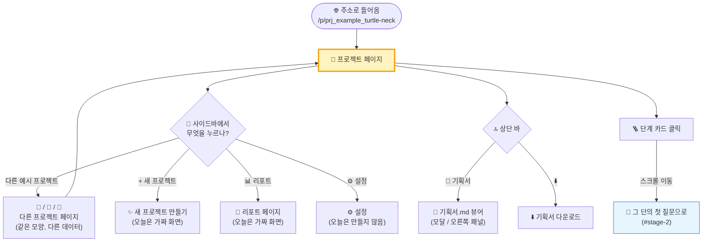

| 출발 | 누르는 것 | 도착 | 오늘 클론? |
|---|---|---|:---:|
| 프로젝트 페이지 | 사이드바 예시 프로젝트 | **같은 페이지 틀 + 다른 JSON** | ✅ 🥇 |
| 프로젝트 페이지 | 단계 카드 | **같은 페이지 안 아래로 스크롤** | ✅ 🥇 |
| 프로젝트 페이지 | 📝 기획서 | 기획서 모달 | ✅ 🥈 |
| 프로젝트 페이지 | `자세히 ▾` / `읽기 ▾` | 같은 카드 안 펼침 | ✅ 🥈 |
| 프로젝트 페이지 | + 새 프로젝트 · 리포트 | 다른 페이지 | 🥉 빈 화면만 |
| 프로젝트 페이지 | 입력창 보내기 | (진짜는 AI 답변) | 🎭 **가짜 답 1개** 보여 주기 |

## 3-2. 🔀 한 질문이 쌓이는 흐름 — 이 서비스의 **심장**

```mermaid
flowchart TD
    Q["🙋 학생이 질문<br/>'30분마다 알림 코드 짜줘'"] --> C["🤖 코치가 답<br/>❌ 코드 ⭕ 규칙표 · 순서도"]
    C --> CHK["✅ 확인하는 법<br/>'10초로 바꿔서 3번 돌려 봐'"]
    CHK --> RA["🙋 열린 되묻기<br/>'30분은 어디서 왔어?'"]
    RA --> ROLE["🎩 이번 답의 역할<br/>👨‍💻 코더 · 🛠 엔지니어 · 🏛 아키텍트 · 📚 백과사전"]
    ROLE --> PLAN["📝 기획서.md에 한 칸 추가"]
    PLAN --> N{"질문이 2개<br/>쌓였나?"}
    N -->|"예"| RQ["🧭 되묻기 카드<br/>'다음에 뭐가 일어나지?'<br/>→ 내 답 → 코치 피드백"]
    N -->|"아니요"| NEXT["🙋 다음 질문<br/>(되묻기에 답하면서 시작)"]
    RQ --> NEXT
    NEXT --> T{"답이 10개<br/>쌓였나?"}
    T -->|"예"| REP["📄 리포트 1장 도착 🎉"]
    T -->|"아니요"| Q
    REP --> Q
    style C fill:#e7f5ff,stroke:#1971c2,stroke-width:2px
    style RA fill:#fff3bf,stroke:#f59f00,stroke-width:2px
    style REP fill:#d3f9d8,stroke:#2f9e44
```

| 규칙 (사이트에서 발견) | 화면에서 어떻게 보이나 | 클론할 때 |
|---|---|---|
| 답에는 **코드가 없다** — 순서도 · 규칙표 · 비교표만 | 답 카드 안에 **표 + 순서도** | 표와 순서도 **모양**을 꼭 만들기 |
| 답마다 끝에 **🙋 열린 되묻기** | 답 카드 맨 아래 노란 줄 | 노란 강조 박스 |
| **두 번 묻고 한 번 🧭 되묻기** | Q2 뒤, Q4 뒤에 별도 카드 | `ReAskCard` |
| 답이 **10개마다 📄 리포트** | 위 🎉 알림 배너 | `NoticeBanner` |
| 답마다 **🎩 역할** 표시 | "이번 답에서 나는 🛠 엔지니어로 일했어" | `RoleBadge` |
| 답마다 **📝 기획서에 담았어** | 답 카드 아래 회색 박스 | 작은 박스 |

> **🗣️ 선생님 대사**
> "이 서비스가 특별한 이유가 여기 있어요. 보통 AI는 '코드 줘'하면 코드를 줘요. 그런데 이 코치는 **코드 대신 규칙표와 순서도**를 주고, **꼭 하나를 되물어요.**
> 그래서 화면에서도 **'되묻기'가 가장 눈에 띄게** 만들어져 있어요. 우리가 클론할 때 **이 부분을 절대 놓치면 안 돼요.**"

## 3-3. 🪜 5단계 성장 흐름 — 프로젝트가 커지는 모양

```mermaid
flowchart LR
    S1["⏱ 1단<br/>타이머와 규칙<br/>Q1–2<br/>AI 없이 시작"] --> S2["👁 2단<br/>AI 눈<br/>Q3–4<br/>포즈 모델"]
    S2 --> S3["📊 3단<br/>기록과 서버<br/>Q5–7<br/>숫자 한 줄만"]
    S3 --> S4["🤝 4단<br/>공유와 협력<br/>Q8–10<br/>기획서.md로 나누기"]
    S4 --> S5["🔁 5단<br/>써 보고 고치기<br/>Q11–20<br/>차별점 · 피드백"]
    style S1 fill:#d3f9d8,stroke:#2f9e44
    style S2 fill:#e5dbff,stroke:#7048e8
    style S3 fill:#ffdeeb,stroke:#d6336c
    style S4 fill:#fff3bf,stroke:#f59f00
    style S5 fill:#d0ebff,stroke:#1971c2
```

| 단 | 아이콘 | 이름 | 질문 범위 | 한 줄 설명 | 2일차 "계단"과 연결 |
|:---:|:---:|---|:---:|---|---|
| 1 | ⏱ | 타이머와 규칙 | Q1–2 | AI 없이, 시간이 되면 자세를 떠올리게 하고 스스로 체크 | 🪜 **1단 = 심장 하나** |
| 2 | 👁 | AI 눈 | Q3–4 | 포즈 모델이 대신 보고, 판정 규칙이 경고 시점을 정함 | 아쉬움이 생기면 한 칸 위로 |
| 3 | 📊 | 기록과 서버 | Q5–7 | 영상은 버리고 숫자 한 줄만 남겨 그래프로 | 🍱 → 🧊 (서랍 → 냉장고) |
| 4 | 🤝 | 공유와 협력 | Q8–10 | 친구와 하루 한 줄, 기획서.md로 따라 만들기 | 🏬 함께 쓰기 |
| 5 | 🔁 | 써 보고 고치기 | Q11–20 | 차별점을 쓰고, 실제로 써 보며 다듬기 | 🔁 회고 · 개선 |

> **💡 발견!** — 이 사이트의 5단계는 **우리가 2일차에 배운 "MVP 계단"** 과 똑같은 생각이에요. 1단은 **AI 없이** 시작하고, 아쉬움이 생길 때만 한 칸 올라가요.

## 3-4. 👤 유저 시나리오 — "누가, 왜, 어떻게 쓰나?"

> **유저 시나리오** = 손님 한 명이 **들어와서 나갈 때까지의 짧은 이야기**. 연극 대본처럼 써요. 🎭

### 페르소나 3명

| | 🧑‍🎓 페르소나 A — **처음 온 친구 '민호'** | 🧑‍🚀 페르소나 B — **프로젝트 중인 '서연'** | 🧑‍🏫 페르소나 C — **지도 선생님** |
|---|---|---|---|
| 나이 · 상황 | 중1, 발명 동아리 첫날 | 중2, 거북목 프로젝트 2주째 | 동아리 담당 교사 |
| 원하는 것 | "이 서비스가 뭔지, 어떻게 질문하는지" | "다음에 무엇을 물어볼지" | "학생이 생각을 키웠는지" |
| 처음 보는 곳 | 🪜 5단계 카드 | 💬 마지막 질문 · 🙋 되물음 | 📄 리포트 · 📝 기획서 |
| 가장 중요한 버튼 | 단계 카드 · 예시 프로젝트 | 입력창 | 📝 기획서 · ⬇️ |
| 실패하는 순간 | 글이 너무 길어서 어디부터 읽을지 모름 | 되물음을 못 찾음 | 기획서가 어디 있는지 모름 |

### 시나리오 A — 처음 온 민호의 5분

```mermaid
journey
    title 민호(중1)가 예시 페이지를 처음 보는 5분
    section 들어오기
      친구가 보낸 링크 클릭: 4: 민호
      우주 배경과 거북이 이모지 보기: 5: 민호
    section 이해하기
      5단계 카드로 전체 흐름 파악: 4: 민호
      1단 카드 클릭해서 Q1로 이동: 5: 민호
      Q1 질문과 코치 답 읽기: 3: 민호
    section 놀라기
      코드 대신 규칙표가 나온 걸 발견: 4: 민호
      되물음 질문에 스스로 답해 보기: 4: 민호
    section 따라 하기
      사이드바에서 다른 예시 보기: 4: 민호
      새 프로젝트 버튼 누르기: 5: 민호
```

| 장면 | 민호의 행동 | 민호의 마음 | 화면이 해 줘야 할 일 | 관련 부품 |
|:---:|---|---|---|---|
| 1 | 링크를 눌러 들어온다 | 😐 "이게 뭐지?" | **3초 안에** 무슨 서비스인지 알게 | TopBar · 슬로건 |
| 2 | 5단계 카드를 본다 | 🙂 "아, 프로젝트가 5단계로 커지는구나" | 단계가 **화살표로 이어져** 보이게 | StageStepper |
| 3 | 1단을 누른다 | 😀 "바로 거기로 가네" | **부드럽게 스크롤** 이동 | StageCard → StageHeader |
| 4 | Q1을 읽는다 | 🤔 "코드를 달랬는데 표를 줬네?" | 질문(나) vs 답(코치) **확실히 구분** | QuestionCard · AnswerCard |
| 5 | 🙋 되물음을 본다 | 😮 "AI가 나한테 질문을 하네" | **노란색으로 눈에 띄게** | AnswerCard 하단 |
| 6 | 사이드바 다른 예시 | 😀 "다른 친구들 것도 볼래" | 같은 틀, 다른 내용 | ProjectItem |
| 7 | + 새 프로젝트 | 🤩 "나도 해 볼래!" | 버튼이 **찾기 쉽게** | Sidebar |

### 시나리오 B — 서연이 다음 질문을 찾는 2분

```mermaid
sequenceDiagram
    participant 서연 as 🧑‍🚀 서연
    participant 페이지 as 🐢 프로젝트 페이지
    participant 타임라인 as 💬 타임라인
    participant 입력 as ⌨️ 입력창
    서연->>페이지: 내 프로젝트 열기
    페이지-->>서연: 🎉 "2번째 리포트 도착" 배너
    서연->>타임라인: 맨 아래 마지막 답으로 스크롤
    타임라인-->>서연: 🙋 "하나만 되물을게 — …"
    서연->>입력: 되물음에 대한 내 답 + 새 질문
    입력-->>타임라인: 🙋 새 질문 카드 추가
    타임라인-->>서연: 🤖 코치 답 (오늘은 가짜 답)
```

### 시나리오 C — 선생님이 성장을 확인하는 1분

| 순서 | 선생님 행동 | 보는 곳 | 화면이 보여 줘야 할 것 |
|:---:|---|---|---|
| 1 | 사이드바에서 학생 프로젝트 | 🐢 ProjectItem | 질문 수 · 최근 역할 `🛠🛠👨‍💻🏛🛠` |
| 2 | 역할 기록 훑기 | 역할 이모지 줄 | 📚 백과사전(넓은 질문)이 줄고 🛠 엔지니어(구체 질문)가 늘었나 |
| 3 | 📝 기획서 열기 | 기획서 모달 | 칸이 몇 개 쌓였나 |
| 4 | ⬇️ 다운로드 | — | `.md` 파일로 저장 |

> **💡 발견!** — "질문을 크게 하면 📚 백과사전, 구체적으로 하면 🛠 엔지니어"로 역할이 바뀌어요. **질문의 질이 이모지로 보이는** 화면이에요. 3일차 "좋은 주문서"와 같은 이야기!

## 3-5. 🧪 상태(State) 흐름 — 화면이 바뀌는 순간들

> **상태** = 화면의 **기분**. 같은 카드도 **접힘 / 펼침**, **선택됨 / 안 됨**에 따라 모습이 바뀌어요.

```mermaid
stateDiagram-v2
    [*] --> 접힘: 처음
    접힘 --> 펼침: '자세히 ▾' 클릭
    펼침 --> 접힘: '▴' 클릭
    접힘: 📌 가정 · 🔎 질문 유형만 보임
    펼침: 코치 노트 전체가 보임
```

| 부품 | 상태 | 바뀌는 모습 | 저장 위치 |
|---|---|---|---|
| ProjectItem | 선택됨 / 아님 | **노란 테두리** · 밝은 배경 | 주소(URL) |
| 예시 프로젝트 묶음 | 펼침 / 접힘 | `접기 ▴` ↔ `펼치기 ▾` | 화면 기억(state) |
| AnswerCard | 펼침 / 접힘 | 코치 답 전체 ↔ 요약 | 화면 기억 |
| CoachNote | 읽기 ▾ | 설명 펼침 | 화면 기억 |
| 기획서 모달 | 열림 / 닫힘 | 화면 위에 덮개 | 화면 기억 |
| 입력창 | 빈칸 / 글 있음 | 보내기 버튼 **회색 ↔ 노랑** | 화면 기억 |
| ✅ 초안에 적기 | 안 누름 / 누름 | `✅` 체크 | 🗄️ localStorage |

---

# ⭐ ④ 강조할 곳 · 데이터 모양 (35~41분) — "무대 조명과 진열장"

## 4-1. 🔦 시선 흐름 — 사람의 눈은 어디부터 보나?

```mermaid
flowchart TD
    E1["👀 1순위<br/>🐢 프로젝트 이름 + 🎉 배너<br/>'여기가 어디지?'"] --> E2["👀 2순위<br/>🪜 5단계 카드<br/>'전체가 어떻게 생겼지?'"]
    E2 --> E3["👀 3순위<br/>🙋 내 질문 카드<br/>'무엇을 물었지?'"]
    E3 --> E4["👀 4순위<br/>🤖 결론부터 — 굵은 첫 줄<br/>'답이 뭐지?'"]
    E4 --> E5["👀 5순위<br/>🙋 하나만 되물을게<br/>'나는 뭐라고 답하지?'"]
    E5 --> E6["👀 6순위<br/>⌨️ 입력창<br/>'다음 질문!'"]
    style E2 fill:#fff3bf,stroke:#f59f00,stroke-width:2px
    style E5 fill:#ffe3e3,stroke:#e03131,stroke-width:3px
```

> **비유** — 연극 무대에서 **조명이 비추는 배우**를 관객이 봐요. 화면에서도 **크게 · 밝게 · 색 있게** 만든 곳에 눈이 가요. 🔦

## 4-2. ⭐ 강조 설계표 — 무엇을 크게, 무엇을 작게

| 순위 | 강조할 것 | 왜 중요해요? | 강조 방법 | 💬 주문할 때 쓸 말 |
|:---:|---|---|---|---|
| 🥇 | **🙋 열린 되묻기** | 서비스의 **차별점** — AI가 학생에게 되물어요 | 노란 왼쪽 띠 · 굵은 글씨 · 🙋 이모지 | "답 카드 맨 아래 되물음은 노란 띠로 가장 눈에 띄게" |
| 🥇 | **🪜 5단계 카드** | 프로젝트가 **커지는 길**을 한눈에 | 큰 카드 5개 · 화살표 · 단마다 다른 색 | "5개 카드를 화살표로 이어 계단처럼" |
| 🥈 | **결론부터 — 첫 문장** | 긴 답에서 **핵심만** 먼저 | 굵게(bold) · 첫 줄 | "답의 첫 문장은 굵게" |
| 🥈 | **🙋 내 질문 vs 🤖 코치 답** | 누가 말했는지 **헷갈리지 않게** | 질문은 오른쪽 · 밝은 카드 / 답은 왼쪽 · 넓은 카드 | "질문 카드와 답 카드 색을 다르게" |
| 🥈 | **🧭 되묻기 카드** | **진짜 이해했는지** 확인하는 쪽지 시험 | 초록 점 🟢 · 별도 카드 · 칩 3개 | "되묻기 카드는 별도 박스, 위에 칩 3개" |
| 🥉 | 🎩 역할 뱃지 | 질문의 질을 보여 줌 | 작은 알약 뱃지 | "작은 뱃지로" |
| 🥉 | 📌 가정 · 🔎 유형 | 자세히 보고 싶은 사람만 | 접어 두기 | "기본은 접어 두고 '자세히 ▾'로 펼치기" |
| 🔇 | 코치 노트 | 선생님 · 관심 있는 학생용 | 접어 두기 · 작은 글씨 | "읽기 ▾ 로 접기" |

```mermaid
quadrantChart
    title 강조 지도 (크게 보일수록 위 · 자주 볼수록 오른쪽)
    x-axis 가끔 본다 --> 자주 본다
    y-axis 작게 --> 크게
    quadrant-1 "🔦 주인공 — 크게, 늘 보이게"
    quadrant-2 "🪧 간판 — 크게, 한 번만"
    quadrant-3 "📎 접어 두기"
    quadrant-4 "🏷️ 작지만 자주"
    되묻기: [0.85, 0.9]
    5단계카드: [0.6, 0.85]
    결론첫줄: [0.8, 0.7]
    알림배너: [0.25, 0.75]
    역할뱃지: [0.7, 0.3]
    코치노트: [0.2, 0.15]
    가정유형: [0.3, 0.25]
    입력창: [0.9, 0.55]
```

## 4-3. 🙅 일부러 **안** 만들 것 — 클론 범위 정하기

> **왜 안 만들 것을 정해요?** — 2일차 칸 ⑧ "일부러 안 넣을 것"과 같아요. **다 만들려고 하면 아무것도 완성 못 해요.**

| 원래 서비스 기능 | 오늘 클론에서 | 대신 이렇게 흉내 내요 |
|---|---|---|
| 🤖 진짜 AI 코치 답변 | ❌ | 🍱 **JSON에 미리 써 둔 답** 20개 보여 주기 |
| 🔐 로그인 · 내 계정 | ❌ | 프로필은 **고정된 가짜 이름**(예: `🧑‍🚀 하늘의 프로젝트`) |
| 💾 질문 저장 (서버 DB) | ❌ | 입력창 보내기 → **화면에만 잠깐** 카드 추가 (새로고침하면 사라짐) |
| 📄 리포트 자동 생성 | ❌ | 배너 문장만 고정 |
| ⬇️ 기획서 다운로드 | 🥉 | 시간 되면 `.md` 파일 다운로드 버튼 |
| 원래 이름 · 로고 · 글 | ❌ **복사 금지** | **우리 서비스 이름 · 우리 예시 내용**으로 바꾸기 |

```mermaid
flowchart LR
    ORIG["🌐 원래 서비스<br/>프론트 + 서버 + AI + DB"] -->|"✂️ 오늘 범위"| OURS["🍱 우리 클론<br/>프론트 + JSON 데이터<br/>(② 모형 음식 식당)"]
    OURS -.->|"나중에<br/>통로(lib/repo.ts)만 바꿔서"| FUTURE["👨‍🍳 진짜 주방<br/>서버 · AI API"]
    style OURS fill:#fff3bf,stroke:#f59f00,stroke-width:3px
```

## 4-4. 🍱 데이터 모양 — 반복되는 것은 JSON으로

> **어떻게 찾아요?** — 화면에서 **똑같은 모양이 여러 번** 나오면, 그건 **데이터 + 틀(컴포넌트)** 이에요. 틀은 하나, 내용만 바뀌어요.

```mermaid
flowchart LR
    R1["🔁 반복 1<br/>프로젝트 4개<br/>(사이드바)"] --> J1["📄 projects.json"]
    R2["🔁 반복 2<br/>단계 5개"] --> J2["stages[ ]"]
    R3["🔁 반복 3<br/>질문 · 답 20쌍"] --> J3["qa[ ]"]
    R4["🔁 반복 4<br/>되묻기 n개"] --> J4["reasks[ ]"]
    J2 --> J1
    J3 --> J1
    J4 --> J1
    J1 --> REPO["🚪 lib/repo.ts<br/>통로 하나"]
    REPO --> UI["🪑 화면"]
    style REPO fill:#fff3bf,stroke:#f59f00,stroke-width:2px
```

**데이터 사전 (어떤 칸이 필요한가)**

| 묶음 | 칸 이름 | 예시 값 | 어디에 보이나 |
|---|---|---|---|
| **project** | `id` | `prj_example_turtle-neck` | 주소 |
| | `emoji` · `title` | `🐢` · `거북목 감시 웹캠` | 상단 바 · 사이드바 |
| | `student` · `grade` | `서연` · `중2` | 사이드바 |
| | `summary` | `숙제할 때 고개가 나가는 걸 알아채기` | 사이드바 카드 |
| | `isExample` | `true` | `예시` 뱃지 |
| | `roles` | `["🛠","🛠","👨‍💻","🏛","🛠"]` | 최근 역할 |
| **stage** | `no` · `icon` · `name` | `1` · `⏱` · `타이머와 규칙` | 단계 카드 |
| | `range` | `Q1–2` | 단계 카드 |
| | `desc` | `AI 없이, 시간이 되면 …` | 단계 카드 · 단 제목 |
| **qa** | `no` · `stage` | `1` · `1` | 질문 번호 · 어느 단 |
| | `question` | `30분마다 '자세 확인!' …` | 🙋 질문 카드 |
| | `chip` | `넓히기` / `좁히기` / `null` | 질문 칩 |
| | `conclusion` | `결론부터 — 뼈대는 맞아.` | 답 첫 줄 (굵게) |
| | `table` | `{ head:[…], rows:[[…]] }` | 규칙표 |
| | `flow` | `["시간 세기","30분 됐어?", …]` | 순서도 |
| | `check` | `30분을 10초로 바꿔 …` | ✅ 확인하는 법 |
| | `reask` | `30분이라는 숫자는 어디서 왔어?` | 🙋 되물음 |
| | `role` | `coder` / `engineer` / `architect` / `encyclopedia` | 🎩 역할 뱃지 |
| | `planItem` | `1. 알고리즘 v1 — 시간 알림 규칙` | 📝 기획서에 담았어 |

**JSON 미리보기** (오늘은 **모양만** 이해 · 2교시에 v0가 만들어 줘요)

```json
{
  "id": "prj_example_sky-study",
  "emoji": "📚",
  "title": "집중 타이머 코치",
  "student": "하늘",
  "grade": "초6",
  "isExample": true,
  "summary": "숙제할 때 딴짓하는 걸 알아채기 — 타이머에서 시작해 기록 · 공유로",
  "stages": [
    { "no": 1, "icon": "⏱", "name": "타이머와 규칙", "range": "Q1–2", "desc": "AI 없이, 시간이 되면 스스로 체크한다" },
    { "no": 2, "icon": "👁", "name": "AI 눈", "range": "Q3–4", "desc": "카메라가 대신 보고, 규칙이 언제 알릴지 정한다" }
  ],
  "qa": [
    {
      "no": 1,
      "stage": 1,
      "question": "25분마다 '쉬는 시간!' 알림이 뜨는 웹페이지 만들어 줘.",
      "chip": null,
      "conclusion": "코드 대신 규칙 카드로 적어 줄게.",
      "table": { "head": ["칸", "내용"], "rows": [["입력", "흐른 시간"], ["판단", "25분이 됐나?"], ["출력", "알림 + 확인 버튼"]] },
      "flow": ["시간 세기", "25분 됐어?", "🔔 알림", "확인 버튼 눌렀어?"],
      "check": "25분을 10초로 바꿔서 3번 연속 제때 뜨면 통과.",
      "reask": "25분이라는 숫자는 어디서 왔어?",
      "role": "coder",
      "planItem": "1. 알고리즘 v1 — 시간 알림 규칙"
    }
  ]
}
```

> **⚠️ 주의** — 원래 사이트의 질문 · 답 글을 **그대로 복사하지 않아요.** 위 예시처럼 **우리 아이템(또는 비슷한 다른 주제)으로 바꿔** 씁니다. 2일차에 만든 **우리 팀 아이템**으로 써도 좋아요!

---

# 📝 ⑤ `분석.md` 완성 (41~45분) — "AI에게 넘길 설계도"

## 5-1. 왜 `.md`(마크다운)로 쓰나요?

```mermaid
flowchart LR
    A["📝 분석.md"] --> B["🤖 AI가 잘 읽어요<br/>제목 · 표 · 목록이<br/>구조로 보여요"]
    A --> C["👀 사람이 잘 읽어요<br/>VS Code · GitHub에서<br/>예쁘게 보여요"]
    A --> D["🔀 그림도 넣어요<br/>mermaid 순서도가<br/>글로 저장돼요"]
    A --> E["📦 코드와 같이 보관<br/>GitHub 창고에<br/>함께 올라가요"]
    style A fill:#ffe3e3,stroke:#e03131,stroke-width:3px
```

| 마크다운 문법 | 쓰는 법 | 보이는 모습 | 비유 |
|---|---|---|---|
| 제목 | `# 큰 제목` / `## 작은 제목` | **큰 글씨** | 📕 책의 장 · 절 |
| 목록 | `- 항목` | • 항목 | 📋 장보기 목록 |
| 굵게 | `**중요**` | **중요** | 🖍️ 형광펜 |
| 표 | `| 칸 | 칸 |` + `|---|---|` | 표 | 📊 시간표 |
| 순서도 | ` ```mermaid ` … ` ``` ` | 그림 | 🗺️ 지도 |
| 체크 | `- [ ] 할 일` | ☐ 할 일 | ✅ 숙제 체크 |

> **VS Code 미리보기** — `분석.md`를 열고 **`Ctrl + Shift + V`** → 오른쪽에 예쁜 모양으로 보여요. (mermaid 그림은 1-4의 확장 프로그램이 있어야 보여요)

## 5-2. 📄 `분석.md` 템플릿 — 복사해서 빈칸만 채우기

````markdown
# 클론 분석서 — 틴스파크AI 프로젝트 페이지
- 팀: ______  /  작성일: 4일차
- 클론 대상: https://askback-omega.vercel.app/p/prj_example_turtle-neck
- 우리 서비스 이름: ______________ (원래 이름 쓰지 않기)
- 우리 예시 프로젝트: ______________ (이모지 __ )

## 1. 한 줄 요약
______ 가 자기 프로젝트를 질문하면, AI 코치가 코드 대신 ______ 로 답하고
______ 로 생각을 넓혀 주는 서비스의 **프로젝트 페이지**.

## 2. 클론 범위
- 만든다: 사이드바 / 상단 바 / 알림 배너 / 5단계 카드 / 질문·답 타임라인 / 입력창
- 안 만든다: 진짜 AI 답변, 로그인, 서버 저장 → 전부 JSON 가짜 데이터

## 3. 레이아웃 (구역 6개)
| # | 구역 | 위치 | 들어갈 것 |
|---|---|---|---|
| 1 | 사이드바 | 왼쪽 고정 260px | 로고, 프로필, +새 프로젝트, 프로젝트 목록 4개, 리포트·설정 |
| 2 | 상단 바 | 메인 맨 위 | 이모지+제목, 예시 뱃지, 기획서 버튼, 레벨 |
| 3 | 알림 배너 | 상단 바 아래 | ______ |
| 4 | 5단계 카드 | 가로 5칸 | 아이콘·단 번호·이름·질문 범위·한 줄 설명 |
| 5 | 타임라인 | 가운데 세로 | 단 제목 → 질문 카드 → 답 카드 → 되묻기 카드 |
| 6 | 입력창 | 맨 아래 고정 | +, 입력칸, 보내기 |

## 4. 사이트 흐름도
```mermaid
flowchart TD
    A[프로젝트 페이지] --> B{사이드바}
    B -->|예시 프로젝트| C[같은 틀 다른 데이터]
    A --> D[단계 카드 클릭] --> E[그 단 첫 질문으로 스크롤]
    A --> F[기획서 버튼] --> G[기획서 모달]
    A --> H[입력창 보내기] --> I[가짜 답 카드 추가]
```

## 5. 유저 시나리오
- 페르소나: ______ (나이 · 상황)
- 장면 1: ______ 하려고 들어와서 → ______ 를 본다
- 장면 2: ______ 를 누르고 → ______ 로 이동한다
- 장면 3: ______ 를 보고 "______" 라고 생각한다
- 성공 기준: ______ 초 안에 ______ 를 찾는다

## 6. 강조할 곳 (순위)
1. ______ — 이유: ______ — 방법: ______
2. ______ — 이유: ______ — 방법: ______
3. ______ — 이유: ______ — 방법: ______

## 7. 디자인 토큰
- 배경: ______ / 카드: ______ / 강조색: ______
- 글씨: ______ / 모서리: ______ / 아이콘: 이모지

## 8. 데이터 모양 (data/projects.json)
- project: id, emoji, title, student, grade, isExample, summary, stages[], qa[]
- stage: no, icon, name, range, desc
- qa: no, stage, question, chip, conclusion, table, flow, check, reask, role, planItem
- 예시 프로젝트 개수: __ 개 / 질문·답 개수: __ 쌍

## 9. 반응형
- 휴대폰: 사이드바 → ☰ 메뉴 / 단계 카드 → 가로 스크롤 / 표 → 표 안에서만 가로 스크롤

## 10. 2교시 주문 순서 (한 번에 하나씩)
- [ ] ① 전체 레이아웃 + 디자인 토큰
- [ ] ② 5단계 카드
- [ ] ③ 질문·답 타임라인 + JSON 데이터
- [ ] ④ 되묻기 강조 · 되묻기 카드
- [ ] ⑤ 사이드바 프로젝트 전환
- [ ] ⑥ 휴대폰 화면
````

## 5-3. ✍️ 팀 분담 — 4분 안에 끝내는 법

```mermaid
flowchart LR
    A["🎩 기획자<br/>1 · 2 · 3 · 7<br/>요약 · 범위 · 레이아웃 · 토큰"] --> M["📝 분석.md<br/>하나로 합치기"]
    B["🎩 탐정<br/>4 · 5 · 9<br/>흐름도 · 시나리오 · 반응형"] --> M
    C["🎩 실행자<br/>6 · 8 · 10<br/>강조 · 데이터 · 주문 순서<br/>+ VS Code에 타이핑"] --> M
    style M fill:#ffe3e3,stroke:#e03131,stroke-width:3px
```

| 역할 | 맡을 칸 | 어디서 가져오나 |
|---|---|---|
| 🎩 기획자 | 1 · 2 · 3 · 7 | 2-1 · 2-3 · 2-6 · 4-3 |
| 🎩 탐정 | 4 · 5 · 9 | 3-1 · 3-4 · 2-4 |
| 🎩 실행자 | 6 · 8 · 10 + **VS Code에 입력** | 4-2 · 4-4 · 2-5 우선순위 |

> **💡 시간이 부족하면** — 종이 분석 시트에 손으로 쓰고 **📷 사진만 찍어** 둡니다. 2교시 v0에 **사진을 첨부**해도 돼요. VS Code `분석.md`는 쉬는 시간에 옮겨도 OK.

## 5-4. ✅ 좋은 분석.md 체크리스트

| # | 질문 | O / X |
|:---:|---|:---:|
| 1 | 구역이 **6개 모두** 위치와 함께 적혀 있나? | |
| 2 | 흐름도에 **화살표 끝(도착)** 이 다 있나? | |
| 3 | 유저 시나리오에 **페르소나 · 성공 기준**이 있나? | |
| 4 | 강조 1순위에 **왜**가 적혀 있나? | |
| 5 | **안 만들 것**이 적혀 있나? | |
| 6 | 데이터 칸 이름이 **영어 소문자**인가? (`title`, `question`) | |
| 7 | 원래 서비스의 **이름 · 글을 그대로 복사하지 않았나?** | |
| 8 | 2교시 **주문 순서가 6개 이하**로 나뉘어 있나? | |

---

# 닫기 (45분) — 🔗 1교시 → 2교시 연결

```mermaid
flowchart LR
    A["🛠️ 1교시 결과 ①<br/>작업실<br/>node · npm · git ✅"] --> D["⌨️ 2교시<br/>v0 → GitHub →<br/>VS Code → Vercel"]
    B["📝 1교시 결과 ②<br/>분석.md"] -->|"v0에 붙여넣기"| D
    C["📂 1교시 결과 ③<br/>C:\\dev\\my-clone"] -->|"git clone 받을 곳"| D
    D --> E["🌐 우리 클론 가게<br/>○○.vercel.app"]
    style E fill:#d3f9d8,stroke:#2f9e44,stroke-width:3px
```

> **🗣️ 선생님 대사 (마무리 30초)**
> "오늘 여러분은 두 가지를 했어요. 하나, **진짜 개발자의 작업실**을 차렸어요. 둘, 남이 만든 서비스를 보고 **'왜 이렇게 만들었지?'를 글과 그림으로** 풀었어요.
> 사실 두 번째가 더 어려운 거예요. AI는 코드를 빨리 써 주지만, **무엇을 왜 강조할지는 여러분이 정해야** 하거든요.
> 쉬는 시간 뒤에는 이 `분석.md`를 v0에 넣고, 진짜 **GitHub와 Vercel**로 가게를 열 거예요."

## 📌 쉬는 시간 전 체크

| # | 체크 | 왜 |
|:---:|---|---|
| 1 | ☐ `node -v` · `npm -v` · `git -v` 세 줄 성공 | 2교시 `npm install` · `git clone`에 필요 |
| 2 | ☐ `분석.md` 저장 (`Ctrl + S`) | 탭에 ● 표시가 있으면 저장 안 된 거예요 |
| 3 | ☐ 분석 시트 📷 사진 | 혹시 몰라서 |
| 4 | ☐ VS Code는 **켜 둔 채로** | 2교시 바로 시작 |

---

## 📎 부록 A. 용어 비유 사전 (4일차 1교시)

| 용어 | 🛠️ 비유 | 한 줄 뜻 |
|---|---|---|
| 개발 환경 | 🛠️ 작업실 | 코드를 만들고 돌리는 데 필요한 도구 모음 |
| Node.js | 🔌 작업실 전기 | JavaScript를 브라우저 밖(내 컴퓨터)에서 돌리는 엔진 |
| LTS | 🏷️ 정식판 | 오래 안정적으로 지원하는 버전 |
| npm | 🛵 부품 배달 앱 | 라이브러리를 설치 · 관리하는 도구 |
| 라이브러리 · 패키지 | 🧱 레고 부품 세트 | 남이 만들어 둔 코드 묶음 |
| VS Code | 🪵 작업대 | 코드를 열고 고치는 편집기 |
| 확장 프로그램 | 🔧 추가 공구 | VS Code에 기능을 더하는 플러그인 |
| 터미널 | 💬 컴퓨터 채팅창 | 명령을 글자로 입력하는 곳 |
| PATH | 📞 전화번호부 | 명령 이름으로 프로그램을 찾는 목록 |
| Git | 💾 세이브 포인트 기계 | 바뀐 기록을 저장하는 도구 |
| 클론 코딩 | 🎨 명화 따라 그리기 | 있는 서비스를 따라 만들며 배우기 |
| 레이아웃 | 🏠 평면도 | 화면의 구역 배치 |
| 컴포넌트 | 🧱 레고 블록 틀 | 반복해서 찍어 쓰는 화면 부품 |
| props | 🏷️ 블록에 붙이는 이름표 | 부품에 넣는 내용 |
| 디자인 토큰 | 🧂 양념 통 | 색 · 글씨 · 모서리 같은 공통 값 |
| 반응형 | 🤸 몸 늘리기 | 화면 크기에 맞춰 배치가 바뀌는 것 |
| 흐름도 (flowchart) | 🗺️ 놀이공원 지도 | 화면 · 행동의 순서 그림 |
| 유저 시나리오 | 🎭 연극 대본 | 손님 한 명의 짧은 사용 이야기 |
| 페르소나 | 🧑 가상 손님 | 대표 사용자 한 명 |
| 상태 (state) | 😊 화면의 기분 | 접힘 · 펼침 같은 지금 모습 |
| 마크다운 (.md) | 📝 구조가 있는 메모 | `#` · `-` · `|` 로 제목 · 목록 · 표를 쓰는 글 |
| mermaid | 🖍️ 글로 그리는 그림 | 글자로 순서도를 그리는 문법 |

## 📎 부록 B. Windows 터미널 기본 명령 치트시트

| 명령 | 뜻 | 비유 | 예시 |
|---|---|---|---|
| `cd 폴더` | 폴더 안으로 들어가기 | 🚪 방에 들어가기 | `cd C:\dev\my-clone` |
| `cd ..` | 한 칸 위로 나가기 | 🚪 방에서 나오기 | `cd ..` |
| `dir` | 지금 폴더 안 목록 보기 | 👀 방 둘러보기 | `dir` |
| `mkdir 이름` | 새 폴더 만들기 | 📦 새 상자 | `mkdir my-clone` |
| `cls` | 화면 지우기 | 🧽 칠판 지우기 | `cls` |
| `code .` | 지금 폴더를 VS Code로 열기 | 🪵 작업대에 올리기 | `code .` |
| `node -v` | Node 버전 | 🔌 전기 들어왔나? | — |
| `npm -v` | npm 버전 | 🛵 배달 앱 깔렸나? | — |
| `git -v` | Git 버전 | 💾 세이브 기계 있나? | — |
| `↑` 키 | 방금 쓴 명령 다시 | ⏪ 되감기 | — |
| `Tab` 키 | 이름 자동 완성 | ✏️ 자동 완성 | `cd my-` + `Tab` |
| `Ctrl + C` | 실행 중인 것 멈추기 | 🛑 비상 정지 | `npm run dev` 멈출 때 |

## 📎 부록 C. 분석 시트 (A4 인쇄용)

```
┌──────────────────────────────────────────────────────────────┐
│ 🔍 클론 분석 시트                      팀: ________          │
├──────────────────────────────────────────────────────────────┤
│ 🏠 평면도 (구역에 번호 쓰기)                                   │
│ ┌────────┬───────────────────────────────────────────┐       │
│ │        │ ② ______________________________________ │       │
│ │   ①    ├───────────────────────────────────────────┤       │
│ │        │ ③ ______________________________________ │       │
│ │        ├───────────────────────────────────────────┤       │
│ │        │ ④ [  ] → [  ] → [  ] → [  ] → [  ]        │       │
│ │        ├───────────────────────────────────────────┤       │
│ │        │ ⑤                                         │       │
│ │        │                                           │       │
│ │        ├───────────────────────────────────────────┤       │
│ │        │ ⑥ ______________________________________ │       │
│ └────────┴───────────────────────────────────────────┘       │
├──────────────────────────────────────────────────────────────┤
│ 🔁 반복되는 모양 : ________ × __개 / ________ × __개           │
│ 🔦 강조 1순위 : ________  왜? ______________________          │
│ 🔦 강조 2순위 : ________  왜? ______________________          │
│ 🙅 안 만들 것 : ________ / ________ / ________                │
│ 👤 페르소나 : ________ → 가장 먼저 보는 곳 : ________          │
│ 🎨 색 : 배경 ____ / 카드 ____ / 강조 ____                     │
│ 📱 휴대폰에서 바뀌는 것 : __________________________          │
└──────────────────────────────────────────────────────────────┘
```

## 📎 부록 D. 슬라이드 구성안 (Gamma용 · 약 24장)

| # | 제목 | 레이아웃 | 핵심 내용 |
|:---:|---|---|---|
| S01 | 바이브 코딩 실전 ① | 표지 | 🛠️ 작업실 + 🔍 레시피 |
| S02 | 오늘의 길 | 6단계 가로 흐름 | 0장 |
| S03 | 맛집 레시피를 거꾸로 | 3단 흐름 | 오프닝 |
| S04 | 3일차 vs 4일차 | 2열 비교 | 0-2 |
| S05 | 개발자의 공구함 4개 | 4칸 아이콘 | 1-1 |
| S06 | 내 컴퓨터 준비됐나? | 판별 사다리 | 1-2 |
| S07 | Node.js 설치 | 단계 스크린샷 | 1-3 · LTS 강조 |
| S08 | VS Code 설치 · 체크 4개 | 체크박스 강조 | 1-4 |
| S09 | VS Code 다섯 구역 | 화면 도식 | 터미널 강조 |
| S10 | Git 설치 | 단계 | 편집기 = VS Code |
| S11 | 세 줄 성공 화면 | 터미널 캡처 | 1-6 |
| S12 | 막혔을 때 | 대처표 | 1-7 · PowerShell |
| S13 | 작업 폴더 규칙 | 나쁜 이름 vs 좋은 이름 | 1-8 |
| S14 | 오늘의 클론 대상 | 사이트 캡처 | 2-1 |
| S15 | 평면도 — 6개 구역 | 와이어프레임 | ⭐ 2-3 |
| S16 | 레고 블록으로 나누기 | 트리 | 2-5 |
| S17 | 양념 통 (디자인 토큰) | 색 칩 | 2-6 |
| S18 | 사이트 지도 | flowchart | 3-1 |
| S19 | 서비스의 심장 — 되묻기 | 순환 | ⭐ 3-2 |
| S20 | 민호의 5분 | journey | 3-4 |
| S21 | 무엇을 크게? | 시선 흐름 · 강조표 | ⭐ 4-1 · 4-2 |
| S22 | 일부러 안 만들 것 | 2열 | 4-3 |
| S23 | 반복 = JSON | 데이터 지도 | 4-4 |
| S24 | 분석.md 완성 + 2교시 예고 | 템플릿 | 5-2 · 닫기 |

> **🎨 이미지 프롬프트 공통 꼬리말** — `friendly flat vector illustration, Korean students (age 11-14) at laptops, cozy maker workshop, navy and teal with warm yellow accent, white background, no text`
> - S05 예: `a cozy workshop desk with four labeled toolboxes: power plug, delivery scooter, wooden workbench, save-game camera, ` + 꼬리말
> - S15 예: `blueprint-style floor plan of a web app screen with six colored zones, sidebar on left, timeline in center, ` + 꼬리말
