# 4일차 · **2교시** — askback을 분석하고, v0로 뼈대를 세우고, 자동 컨베이어 벨트를 깔고, AI 요리사를 초대한다
## 성격: **회사의 프론트 개발 흐름을 처음부터 끝까지 한 바퀴** — 분석 → v0 → GitHub → Vercel CI/CD → Claude Code

> **앞 시간(1교시)에 한 것** — 🏠 **내 주방(개발 환경)** 을 차렸습니다. 🔥 Node.js · 🛵 npm · 🔪 VS Code · 📒 Git · 🏦 GitHub 연결 ✅, 그리고 `npx create-next-app`으로 **첫 Next.js 요리**를 맛봤습니다. 📜 **React = 엔진, Next.js = 완성차, v0 · Vercel = 같은 회사의 디자인 스튜디오 · 정비소**라는 것도 배웠습니다.
> **이 시간에 하는 것** — 회사 개발자처럼 ① **askback을 분석**해 `분석.md`를 쓰고 → ② **v0로 기본 레이아웃**을 잡고 → ③ **GitHub에 넣고 Vercel을 연결해 CI/CD(자동 배포)** 를 깔고 → ④ **Claude Code를 내 주방에 초대**해 고치고 push하면 가게가 저절로 바뀌는 것까지 확인합니다. **Claude Code 연결 = 수업 끝!**
> **⬅️ 앞 문서** — `4일차_1교시_개발환경_구축과_Nextjs의_탄생.md`
>
> **🎯 클론 대상** — [askback · 거북목 감시 웹캠 예시 프로젝트](https://askback-omega.vercel.app/p/prj_example_turtle-neck) · **프론트 페이지만** (AI 답변 · 로그인 · 서버는 JSON 가짜 데이터로 흉내)

| 항목 | 내용 |
|---|---|
| **대상** | 초등 5~6학년 · 중학생 · 3인 1팀 (팀당 Windows 노트북 1대 + 확인용 휴대폰 1대) |
| **시간** | **45분** — 1교시와 연속 운영 |
| **도구** | 🎨 v0 · 🏦 GitHub · 🔪 VS Code · 🚀 Vercel · 🤖 **Claude Code** |
| **계정** | 모두 **학교/강사 계정** · 로그인 · 인증은 **선생님이 직접** (학생 개인 가입 ❌) |
| **핵심 비유** | 🏭 **회사 = 자동차 공장 컨베이어 벨트** — 설계도 → 뼈대 로봇 → 부품 창고 → 장인 손질 → 자동 출고 |
| **이 시간의 결과물** | ✅ `분석.md` ✅ v0 클론 레이아웃 ✅ GitHub 저장소 ✅ **Vercel 자동 배포 주소** ✅ Claude Code로 고친 commit 1개 → 자동 반영 확인 ✅ 회고 |

---

## 0. 한눈에 보는 2교시

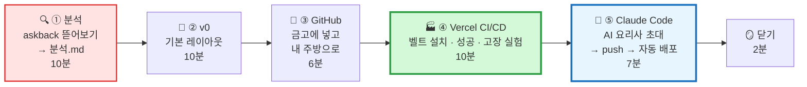

| 단계 | 시간 | 하는 일 | **왜 필요해요?** | 🏭 공장 비유 |
|---|:---:|---|---|---|
| 🔍 ① 분석 | 0~10분 | 레이아웃 · 흐름도 · 유저 시나리오 · 강조점 · 데이터 모양 | AI에게 **정확한 설계도**를 주려고 | 📐 설계도 그리기 |
| 🎨 ② v0 | 10~20분 | 분석.md로 구역별 주문 | **뼈대를 몇 분 만에** | 🏗️ 뼈대 조립 로봇 |
| 🏦 ③ GitHub | 20~26분 | v0 → GitHub → 🏧 Desktop Clone → `npm install` → `npm run dev` | 코드를 **우리 금고 · 우리 주방**으로 | 🗄️ 부품 창고 입고 |
| 🏭 ④ Vercel CI/CD | 26~36분 | Import → 성공 실험(로그 5단계) → **일부러 고장** 실험 → 되돌리기 | **push만 하면 가게가 저절로** | 🏭 자동 출고 벨트 |
| 🤖 ⑤ Claude Code | 36~43분 | 설치 → 실행 → 고쳐 달라고 부탁 → push → 자동 반영 | **내 주방 안에서 AI와 함께** 다듬기 | 🔧 AI 장인 손질 |
| 🪞 닫기 | 43~45분 | 회고 · QR · 증거 | 다음에 더 잘하려고 | 📒 작업 일지 |

> **⏱ 시간이 밀리면** — ① 분석은 **템플릿 칸 1 · 3 · 6만** 채우고 넘어갑니다. ② v0 주문은 **🥇 3번**으로 줄입니다. **④ Vercel 주소와 ⑤ Claude Code 한 번 고치기는 꼭 지킵니다.** 이 두 개가 오늘의 마지막 퍼즐이에요.

## 0-1. 오늘 우리가 도는 컨베이어 벨트

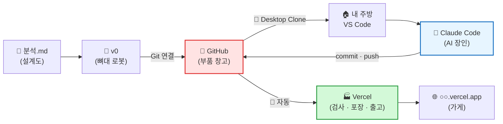

> **🗣️ 선생님 대사**
> "자동차 공장을 떠올려 봐요. **설계도**가 있고, **뼈대를 세우는 로봇**이 있고, 부품을 보관하는 **창고**, 마무리하는 **장인**, 그리고 다 된 차를 **자동으로 내보내는 벨트**가 있어요.
> 오늘 우리가 딱 이 공장을 만들 거예요. 설계도는 **분석.md**, 로봇은 **v0**, 창고는 **GitHub**, 벨트는 **Vercel**, 그리고 장인은… **AI 요리사 Claude Code**예요."

---

## 🧰 수업 전 준비 (선생님용 · 전날까지)

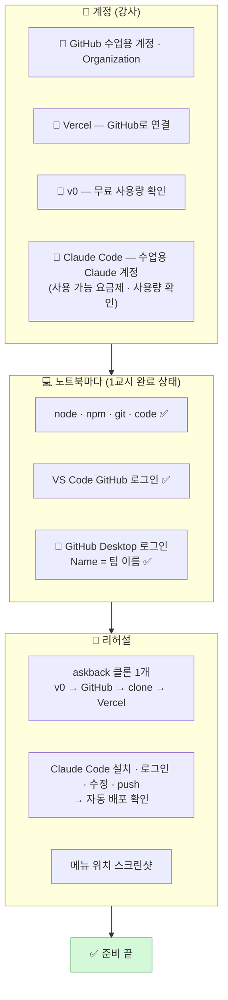

| # | 체크 | 왜 | 담당 |
|:---:|---|---|:---:|
| 1 | ☐ GitHub · Vercel · v0 **수업용 계정** 연결 확인 | 학생 개인 가입 ❌ · 서비스 이용 연령 · 개인정보 | 🧑‍🏫 |
| 2 | ☐ v0 **무료 사용량** → 팀당 주문 **5번 이내** | 주문마다 사용량이 줄어요 | 🧑‍🏫 |
| 3 | ☐ **Claude Code 사용 가능한 수업용 계정** + 사용량 확인 | 로그인은 선생님이 직접 · 팀 수만큼 동시 사용 가능한지 | 🧑‍🏫 |
| 4 | ☐ 노트북마다 **Claude Code 미리 설치** (권장) | 설치 대기 시간을 줄여요 | 🧑‍🏫 |
| 5 | ☐ **전체 리허설 1회** (v0 · Vercel · Claude Code 메뉴는 업데이트로 자주 바뀜) | 실제 화면으로 확인 | 🧑‍🏫 |
| 6 | ☐ **플랜 B 저장소** (완성된 클론, clone만 하면 되는 것) | v0가 늦거나 사용량이 떨어진 팀용 | 🧑‍🏫 |
| 7 | ☐ 분석 시트 · 포스트잇 · 네임펜 | 손으로 먼저 그려요 | 🧑‍🏫 |

---

# 🔍 ① askback 분석 (0~10분) — "설계도부터 그린다"

> **왜 바로 v0에 안 가요?** — 회사에서는 **설계도 없이 공장 로봇을 돌리지 않아요.** 로봇(v0)은 시킨 대로만 만들어요. **무엇이 어디에, 무엇이 가장 중요한지** 정해 주는 건 사람이에요. 📐

## 1-1. 오늘의 클론 대상

| 항목 | 내용 |
|---|---|
| **주소** | https://askback-omega.vercel.app/p/prj_example_turtle-neck |
| **서비스 한 줄** | 학생이 자기 프로젝트를 **AI 코치에게 질문**하면, 코치가 **코드 대신 순서도 · 규칙표 · 비교표**로 답하고 **"하나만 되물을게"** 로 생각을 넓혀 주는 서비스 |
| **이 페이지** | 중학생 '서연'의 **🐢 거북목 감시 웹캠** — 질문 20개가 **5단계**로 쌓인 **예시 페이지** |
| **주소 끝** | **`vercel.app`** → 우리가 배운 **Next.js + Vercel** 조합일 가능성이 커요! |
| **주소 모양** | `/p/prj_example_turtle-neck` → 1교시 **`app/p/[id]/page.tsx`** (폴더 = 주소) 바로 그 모양 |

> **🗣️ 선생님 대사** — "주소를 보세요. `/p/` 다음에 프로젝트 이름이 붙어요. 1교시에 배운 **'방을 만들면 호수가 붙는다'** 그대로죠? 이 서비스도 우리가 쓰는 **완성차(Next.js)** 로 만들어졌을 거예요."

## 1-2. 3분 탐험 미션 (팀원 3명 동시에)

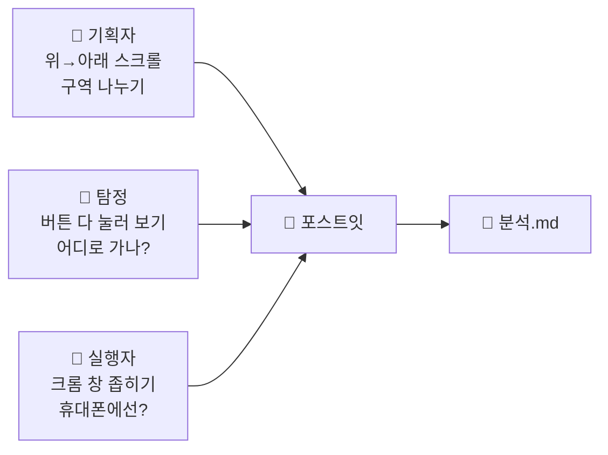

| 역할 | 미션 | 찾을 것 |
|---|---|---|
| 🎩 기획자 | 끝까지 스크롤 | 화면이 **몇 덩어리**? **반복되는 모양**은? |
| 🎩 탐정 | 사이드바 · 단계 카드 · `자세히 ▾` 눌러 보기 | 누르면 **어디로 가나**? 숨어 있다 나오는 것은? |
| 🎩 실행자 | 크롬 창을 좁게 (휴대폰 크기) | **사이드바는 어디로**? 카드는 몇 줄? |

## 1-3. 🏠 레이아웃 평면도 — 6구역

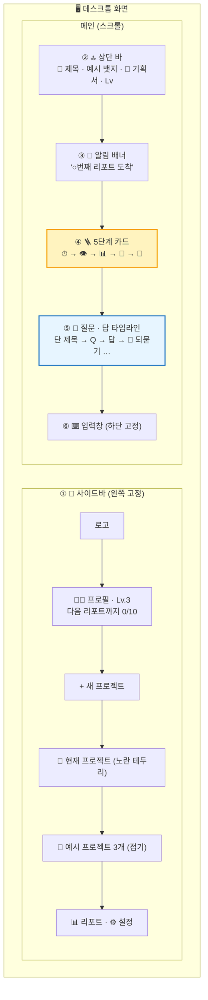

| # | 구역 | 🏠 비유 | 안에 들어 있는 것 | 📱 휴대폰에서 |
|:---:|---|---|---|---|
| ① | 🧭 사이드바 | 🗂️ 서랍장 · 학생증 | 프로필 · 레벨 · 프로젝트 목록 · 메뉴 | ☰ 버튼 → 서랍처럼 |
| ② | 🔝 상단 바 | 🪧 가게 간판 | 이모지 + 제목 · `예시` · 📝 기획서 · Lv | 그대로 (짧게) |
| ③ | 🎉 알림 배너 | 📣 전광판 | 리포트 도착 알림 | 그대로 |
| ④ | 🪜 5단계 카드 | 🚇 지하철 노선도 | 아이콘 · 단 번호 · 이름 · `Q1–2 ›` · 설명 | 가로로 밀어 보기 |
| ⑤ | 💬 타임라인 | 📒 대화 일기장 | 단 제목 · 🙋 질문 · 🤖 답(표 · 순서도) · 🧭 되묻기 | 1열 |
| ⑥ | ⌨️ 입력창 | 🛎️ 주문 벨 | `+` · 입력칸 · 보내기 | 맨 아래 고정 |

## 1-4. 🗺️ 흐름도 — 손님은 어떻게 움직이나

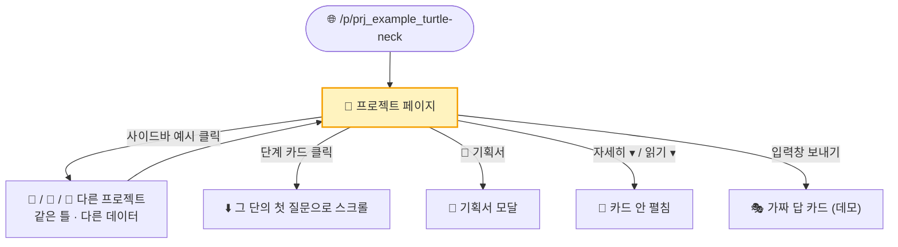

**이 서비스의 심장 — 질문 하나가 쌓이는 흐름**

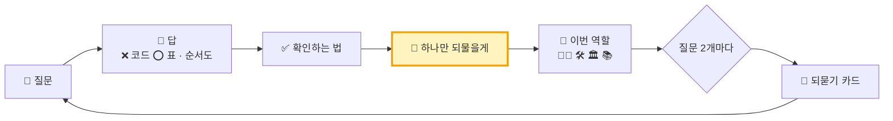

## 1-5. 👤 유저 시나리오 — 처음 온 민호의 1분

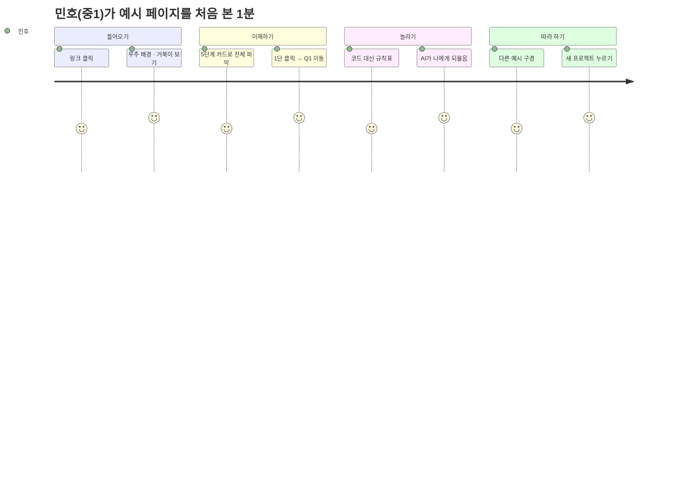

| 장면 | 민호의 마음 | 화면이 해 줘야 할 일 | 관련 구역 |
|:---:|---|---|:---:|
| 1 | 😐 "이게 뭐지?" | **3초 안에** 무슨 서비스인지 | ② |
| 2 | 🙂 "5단계로 커지는구나" | 화살표로 **이어진 계단** | ④ |
| 3 | 😀 "바로 가네" | 부드러운 **스크롤 이동** | ④→⑤ |
| 4 | 🤔 "코드 대신 표?" | 질문(나) vs 답(코치) **구분** | ⑤ |
| 5 | 😮 "AI가 나한테 물어보네" | 되물음을 **가장 눈에 띄게** | ⑤ |

## 1-6. 🔦 강조할 곳 · 🙅 안 만들 것 · 🍱 데이터 모양

**강조 순위**

| 순위 | 강조할 것 | 왜? | 방법 |
|:---:|---|---|---|
| 🥇 | **🙋 하나만 되물을게** | 서비스의 **차별점** | 노란 왼쪽 띠 · 연노랑 배경 · 큰 글씨 |
| 🥇 | **🪜 5단계 카드** | 프로젝트가 **커지는 길** | 큰 카드 5개 · 화살표 · 단마다 다른 색 |
| 🥈 | 답의 **결론 첫 줄** | 긴 답에서 핵심 먼저 | 굵게 |
| 🥈 | 🙋 질문 vs 🤖 답 | 누가 말했는지 | 색 · 위치 다르게 |
| 🥉 | 🎩 역할 · 📝 기획서 · 코치 노트 | 관심 있는 사람만 | 작게 · 접기 |

**안 만들 것 → 대신 흉내**

| 원래 기능 | 오늘 | 대신 |
|---|:---:|---|
| 🤖 진짜 AI 답변 | ❌ | 🍱 **JSON에 미리 쓴 답** |
| 🔐 로그인 | ❌ | 가짜 이름 프로필 |
| 💾 서버 저장 | ❌ | 화면에만 잠깐 |
| 원래 이름 · 로고 · 글 | ❌ **복사 금지** | **우리 서비스 이름 · 우리 예시** |

**반복되는 것 = JSON**

```mermaid
flowchart LR
    R1["🔁 프로젝트 4개"] --> J["🍱 data/projects.json"]
    R2["🔁 단계 5개"] --> J
    R3["🔁 질문 · 답 n쌍"] --> J
    R4["🔁 되묻기 n개"] --> J
    J --> REPO["🚪 lib/repo.ts<br/>통로 하나"]
    REPO --> UI["🪑 화면"]
    style REPO fill:#fff3bf,stroke:#f59f00,stroke-width:2px
```

| 묶음 | 칸 이름 |
|---|---|
| project | `id` · `emoji` · `title` · `student` · `grade` · `isExample` · `summary` · `stages[]` · `qa[]` · `reasks[]` |
| stage | `no` · `icon` · `name` · `range` · `desc` |
| qa | `no` · `stage` · `question` · `chip` · `conclusion` · `table{head,rows}` · `flow[]` · `check` · `reask` · `role` · `planItem` |
| reask | `afterQa` · `question` · `myAnswer` · `feedback` |

## 1-7. 📐 `분석.md` — 5분 안에 채우기

> **어디에?** — VS Code에서 `C:\dev` 를 열고 **`분석.md`** 새 파일 (나중에 저장소에 함께 넣어요)

````markdown
# 클론 분석서 — askback 프로젝트 페이지
- 팀: ____ / 우리 서비스 이름: ____ (원래 이름 ❌) / 예시 프로젝트: ____ (이모지 __)

## 1. 한 줄 요약
____ 가 질문하면 AI 코치가 코드 대신 ____ 로 답하고 ____ 로 되묻는 프로젝트 페이지

## 2. 범위
- 만든다: ①사이드바 ②상단 바 ③알림 배너 ④5단계 카드 ⑤타임라인 ⑥입력창
- 안 만든다: 진짜 AI · 로그인 · 서버 → JSON 가짜 데이터

## 3. 레이아웃
| # | 구역 | 위치 | 내용 |
|---|---|---|---|
| 1 | 사이드바 | 왼쪽 고정 260px | 프로필 · +새 프로젝트 · 프로젝트 4개 |
| 2 | 상단 바 | 메인 위 | 이모지 · 제목 · 예시 뱃지 · 기획서 |
| 3 | 알림 배너 | 상단 바 아래 | ____ |
| 4 | 5단계 카드 | 가로 5칸 + 화살표 | 아이콘 · 단 · 이름 · Q범위 · 설명 |
| 5 | 타임라인 | 가운데 | 단 제목 → 질문 → 답 → 되묻기 |
| 6 | 입력창 | 하단 고정 | + · 입력 · 보내기 |

## 4. 흐름도
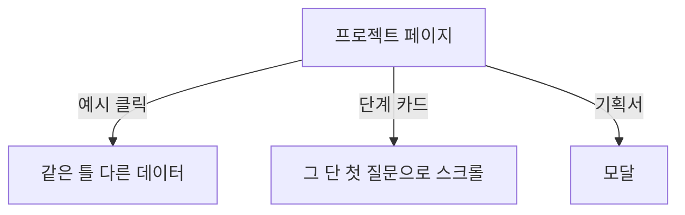

## 5. 유저 시나리오
- 페르소나: ____ / 성공 기준: ____ 초 안에 ____ 를 이해

## 6. 강조
1. 되물음 — 노란 띠 / 2. 5단계 카드 — 화살표 / 3. ____

## 7. 디자인
진한 남색 우주 배경 · 살짝 밝은 남색 카드 · 노랑-주황 강조 · 흰 글씨 · 모서리 16px · 알약 버튼 · 이모지

## 8. 데이터
data/projects.json — project / stage / qa / reask (칸 이름은 위 표 그대로)
````

> **💡 시간이 부족하면** — 종이 분석 시트에 쓰고 **📷 사진**으로 v0에 첨부해도 됩니다.

---

# 🎨 ② v0로 기본 레이아웃 (10~20분) — "뼈대 조립 로봇"

> **왜 v0로 시작해요?** — 회사에서도 **빈 화면에서 한 줄씩 시작하지 않아요.** v0로 **기본 레이아웃을 몇 분 만에** 세우고, 그다음 개발자가 다듬어요. 🏗️ **비유** — 집을 지을 때 **뼈대는 크레인 로봇**이, **마감은 장인**이 해요.

## 2-1. 주문 순서 — 한 번에 한 구역

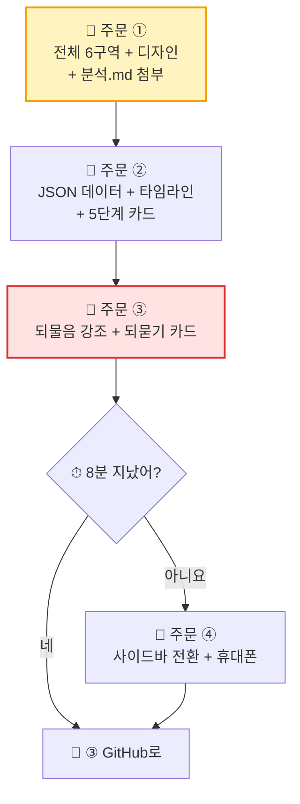

| 주문 | 구역 | 확인할 것 | 우선 |
|:---:|---|---|:---:|
| ① | 전체 ①~⑥ + 디자인 | 6구역이 위치대로 · 남색 우주 · 노랑 강조 | 🥇 |
| ② | ④ + ⑤ + JSON | 데이터가 **JSON 파일**에서 · 단 카드 클릭 → 스크롤 | 🥇 |
| ③ | ⑤ 되물음 | 🙋 되물음이 **가장 눈에 띄나** | 🥇 |
| ④ | ① + 반응형 | 예시 클릭 → 데이터 바뀜 · 휴대폰 ☰ | 🥈 |

## 2-2. 📝 주문 ① — 전체 틀

```text
첨부한 분석.md는 우리가 분석한 "AI 질문 코치" 서비스의 프로젝트 페이지 설계도야.
[3. 레이아웃]과 [7. 디자인]을 따라 Next.js App Router + Tailwind로 프론트 화면만 만들어 줘.

[서비스 이름] ________ (원래 서비스 이름 · 로고는 쓰지 마)
[구역 6개]
① 왼쪽 고정 사이드바(260px): 로고, 프로필 카드(레벨 · 다음 리포트까지 진행도),
   "+ 새 프로젝트", 현재 프로젝트 카드(노란 테두리), 예시 프로젝트 3개(접기), 리포트 · 설정
② 상단 바: 이모지 + 제목, "예시" 알약 뱃지, 📝 기획서 버튼, 레벨 뱃지
③ 알림 배너: "🎉 2번째 리포트 도착 — 보고 싶을 때 열어봐"
④ 5단계 카드 자리 ⑤ 타임라인 자리 (다음 주문에서 채울게)
⑥ 화면 맨 아래 고정 입력창: + 버튼, "무엇이든 물어봐", 보내기
[디자인] 진한 남색 우주 배경 + 작은 별 점, 살짝 밝은 남색 카드 + 얇은 반투명 테두리,
노랑-주황 강조, 흰 글씨 / 연회색 보조 글, 모서리 16px, 알약 버튼, 아이콘은 이모지.
[규칙] 서버 · 로그인 · 진짜 AI 만들지 마. 화면만. 모든 글자 한국어.
화면 맨 아래에 작은 회색 글씨로 "교육용 클론 데모 · 예시 데이터" 를 넣어 줘.
```

## 2-3. 📝 주문 ② — JSON + 5단계 카드 + 타임라인

```text
위 구역은 바꾸지 말고 ④ 5단계 카드와 ⑤ 타임라인을 만들어 줘.

[데이터] data/projects.json 에 프로젝트 4개. 칸 이름은 분석.md [8. 데이터]와 똑같이.
첫 프로젝트(________)는 stages 5개와 qa 6개, 나머지는 qa 2개씩.
내용은 초 · 중학생 눈높이로 새로 지어 줘 (원래 서비스 글을 베끼지 마).
데이터는 lib/repo.ts 한 곳에서만 불러오게. 주소는 /p/[id], 첫 화면(/)은 첫 프로젝트로 이동.

[④ 5단계 카드] 가로 5칸, 사이에 → 화살표, 단마다 다른 파스텔 아이콘 원,
"n단" · 단 이름(굵게) · "Q1–2 ›" · 한 줄 설명. 누르면 id="stage-n" 으로 부드럽게 스크롤.

[⑤ 타임라인] 단이 바뀔 때 단 제목 줄(id="stage-n", "여기서부터 · n/5단").
🙋 질문 카드: "Q1" · "🙋 내 질문" · chip이 있으면 "🌅 넓히기"/"🔍 좁히기" 칩 · 질문 글.
🤖 답 카드: "코치" 라벨, conclusion 굵게, table은 표(넘치면 표 안에서만 가로 스크롤),
flow는 위→아래 화살표 상자, "확인하는 법 — " + check,
"이번 답에서 나는 [역할] 로 일했어"(coder=👨‍💻 코더, engineer=🛠 엔지니어, architect=🏛 아키텍트, encyclopedia=📚 백과사전),
"📝 기획서.md에 담았어 · " + planItem 회색 박스. 오른쪽 위 ▴ 로 접기.
```

## 2-4. 📝 주문 ③ — 되물음 강조 (서비스의 심장)

```text
다른 부분은 바꾸지 말고:
- 답 카드 맨 아래 "🙋 하나만 되물을게 — " + reask 를 굵은 노란 왼쪽 띠, 연노랑 배경,
  조금 큰 글씨로 답 카드 안에서 가장 눈에 띄게 해 줘.
- project.reasks[] 의 afterQa 번호 뒤에 "🧭 되묻기 카드": 칩 3개("🧭 되묻기" "🔀 알고리즘" "🗺 흐름 · 고르기"),
  🟢 초록 점, 질문 → "🙋 내 답 · ..." → 코치 피드백.
```

## 2-5. 📝 주문 ④ (🥈) — 사이드바 전환 + 휴대폰

```text
- 사이드바 예시 프로젝트를 누르면 /p/[id] 로 이동, 지금 프로젝트는 노란 테두리.
- 768px보다 좁으면 사이드바 숨기고 상단 바 왼쪽 ☰ 버튼으로 서랍처럼 열기.
  5단계 카드는 가로 스크롤, 입력창은 맨 아래 고정.
```

## 2-6. ✅ v0 결과 확인 · 🆘

| # | 확인 | O / X |
|:---:|---|:---:|
| 1 | 6구역이 **분석.md 위치대로** | |
| 2 | v0 코드 탭에 **`data/projects.json`** · **`lib/repo.ts`** 가 있다 | |
| 3 | 단계 카드 클릭 → **스크롤 이동** | |
| 4 | 🙋 되물음이 **가장 먼저 눈에 띈다** | |
| 5 | 원래 서비스 **이름 · 로고 · 글 없음** | |

| 증상 | 해결 |
|---|---|
| 다른 구역까지 바뀜 | ⏪ 되돌리기 → 끝에 **"다른 구역은 절대 바꾸지 마"** |
| 데이터가 코드에 박혀 있음 | `qa 데이터를 data/projects.json 으로 옮기고 lib/repo.ts 에서만 불러오게 해 줘.` |
| 빨간 에러 | **Fix** 버튼 → 없으면 에러 글 붙여 `이 에러를 고쳐 줘. 다른 부분은 바꾸지 마.` |
| 사용량 끝 | 🙋 **플랜 B 저장소**로 ③부터 |

---

# 🏦 ③ GitHub — 금고에 넣고 내 주방으로 (20~26분) — "부품 창고 입고"

> **왜 v0에 두지 않고 GitHub로?** — 공장에서 만든 뼈대를 **로봇 옆 바닥에 두면** 잃어버려요. **창고(GitHub)** 에 넣어야 **장인(Claude Code)** 도 꺼내 쓰고, **출고 벨트(Vercel)** 도 연결돼요.

## 3-1. 흐름 — 🏧 GitHub Desktop(ATM)으로

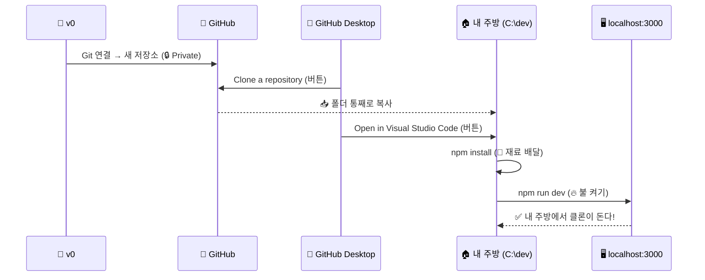

> **🏧 비유** — 은행 창구에서 "`git clone` 해 주세요"라고 **말로** 하는 대신, **ATM(GitHub Desktop)에서 버튼**을 눌러 금고를 꺼내 와요. 하는 일은 똑같아요.

## 3-2. v0 → GitHub (2분)

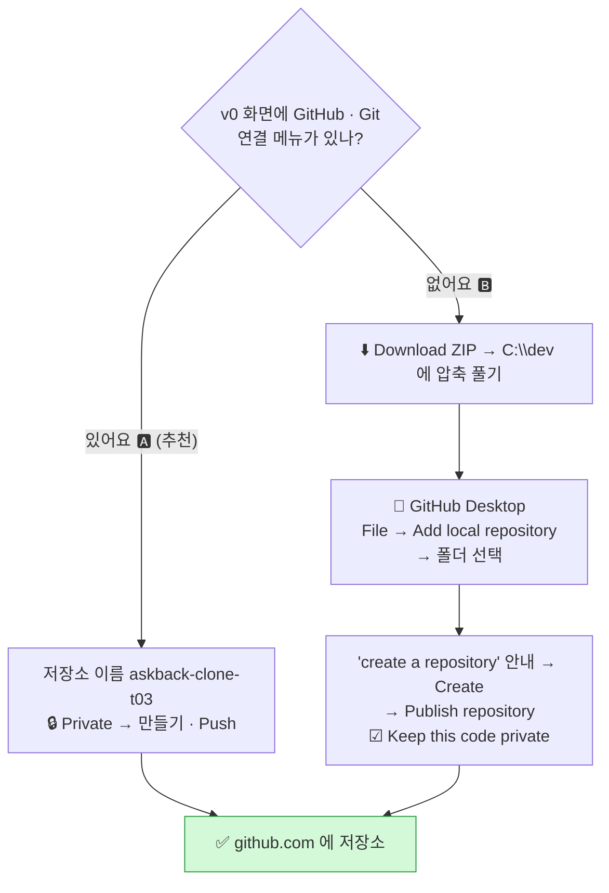

| | 🅰️ v0 Git 연결 | 🅱️ ZIP + GitHub Desktop Publish |
|---|---|---|
| 다음 | 3-3 **Clone** | Clone 건너뛰고 3-3의 **4번(VS Code 열기)부터** |
| 주의 | 메뉴 이름 · 위치는 바뀔 수 있어요 (리허설 스크린샷) | 압축을 **꼭 풀고** · Publish 때 **☑ Keep this code private** |

**저장소 이름** — 영어 소문자 + `-` · 실명 ❌ · 예: `askback-clone-t03`

## 3-3. 🏧 GitHub Desktop으로 내 주방에 가져오기 (4분)

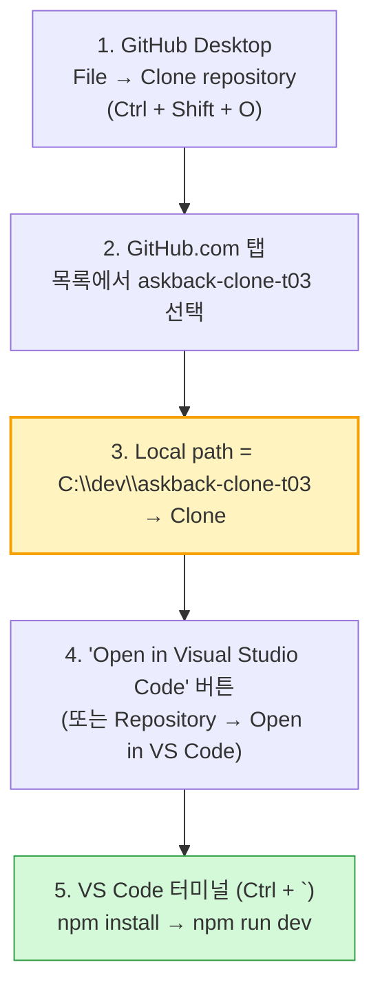

| 순서 | GitHub Desktop 버튼 | 🏧 비유 | 성공 신호 |
|:---:|---|---|---|
| 1 | `File → Clone repository` | 💳 ATM에 카드 넣기 | 저장소 목록 창 |
| 2 | **GitHub.com** 탭에서 우리 저장소 선택 | 🗄️ 금고 칸 고르기 | 파란 선택 |
| 3 | **Local path** 를 `C:\dev\…` 로 → **Clone** | 📥 꺼내 오기 | 진행 막대 → "No local changes" |
| 4 | **Open in Visual Studio Code** | 🔪 조리대에 올리기 | VS Code 창 |

> **⚠️ Local path 확인** — 기본값이 `C:\Users\(이름)\Documents\GitHub\…` 일 수 있어요. 한글 이름 · OneDrive 문제를 피하려고 **`C:\dev`** 로 바꿔요.

**VS Code 터미널(`Ctrl + `` `)에서 — 여기만 명령어예요 (npm은 Desktop이 대신 못 해요)**

```bash
npm install
```

```bash
npm run dev
```

| 단계 | 🍳 비유 | 성공 신호 |
|---|---|---|
| 🏧 Clone (Desktop) | 📥 창고에서 통째로 꺼내 오기 | "No local changes" 화면 |
| `npm install` | 🛵 재료 배달 (1~3분) | `added ○○○ packages` |
| `npm run dev` | 🔥 불 켜기 | `Ready` · `http://localhost:3000` |

> **💡 `npm install` 이 `ERESOLVE` 로 실패하면** — `npm install --legacy-peer-deps` · v0 프로젝트가 `pnpm-lock.yaml` 을 쓰는 경우 흔해요.

| 확인 | O / X |
|---|:---:|
| `localhost:3000` 에 **v0에서 본 화면** | |
| `localhost:3000/p/첫번째id` 도 열림 | |
| GitHub Desktop 왼쪽 위 Current repository = **askback-clone-t03** | |

---

# 🏭 ④ Vercel CI/CD — 컨베이어 벨트를 깔고, 직접 돌려 보고, 일부러 고장 내 본다 (26~36분)

> **왜 Vercel?** — 1교시에 배웠죠. **Next.js를 만든 회사의 전용 정비소**라서, 저장소만 연결하면 **설정 없이** 알아서 검사 · 포장 · 출고해요.
> **이 파트의 목표** — "CI/CD = 자동 배포"라는 **말**이 아니라, push 한 번에 **어떤 일이 어떤 순서로 일어나는지** 눈으로 따라가요. 그리고 **일부러 고장 내서** CI/CD가 가게를 **어떻게 지켜 주는지** 확인해요.

| 실험 | 시간 | 무엇을 보나 | 우선 |
|---|:---:|---|:---:|
| 🔗 4-2 벨트 설치 | 26~29분 | GitHub 저장소 Import → 첫 배포 | 🥇 |
| ✅ 4-4 실험 1 — 성공하는 벨트 | 29~32분 | push → 로그 5단계 → 주소가 바뀜 | 🥇 |
| 💥 4-5 실험 2 — 일부러 고장 | 32~35분 | 빌드 실패 → **가게는 멀쩡** → 고쳐서 다시 | 🥇 |
| ⏪ 4-6 실험 3 — 되돌리기 | 35~36분 | 예전 배포로 즉시 되돌리기 | 🥈 (선생님 시연) |
| 🌿 4-7 시승장 (Preview) | 과제 · 시연 | branch → 미리보기 주소 → 합치기 | 🥉 |

## 4-1. CI/CD 한 장 그림 — 벨트 위 5개 작업대

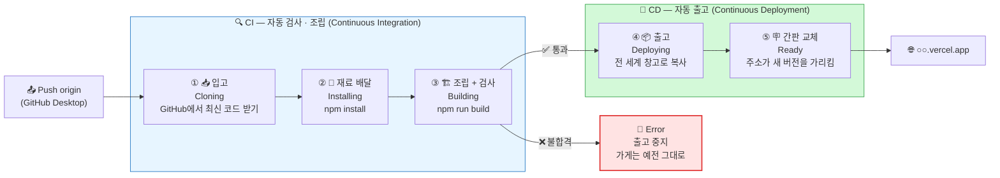

| 작업대 | Vercel 로그에 보이는 말 (예) | 🏭 공장 비유 | 실제로 하는 일 | 걸리는 시간 |
|:---:|---|---|---|:---:|
| ① 입고 | `Cloning github.com/…/askback-clone-t03 (Branch: main, Commit: a1b2c3d)` | 📥 창고에서 새 설계도 꺼내기 | 방금 push한 **그 commit**을 받아 옴 | 2~5초 |
| ② 재료 | `Running "npm install"` · `added 300 packages` | 🛵 부품 배달 | `package.json` 대로 부품 설치 | 10~40초 |
| ③ 조립 · 검사 | `Running "npm run build"` · `✓ Compiled successfully` · `✓ Generating static pages` | 🏗️ 조립 + 🔍 품질 검사 | TypeScript 검사 · 페이지 미리 그리기 · **에러가 있으면 여기서 멈춤** | 20~60초 |
| ④ 출고 | `Deploying outputs…` | 🚚 트럭에 싣기 | 완성된 파일을 전 세계 서버(CDN)로 | 5~10초 |
| ⑤ 간판 | `Deployment completed` · 상태 **Ready** | 🪧 가게 간판을 새 차로 바꿔 달기 | 주소(`○○.vercel.app`)가 **새 버전**을 가리킴 | 즉시 |

> **🏭 핵심 문장** — **간판(⑤)은 검사(③)를 통과한 차에만 바뀌어요.** 그래서 고장 난 코드를 push해도 **손님이 보는 가게는 고장 나지 않아요.** 이것이 회사들이 CI/CD를 쓰는 진짜 이유예요.

> **❓ 손으로 하면 어땠을까?** — 매번 ① 코드 받고 ② 설치하고 ③ 빌드하고 ④ 서버에 올리고 ⑤ 주소를 바꾸는 걸 **사람이 직접** 해야 해요. 하나라도 빠뜨리면 가게가 고장 나요. 벨트는 **매번 똑같이, 빠짐없이** 해 줘요.

## 4-2. 🔗 벨트 설치 — GitHub 저장소 Import (3분)

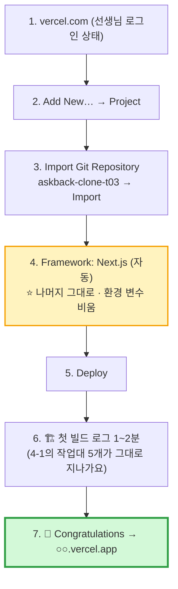

| 화면 | 확인 | 건드리지 않기 | 왜 |
|---|---|---|---|
| Import | **우리 팀 저장소**인가 | 다른 팀 것 ❌ | 남의 공장에 벨트를 깔면 안 돼요 |
| Configure → Framework Preset | **Next.js** 자동 선택 | — | 같은 회사라 알아봐요 |
| Build and Output Settings | 보기만 (Build Command = `npm run build`) | 바꾸지 않기 | ③ 작업대의 명령이 바로 이것 |
| Environment Variables | **비워 둠** | 🔑 키 넣지 않기 | 오늘은 비밀 키가 필요 없어요 |

**🔧 벨트 설정 확인 (30초)** — 프로젝트 → **Settings → Git**

| 설정 | 값 | 🏭 뜻 |
|---|---|---|
| Connected Git Repository | `수업계정/askback-clone-t03` | 이 창고와 벨트가 연결됨 |
| **Production Branch** | **`main`** | `main`에 들어온 것만 **진짜 가게**로 출고 |

> **❓ 3일차에 v0 Publish로 만든 Vercel 프로젝트가 있다면?** — 헷갈리지 않게 **오늘 Import한 새 프로젝트**만 씁니다.

## 4-3. 👀 벨트를 지켜보는 3개의 창

> push 한 번이 **세 곳**에 흔적을 남겨요. 실행자 · 기획자 · 탐정이 **한 창씩 맡아** 동시에 지켜봐요.

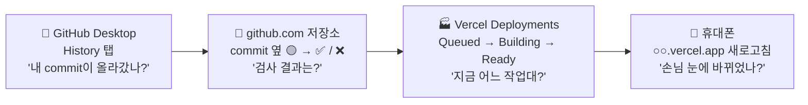

| 창 | 담당 | 보는 것 | 비유 |
|---|---|---|---|
| 🏧 GitHub Desktop **History** | 🎩 실행자 | 맨 위에 방금 commit 메시지 · ⬆ 표시 사라짐 | 📒 입금 영수증 |
| 🏦 **github.com** 저장소 첫 화면 | 🎩 기획자 | commit 옆 **🟡 노란 점(검사 중) → ✅ 초록 체크 / ❌ 빨간 X** (Vercel이 붙여 줘요) | 🏷️ 품질 검사 도장 |
| 🏭 **Vercel → Deployments** | 🎩 탐정 | 새 줄의 상태 변화 · 클릭하면 **Build Logs** | 📺 공장 CCTV |
| 📱 **휴대폰** | 모두 | 주소 새로고침 → 바뀐 내용 | 🏪 손님 시점 |

**Deployments 상태 읽는 법**

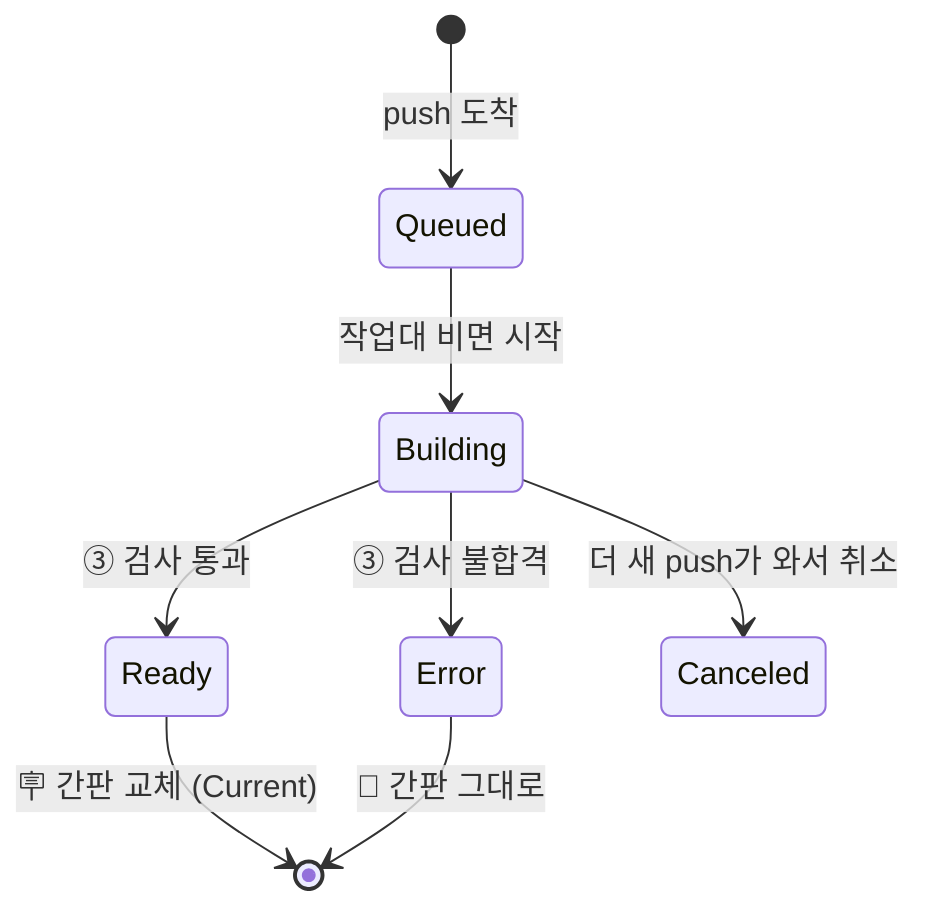

| 상태 | 색 | 🏭 비유 | 가게는? |
|---|---|---|---|
| **Queued** | ⚪ | 벨트 앞 대기 줄 | 예전 그대로 |
| **Building** | 🟡 | 조립 · 검사 중 | 예전 그대로 |
| **Ready** | 🟢 | 출고 완료 · 간판 교체 | ✨ **새 버전** |
| **Error** | 🔴 | 검사 불합격 · 출고 중지 | 🛡️ **예전 그대로 (안전)** |
| **Canceled** | ⚫ | 더 새 주문이 와서 이 차는 폐기 | 예전 그대로 |

> **💡 Current 표시** — Deployments 목록에서 **Current**(또는 Production 표시)가 붙은 줄이 **지금 손님이 보는 버전**이에요. 🪧 간판이 걸린 차!

## 4-4. ✅ 실험 1 — 성공하는 벨트 (3분)

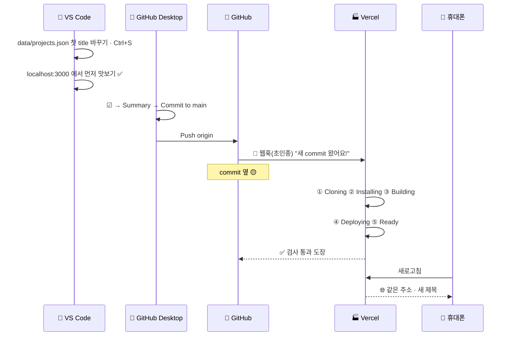

**🏧 GitHub Desktop으로 commit · push (명령어 없이)**

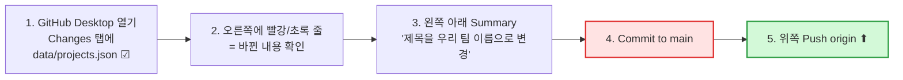

| 버튼 | 🏧 ATM 비유 | Git 명령어로는 |
|---|---|---|
| ☑ 파일 체크 | 입금할 돈 고르기 | `git add` |
| Summary + **Commit to main** | 거래 메모 쓰고 확인 | `git commit -m "…"` |
| **Push origin** | 금고로 보내기 | `git push` |
| **Fetch / Pull origin** | 새 거래 내역 받기 | `git pull` |
| **History** 탭 | 지난 거래 내역 | `git log` |

> **💡 빨강/초록 줄 읽기** — 🟥 빨강 = **지운 줄**, 🟩 초록 = **새로 쓴 줄**. 커밋 전에 **팀이 함께 읽고** 이상하면 파일을 오른쪽 클릭 → **Discard changes**(되돌리기).

**⏱ 스톱워치 기록표** — Push origin을 누른 순간부터 재요

| 시각 | 무엇이 보였나 | 어느 창 | 작업대 |
|---|---|---|:---:|
| 0초 | Push origin 완료 | 🏧 Desktop | — |
| ___초 | Deployments에 새 줄 **Queued/Building** | 🏭 Vercel | ① |
| ___초 | 로그에 `npm install` | 🏭 Vercel | ② |
| ___초 | 로그에 `npm run build` · `Compiled successfully` | 🏭 Vercel | ③ |
| ___초 | 상태 **Ready** · commit 옆 ✅ | 🏭 · 🏦 | ④⑤ |
| ___초 | 📱 휴대폰에 새 제목 | 📱 | 🌐 |

**🔗 commit과 배포 짝 맞추기** — Vercel Deployments의 새 줄에 적힌 **commit 메시지 · 7자리 번호(예: `a1b2c3d`)** 가 GitHub Desktop **History**의 내 commit과 **같은지** 확인해요.
> 🏷️ **비유** — 자동차마다 붙은 **차대 번호**. "가게에 걸린 이 차는 **어느 설계도**로 만들었나?"를 언제든 추적할 수 있어요.

> **🗣️ 선생님 대사** — "방금 여러분은 Vercel에서 **아무 버튼도 안 눌렀어요.** 금고에 넣었을 뿐인데 **다섯 개 작업대**를 차례로 지나서 가게 간판이 바뀌었죠? 회사에서는 이걸 **하루에 수십 번** 해요."

## 4-5. 💥 실험 2 — 일부러 고장 내기 (3분) · ⭐ 오늘의 핵심

> **왜 일부러 고장 내요?** — CI/CD의 진짜 가치는 **성공할 때가 아니라 실패할 때** 보여요. 불량품이 나왔을 때 **벨트가 멈추고 가게를 지키는지** 직접 확인해요. 🚒 **비유** — 소방 훈련처럼, 진짜 불이 나기 전에 **일부러 경보를 울려 봐요.**

```mermaid
flowchart TD
    B1["1. projects.json 에서<br/>title 줄 끝 쉼표 , 하나 지우기<br/>(일부러!)"] --> B2["2. Commit to main<br/>'실험: 일부러 고장'<br/>→ Push origin"]
    B2 --> B3["3. 🏭 Vercel: Building…<br/>③ 작업대에서 🔴 Error"]
    B3 --> B4["4. 📱 휴대폰 새로고침<br/>→ 가게는 실험 1 그대로! 🛡️"]
    B4 --> B5["5. 🏦 github.com<br/>commit 옆 ❌ 빨간 X"]
    B5 --> B6["6. 로그에서 빨간 줄 찾기<br/>→ 쉼표 되살리기 → Commit → Push"]
    B6 --> B7["7. 🟢 Ready — 다시 정상"]
    style B3 fill:#ffe3e3,stroke:#e03131,stroke-width:2px
    style B4 fill:#d3f9d8,stroke:#2f9e44,stroke-width:3px
    style B7 fill:#d3f9d8,stroke:#2f9e44
```

| 단계 | 확인 | O / X |
|:---:|---|:---:|
| 3 | Vercel 상태 **Error** (🔴) | |
| 4 | 📱 휴대폰의 가게는 **실험 1의 제목 그대로** | |
| 5 | github.com commit 옆 **❌** | |
| 6 | Build Logs에서 **에러 줄**을 찾았다 (예: `Unexpected token` · `JSON` · 파일 이름 · 줄 번호) | |
| 7 | 고친 뒤 다시 **Ready** · ✅ | |

**🔍 빌드 로그에서 범인 찾기 — 3단계**

```mermaid
flowchart LR
    L1["📜 Build Logs 열기"] --> L2["🔴 빨간 글씨 · 'Error' ·<br/>'Failed' 가 있는 줄 찾기"]
    L2 --> L3["📍 파일 이름 + 줄 번호 보기<br/>예: data/projects.json:5"]
    L3 --> L4["🔪 VS Code에서 그 줄로<br/>Ctrl + G → 5"]
```

| 로그에서 보이는 말 (예) | 뜻 | 🏭 비유 |
|---|---|---|
| `Unexpected token` · `in JSON at position` | JSON 모양이 깨짐 (쉼표 · 따옴표) | 🍱 진열장 칸막이가 빠짐 |
| `Type error:` | 타입 검사 불합격 | 📏 부품 규격이 안 맞음 |
| `Module not found: Can't resolve` | 없는 부품을 찾음 | 📦 배달 안 온 부품 |
| `Build failed because of webpack errors` / `Command "npm run build" exited with 1` | ③ 작업대 불합격 (요약 줄) | 🛑 최종 판정 — **위쪽에서 진짜 원인을 찾아요** |

> **💡 개발자 습관 — 벨트에 올리기 전에 내 주방에서 먼저 검사** — VS Code 터미널에서 아래를 돌리면 ③ 작업대와 **똑같은 검사**를 내 컴퓨터에서 미리 해요. 🧪 **비유** — 출고 전에 **우리 공장 안에서 먼저 시운전**.

```bash
npm run build
```

> **🗣️ 선생님 대사** — "봤죠? 고장 난 코드를 금고에 넣었는데도 **손님 가게는 멀쩡했어요.** 벨트가 '이건 불량이야!' 하고 **출고를 멈췄기** 때문이에요. 그리고 github.com에 ❌ 표시가 붙어서 **누구 commit이 문제인지** 바로 알 수 있었죠. 이게 CI/CD예요."

## 4-6. ⏪ 실험 3 — 즉시 되돌리기 (1분 · 선생님 시연)

> **언제 써요?** — 검사는 통과했는데 **손님이 보기엔 이상한** 버전이 나갔을 때 (예: 글자를 잘못 바꿈). 고쳐서 다시 push하는 동안 **예전 간판을 다시 걸어** 둬요.

```mermaid
flowchart LR
    D["🏭 Deployments 목록"] --> O["예전 Ready 줄의 ⋯ 메뉴"]
    O --> R["⏪ Instant Rollback<br/>(또는 Promote to Production)"]
    R --> U["🪧 간판이 예전 차로<br/>몇 초 만에"]
    style U fill:#d3f9d8,stroke:#2f9e44
```

| | 🔁 고쳐서 다시 push | ⏪ Instant Rollback |
|---|---|---|
| 🏭 비유 | 새 차를 다시 만들어 출고 | **창고에 있던 예전 차**로 간판만 바꿔 달기 |
| 걸리는 시간 | 1~2분 (작업대 5개를 다시) | **몇 초** (이미 만들어진 차) |
| 언제 | 평소 | **급할 때** |
| 주의 | — | 되돌린 뒤에도 **코드는 고쳐서 다시 push** 해야 해요 |

> **💡 왜 이게 가능해요?** — Vercel은 **예전 배포를 버리지 않고** 모두 보관해요. 🗄️ 출고된 차를 **전부 주차장에 세워 두는** 공장이라, 어느 차든 바로 다시 간판에 걸 수 있어요. (메뉴 이름은 업데이트로 바뀔 수 있어요)

## 4-7. 🌿 시승장 — Preview 배포 (과제 · 선생님 시연)

> **왜?** — 회사에서는 **`main`(진짜 가게)에 바로 push하지 않아요.** 새 가지(branch)에 먼저 올려 **미리보기 주소**에서 팀이 확인하고, 괜찮으면 합쳐요. 🚗 **비유** — 신차를 바로 매장에 내놓지 않고 **시승장**에서 먼저 타 보기.

```mermaid
flowchart LR
    M["🌳 main"] -->|"Push"| P["🌐 Production<br/>○○.vercel.app<br/>진짜 가게"]
    M --> B["🌿 new-color<br/>(새 가지)"]
    B -->|"Publish branch"| PV["👀 Preview<br/>○○-git-new-color-….vercel.app<br/>시승장 주소"]
    PV -->|"팀이 확인 OK"| PR["📝 Pull Request<br/>'합쳐도 될까요?'"]
    PR -->|"Merge"| M
    style P fill:#d3f9d8,stroke:#2f9e44
    style PV fill:#fff3bf,stroke:#f59f00,stroke-width:2px
```

| 순서 | 🏧 GitHub Desktop / 웹 | 🏭 비유 |
|:---:|---|---|
| 1 | **Current branch → New branch** → `new-color` | 🌿 시승용 라인 따로 만들기 |
| 2 | VS Code에서 색 하나 바꾸기 → **Commit to new-color** | 시승차 조립 |
| 3 | **Publish branch** | 시승장으로 보내기 |
| 4 | 🏭 Vercel Deployments에 **Preview** 줄 → 미리보기 주소 클릭 | 🚗 시승 |
| 5 | Desktop **Create Pull Request** → github.com에서 PR 열기 (Vercel 봇이 미리보기 링크 댓글을 달아 줘요) | 📝 "매장에 내도 될까요?" 결재 |
| 6 | 확인 후 **Merge pull request** | ✅ 결재 완료 |
| 7 | `main`에 합쳐짐 → **Production 자동 배포** | 🪧 매장 간판 교체 |
| 8 | Desktop에서 **Current branch = main** → **Pull origin** | 내 주방도 최신으로 |

| | 🌐 Production | 👀 Preview |
|---|---|---|
| 어느 가지 | `main` | 그 밖의 모든 가지 |
| 주소 | `○○.vercel.app` (고정) | 가지 · commit마다 **새 주소** |
| 누가 봐요 | 손님 모두 | 주로 팀 (주소를 아는 사람) |
| 비유 | 🏪 매장 | 🚗 시승장 |

## 4-8. 🏢 회사의 벨트는 작업대가 더 많아요

```mermaid
flowchart LR
    P["📤 push"] --> L["🧹 Lint<br/>코드 맞춤법 검사"]
    L --> T["🧪 Test<br/>자동 시험 문제"]
    T --> B["🏗️ Build<br/>조립 검사"]
    B --> PV["👀 Preview<br/>시승장"]
    PV --> RV["🧑‍🤝‍🧑 Review<br/>동료 결재 (PR)"]
    RV --> PD["🌐 Production"]
    PD --> MO["📈 Monitor<br/>손님 반응 · 오류 감시"]
    style B fill:#fff3bf,stroke:#f59f00,stroke-width:2px
```

| 작업대 | 하는 일 | 🏭 비유 | 오늘 우리 벨트 |
|---|---|---|:---:|
| 🧹 Lint | 코드 모양 · 실수 검사 (`next lint` · ESLint) | 맞춤법 선생님 | (일부 빌드에 포함) |
| 🧪 Test | 미리 써 둔 시험 문제 자동 채점 | 시험 감독관 | ❌ |
| 🏗️ **Build** | 조립 + 타입 검사 | 조립 라인 검사원 | ✅ |
| 👀 **Preview** | 가지마다 미리보기 주소 | 시승장 | ✅ (4-7) |
| 🧑‍🤝‍🧑 Review | 동료가 PR 읽고 승인 | 결재 도장 | ✅ (4-7) |
| 🌐 **Production** | 진짜 가게 | 매장 | ✅ |
| 📈 Monitor | 오류 · 속도 감시 | 매장 CCTV | ❌ |

> **💡 다음에 할 수 있는 것** — Claude Code에게 `projects.json 모양이 깨지지 않았는지 검사하는 테스트를 만들어 줘` 라고 부탁하면 **🧪 Test 작업대**를 하나 더 깔 수 있어요. (⑤에서 이어서!)

## 4-9. 🆘 Vercel 막혔을 때

| 증상 | 🏭 비유 | 해결 |
|---|---|---|
| Import 목록에 저장소 없음 | 🔑 창고 열쇠를 안 줌 | **Adjust GitHub App Permissions** → 저장소 허용 (🙋 선생님) |
| push했는데 Deployments에 새 줄이 없음 | 🔔 초인종이 안 울림 | GitHub Desktop에서 **Push origin**까지 했는지 (⬆ 숫자 0인지) · Settings → Git 연결 확인 |
| 계속 **Queued** | 벨트 앞 줄이 김 | 다른 배포가 끝나길 기다리기 (무료 요금제는 한 번에 하나씩) |
| **Error** · `Type error` | 📏 부품 규격 불합격 | 로그의 빨간 줄 복사 → ⑤ **Claude Code**에게 맡기기 (딱 좋은 연습!) |
| **Error** · `JSON` · `Unexpected token` | 🍱 칸막이 빠짐 | 따옴표 · 쉼표 확인 → 내 주방에서 `npm run build` |
| Ready인데 휴대폰은 그대로 | 🧠 브라우저가 예전 화면을 기억 | 새로고침 · 시크릿 창으로 열기 · **Current** 줄이 새 commit인지 확인 |
| 내 컴퓨터 `localhost`는 되는데 Vercel만 Error | 🏠 집에선 검사가 느슨 | 내 주방에서 **`npm run build`** → 같은 에러 재현 |

---

# 🤖 ⑤ Claude Code — 내 주방에 AI 요리사 초대 (36~43분)

> **왜 마지막이 Claude Code?** — v0는 **밖의 디자인 스튜디오**였어요. Claude Code는 **내 주방(터미널) 안으로 들어와서** 내 폴더의 코드를 **읽고, 고치고, 명령도 실행**하는 AI예요. 1교시에 주방을 차린 이유가 바로 여기서 완성돼요. 🏠🤖

## 5-1. v0 vs Claude Code — 두 AI의 자리

```mermaid
flowchart TB
    subgraph OUT["🏢 밖 — 디자인 스튜디오"]
        V0["🎨 v0<br/>빈 땅에 뼈대를 빠르게<br/>(처음 레이아웃)"]
    end
    subgraph IN["🏠 내 주방 안 — 터미널"]
        CC["🤖 Claude Code<br/>이미 있는 코드를 읽고<br/>고치고 · 명령 실행<br/>(다듬기 · 버그 고치기)"]
        FILES["📂 내 폴더 전체<br/>app · components · data"]
        CC <--> FILES
    end
    V0 -->|"GitHub"| IN
    IN -->|"push"| VC["🏭 Vercel"]
    style CC fill:#e7f5ff,stroke:#1971c2,stroke-width:3px
```

| | 🎨 v0 | 🤖 Claude Code |
|---|---|---|
| 🍳 비유 | 인테리어 디자인 스튜디오 | **내 주방에 출근한 AI 요리사** |
| 일하는 곳 | 웹사이트 (밖) | **내 컴퓨터 터미널** (안) |
| 보는 것 | 대화 + 첨부 | **내 프로젝트 폴더 전체** |
| 잘하는 것 | 처음 뼈대 · 디자인 | 고치기 · 에러 해결 · 설명 · 명령 실행 |
| 결과 | v0 안 → GitHub로 보냄 | **내 파일이 바로 바뀜** → 내가 확인 → push |
| 회사에서는 | 기획 · 시안 단계 | **개발자가 매일 쓰는 짝꿍** |

## 5-2. 설치 (2분) — 🛵 npm으로 요리사 모셔 오기

> 1교시에 깐 **npm**이 여기서 또 쓰여요! (선생님이 **미리 설치**해 뒀다면 5-3으로)

```bash
npm install -g @anthropic-ai/claude-code
```

```bash
claude --version
```

| 부분 | 뜻 | 🍳 비유 |
|---|---|---|
| `npm install` | 배달 앱으로 주문 | 🛵 |
| `-g` | **전역(global)** — 어느 폴더에서나 쓰게 | 🏠 집 전체에 상주하는 요리사 |
| `@anthropic-ai/claude-code` | Claude Code 패키지 이름 | 요리사 이름표 |
| `claude --version` | 설치 확인 | 🔍 출근 도장 |

> **💡** Windows는 1교시에 깐 **Git for Windows**가 있어야 Claude Code가 잘 돌아가요. 이미 ✅! 설치 방법은 업데이트로 바뀔 수 있으니 **선생님 리허설 방식**을 따르세요.

## 5-3. 첫 출근 — 프로젝트 폴더에서 실행 (2분)

> ⚠️ `npm run dev` 가 돌고 있는 터미널은 그대로 두고, 터미널 **`+`** 로 **새 터미널**을 열어요.

```bash
claude
```

```mermaid
flowchart TD
    C1["⌨️ claude 입력"] --> C2["🔐 처음이면 로그인 안내<br/>🧑‍🏫 선생님이 수업용 계정으로 직접"]
    C2 --> C3["❓ '이 폴더를 신뢰하나요?'<br/>→ 우리 폴더니까 예"]
    C3 --> C4["💬 > 입력창이 뜸<br/>= 요리사가 대기 중"]
    style C2 fill:#ffe3e3,stroke:#e03131,stroke-width:2px
    style C4 fill:#d3f9d8,stroke:#2f9e44
```

> **🔒 약속** — 로그인 · 결제 · 계정 정보는 **학생이 다루지 않아요.** 선생님이 직접 합니다.

## 5-4. 첫 부탁 — "우리 주방부터 둘러봐 줘" (1분)

> **왜 먼저 설명을 부탁해요?** — 새로 온 요리사에게 **주방 구경부터** 시키는 것처럼, AI가 **무엇을 이해했는지** 먼저 확인해야 엉뚱하게 고치지 않아요.

```text
이 프로젝트의 폴더 구조를 초등학생도 알게 쉽게 설명해 줘.
데이터는 어디 있고, 5단계 카드와 질문 카드는 어느 파일에 있는지 알려 줘. 아직 아무것도 고치지 마.
```

| 확인 | 기대하는 답 | O / X |
|---|---|:---:|
| 데이터 위치 | `data/projects.json` | |
| 통로 | `lib/repo.ts` | |
| 카드 부품 | `components/…` 파일 이름 | |

## 5-5. 고쳐 달라고 부탁하기 (3분) — 하나만 고르기

> **주문 공식 (3일차 기억!)** — **"○○할 때 △△가 돼. □□로 고쳐 줘. 다른 건 바꾸지 마."**

| 난이도 | 📝 Claude Code에게 부탁 | 🍳 비유 |
|:---:|---|---|
| ⭐ | `data/projects.json 첫 프로젝트에 우리 팀 아이템으로 질문·답 1개를 더 추가해 줘. 칸 이름은 기존과 똑같이. 다른 파일은 바꾸지 마.` | 진열장에 메뉴 하나 추가 |
| ⭐⭐ | `입력창에 글을 쓰고 보내면 타임라인 맨 아래에 질문 카드를 추가하고, 1초 뒤 "🤖 (데모) 좋은 질문이야!" 답 카드를 보여 줘. 저장은 하지 마.` | 주문 벨 누르면 직원이 와요 |
| ⭐⭐ | `휴대폰 폭에서 5단계 카드가 잘려. 가로로 밀어서 볼 수 있게 고쳐 줘.` | 좁은 복도에 맞춰 진열 |
| ⭐⭐⭐ | `npm run build 를 실행해서 에러가 있으면 원인을 쉽게 설명하고 고쳐 줘.` | 출고 전 자체 품질 검사 |

```mermaid
sequenceDiagram
    participant 나 as 🧑 우리 팀
    participant CC as 🤖 Claude Code
    participant F as 📂 내 파일
    participant LH as 🖥️ localhost
    나->>CC: "○○할 때 △△야. □□로 고쳐 줘"
    CC->>F: 관련 파일 읽기
    CC-->>나: "이 파일을 이렇게 바꿀게요" (변경 내용 보여 줌)
    나->>CC: ✅ 허락 (Yes)
    CC->>F: ✏️ 파일 수정
    F-->>LH: ⚡ 핫 리로드
    나->>LH: 👀 눈으로 확인!
```

> **🧑‍⚖️ 중요 — AI가 바꾸기 전에 "허락"을 물어요.** 화면에 바뀔 내용이 나오면 **팀이 함께 읽고** 괜찮을 때만 허락해요. 모르겠으면 **"이게 무슨 뜻인지 쉽게 설명해 줘"** 라고 물어봐도 돼요. **결정은 사람(지휘자)이** 해요. 🎼

## 5-6. 🔁 마지막 한 바퀴 — Claude Code로 push까지 (2분)

> **목표** — AI 요리사가 고친 레시피를 **창고에 넣으면 → 벨트가 돌아 → 가게가 바뀐다.** 오늘의 모든 퍼즐이 맞춰지는 순간!

```text
방금 바꾼 내용을 확인할 수 있게 git 변경 사항을 보여 주고,
"Claude Code로 질문 추가" 라는 메시지로 commit 한 다음 push 해 줘.
```

```mermaid
flowchart LR
    CC["🤖 Claude Code<br/>git status · commit · push"] --> GH["🏦 GitHub<br/>새 commit"]
    GH -->|"🔔"| VC["🏭 Vercel<br/>자동 빌드"]
    VC --> URL["🌐 ○○.vercel.app<br/>📱 새로고침 → 바뀜!"]
    style URL fill:#d3f9d8,stroke:#2f9e44,stroke-width:3px
```

| 확인 | 어디서 | O / X |
|---|---|:---:|
| GitHub 커밋 목록에 **"Claude Code로 질문 추가"** | github.com 저장소 | |
| Vercel Deployments **Ready** | vercel.com | |
| 📱 휴대폰에서 **바뀐 내용** | `○○.vercel.app` | |

> **🏧 추천 — commit · push는 GitHub Desktop으로** — Claude Code에게는 **고치기만** 맡기고, GitHub Desktop **Changes** 탭에서 빨강/초록 줄을 **팀이 직접 확인**한 뒤 **Commit to main → Push origin**. 사람이 마지막 확인을 하는 습관이에요. **누가 push하든 벨트는 돌아요.**

## 5-7. 🛡️ AI 요리사와 일하는 약속 5가지

| # | 약속 | 왜 (🍳 비유) |
|:---:|---|---|
| 1 | **한 번에 하나만** 부탁 | 🍳 주문 10개를 한꺼번에 외치면 하나는 빠져요 |
| 2 | 바꾸기 전 **허락 화면을 읽기** | 🧑‍⚖️ 요리사가 소금을 넣기 전에 **확인**하는 건 주인의 일 |
| 3 | 바꾼 뒤 **`localhost`로 직접 확인** | 🥄 맛을 안 보고 손님에게 내지 않아요 |
| 4 | **개인정보 · 비밀번호 · 키**는 절대 쓰지 않기 | 🔒 주방 일지에 금고 비밀번호를 적지 않아요 |
| 5 | 이상하면 **되돌리기** (`git` 기록이 있으니까!) | 💾 세이브 포인트가 있어서 겁낼 필요 없어요 |

## 5-8. 🆘 Claude Code 막혔을 때

| 증상 | 해결 |
|---|---|
| `'claude'은(는) 내부 또는 외부 명령…` | 터미널 닫고 다시 열기 → `npm install -g …` 다시 → 🙋 선생님 |
| 로그인 화면 | 🙋 **선생님이 직접** |
| 엉뚱한 파일을 바꾸려 함 | 허락하지 않기(No) → `data/projects.json 만 바꿔 줘. 다른 파일은 건드리지 마.` |
| 바꿨더니 화면이 깨짐 | `방금 바꾼 걸 되돌려 줘.` 또는 GitHub Desktop에서 파일 오른쪽 클릭 → **Discard changes** |
| 사용량 제한 | 🙋 옆 팀과 화면 같이 보기 · VS Code에서 손으로 고쳐 GitHub Desktop으로 push |

---

# 🪞 닫기 (43~45분) — "오늘 우리가 만든 공장"

## 6-1. 한 바퀴 완성

```mermaid
flowchart LR
    A["📐 분석.md"] --> B["🎨 v0<br/>뼈대"] --> C["🏦 GitHub<br/>창고"] --> D["🏠 내 주방<br/>npm run dev"]
    D --> E["🤖 Claude Code<br/>다듬기"] --> F["📤 push"] --> G["🏭 Vercel<br/>CI/CD"] --> H["🌐 가게"]
    H -.->|"손님 의견으로<br/>다음 바퀴"| A
    style G fill:#d3f9d8,stroke:#2f9e44,stroke-width:2px
    style E fill:#e7f5ff,stroke:#1971c2,stroke-width:2px
```

| 단계 | 오늘 배운 능력 | 🏭 공장 역할 |
|---|---|---|
| 📐 분석.md | **보는 눈** — 구역 · 흐름 · 강조 · 데이터 | 설계자 |
| 🎨 v0 | **지휘하는 말** — 구역별 · 한 번에 하나 | 뼈대 로봇 조종사 |
| 🏦 GitHub | **보관 · 기록 습관** | 창고 관리자 |
| 🏠 npm | **내 주방에서 돌리기** | 시운전 담당 |
| 🏭 Vercel | **자동 출고 벨트 설치** | 공장장 |
| 🤖 Claude Code | **AI 짝꿍과 다듬고 판단하기** | 장인 + 감독 |

## 6-2. 회고 (팀당 1장)

```
┌──────────────────────────────────────────────────────────────┐
│ 🪞 오늘의 공장 일지                       팀: ______         │
├──────────────────────────────────────────────────────────────┤
│ 🌐 가게 주소   : https://________________.vercel.app        │
│ 🏦 저장소      : github.com/________/________ (🔒 Private)   │
│ 🤖 Claude Code에게 한 부탁 : ___________________________     │
│ 📸 자동 배포로 바뀐 것     : ___________________________     │
├──────────────────────────────────────────────────────────────┤
│ ✅ 잘된 것       : ______________________________           │
│ 😵 가장 막힌 곳  : ☐ 분석 ☐ v0 ☐ clone ☐ npm ☐ Vercel ☐ Claude │
│ 🔁 다음에 할 것  : ______________________________           │
├──────────────────────────────────────────────────────────────┤
│ 💬 v0와 Claude Code의 차이를 한 줄로 :                        │
│    ________________________________________________         │
└──────────────────────────────────────────────────────────────┘
```

## 6-3. 🏆 증거 상자

| 증거 | 왜 강해요? |
|---|---|
| 📐 `분석.md` | "먼저 **분석**하고 지휘했다" |
| 📜 GitHub 커밋 목록 (v0 · 우리 · Claude Code) | **사람과 AI의 작업 기록**이 함께 |
| 🏭 Vercel Deployments 목록 | **push → 자동 배포**가 여러 번 돈 증거 |
| 🌐 주소 + QR | 심사위원이 **직접 눌러 볼 수** 있어요 |

> **🗣️ 선생님 대사 (마무리)**
> "오늘 여러분은 **회사 개발팀이 일하는 공장 하나를 통째로** 만들었어요. 설계도를 그리고(분석.md), 로봇으로 뼈대를 세우고(v0), 창고에 넣고(GitHub), 내 주방에서 시운전하고(npm), 자동 출고 벨트를 깔고(Vercel), 마지막으로 **AI 요리사(Claude Code)** 를 주방에 들였어요.
> 이제 여러분은 **새 아이디어가 생기면 이 공장에 넣기만 하면** 돼요. 다음 시간엔 이 클론의 틀에 **우리 팀 아이템**을 넣어 볼 거예요."

---

## 📌 수업 안에서 끝낼 것 vs 과제

| 구분 | 내용 |
|---|---|
| ✅ **반드시** | v0 레이아웃 · GitHub 저장소 · **Vercel 주소** · push → 자동 배포 확인 1번 |
| ✅ **반드시** | Claude Code **실행 + 부탁 1번** (push까지 못 하면 과제 1로) |
| 📝 과제 1 | Claude Code로 `data/projects.json` 첫 프로젝트를 **우리 팀 아이템 · 질문 6개**로 바꿔 push |
| 📝 과제 2 | 사용자 3명에게 주소 보내기 → "가장 먼저 눈에 띈 곳" 묻기 (강조 1순위 검증) |
| 📝 과제 3 (선택) | `분석.md` 를 저장소에 넣어 push (설계도와 코드를 한 창고에) |

---

## 🏗️ 부록 A. 전체 명령 · 부탁 치트시트

| 상황 | 명령 / 부탁 | 비유 |
|---|---|---|
| 창고에서 꺼내기 | 🏧 GitHub Desktop `File → Clone repository` | 📥 |
| 재료 배달 | `npm install` | 🛵 |
| 불 켜기 · 끄기 | `npm run dev` · `Ctrl + C` | 🔥 |
| 출고 전 검사 | `npm run build` | 🔍 |
| 기록 · 창고에 넣기 | 🏧 ☑ 체크 → Summary → **Commit to main** → **Push origin** | 📸📤 |
| 최신본 가져오기 | 🏧 **Fetch origin → Pull origin** | 🔄 |
| AI 요리사 설치 | `npm install -g @anthropic-ai/claude-code` | 🛵🤖 |
| AI 요리사 부르기 | `claude` | 🤖 |
| 구경 부탁 | `이 프로젝트 구조를 쉽게 설명해 줘. 아직 고치지 마.` | 👀 |
| 고치기 부탁 | `○○할 때 △△야. □□로 고쳐 줘. 다른 건 바꾸지 마.` | ✏️ |
| 검사 부탁 | `npm run build 해서 에러가 있으면 쉽게 설명하고 고쳐 줘.` | 🔍 |
| 되돌리기 부탁 | `방금 바꾼 걸 되돌려 줘.` | ⏪ |
| 기록 부탁 | `변경 사항을 보여 주고 "메시지"로 commit · push 해 줘.` | 📸📤 |
| AI 요리사 퇴근 | `/exit` 또는 `Ctrl + C` 두 번 | 👋 |

## 🏗️ 부록 B. 용어 비유 사전 (4일차 2교시)

| 용어 | 🏭 비유 | 한 줄 뜻 |
|---|---|---|
| 클론 코딩 | 🍜 맛집 라면 따라 끓이기 | 있는 서비스를 따라 만들며 배우기 |
| 분석.md | 📐 설계도 | 레이아웃 · 흐름 · 강조 · 데이터를 적은 문서 |
| 레이아웃 | 🏠 평면도 | 화면의 구역 배치 |
| 흐름도 | 🗺️ 놀이공원 동선 | 화면 · 행동 순서 |
| 유저 시나리오 | 🎭 연극 대본 | 손님 한 명의 사용 이야기 |
| v0 | 🏗️ 뼈대 조립 로봇 | 말로 Next.js 화면을 만드는 AI |
| 저장소 (repo) | 🗄️ 창고 한 칸 | 프로젝트 하나의 코드 보관 공간 |
| clone / pull / push | 📥 / 🔄 / 📤 | 창고에서 꺼내기 / 새것 가져오기 / 넣기 |
| GitHub Desktop | 🏧 금고 ATM | 명령어 대신 버튼으로 Clone · Commit · Push |
| commit | 📸 세이브 포인트 | 변경 기록 한 장 |
| branch | 🌿 나뭇가지 | 기록의 갈래 (`main` = 큰 줄기) |
| CI | 🔍 자동 품질 검사기 | push마다 자동 빌드 · 검사 |
| CD | 🚚 자동 출고 트럭 | 검사 통과 시 자동 배포 |
| Production / Preview | 🏪 매장 / 🚗 시승장 | 진짜 가게 / 미리보기 주소 |
| Deployments | 📜 출고 기록부 | Vercel의 배포 목록 |
| Claude Code | 🤖 내 주방의 AI 요리사 | 터미널에서 코드를 읽고 고치는 AI |
| 전역 설치 (`-g`) | 🏠 집 전체 상주 | 어느 폴더에서나 쓰는 설치 |
| 허락 (권한 확인) | 🧑‍⚖️ 주인의 확인 | AI가 바꾸기 전에 사람에게 묻는 것 |

## 🏗️ 부록 C. 슬라이드 구성안 (Gamma용 · 약 24장)

| # | 제목 | 레이아웃 | 핵심 |
|:---:|---|---|---|
| S01 | 공장을 통째로 만든다 | 표지 | 🏭 |
| S02 | 오늘의 길 | 6단계 흐름 | 0장 |
| S03 | 컨베이어 벨트 한 장 | 큰 흐름도 | ⭐ 0-1 |
| S04 | 설계도부터 | 비유 | ① 도입 |
| S05 | askback 소개 · 주소 모양 | 캡처 + 폴더=주소 | 1-1 |
| S06 | 평면도 6구역 | 와이어프레임 | ⭐ 1-3 |
| S07 | 흐름도 · 서비스의 심장 | flowchart | 1-4 |
| S08 | 민호의 1분 | journey | 1-5 |
| S09 | 강조 · 안 만들 것 · JSON | 3분할 | 1-6 |
| S10 | 분석.md 템플릿 | 문서 | 1-7 |
| S11 | 뼈대는 로봇이 | 비유 | ② 도입 |
| S12 | 주문 ①②③ | 프롬프트 카드 | 2-2~2-4 |
| S13 | 창고에 넣기 | 시퀀스 | 3-1 |
| S14 | 내 주방에서 시운전 | 명령 3줄 | 3-3 |
| S15 | 자동 출고 벨트 | CI/CD 흐름 | ⭐ 4-1 |
| S16 | Vercel 연결 4단계 | 단계 | 4-2 |
| S17 | 버튼 없이 바뀐다 | 시퀀스 | ⭐ 4-3 |
| S18 | 시승장 (Preview) | 가지 그림 | 4-4 |
| S19 | 두 AI의 자리 | 2열 비교 | ⭐ 5-1 |
| S20 | 요리사 모셔 오기 | 설치 · 실행 | 5-2 · 5-3 |
| S21 | 부탁 공식 · 허락 | 시퀀스 | 5-5 |
| S22 | 마지막 한 바퀴 | 흐름 | ⭐ 5-6 |
| S23 | AI 요리사와의 약속 5 | 체크리스트 | 5-7 |
| S24 | 오늘의 공장 일지 | 회고 양식 | 닫기 |

> **🎨 이미지 프롬프트 공통 꼬리말** — `friendly flat vector illustration, Korean students (age 11-14), friendly car factory and cozy kitchen metaphor, navy and teal with warm yellow accent, white background, no text`
> - S03 예: `a cheerful mini factory line: blueprint table, robot arm building a car frame, storage warehouse, craftsman with a friendly robot helper, conveyor belt delivering a car to a small shop, ` + 꼬리말
> - S19 예: `left an AI design studio with a big drawing screen, right a friendly robot chef cooking inside a student's home kitchen next to a laptop, ` + 꼬리말
