# 4일차 · **2교시** — 바이브 코딩 실전 ②: 설계도로 주문하고, 창고에 넣고, 내 작업대에서 돌리고, 가게를 연다
## 성격: **진짜 개발자 흐름을 한 바퀴 도는 시간** — v0 → GitHub → VS Code(`npm`) → Vercel

> **앞 시간(1교시)에 한 것** — Windows에 **Node.js · npm · VS Code · Git**을 설치하고(`node -v` · `npm -v` · `git -v` ✅), 클론 대상 [틴스파크AI 예시 프로젝트 페이지](https://askback-omega.vercel.app/p/prj_example_turtle-neck)를 뜯어보며 **`분석.md`** (레이아웃 · 흐름도 · 유저 시나리오 · 강조점 · 데이터 모양)를 썼습니다.
> **이 시간에 하는 것** — `분석.md`를 **v0**에 넣어 **프론트 화면**을 만들고 → **GitHub**(코드 창고)에 보관하고 → **내 컴퓨터 VS Code**로 받아 `npm install` · `npm run dev`로 돌려 보고 → 글자 하나 고쳐 `git push` → **Vercel**이 자동으로 가게를 엽니다.
> **⬅️ 앞 문서** — `4일차_1교시_개발환경_설정과_클론_분석.md`

| 항목 | 내용 |
|---|---|
| **대상** | 초등 5~6학년 · 중학생 · 3인 1팀 (팀당 Windows 노트북 1대 + 확인용 휴대폰 1대) |
| **시간** | **45분** (실습) — 1교시와 연속 운영 |
| **도구** | **v0** (화면 AI) · **GitHub** (코드 창고) · **VS Code** + 터미널 (`npm` · `git`) · **Vercel** (가게 오픈) |
| **가져올 것** | 1교시 **`분석.md`** · 분석 시트 사진 · `C:\dev` 폴더 · 설치 확인 3줄 |
| **만드는 것** | 🍱 **② 모형 음식 식당** — 프론트 + JSON 가짜 데이터 · **서버 · 로그인 · 진짜 AI 없음** |
| **계정** | GitHub · Vercel · v0 모두 **학교/강사 계정** (학생 개인 가입 ❌ · 로그인은 선생님이 직접) |
| **이 시간의 결과물** | ✅ v0 클론 화면 ✅ GitHub 저장소 주소 ✅ 내 컴퓨터 `localhost:3000` 실행 화면 ✅ 내가 고친 커밋 1개 ✅ `○○.vercel.app` 주소 + QR ✅ 회고 3줄 |

---

## 0. 한눈에 보는 2교시

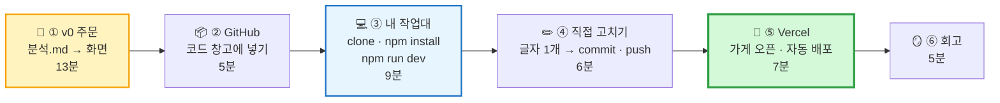

| 단계 | 시간 | 하는 일 | **왜 필요해요?** | 비유 |
|---|:---:|---|---|---|
| 🎨 ① v0 주문 | 0~13분 | `분석.md` 기반 주문 4~6번 | 설계도대로 **홀을 차려요** | 인테리어 업체에 도면 맡기기 |
| 📦 ② GitHub | 13~18분 | v0 코드를 GitHub 저장소로 | 코드를 **안전한 창고**에 보관 | 은행 금고에 넣기 |
| 💻 ③ 내 작업대 | 18~27분 | `git clone` → `npm install` → `npm run dev` | **내 컴퓨터에서** 직접 돌려 봐요 | 금고에서 꺼내 내 작업대에 올리기 |
| ✏️ ④ 직접 고치기 | 27~33분 | VS Code에서 글자 1개 → `commit` → `push` | **내 손으로 고친 기록**을 남겨요 | 세이브 포인트 찍고 금고에 다시 넣기 |
| 🚀 ⑤ Vercel | 33~40분 | GitHub 저장소 연결 → 배포 → 자동 배포 확인 | **주소**가 생기고, push할 때마다 **자동 리모델링** | 상가 입점 + 자동 리모델링 계약 |
| 🪞 ⑥ 회고 | 40~45분 | 회고 3줄 · QR · 스크린샷 | 다음에 더 잘하려고 + 공모전 증거 | 장사 일기 |

> **⏱ 시간이 밀리면** — ①의 주문을 **4번(🥇만)** 으로 줄이고, ④는 **글자 1개만** 고칩니다. **⑤ Vercel 주소는 절대 빼지 마세요.** 그래도 밀리면 **플랜 B** (v0에서 바로 Publish → 과제로 GitHub · VS Code)로 갑니다.

## 0-1. 오늘의 큰 그림 — 코드의 여행

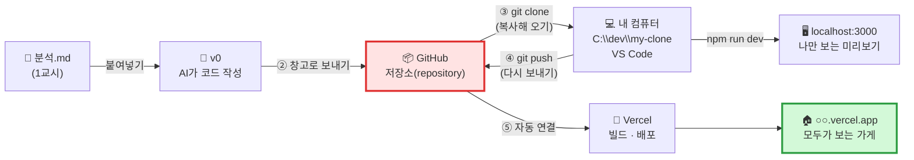

> **🗣️ 선생님 대사**
> "어제는 v0 안에서 버튼 하나로 가게를 열었죠? 오늘은 **진짜 회사 개발자들이 일하는 길**로 가요.
> 코드는 **GitHub라는 은행 금고**에 넣고, 꺼내서 **내 작업대**에서 고치고, 다시 금고에 넣으면 **Vercel이 알아서 가게를 새로 꾸며요.**
> 이 한 바퀴를 돌 줄 알면, 여러분은 **어떤 AI 도구를 써도** 결과를 내 것으로 가져올 수 있어요."

## 0-2. 3개의 장소 — 코드는 지금 어디에 있나?

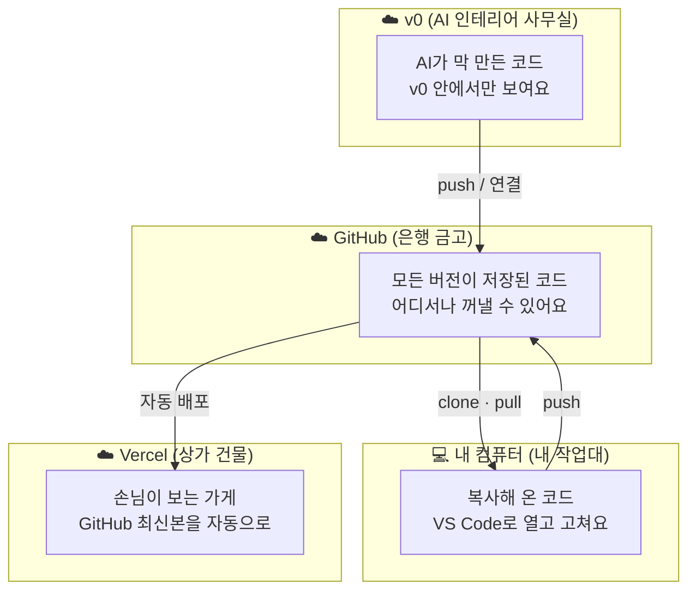

| 장소 | 비유 | 누가 봐요? | 무엇을 해요? | 오늘 단계 |
|---|---|---|---|:---:|
| ☁️ **v0** | 🎨 인테리어 사무실 | 우리 팀 | AI에게 주문 · 미리보기 | ① |
| ☁️ **GitHub** | 🏦 은행 금고 | 우리 팀 (+ 공개하면 누구나) | **코드와 모든 기록** 보관 | ② ④ |
| 💻 **내 컴퓨터** | 🪵 내 작업대 | 나만 | 직접 열고 고치고 **`localhost`** 로 실행 | ③ ④ |
| ☁️ **Vercel** | 🏢 상가 건물 | **전 세계 누구나** | 가게(사이트) 운영 | ⑤ |

---

## 🧰 수업 전 준비 (선생님용 · 전날까지)

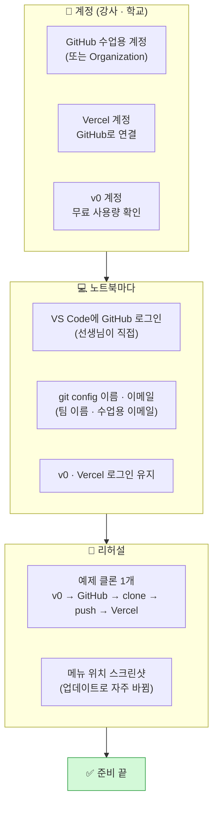

| # | 체크 | 왜 | 담당 |
|:---:|---|---|:---:|
| 1 | ☐ **GitHub 수업용 계정**(또는 Organization) 하나에 팀별 저장소를 만들 수 있게 | 초등학생은 GitHub 가입 연령이 안 될 수 있어요 · 개인정보 보호 | 🧑‍🏫 |
| 2 | ☐ **Vercel**을 같은 GitHub 계정으로 연결 | Vercel이 저장소를 볼 수 있어야 자동 배포 | 🧑‍🏫 |
| 3 | ☐ 노트북마다 **VS Code → GitHub 로그인**을 **선생님이 직접** | 비밀번호 · 인증은 학생이 다루지 않아요 | 🧑‍🏫 |
| 4 | ☐ 노트북마다 `git config` 이름 · 이메일 설정 (아래 표) | 안 하면 첫 commit에서 멈춰요 | 🧑‍🏫 |
| 5 | ☐ v0 **무료 사용량** 확인 → 팀당 주문 **6번 이내** 계획 | 주문마다 사용량이 줄어요 | 🧑‍🏫 |
| 6 | ☐ **전체 리허설 1회** + 메뉴 위치 스크린샷 | v0 · Vercel 메뉴 이름이 자주 바뀌어요 | 🧑‍🏫 |
| 7 | ☐ **플랜 B용 완성 저장소 1개** 준비 (`clone`만 하면 되는 예제) | v0가 늦거나 사용량이 떨어진 팀용 | 🧑‍🏫 |

**`git config` 설정 (선생님이 노트북마다 1회)** — 학생 **실명 · 개인 이메일 ❌**

```bash
git config --global user.name "team-03"
```

```bash
git config --global user.email "수업용계정@example.com"
```

| 칸 | 넣을 값 | ❌ 넣지 않을 값 |
|---|---|---|
| `user.name` | `team-03` 같은 **팀 이름** | 학생 실명 |
| `user.email` | **수업용 계정 이메일** (또는 GitHub의 noreply 주소) | 학생 · 부모님 개인 이메일 |

> **❓ 왜?** — commit 기록에는 이름 · 이메일이 **영원히** 남고, 공개 저장소면 **누구나** 봐요.

---

# 🎨 ① v0 주문 (0~13분) — "설계도를 넘기고, 한 방씩 짓기"

## 1-1. 3일차 주문 vs 4일차 주문 — 무엇이 다른가?

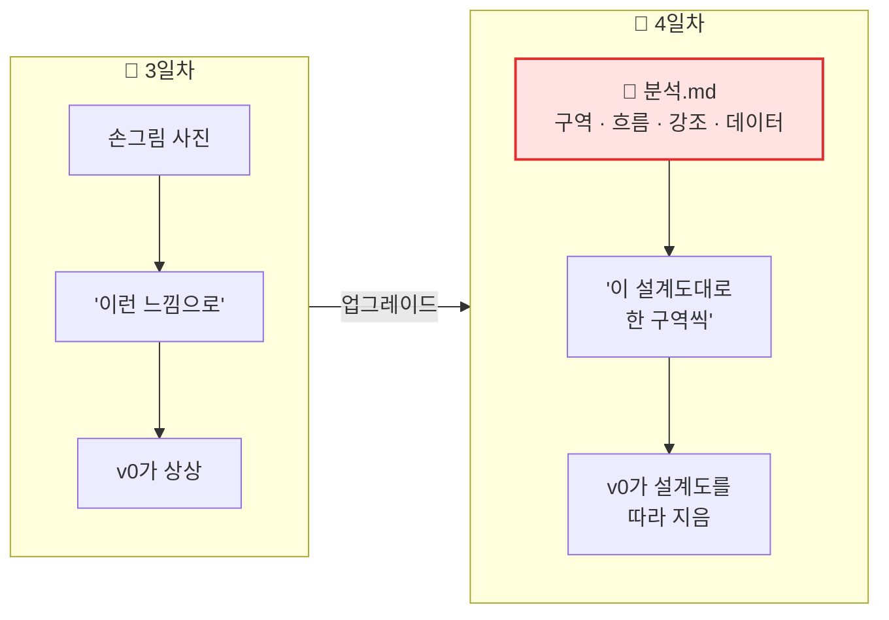

| | 📅 3일차 | 📅 4일차 |
|---|---|---|
| 넘기는 것 | 손그림 + 짧은 주문서 | **`분석.md` 통째로 + 구역별 주문** |
| AI가 아는 것 | "대충 이런 화면" | **구역 6개 · 부품 · 데이터 칸 이름 · 강조 순위** |
| 결과 | 비슷한 느낌 | **설계도와 거의 같은 구조** |
| 고칠 때 | "버튼 크게" | **"④ 5단계 카드의 화살표를…"** 처럼 **구역 번호로** |

> **비유** — 인테리어 업체에 "예쁘게 해 주세요"(3일차)보다 **"거실은 남쪽, 책장은 3칸, 조명은 노란색"** 이 적힌 **도면**(4일차)을 주면 훨씬 정확해요.

## 1-2. 주문 순서 — 한 번에 한 구역 (🥇 4번 + 🥈 2번)

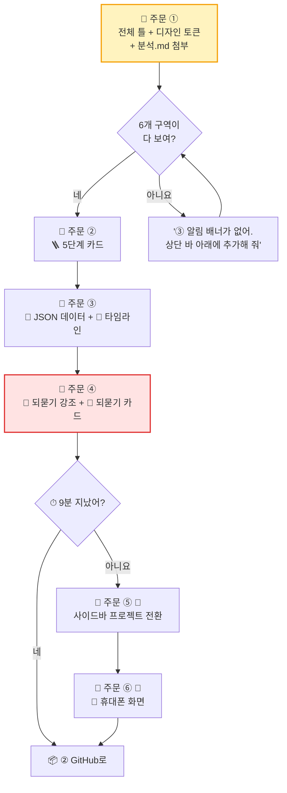

| 주문 | 시간 | 구역 (1교시 번호) | 확인할 것 | 우선 |
|:---:|:---:|---|---|:---:|
| ① | 0~4분 | 전체 ①~⑥ + 토큰 | 6개 구역이 위치대로 있나 · 남색 우주 배경 | 🥇 |
| ② | 4~6분 | ④ 5단계 카드 | 카드 5개 · 화살표 · 단마다 다른 색 · 클릭 시 스크롤 | 🥇 |
| ③ | 6~9분 | ⑤ 타임라인 + JSON | 질문 · 답 카드가 **JSON에서** 나오나 · 표 · 순서도 | 🥇 |
| ④ | 9~11분 | ⑤ 되묻기 | 🙋 되물음이 **가장 눈에 띄나** · 🧭 카드 | 🥇 |
| ⑤ | 11~12분 | ① 사이드바 | 다른 예시 누르면 내용이 바뀌나 | 🥈 |
| ⑥ | 12~13분 | 반응형 | 휴대폰에서 ☰ 메뉴 · 가로 스크롤 | 🥈 |

## 1-3. 📝 주문 ① — 전체 틀 + 디자인 토큰 (분석.md 첨부)

> **첨부 방법** — v0 대화창 📎 → `C:\dev\my-clone\분석.md` 선택 (안 되면 **`분석.md` 내용 전체를 복사해서** 주문 아래에 붙여넣기)

```text
첨부한 분석.md는 우리가 분석한 "AI 질문 코치" 서비스의 프로젝트 페이지 설계도야.
이 설계도의 [3. 레이아웃]과 [7. 디자인 토큰]을 따라 Next.js App Router + Tailwind로
프론트 화면만 만들어 줘.

[서비스 이름] ________ (원래 서비스 이름은 쓰지 마)
[예시 프로젝트] ________ (이모지 __) — 학생 이름은 가명 "____"

[구역 6개]
① 왼쪽 고정 사이드바(폭 260px): 로고, 프로필 카드(레벨 · 다음 리포트까지 진행도),
   "+ 새 프로젝트" 버튼, 현재 프로젝트 카드(노란 테두리), 예시 프로젝트 3개(접기 가능), 리포트 · 설정
② 메인 상단 바: 이모지 + 프로젝트 제목, "예시" 알약 뱃지, 진행도 뱃지, 📝 기획서 버튼, 레벨 뱃지
③ 상단 바 아래 알림 배너: "🎉 ○번째 리포트 도착 — 보고 싶을 때 열어봐"
④ 5단계 카드 줄 (다음 주문에서 자세히)
⑤ 질문 · 답 타임라인 (다음 주문에서 자세히) — 지금은 빈 자리만
⑥ 화면 맨 아래 고정 입력창: + 버튼, "무엇이든 물어봐" 입력칸, 보내기 버튼

[디자인] 진한 남색 우주 배경에 작은 별 점, 카드는 살짝 밝은 남색 + 얇은 반투명 테두리,
강조색은 따뜻한 노랑-주황, 글씨는 흰색 / 보조 글은 연회색, 카드 모서리 16px,
버튼과 뱃지는 알약 모양, 아이콘은 이모지.

[규칙] 서버 · 로그인 · 진짜 AI는 만들지 마. 화면만. 모든 글자는 한국어.
```

**✅ 주문 ① 확인 체크**

| # | 확인 | O / X |
|:---:|---|:---:|
| 1 | 사이드바가 **왼쪽에 고정**되어 있고 메인만 스크롤되나? | |
| 2 | 구역 ②③⑥이 **위치대로** 있나? | |
| 3 | 배경이 **남색 우주**, 강조가 **노랑**인가? | |
| 4 | 원래 서비스 이름 · 로고가 **안 들어갔나?** | |

## 1-4. 📝 주문 ② — 🪜 5단계 카드

```text
④ 5단계 카드 줄을 만들어 줘. 다른 구역은 바꾸지 마.
- 카드 5개를 가로 한 줄로 놓고, 카드 사이를 → 화살표로 이어서 계단처럼 보이게 해 줘.
- 카드 안: 동그란 아이콘(단마다 다른 파스텔 색: 초록 · 보라 · 분홍 · 노랑 · 하늘),
  "1단" 작은 글씨, 단 이름(굵게), "Q1–2 ›" 질문 범위, 한 줄 설명(연회색).
- 카드를 누르면 아래 타임라인의 그 단 제목(id="stage-1" ~ "stage-5")으로 부드럽게 스크롤해 줘.
- 카드 줄 아래에 작은 글씨로 "👆 한 단을 누르면 그 단이 시작되는 질문으로 가" 를 넣어 줘.
- 단 내용:
  1단 ⏱ ________ / Q1–2 / ________
  2단 👁 ________ / Q3–4 / ________
  3단 📊 ________ / Q5–7 / ________
  4단 🤝 ________ / Q8–10 / ________
  5단 🔁 ________ / Q11–20 / ________
```

| 확인 | 왜 중요해요? (1교시 4-2 강조표) | O / X |
|---|---|:---:|
| 화살표로 **이어져** 보이나? | 🥇 프로젝트가 **커지는 길**을 한눈에 | |
| 단마다 **색이 다른가?** | 단을 **색으로 기억** | |
| 누르면 **스크롤 이동**하나? | 시나리오 A 장면 3 | |

## 1-5. 📝 주문 ③ — 🍱 JSON 데이터 + 💬 타임라인 (가장 중요!)

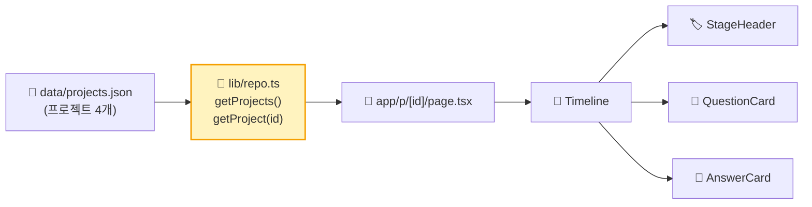

```text
⑤ 질문 · 답 타임라인을 만들어 줘. 위의 구역은 바꾸지 마.

[데이터]
- data/projects.json 파일에 프로젝트 4개(예시)를 만들어 줘. 칸 이름은 분석.md [8. 데이터 모양]과 똑같이:
  project: id, emoji, title, student, grade, isExample, summary, stages[], qa[]
  stage: no, icon, name, range, desc
  qa: no, stage, question, chip, conclusion, table{head,rows}, flow[], check, reask, role, planItem
- 첫 번째 프로젝트(________)는 qa를 6개 이상 채워 줘. 나머지 3개는 qa 2개씩.
- 내용은 초등 · 중학생 눈높이로 새로 지어서 써 줘. (원래 서비스 글을 베끼지 마)
- 데이터는 lib/repo.ts 한 곳에서만 불러오게 해 줘. 나중에 서버 API로 바꿔도 화면 코드는 안 고치게.
- 주소는 /p/[id] 로 해 줘. 첫 화면(/)은 첫 번째 프로젝트로 이동.

[화면]
- 단이 바뀔 때마다 단 제목 줄(id="stage-n"): 아이콘 + "n단 · 이름" + 오른쪽에 "여기서부터 · n/5단" + 한 줄 설명.
- 🙋 질문 카드: "Q1" 번호, "🙋 내 질문" 라벨, chip이 있으면 "🌅 넓히기" / "🔍 좁히기" 칩, 질문 글.
- 🤖 답 카드: 왼쪽에 "코치" 라벨, conclusion은 굵게 첫 줄,
  table은 표로(넘치면 표 안에서만 가로 스크롤), flow는 위→아래 화살표로 이어진 상자들,
  "확인하는 법 — " + check,
  role 뱃지("이번 답에서 나는 🛠 엔지니어 로 일했어" — coder=👨‍💻 코더, engineer=🛠 엔지니어,
  architect=🏛 아키텍트, encyclopedia=📚 백과사전),
  "📝 기획서.md에 담았어 · " + planItem 회색 박스.
- 답 카드는 기본 펼침, 오른쪽 위 ▴ 버튼으로 접기.
```

**✅ 주문 ③ 확인 체크 — 🕵️ 탐정 담당**

| # | 확인 | 해 보는 법 | O / X |
|:---:|---|---|:---:|
| 1 | 데이터가 **JSON 파일**에서 나오나? | v0 코드 탭 → `data/projects.json` 이 있나 | |
| 2 | **통로 하나**인가? | `lib/repo.ts` 가 있나 | |
| 3 | 질문(나)과 답(코치)이 **구분**되나? | 색 · 위치가 다른가 | |
| 4 | 표가 휴대폰에서 **화면 밖으로 안 나가나?** | 미리보기 폭 줄이기 | |
| 5 | 단 카드 클릭 → **그 단 제목**으로 가나? | ④ 카드 눌러 보기 | |

> **❓ 왜 칸 이름을 분석.md와 "똑같이"라고 하나요?** — 이름이 같아야 나중에 **우리가 VS Code에서 JSON을 고칠 때** 어디를 고칠지 바로 알아요. 설계도의 방 이름과 실제 문패가 같아야 길을 안 잃어요. 🚪

## 1-6. 📝 주문 ④ — 🙋 되묻기 강조 (서비스의 심장)

```text
1교시 분석에서 강조 1순위는 "🙋 열린 되묻기"야. 다른 부분은 바꾸지 말고 아래만 해 줘.
- 답 카드 맨 아래 reask를 "🙋 하나만 되물을게 — " + reask 로 보여 주고,
  왼쪽에 굵은 노란 띠, 연한 노란 배경, 글씨는 조금 크게 해서 답 카드 안에서 가장 눈에 띄게 해 줘.
- qa 2개마다 그 뒤에 "🧭 되묻기 카드"를 하나 넣어 줘:
  위에 작은 칩 3개("🧭 되묻기", "🔀 알고리즘", "🗺 흐름 · 고르기"), 초록 점 🟢,
  되묻기 질문 → "🙋 내 답 · ..." → 코치 피드백 한 문단.
  되묻기 데이터는 project.reasks[] (afterQa, question, myAnswer, feedback) 로 JSON에 추가해 줘.
```

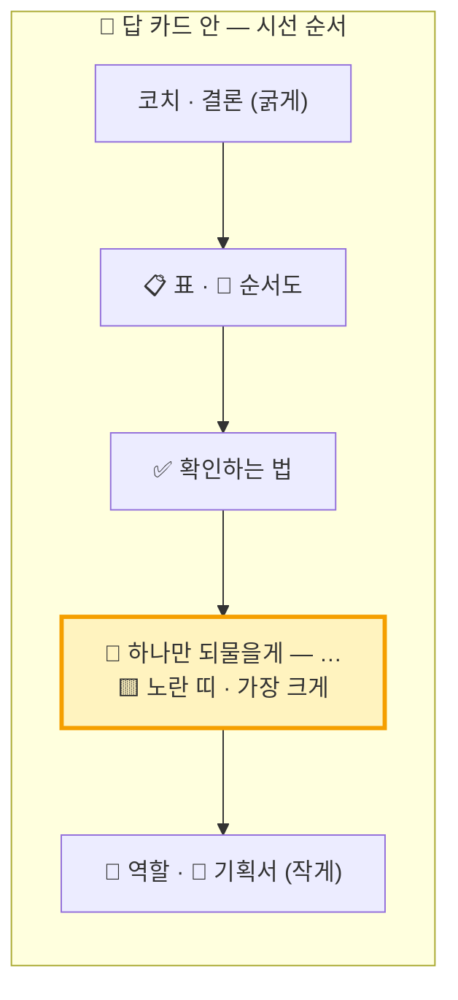

## 1-7. 📝 주문 ⑤ · ⑥ — 🥈 시간 되면

| 주문 | 📝 주문서 |
|---|---|
| ⑤ 사이드바 전환 | `사이드바의 예시 프로젝트를 누르면 /p/[id] 로 이동해서 그 프로젝트 데이터로 바뀌게 해 줘. 지금 보고 있는 프로젝트 카드는 노란 테두리로 표시해 줘. "📂 예시 프로젝트 ▴" 를 누르면 목록이 접히고 펼쳐지게 해 줘.` |
| ⑥ 휴대폰 | `화면 폭이 768px보다 좁으면 사이드바를 숨기고 상단 바 왼쪽에 ☰ 버튼을 둬서 누르면 왼쪽에서 서랍처럼 나오게 해 줘. 5단계 카드는 가로로 밀어서 보게 하고, 입력창은 화면 맨 아래에 붙여 줘.` |
| (선택) 가짜 답 | `입력창에 글을 쓰고 보내면 타임라인 맨 아래에 🙋 질문 카드를 추가하고, 1초 뒤 "🤖 (예시) 좋은 질문이야! 이 서비스는 데모라서 진짜 답 대신 이 문장이 나와." 답 카드를 추가해 줘. 저장은 하지 마.` |

## 1-8. 🆘 v0에서 막혔을 때

| 증상 | 비유 | 해결 주문 / 행동 |
|---|---|---|
| 분석.md 첨부가 안 돼요 | 📎 클립이 안 맞아요 | `분석.md` 내용을 **복사해서 붙여넣기** |
| 다른 구역이 같이 바뀌었어요 | 🧱 벽 고치다 창문 깨짐 | ⏪ 버전 되돌리기 → 주문 끝에 **"다른 구역은 절대 바꾸지 마"** |
| 데이터가 코드 안에 박혀 있어요 | 🍱 진열장 없이 접시에 바로 | `qa 데이터를 data/projects.json 으로 옮기고 lib/repo.ts 에서만 불러오게 해 줘.` |
| 영어로 나와요 | 🌏 | `화면의 모든 글자를 한국어로 바꿔 줘.` |
| 빨간 에러 | 🔥 | v0의 **Fix** 버튼 → 없으면 `이 에러를 고쳐 줘. 다른 부분은 바꾸지 마.` + 에러 글 붙여넣기 |
| 사용량이 떨어졌어요 | ⛽ | 🙋 선생님 → **플랜 B 저장소** 사용 |

---

# 📦 ② GitHub — 코드 창고에 넣기 (13~18분)

## 2-1. GitHub가 뭐예요? 왜 필요해요?

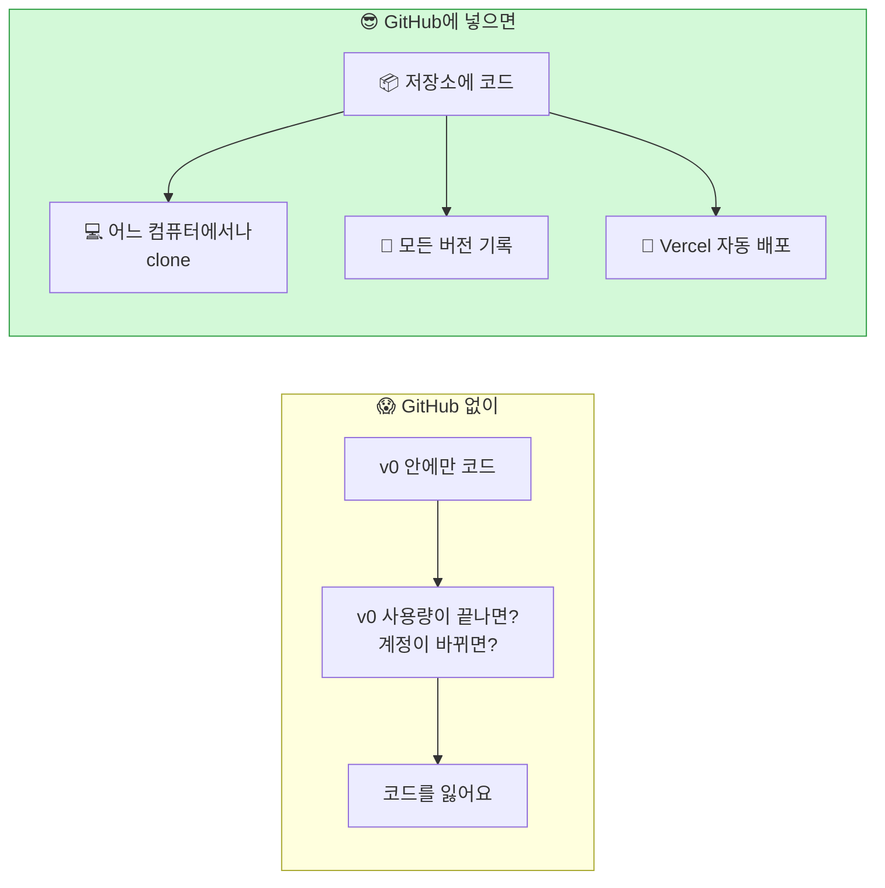

| 용어 | 비유 | 뜻 |
|---|---|---|
| **GitHub** | 🏦 은행 | 코드를 맡기는 온라인 창고 서비스 |
| **저장소 (repository · repo)** | 🗄️ 내 금고 한 칸 | 프로젝트 하나를 담는 공간 |
| **commit** | 📸 세이브 포인트 사진 | "여기까지 이렇게 바꿨음" 기록 한 장 |
| **push** | 📤 금고에 넣기 | 내 컴퓨터 기록 → GitHub |
| **clone** | 📥 금고 통째로 복사해 오기 | GitHub → 내 컴퓨터 (처음 한 번) |
| **pull** | 🔄 새로 들어온 것만 가져오기 | GitHub 최신본 → 내 컴퓨터 |
| **branch (main)** | 🌳 나뭇가지 (큰 줄기) | 기록의 줄기. 오늘은 `main` 하나만 |
| **Public / Private** | 🪟 유리 금고 / 🔒 철 금고 | 누구나 볼 수 있음 / 우리만 |

> **🔒 오늘은 Private(비공개) 저장소**로 만들어요. Vercel 가게는 공개되지만, **코드 창고는 우리만** 봐요.

## 2-2. 길 두 개 — v0에서 GitHub로 보내는 법

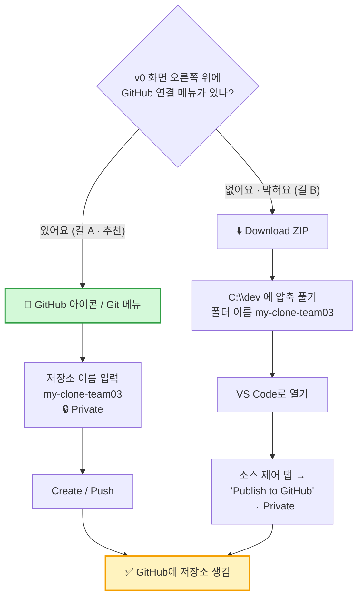

| | 🅰️ 길 A — v0 GitHub 연결 | 🅱️ 길 B — ZIP + VS Code Publish |
|---|---|---|
| 언제 | v0에 GitHub 연결 메뉴가 보일 때 (기본) | 메뉴가 없거나 연결 오류 |
| 장점 | 클릭 몇 번 · v0에서 더 고쳐도 다시 보낼 수 있음 | v0 상태와 상관없이 확실 |
| 다음 단계 | ③에서 **`git clone`** | ③의 clone을 **건너뛰고** 바로 `npm install` |
| 주의 | 메뉴 이름 · 위치는 **업데이트로 바뀔 수 있어요** (선생님 리허설 스크린샷 참고) | 압축을 **꼭 풀고** 열기 (ZIP 안에서 열면 저장 안 돼요) |

**저장소 이름 규칙**

| 😵 나쁜 이름 | 😎 좋은 이름 | 이유 |
|---|---|---|
| `우리 클론` | `my-clone-team03` | 한글 · 띄어쓰기 ❌ → 주소에 쓰여요 |
| `test` | `ask-coach-clone-t03` | 무엇인지 알 수 있게 |
| `김민준_프로젝트` | `team03-clone` | **실명 ❌** (주소에 그대로 보여요) |

## 2-3. ✅ GitHub에서 확인하기 (1분)

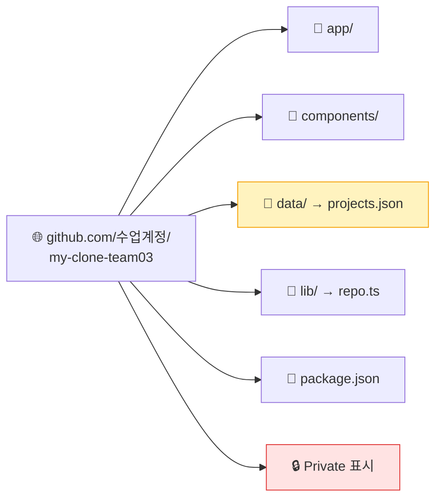

| 확인 | 어디서 | O / X |
|---|---|:---:|
| 저장소 이름 옆에 **Private** | 저장소 제목 옆 | |
| `data/projects.json` 이 있다 | 파일 목록 | |
| `package.json` 이 있다 | 파일 목록 (이게 있어야 `npm install` 가능) | |
| 초록 **`<> Code`** 버튼 → HTTPS 주소 복사 | 오른쪽 위 | |

> **📋 HTTPS 주소를 메모장에 붙여 두세요** — `https://github.com/수업계정/my-clone-team03.git` 모양. ③에서 씁니다.

---

# 💻 ③ 내 작업대에서 돌리기 (18~27분) — clone · npm install · npm run dev

## 3-1. 명령 3개의 여행

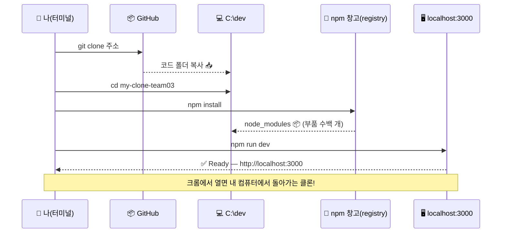

| 순서 | 명령 | 비유 | 걸리는 시간 | 성공 신호 |
|:---:|---|---|:---:|---|
| 1 | `cd C:\dev` | 🚪 작업실 들어가기 | 즉시 | 줄 앞이 `C:\dev>` |
| 2 | `git clone 주소` | 📥 금고 복사해 오기 | 10초 | `done.` |
| 3 | `cd my-clone-team03` | 🚪 프로젝트 방 들어가기 | 즉시 | 줄 앞이 바뀜 |
| 4 | `code .` | 🪵 작업대에 올리기 (새 VS Code 창) | 3초 | 새 창 |
| 5 | `npm install` | 🛵 부품 배달 | **1~3분** ☕ | `added ○○○ packages` |
| 6 | `npm run dev` | 🔌 전원 켜기 | 10초 | `Ready` · `http://localhost:3000` |

## 3-2. 따라 치기 — 한 줄씩, `Enter`

**1) 작업실로 이동** (VS Code 터미널 `Ctrl + `` `)

```bash
cd C:\dev
```

**2) GitHub에서 복사해 오기** — 주소는 2-3에서 복사한 것 (길 B 팀은 건너뛰기)

```bash
git clone https://github.com/수업계정/my-clone-team03.git
```

> 처음이면 **GitHub 로그인 창**이 뜰 수 있어요 → 🙋 **선생님이 직접** 로그인합니다.

**3) 프로젝트 폴더로 들어가서 VS Code로 열기**

```bash
cd my-clone-team03
```

```bash
code .
```

**4) 새로 열린 VS Code 창에서 터미널을 다시 열고 (`Ctrl + `` `) 부품 설치**

```bash
npm install
```

> ☕ **기다리는 동안** — 탐색기에 `node_modules` 폴더가 생기는 걸 구경하세요. **부품 수백 개**가 배달되는 중이에요.
> v0 프로젝트가 `pnpm-lock.yaml`을 가지고 있어 `npm install`이 오류를 내면 → 3-5 대처표 참고.

**5) 전원 켜기**

```bash
npm run dev
```

**6) 크롬에서 열기** — 터미널의 `http://localhost:3000` 을 **`Ctrl` + 클릭** (또는 크롬 주소창에 직접 입력)

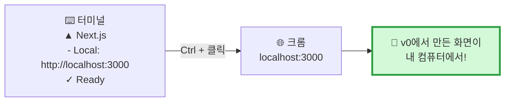

> **🗣️ 선생님 대사**
> "지금 보이는 화면은 **인터넷 가게가 아니에요.** 여러분 **노트북 안에서** 돌아가는 가게예요. `localhost`는 **'바로 이 컴퓨터'** 라는 뜻이에요.
> 그래서 친구 폰으로는 이 주소가 안 열려요. 친구가 들어오려면 ⑤ Vercel이 필요해요."

## 3-3. `localhost` vs `vercel.app` — 무엇이 다른가?

| | 🖥️ `localhost:3000` | 🌐 `○○.vercel.app` |
|---|---|---|
| 비유 | 🏗️ 내 작업실 안 시제품 | 🏪 상가에 연 진짜 가게 |
| 누가 봐요? | **나만** (이 노트북) | **전 세계 누구나** |
| 언제 바뀌어요? | 파일 **저장하는 순간** 바로 (⚡ 핫 리로드) | **push → 빌드** 후 1~2분 |
| 꺼지면? | 터미널을 닫거나 `Ctrl + C` 하면 꺼져요 | 24시간 열려 있어요 |
| 쓰는 때 | 고치면서 **빨리 확인** | 다 고친 뒤 **손님에게 보여 주기** |

## 3-4. 📂 VS Code에서 우리 가게 둘러보기 (구경 2분)

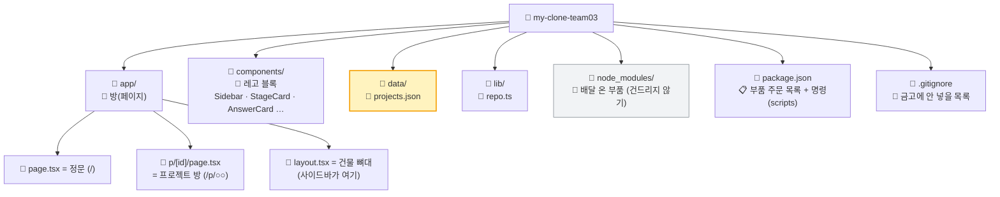

| 파일 · 폴더 | 비유 | 1교시 분석.md와 연결 | 고쳐도 돼요? |
|---|---|---|:---:|
| `data/projects.json` | 🍱 진열장 | [8. 데이터 모양] | ✅ **오늘 고칠 곳** |
| `components/StageCard.tsx` 등 | 🧱 블록 틀 | [2-5 부품 목록] | ⚠️ 조심 |
| `lib/repo.ts` | 🚪 통로 하나 | [통로 하나 원칙] | ❌ 오늘은 구경 |
| `app/layout.tsx` | 🏢 건물 뼈대 | [3. 레이아웃] | ❌ 구경 |
| `node_modules/` | 🛵 부품 창고 | — | ❌ **절대 손대지 않기** |
| `package.json` | 📋 주문 목록 | — | ❌ 구경 |
| `.gitignore` | 🙈 비밀 목록 | — | ❌ 구경 |

**`package.json` 의 `scripts` 읽는 법**

```json
{
  "scripts": {
    "dev": "next dev",
    "build": "next build",
    "start": "next start"
  }
}
```

| 명령 | 실제로 실행되는 것 | 비유 | 누가 써요? |
|---|---|---|---|
| `npm run dev` | `next dev` | 🔧 작업실 시제품 켜기 | 우리 (지금) |
| `npm run build` | `next build` | 📦 가게용으로 포장 | Vercel이 자동으로 |
| `npm run start` | `next start` | 🏪 포장한 걸로 영업 | Vercel이 자동으로 |

> **❓ `node_modules`는 왜 GitHub에 없어요?** — `.gitignore`에 적혀 있어서요. 부품은 **주문 목록(`package.json`)만 있으면 언제든 다시 배달**받을 수 있으니까 금고에 넣지 않아요. 레고 설명서만 보관하고 블록은 필요할 때 사는 것처럼요.

## 3-5. 🆘 ③에서 막혔을 때

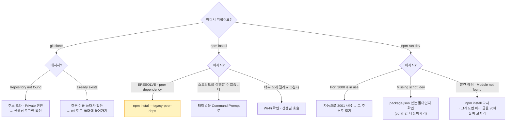

| 증상 | 원인 (비유) | 해결 |
|---|---|---|
| `fatal: repository '…' not found` | 🏦 금고 번호 틀림 / 열쇠 없음 | 주소 다시 복사 · 선생님이 GitHub 로그인 |
| `destination path '…' already exists` | 📦 같은 이름 상자가 이미 있음 | `cd my-clone-team03` 로 그 폴더 사용 |
| `npm ERR! ERESOLVE unable to resolve dependency tree` | 🧩 부품끼리 버전이 안 맞음 | `npm install --legacy-peer-deps` |
| `npm.ps1 … 스크립트를 실행할 수 없으므로` | 🛡️ PowerShell 경비원 | 터미널 `+` 옆 `∨` → **Command Prompt** |
| `'next'은(는) 내부 또는 외부 명령…` | 🛵 부품 배달이 아직 안 옴 | `npm install` 을 먼저 |
| `Missing script: "dev"` | 🚪 다른 방에 있음 | `dir` 로 `package.json` 이 보이는 폴더인지 확인 |
| `Port 3000 is in use` | 🅿️ 주차 자리가 찼음 | 터미널에 나온 **3001** 주소로 열기 |
| 화면이 하얗고 콘솔에 빨간 글 | 🔥 | 에러 글 복사 → v0에 `이 에러를 고쳐 줘` → 다시 push → `git pull` |

> **🆘 플랜 B** — 7분이 지나도 `localhost`가 안 열리면 → 선생님의 **완성 예제 저장소**를 clone해서 ④ · ⑤를 진행하고, 우리 저장소는 과제로 돌립니다. **흐름을 한 바퀴 도는 경험**이 오늘의 목표예요.

---

# ✏️ ④ 직접 고치기 → commit → push (27~33분) — "내 손으로 찍는 첫 세이브 포인트"

## 4-1. 왜 직접 고쳐요?

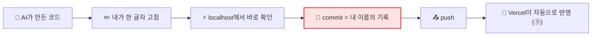

> **핵심** — AI가 만든 코드도 **내가 열고, 고치고, 기록하면 내 것**이 돼요. 오늘은 **가장 안전한 곳(JSON 데이터)** 에서 시작해요.

## 4-2. 고칠 곳 3가지 — 하나만 고르기

| 난이도 | 고칠 곳 | 파일 | 바꿀 것 | 확인 |
|:---:|---|---|---|---|
| ⭐ | **프로젝트 제목** | `data/projects.json` | `"title": "________"` 의 글자 | 상단 바 · 사이드바 제목이 바뀜 |
| ⭐ | **되묻기 문장** | `data/projects.json` | 첫 qa의 `"reask": "…"` | 🙋 노란 띠 문장이 바뀜 |
| ⭐⭐ | **알림 배너 문장** | `components/NoticeBanner.tsx` (또는 비슷한 이름) | `"🎉 …"` 글자 | 배너 문장이 바뀜 |

**순서**

```mermaid
flowchart TD
    S1["1. VS Code 탐색기 → data/projects.json 열기"] --> S2["2. Ctrl + F 로 'title' 찾기"]
    S2 --> S3["3. 따옴표 \" \" 안의 글자만 바꾸기<br/>⚠️ 따옴표 · 쉼표는 지우지 않기"]
    S3 --> S4["4. Ctrl + S 저장"]
    S4 --> S5["5. 크롬 localhost:3000 보기<br/>⚡ 자동으로 바뀜!"]
    S5 --> C{"바뀌었어?"}
    C -->|"네 🎉"| N["4-3 commit으로"]
    C -->|"빨간 에러"| F["따옴표 · 쉼표 확인<br/>Ctrl + Z 로 되돌리기"]
    F --> S3
    style S3 fill:#ffe3e3,stroke:#e03131
    style S5 fill:#d3f9d8,stroke:#2f9e44
```

**⚠️ JSON 고칠 때 지켜야 할 약속**

| 😵 깨지는 예 | 😎 올바른 예 | 이유 |
|---|---|---|
| `"title": 집중 타이머",` | `"title": "집중 타이머",` | 따옴표는 **양쪽 모두** |
| `"title": "집중 타이머"` (다음 줄이 있는데 쉼표 없음) | `"title": "집중 타이머",` | 칸 사이엔 **쉼표** |
| `"title': "집중 타이머",` | `"title": "집중 타이머",` | 작은따옴표 ❌ **큰따옴표만** |
| `"title": "“집중” 타이머",` | `"title": "집중 타이머",` | 글 안의 큰따옴표는 깨져요 |

## 4-3. 📸 commit → 📤 push — 두 가지 방법

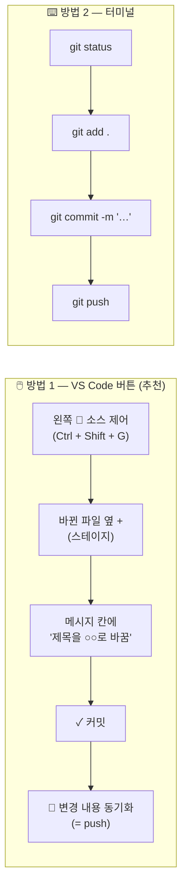

**⌨️ 방법 2 — 터미널 명령** (`npm run dev` 가 돌고 있는 터미널은 두고, 터미널 `+` 로 **새 터미널**을 열어서)

```bash
git status
```

```bash
git add .
```

```bash
git commit -m "프로젝트 제목을 우리 팀 아이템으로 바꿈"
```

```bash
git push
```

| 명령 | 뜻 | 비유 | 성공 신호 |
|---|---|---|---|
| `git status` | 무엇이 바뀌었나 보기 | 👀 "어디 고쳤더라?" | 빨간 글씨 `modified: data/projects.json` |
| `git add .` | 바뀐 것 전부 사진 찍을 준비 | 🖼️ 액자에 넣기 | (아무 말 없음 = 성공) |
| `git commit -m "…"` | 세이브 포인트 찍기 + 메모 | 📸 찰칵 + 사진 뒤에 메모 | `1 file changed` |
| `git push` | GitHub 금고로 보내기 | 📤 금고에 넣기 | `main -> main` |

**좋은 commit 메시지 쓰기**

| 😵 나쁜 메시지 | 😎 좋은 메시지 | 이유 |
|---|---|---|
| `수정` | `프로젝트 제목을 '집중 타이머 코치'로 바꿈` | 나중에 **무엇을** 바꿨는지 알 수 있어요 |
| `ㅁㄴㅇㄹ` | `1단 되묻기 문장을 더 쉽게 고침` | 팀원이 읽을 수 있어요 |
| `최종최종진짜최종` | `알림 배너에 이모지 추가` | 기록은 쌓이는 거예요. "최종"은 없어요 😄 |

## 4-4. ✅ GitHub에서 내 기록 확인

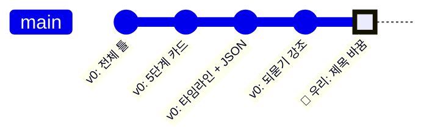

| 확인 | 어디서 | O / X |
|---|---|:---:|
| 저장소 첫 화면 맨 위에 **내 commit 메시지**가 보인다 | github.com 저장소 | |
| `🕐 commits` 를 누르면 v0 기록 아래에 **우리 기록**이 있다 | 커밋 목록 | |
| `data/projects.json` 을 열면 **바뀐 제목**이 보인다 | 파일 | |

> **🗣️ 선생님 대사** — "커밋 목록을 보세요. 위에서부터 **AI가 찍은 세이브 포인트**들이 있고, 맨 위에 **여러분이 찍은 첫 번째 세이브 포인트**가 있어요. 이게 여러분이 **개발자가 된 증거**예요."

## 4-5. 🆘 commit · push 막혔을 때

| 증상 | 원인 | 해결 |
|---|---|---|
| `Please tell me who you are` | 🪪 이름표가 없음 | 🙋 선생님 → `git config` (수업 전 준비 #4) |
| `nothing to commit` | 📭 바뀐 게 없음 / 저장 안 함 | `Ctrl + S` 했는지 확인 (탭에 ● 표시) |
| `rejected … fetch first` | 🔄 금고에 내가 모르는 새 기록 (v0가 또 보냈음) | `git pull` → 다시 `git push` |
| push할 때 로그인 창 | 🔑 | 🙋 **선생님이 직접** 로그인 |
| 소스 제어 탭에 아무것도 없음 | 📂 다른 폴더를 열었음 | `파일 → 폴더 열기` → `my-clone-team03` |

---

# 🚀 ⑤ Vercel — 가게 오픈 + 자동 배포 (33~40분)

## 5-1. Vercel과 GitHub를 이으면 무슨 일이?

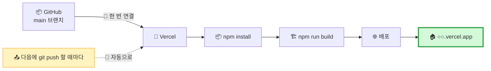

> **비유** — Vercel과 **자동 리모델링 계약**을 맺는 거예요. 우리가 금고(GitHub)에 새 설계도를 넣을 때마다, Vercel이 **알아서 가게를 새로 꾸며요.** 우리는 push만 하면 돼요. 🔁

## 5-2. 순서 — Import → Deploy

```mermaid
flowchart TD
    V1["1. vercel.com 접속<br/>(선생님이 로그인해 둔 상태)"] --> V2["2. Add New… → Project"]
    V2 --> V3["3. Import Git Repository<br/>목록에서 my-clone-team03 → Import"]
    V3 --> V4["4. 설정 화면<br/>Framework: Next.js (자동)<br/>Root Directory: ./<br/>⭐ 나머지 그대로"]
    V4 --> V5["5. Deploy 클릭"]
    V5 --> V6["6. 🏗️ 1~2분 빌드 로그 구경"]
    V6 --> V7{"🎉 Congratulations?"}
    V7 -->|"네"| V8["7. 화면 미리보기 클릭<br/>→ ○○.vercel.app"]
    V7 -->|"빨간 Error"| V9["5-4 대처표"]
    style V4 fill:#fff3bf,stroke:#f59f00,stroke-width:2px
    style V8 fill:#d3f9d8,stroke:#2f9e44,stroke-width:3px
```

| 화면 | 확인할 것 | 건드리지 않기 |
|---|---|---|
| Import | 저장소 이름이 **우리 팀 것**인지 | 다른 팀 저장소 ❌ |
| Configure Project | **Framework Preset = Next.js** 가 자동 선택됐나 | Build Command · Output Directory |
| Environment Variables | **비워 둠** (오늘은 비밀 키가 없어요) | 🔑 키 넣지 않기 |
| Deploy | 빌드 로그가 위로 흘러감 ☕ | — |

> **❓ v0 Publish로 이미 만든 프로젝트가 있으면?** — 3일차처럼 v0에서 Publish한 적이 있으면 Vercel에 **같은 이름 프로젝트**가 있을 수 있어요. 오늘은 **GitHub에서 Import한 새 프로젝트**를 씁니다. 헷갈리면 선생님께!

## 5-3. 🔁 자동 배포 확인 — 진짜 마법의 순간

```mermaid
sequenceDiagram
    participant 나 as 🧑 VS Code
    participant GH as 📦 GitHub
    participant VC as 🚀 Vercel
    participant 폰 as 📱 친구 폰
    나->>나: projects.json 되묻기 문장 고치기 · 저장
    나->>GH: commit + push
    GH->>VC: 🔔 "새 기록이 왔어요!"
    VC->>VC: 🏗️ 자동 빌드 (1분)
    VC-->>폰: 🌐 같은 주소 · 새 내용
    폰->>폰: 🔄 새로고침 → 바뀐 문장! 🎉
```

| 순서 | 행동 | 확인 |
|:---:|---|---|
| 1 | VS Code에서 **되묻기 문장** 하나를 또 바꾸고 저장 | `localhost`에서 먼저 확인 |
| 2 | commit (`되묻기 문장 수정`) → push | GitHub에 기록 |
| 3 | Vercel 프로젝트 화면 → **Deployments** | 새 줄이 생기고 **Building** → **Ready** |
| 4 | 📱 휴대폰으로 `○○.vercel.app` 새로고침 | **같은 주소, 바뀐 문장** |

> **🗣️ 선생님 대사**
> "지금 여러분은 **버튼을 누르지 않았어요.** 그냥 GitHub에 넣었을 뿐인데 가게가 저절로 바뀌었죠?
> 회사에서는 이걸 **CI/CD(자동 배포)** 라고 불러요. 여러분이 방금 **실제 회사와 똑같은 방식**으로 서비스를 업데이트한 거예요."

## 5-4. 🆘 Vercel에서 막혔을 때

| 증상 | 원인 (비유) | 해결 |
|---|---|---|
| Import 목록에 저장소가 없어요 | 🔑 Vercel이 그 금고를 볼 권한이 없음 | Import 화면의 **Adjust GitHub App Permissions** → 저장소 허용 (🙋 선생님) |
| `Build Failed` · `Type error` | 🔍 포장 검사에서 걸림 (`localhost`는 검사가 느슨해요) | 빌드 로그의 **빨간 줄 복사** → v0 / 내 컴퓨터에서 `npm run build` 로 같은 에러 재현 → 고쳐서 push |
| `Module not found` | 📦 부품 목록에 빠진 게 있음 | `package.json` 확인 · v0에 에러 붙여 고치기 |
| `JSON parse error` / `Unexpected token` | 🍱 진열장 글씨가 깨짐 | ④에서 고친 JSON의 **따옴표 · 쉼표** 확인 |
| 404 NOT_FOUND | 🚪 정문이 없음 | `app/page.tsx` 가 있는지 · `/p/첫번째id` 로 직접 들어가 보기 |
| push했는데 안 바뀜 | ⏳ 아직 빌드 중 / 다른 브랜치 | Deployments에서 **Ready** 확인 · 브랜치가 `main` 인지 |

```mermaid
flowchart LR
    E["🔴 Vercel Build Failed"] --> L["📜 빌드 로그<br/>빨간 줄 찾기"]
    L --> R["💻 내 컴퓨터에서<br/>npm run build"]
    R --> F{"같은 에러?"}
    F -->|"네"| FIX["✏️ 고치기<br/>(직접 또는 v0에 붙여넣기)"]
    F -->|"아니요"| T["🙋 선생님"]
    FIX --> P["📤 commit + push"]
    P --> E2["🟢 자동 재배포"]
    style E2 fill:#d3f9d8,stroke:#2f9e44
```

> **💡 개발자 습관** — push하기 전에 **`npm run build`** 를 내 컴퓨터에서 한 번 돌려 보면, Vercel에서 실패할 일을 **미리** 잡을 수 있어요. 🕵️ "개업 전 리허설"!

## 5-5. ✅ 배포 전 · 후 안전 점검

| # | 점검 | 왜 | O / X |
|:---:|---|---|:---:|
| 1 | 화면 · JSON에 **실명 · 전화번호 · 학교 이름 없음** | 🌍 전 세계 공개 | |
| 2 | 원래 서비스 **이름 · 로고 · 글 그대로 복사 없음** | 클론은 **공부용** | |
| 3 | 화면 어딘가에 **"교육용 클론 · 데모"** 문구 | 진짜 서비스로 오해하지 않게 | |
| 4 | **Environment Variables 비어 있음** · 코드에 🔑 키 없음 | 오늘은 비밀 키가 필요 없어요 | |
| 5 | GitHub 저장소는 **Private** | 코드 창고는 우리만 | |

> **📝 4번 문구 넣기 (선택 주문)** — `화면 맨 아래 입력창 위에 작은 회색 글씨로 "교육용 클론 데모 · 실제 AI 답변이 아닌 예시 데이터입니다" 를 넣어 줘.`

## 5-6. 🔄 옆 팀 가게 방문 (1분) — QR 바꾸기

```mermaid
flowchart LR
    A["🏠 우리 주소"] --> Q["📱 크롬 주소창 공유 → QR"]
    Q --> B["🔄 옆 팀과 QR 교환"]
    B --> C["🙋 손님 카드 작성"]
```

| 🙋 손님 카드 | 적기 |
|---|---|
| 👀 3초 안에 **무슨 서비스인지** 알았나? | 😀 / 🙂 / 😐 |
| 🔦 가장 먼저 눈에 띈 곳은? (분석.md 강조 1순위와 같나?) | |
| 🪜 5단계 카드 누르면 잘 이동했나? | O / X |
| 💡 "이게 있으면 좋겠어요" 1개 | |

---

# 🪞 ⑥ 회고 · 기록 (40~45분) — "오늘의 개발 일지"

## 6-1. 오늘 돈 한 바퀴

```mermaid
flowchart LR
    A["📝 분석.md"] --> B["🎨 v0"] --> C["📦 GitHub"] --> D["💻 VS Code<br/>npm run dev"] --> E["✏️ commit · push"] --> F["🚀 Vercel"]
    F -.->|"다음 시간<br/>손님 의견으로 다시"| A
    style F fill:#d3f9d8,stroke:#2f9e44,stroke-width:3px
```

| 단계 | 오늘 배운 개발자 능력 | 앞으로 어디에 쓰나 |
|---|---|---|
| 📝 분석.md | **보는 눈** — 구역 · 흐름 · 강조 · 데이터 | 어떤 서비스든 따라 만들 때 · 우리 기획서 |
| 🎨 v0 | **지휘하는 말** — 구역별 · 한 번에 하나 | 다른 AI 도구(Cursor · Claude Code)에도 똑같이 |
| 📦 GitHub | **보관하는 습관** — 코드는 금고에 | 팀 협업 · 포트폴리오 |
| 💻 npm | **내 작업대에서 돌리기** | 어떤 웹 프로젝트든 `npm install` → `npm run dev` |
| ✏️ commit | **기록하는 습관** — 세이브 포인트 + 메모 | 망쳐도 되돌릴 수 있는 용기 |
| 🚀 Vercel | **자동으로 여는 가게** | push만 하면 업데이트 |

## 6-2. 회고 3줄 + 기록 (팀당 1장)

```
┌──────────────────────────────────────────────────────────────┐
│ 🪞 오늘의 개발 일지                      팀: ______          │
├──────────────────────────────────────────────────────────────┤
│ 🏠 가게 주소   : https://________________.vercel.app        │
│ 📦 저장소 주소 : github.com/________/________ (🔒 Private)   │
│ 📸 우리 commit : "_________________________________"        │
├──────────────────────────────────────────────────────────────┤
│ ✅ 잘된 것           : ______________________________       │
│ 😵 가장 막혔던 곳     : ☐ 설치 ☐ v0 ☐ clone ☐ npm ☐ push ☐ Vercel │
│    → 어떻게 풀었나   : ______________________________       │
│ 🔁 다음에 고칠 것 1개 : ______________________________       │
├──────────────────────────────────────────────────────────────┤
│ 🔦 손님이 처음 본 곳 = 우리 강조 1순위?  ☐ 같다 ☐ 다르다      │
│ 📝 v0 주문 횟수 : ___ 번  /  내 commit 횟수 : ___ 번          │
└──────────────────────────────────────────────────────────────┘
```

## 6-3. 🏆 공모전 증거 상자

```mermaid
flowchart LR
    B["📦 증거 상자"] --> S1["📝 분석.md<br/>'우리는 이렇게 분석했다'"]
    B --> S2["📸 스크린샷 3장<br/>localhost · vercel · 휴대폰"]
    B --> S3["📜 GitHub 커밋 목록<br/>'AI와 우리의 기록'"]
    B --> S4["🏠 배포 주소 + QR"]
    B --> S5["🙋 손님 카드"]
    S1 --> C["🏆 발표<br/>분석 → 지휘 → 기록 → 배포 → 반응"]
    S2 --> C
    S3 --> C
    S4 --> C
    S5 --> C
    style C fill:#d3f9d8,stroke:#2f9e44,stroke-width:2px
```

| 증거 | 왜 강해요? |
|---|---|
| 📝 `분석.md` | "AI에게 그냥 시킨 게 아니라 **먼저 분석했다**" — 생각의 증거 |
| 📜 커밋 목록 | **AI 기록과 우리 기록이 함께** 보여요 — 지휘자의 증거 |
| 🖥️ `localhost` 캡처 | "**내 컴퓨터에서 직접** 돌렸다" — 개발 환경 능력 |
| 🏠 Vercel 주소 | 심사위원이 **직접 눌러 볼 수** 있어요 |
| 🙋 손님 카드 | 강조 1순위가 **진짜 먼저 보였는지** 검증 |

> **🗣️ 선생님 대사 (마무리 30초)**
> "오늘 여러분은 **회사 개발자가 매일 하는 한 바퀴**를 처음부터 끝까지 돌았어요. 분석하고, AI에게 지휘하고, 금고에 넣고, 내 작업대에서 돌리고, 직접 고쳐서 기록하고, 가게를 열었어요.
> 다음엔 이 클론의 틀에 **우리 팀 아이템**을 넣어 볼 거예요. 틀은 이미 있으니까, **JSON만 바꾸면** 우리 서비스가 돼요."

---

## 📌 수업 안에서 끝낼 것 vs 과제

| 구분 | 내용 | 이유 |
|---|---|---|
| ✅ **수업 안에서 반드시** | v0 화면 + GitHub 저장소 + **Vercel 주소** | 주소가 있어야 과제(사용자 테스트) 가능 |
| ✅ 수업 안에서 (가능하면) | `localhost` 실행 + commit 1개 | 안 되면 과제 1로 |
| 📝 과제 1 | 집/동아리실에서 **clone → npm install → npm run dev** 다시 해 보기 | 혼자서 한 바퀴 = 진짜 내 능력 |
| 📝 과제 2 | `data/projects.json` 첫 프로젝트를 **우리 팀 아이템 · 질문 6개**로 바꿔 push | 클론 → **우리 서비스** |
| 📝 과제 3 | 사용자 3명에게 주소 보내고 손님 카드 받기 | 강조 1순위 검증 |
| 📝 과제 4 (선택) | `분석.md`를 저장소에 함께 넣어 push | 설계도와 코드를 한 금고에 |

---

## 🏗️ 부록 A. 전체 명령 치트시트 (한 장 인쇄)

```mermaid
flowchart TD
    A["📥 처음 한 번<br/>git clone 주소<br/>cd 폴더<br/>npm install"] --> B["🔁 매번 시작할 때<br/>git pull<br/>npm run dev"]
    B --> C["✏️ 고치고 저장<br/>localhost 확인"]
    C --> D["📸 기록하기<br/>git add .<br/>git commit -m '메모'<br/>git push"]
    D --> E["🚀 Vercel 자동 배포"]
    E --> C
    style A fill:#e7f5ff,stroke:#1971c2
    style D fill:#ffe3e3,stroke:#e03131
    style E fill:#d3f9d8,stroke:#2f9e44
```

| 상황 | 명령 | 비유 |
|---|---|---|
| 작업실로 이동 | `cd C:\dev` | 🚪 |
| 금고에서 처음 복사 | `git clone 주소` | 📥 |
| 프로젝트 방으로 | `cd my-clone-team03` | 🚪 |
| VS Code로 열기 | `code .` | 🪵 |
| 부품 배달 (처음 · package.json 바뀌었을 때) | `npm install` | 🛵 |
| 시제품 켜기 | `npm run dev` | 🔌 |
| 시제품 끄기 | `Ctrl + C` → `Y` | 🛑 |
| 가게용 포장 검사 | `npm run build` | 📦🔍 |
| 금고 최신본 가져오기 | `git pull` | 🔄 |
| 뭐가 바뀌었나 | `git status` | 👀 |
| 기록 준비 | `git add .` | 🖼️ |
| 세이브 포인트 | `git commit -m "메모"` | 📸 |
| 금고에 넣기 | `git push` | 📤 |
| 기록 보기 | `git log --oneline` | 📜 |

## 🏗️ 부록 B. Git 기본 흐름 — 세 칸 상자

```mermaid
flowchart LR
    W["📝 작업 폴더<br/>(Working)<br/>내가 고친 파일"] -->|"git add"| S["🖼️ 무대<br/>(Staging)<br/>사진 찍을 준비"]
    S -->|"git commit"| L["📸 내 컴퓨터 기록<br/>(Local repo)"]
    L -->|"git push"| R["🏦 GitHub<br/>(Remote)"]
    R -->|"git pull"| W
    R -->|"git clone<br/>(처음 한 번)"| W
```

| 칸 | 비유 | 들어가는 명령 | VS Code에서 보이는 모습 |
|---|---|---|---|
| 📝 작업 폴더 | 책상 위 그림 | (저장 `Ctrl + S`) | 파일 옆 **M** (수정됨) |
| 🖼️ 무대 | 액자에 넣은 그림 | `git add` | **스테이징된 변경 사항** 목록 |
| 📸 내 기록 | 앨범에 붙인 사진 | `git commit` | 소스 제어 목록이 비워짐 |
| 🏦 GitHub | 은행 금고 앨범 | `git push` | 아래 상태 표시줄 ↑ 숫자가 0 |

## 🏗️ 부록 C. 클론 → 우리 서비스로 바꾸는 지도 (다음 시간 예고)

```mermaid
flowchart LR
    T["🐢 오늘<br/>클론 틀 + 예시 JSON"] --> N1["📝 과제<br/>JSON을 우리 아이템으로"]
    N1 --> N2["🎨 다음<br/>우리 색 · 이름 · 로고"]
    N2 --> N3["👨‍🍳 나중<br/>lib/repo.ts 뒤에<br/>진짜 서버 API"]
    N3 --> N4["🤖 더 나중<br/>진짜 AI 코치<br/>🔑 키는 서버 금고에"]
    T -.->|"화면 코드는 그대로<br/>통로만 바꿔요"| N3
    style T fill:#fff3bf,stroke:#f59f00,stroke-width:3px
```

| 단계 | 바꾸는 곳 | 바뀌지 않는 곳 |
|---|---|---|
| 📝 우리 아이템 | `data/projects.json` | 모든 화면 코드 |
| 🎨 우리 디자인 | 디자인 토큰 (`globals.css` · Tailwind 설정) | 데이터 · 구조 |
| 👨‍🍳 진짜 서버 | `lib/repo.ts` 안쪽만 | 화면 · 컴포넌트 |
| 🤖 진짜 AI | 서버 쪽 (+ 🔑 환경 변수는 **Vercel Environment Variables**에) | 화면 |

## 🏗️ 부록 D. 2교시 슬라이드 구성안 (Gamma용 · 약 24장)

| # | 제목 | 레이아웃 | 핵심 내용 |
|:---:|---|---|---|
| S01 | 바이브 코딩 실전 ② | 표지 | 설계도 → 창고 → 작업대 → 가게 |
| S02 | 오늘의 길 | 6단계 가로 흐름 | 0장 |
| S03 | 코드의 여행 | 큰 흐름도 | ⭐ 0-1 |
| S04 | 코드가 사는 4곳 | 4칸 | 0-2 |
| S05 | 3일차 주문 vs 4일차 주문 | 2열 비교 | 1-1 |
| S06 | 한 번에 한 구역 | 순서도 | 1-2 |
| S07 | 주문 ① 전체 틀 | 프롬프트 카드 | 1-3 |
| S08 | 주문 ② 5단계 카드 | 프롬프트 + 결과 캡처 | 1-4 |
| S09 | 주문 ③ JSON + 타임라인 | 데이터 흐름 | ⭐ 1-5 |
| S10 | 주문 ④ 되묻기 강조 | 시선 순서 | 1-6 |
| S11 | GitHub = 은행 금고 | 용어 표 | 2-1 |
| S12 | v0 → GitHub 길 두 개 | 분기 | 2-2 |
| S13 | 명령 3개의 여행 | 시퀀스 | ⭐ 3-1 |
| S14 | 따라 치기 | 터미널 캡처 | 3-2 |
| S15 | localhost vs vercel.app | 2열 비교 | 3-3 |
| S16 | 우리 가게 안 둘러보기 | 폴더 트리 | 3-4 |
| S17 | npm 막혔을 때 | 대처 사다리 | 3-5 |
| S18 | 내 손으로 한 글자 | JSON 약속 | 4-2 |
| S19 | commit · push | 버튼 vs 명령 | 4-3 |
| S20 | 내 첫 세이브 포인트 | gitGraph | 4-4 |
| S21 | Vercel Import → Deploy | 단계 | 5-2 |
| S22 | push 하면 가게가 바뀐다 | 시퀀스 | ⭐ 5-3 |
| S23 | 안전 점검 · 손님 카드 | 체크리스트 | 5-5 · 5-6 |
| S24 | 개발 일지 + 증거 상자 | 양식 | 6장 |

> **🎨 이미지 프롬프트 공통 꼬리말** — `friendly flat vector illustration, Korean students (age 11-14) with laptops, cozy maker workshop, navy and teal with warm yellow accent, white background, no text`
> - S03 예: `a journey map where a glowing code package travels from an AI design studio to a bank vault, then to a student's workbench, then to a shop on a busy street, ` + 꼬리말
> - S22 예: `a student putting a blueprint into a vault, and a robot automatically renovating a small shop across the street, ` + 꼬리말
