# 5일차 · 실습 안내서 — 틴스파크AI UI 직접 만들기

> **오늘의 한 줄:** 완성작을 보고 → 설계도(.md)를 읽고 → 클론으로 뼈대를 받고 → Claude Desktop에게 **질문하며** UI를 완성해요.
>
> - 완성작: https://askback-omega.vercel.app/p/prj_mvt63v7u1cbla
> - 클론 기준 사이트(v0로 만든 것): https://teenspark.vercel.app/
> - 함께 볼 자료: `5일차_틴스파크AI_유저시나리오.md` · `5일차_틴스파크AI_v0_페이지설계.md`
> - 오늘 범위: **UI만 만들어요** (가짜 데이터 + localStorage, 진짜 AI 연결·서버·로그인 ❌)

---

## 🎯 오늘 끝날 때 내가 가진 것

1. 내 노트북에서 실행되는 틴스파크AI 웹사이트 (`localhost:3000`)
2. 내가 직접 고친 화면 1~2개 + **Before / After 캡처**
3. "나는 Claude에게 이렇게 물었다" 요청 기록 3개

## ⏱ 오늘의 순서 (90분)

| 시간 | 할 일 |
| --- | --- |
| 0~15분 | 완성작 둘러보기 |
| 15~25분 | 유저 시나리오 .md 읽기 · 내 페르소나 고르기 |
| 25~35분 | v0로 만든 뼈대(클론) 이해하기 |
| 35~45분 | Claude Desktop 설치 · 로그인 · 기본 셋팅 |
| 45~55분 | `npm install` → `npm run dev` 로 실행하기 |
| 55~80분 | **UI 만들기 실습** — 다섯 눈 · 단어장 · 미션 카드 · 상태/모바일 점검 |
| 80~90분 | Claude Desktop 잘 쓰는 법 정리 · 제출 · 로그아웃 |

```mermaid
gantt
  title 5일차 90분 타임라인
  dateFormat mm
  axisFormat %M분
  section 보기
  완성작 둘러보기        :a1, 00, 15m
  유저 시나리오 .md      :a2, after a1, 10m
  v0 클론 이해          :a3, after a2, 10m
  section 준비
  Claude Desktop 셋팅   :b1, after a3, 10m
  npm 실행              :b2, after b1, 10m
  section 만들기
  UI 실습 ⭐            :crit, c1, after b2, 25m
  section 정리
  잘 쓰는 법 · 제출      :d1, after c1, 10m
```

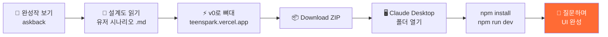

---

## 1. 완성작 둘러보기

👉 https://askback-omega.vercel.app/p/prj_mvt63v7u1cbla

아래 순서대로 눌러 보고, 오늘 만들 화면이 어떤 모습인지 눈에 담아 두세요.

| 순서 | 볼 곳 | 확인할 것 |
| ---: | --- | --- |
| 1 | 대화 화면 전체 | 왼쪽: 프로젝트 목록 / 가운데: 대화 / 위: 진행률 |
| 2 | AI 답변 끝의 🙋 되묻기 | 답을 **다 준 다음** 딱 하나만 되물어요 |
| 3 | 입력창 옆 여섯 축 칩 (❓왜 📍맥락 🧱제약 📏기준 ⚖검증 ✂️버릴 것) | 칩을 누르면 내 문장 뒤에 빈칸이 붙어요 |
| 4 | 🧭 퀴즈 카드 (질문 2개마다) | 앱이 선생님 대신 점검해요 |
| 5 | 📊 리포트 (질문 10개마다) | 내 질문이 O5 → O3로 바뀐 기록 |
| 6 | 기획서 미리보기 · 내보내기 | `.md`로 내려받아 그대로 제출 |

> 🤔 **생각해 보기:** 이 앱은 몇 개의 **페이지**로 쪼갤 수 있을까요? (힌트: 설계서 1절 사이트 맵)

> 💡 완성작을 먼저 보는 이유 = **목적지를 알아야 길을 물어볼 수 있으니까요.**

---

## 2. 유저 시나리오 .md 읽기

### 왜 코드보다 .md가 먼저일까?

AI에게 `급식 앱 만들어줘`라고 하면 **아무나 쓰는 급식 앱**이 나와요.
`견과류 알레르기가 있는 민지가 아침에 3초 안에 확인하는 화면`이라고 하면 **민지의 앱**이 나와요.
그 차이를 만드는 게 바로 `.md` 파일이에요.

| 파일 | 역할 | 비유 |
| --- | --- | --- |
| `5일차_틴스파크AI_유저시나리오.md` | **누가, 왜, 어떤 순서로** 쓰는가 | 영화 시나리오 |
| `5일차_틴스파크AI_v0_페이지설계.md` | **어떤 화면이, 몇 개, 어떻게** 생겼나 + v0 프롬프트 | 건축 설계도 |

### 꼭 읽을 부분

**유저 시나리오 파일**
1. **1절 한 줄 정의** — "답을 다 주고, 끝에 '너라면?'을 한 번 더"
2. **6절 페르소나** — 서연(중2) · 도윤(고2) · 하린(초5) · 김 선생님
3. **7절 시나리오 A** — 서연의 첫 수업 45분

**페이지 설계서 파일**
1. **0절 v0 다섯 가지 규칙** — 한 번에 한 페이지 / 공통 디자인 먼저 / 가짜 데이터 / localStorage / 프롬프트 복사
2. **1절 사이트 맵** — 12개 페이지
3. **3-4절 `/p/[id]` 대화 화면 ⭐** — 앱의 심장

### ✍️ 활동

> 페르소나 4명 중 **나는 누구를 위해 만들까?** 한 명 골라 적어 두세요.
>
> 내 페르소나: ________________
>
> → Claude에게 요청할 때 "**서연이가 쓰기 편하게**"처럼 붙여 쓸 거예요.

### 두 파일은 이렇게 이어져요

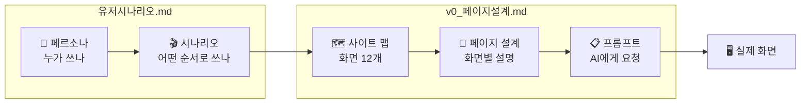

> 💡 `.md` 파일은 **AI에게 주는 설명서**이자 **내가 발표할 때 쓰는 대본**이에요.

---

## 3. v0로 만든 뼈대 이해하기

👉 https://teenspark.vercel.app/

### 이 사이트는 이렇게 만들어졌어요

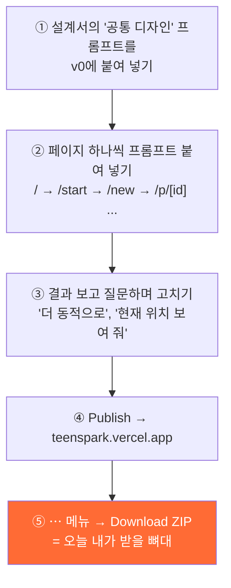

### 실제로 v0에 했던 질문 예시

> 🧑‍💻 "좀 더 UI를 개선해 주세요. 동적으로 움직이고 UX를 좀 더 해 주세요. **상단의 현재 위치**를 보여 주고 **반응형** 웹페이지로 만들어 주세요."
>
> 🤖 v0가 바꾼 것:
> - 데스크톱 상단에 현재 위치(`/ 홈`)와 `우주 탐험 중` 상태 표시
> - 모바일 헤더에도 현재 위치 표시
> - 마우스를 움직이면 행성이 따라 움직이는 효과
> - 행성·위성·궤도·별빛 애니메이션 + "모션 감소" 설정 대응
> - 모바일에서 버튼과 내용이 세로로 자연스럽게 배치

**한 번에 완성된 게 아니에요.** 이렇게 여러 번 묻고 고쳐서 완성했어요.

### 왜 클론(복제)해서 시작할까?

| 0부터 만들기 | 클론해서 고치기 |
| --- | --- |
| "앱 만들어 줘" → 결과가 매번 다름 | "이 버튼 색만 주황으로" → 정확히 그 부분만 바뀜 |
| 폴더·라이브러리 설정에서 막힘 | 이미 실행되는 상태에서 출발 |
| 90분 안에 완성 어려움 | 90분 안에 **내 버전** 완성 가능 |

> 💡 이미 돌아가는 사이트가 있으면 "**여기 이 부분을 이렇게**"라고 비교하며 질문할 수 있어요.

---

## 4. Claude Desktop 설치 · 로그인 · 기본 셋팅

### 셋팅 전체 흐름

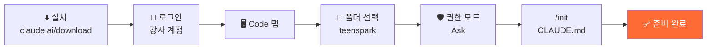

### 4-1. 설치

1. https://claude.ai/download 접속
2. 내 컴퓨터(macOS / Windows)에 맞는 파일 다운로드
3. 설치 후 실행

### 4-2. 로그인 — 오늘은 **강사 계정**으로

선생님이 화면에 안내하는 방법으로 로그인해요.

| ✅ 해도 되는 것 | ❌ 하면 안 되는 것 |
| --- | --- |
| 오늘 실습 폴더 열기, 코드 요청 | 개인정보·비밀번호·사진 올리기 |
| 실습용 대화 만들기 | 계정 설정·결제 메뉴 건드리기 |
| 수업 끝나고 **로그아웃** | 다른 사람의 대화 열어 보기 |

> ⚠️ 수업이 끝나면 반드시 **왼쪽 아래 계정 메뉴 → 로그아웃**!

### 4-3. 권한 모드(Ask)에서 Claude가 일하는 방식

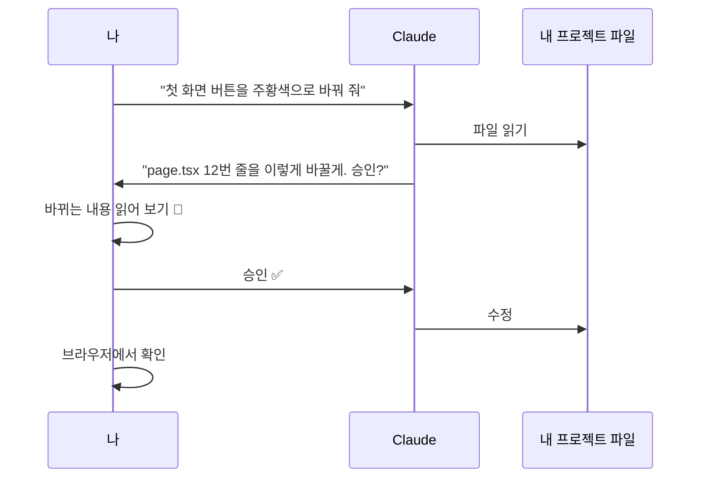

### 4-4. 화면 구성

오늘 쓰는 건 위쪽의 **Code 탭**이에요.

| 탭 | 하는 일 | 오늘 |
| --- | --- | --- |
| Chat | 일반 대화 (질문, 글쓰기) | 개념이 궁금할 때 |
| **Code** | **내 컴퓨터 폴더를 열고** 파일을 읽고·고치고·명령어 실행 | ⭐ 메인 |

### 4-5. 기본 셋팅 체크리스트

| ✔ | 설정 | 어떻게 | 왜 |
| :-: | --- | --- | --- |
| ☐ | **작업 폴더 선택** | 새 세션 → 폴더 선택 → 압축 푼 `teenspark` 폴더 | Claude가 **이 폴더 안만** 보고 고치게 |
| ☐ | **권한 모드** | 입력창 아래 모드 선택 → 처음엔 **"매번 물어보기(Ask)"** | 무엇이 바뀌는지 눈으로 보며 배우기 |
| ☐ | **모델 선택** | 입력창 아래 모델 메뉴 | 선생님이 정한 모델 그대로 |
| ☐ | **CLAUDE.md 만들기** | 첫 요청으로 `/init` 입력 | 프로젝트 규칙을 Claude가 매번 기억 |
| ☐ | **미리보기** | `npm run dev` 후 `localhost:3000` 열기 | 고치자마자 화면 확인 |

### 4-6. CLAUDE.md에 우리 반 규칙 넣기

`/init`이 끝나면 아래 문장을 복사해서 Claude에게 보내세요.

```text
CLAUDE.md 맨 아래에 다음 규칙을 추가해 줘.
- 이 프로젝트는 UI만 만든다. 진짜 AI 연결, 서버, 로그인은 하지 않는다.
- 데이터는 가짜 데이터(mock)와 localStorage만 쓴다.
- 모든 문구는 한국어, 코치 말투는 반말("~해 볼래?").
- 설계는 docs/5일차_틴스파크AI_v0_페이지설계.md 를 따른다.
- 한 번에 한 페이지만 고친다.
```

> 💡 CLAUDE.md = **Claude에게 주는 우리 반 규칙표**. 한 번 써 두면 매번 다시 말할 필요가 없어요.

---

## 5. 프로젝트 실행하기

### 실행 흐름 한눈에 보기

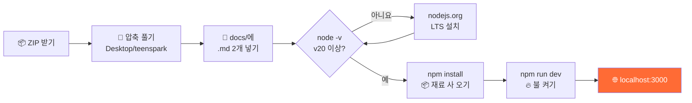

### 프로젝트 폴더 구조 (대략)

```text
teenspark/
├── app/              ← 페이지들 (page.tsx = 화면 하나)
│   ├── page.tsx      ← / 첫 화면
│   ├── start/        ← /start
│   ├── new/          ← /new
│   └── p/[id]/       ← /p/[id] 대화 화면 ⭐
├── components/       ← 버튼·카드 같은 부품
├── docs/             ← 오늘 넣을 .md 2개
├── package.json      ← 레시피 (재료 목록)
└── node_modules/     ← npm install 후 생기는 재료 창고
```

> 실제 폴더 이름은 v0가 만든 것에 따라 조금 다를 수 있어요. 헷갈리면 Claude에게 "이 프로젝트 폴더 구조 설명해 줘"라고 물어보세요.

### 5-1. 뼈대 코드 받기

1. 선생님이 공유한 ZIP 파일 받기 (v0의 `⋯` 메뉴 → **Download ZIP** 으로 받은 파일)
2. **바탕화면/`teenspark`** 폴더에 압축 풀기
3. 두 개의 .md 파일을 `teenspark/docs/` 폴더에 넣기
4. Claude Desktop Code 탭에서 `teenspark` 폴더를 작업 폴더로 선택

> ⚠️ 폴더 이름·경로에 **한글이나 띄어쓰기가 없게** 하면 오류가 적어요.

### 5-2. Node.js 확인

```bash
node -v
```

- `v20.x` 이상이 나오면 OK
- `command not found`가 나오면 https://nodejs.org 에서 **LTS 버전** 설치 → 터미널 다시 열기

### 5-3. 두 줄로 실행하기

```bash
npm install
```

> 📦 **npm install** = 레시피(`package.json`)에 적힌 **재료(라이브러리)를 장 보러 가는 것**. 처음 한 번만, 1~3분 걸려요. `node_modules` 폴더가 생겨요.

```bash
npm run dev
```

> 🔥 **npm run dev** = 재료로 **요리를 시작하고 불을 켜 두는 것**. 켜져 있는 동안 코드를 고치면 화면이 **자동으로** 바뀌어요.

터미널에 `Local: http://localhost:3000` 이 보이면 브라우저에서 열어 보세요.

### 5-4. 막히면 Claude에게

```text
이 프로젝트를 실행하고 싶어. 필요한 설치를 하고 개발 서버를 켜서 미리보기로 보여 줘.
```

> 직접 쳐 보는 게 먼저예요. 원리를 알아야 오류가 나도 설명할 수 있거든요.

### 5-5. 자주 나는 오류

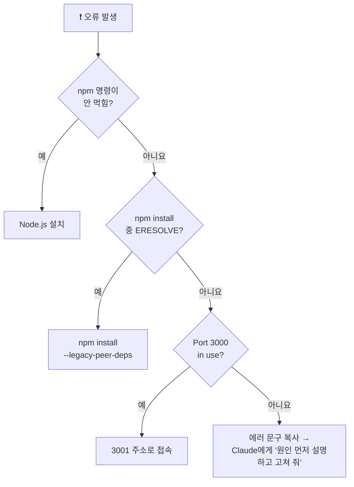

| 증상 | 원인 | 해결 |
| --- | --- | --- |
| `npm: command not found` | Node.js 미설치 | nodejs.org에서 LTS 설치 → 터미널 다시 열기 |
| `ERESOLVE unable to resolve dependency` | 라이브러리 버전 충돌 | `npm install --legacy-peer-deps` |
| `Port 3000 is in use` | 이미 다른 서버가 켜져 있음 | 3001 등 다른 주소로 열림 → 그 주소로 접속 |
| 화면이 하얗고 빨간 에러 | 코드 오류 | 에러 문구를 **그대로 복사**해서 Claude에게 "이 에러 고쳐 줘" |
| `pnpm-lock.yaml` 관련 경고 | v0가 pnpm 기준으로 만든 파일 | 무시해도 돼요 (npm으로 진행) |

✅ **체크포인트:** `localhost:3000`에서 **"아이디어에 불꽃, 설계는 내가."** 첫 화면이 보이나요?

---

## 6. UI 만들기 실습 ⭐

> **규칙:** 오늘은 **UI만**! 진짜 AI가 대답할 필요 없어요. 가짜 데이터로 "그럴듯하게" 보이면 성공.
>
> **목표:** 미션 **하나**를 골라 **Before → After** 가 눈에 보이게 바꾸고, 바꾼 이유를 **내 말로** 설명할 수 있으면 끝!

### 6-0. 25분 이렇게 써요

| 시간 | 할 일 | 남는 것 |
| --- | --- | --- |
| 55~58분 | 미션 고르기 · **Before 캡처** | `before.png` |
| 58~62분 | 설계서 읽히기 → 계획 3줄 받기 | Claude의 계획 |
| 62~72분 | 한 부분씩 만들기 (2~3번 반복) | 바뀐 화면 |
| 72~77분 | 다듬기 — 상태 5종 · 모바일 폭 점검 | 점검표 체크 |
| 77~80분 | **After 캡처** · 요청 기록 정리 | `after.png` · 요청문 3개 |

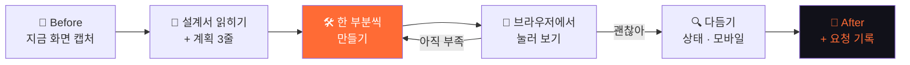

> 💡 **Before 캡처를 꼭 먼저!** 나중에 "뭘 바꿨는지" 설명할 때 가장 강력한 증거가 돼요.

### 6-1. 오늘 만들 화면 지도

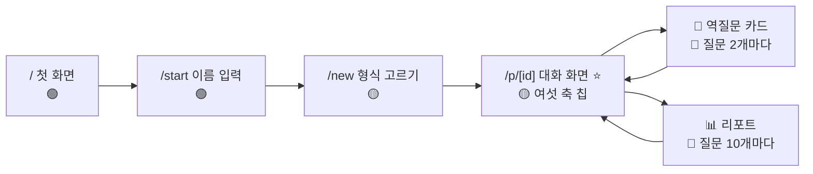

### 6-2. UI를 보는 다섯 가지 눈

화면이 "별로"라고 느껴질 때, 사실은 아래 다섯 개 중 하나가 문제예요. **무엇이 문제인지 이름을 붙일 수 있으면**, Claude에게도 정확히 요청할 수 있어요.

| 눈 | 스스로 묻기 | 틴스파크AI에서는 | Claude에게 이렇게 |
| --- | --- | --- | --- |
| 👁 **위계** | 제일 먼저 눈에 들어오는 게 **딱 하나**인가? | 첫 화면에선 "🚀 시작하기" | "제목 다음으로 시작 버튼이 제일 눈에 띄게 해 줘" |
| 🌗 **대비** | 글자가 배경에서 **잘 읽히나**? | 회색 `#b7b3d6` 글자 on 남색 `#111119` | "보조 글자가 어두운 배경에서 잘 읽히는지 확인해 줘" |
| 📐 **간격** | 같은 묶음은 가깝고, 다른 묶음은 멀리 있나? | 칩끼리는 촘촘, 섹션끼리는 넉넉 | "칩 사이는 8px, 섹션 사이는 24px로" |
| 🧩 **일관성** | 같은 역할은 **같은 모양**인가? | 주요 버튼은 전부 주황 그라데이션 | "이 페이지 버튼을 첫 화면 시작 버튼과 같은 스타일로" |
| 👆 **피드백** | 누르면 **반응**하나? | hover 시 떠오름, 선택된 칩 테두리, 로딩 점 3개 | "누르면 눌렸다는 게 보이게 해 줘" |

> 🤔 **해 보기:** 완성작(askback)과 내 `localhost:3000`을 나란히 띄워 놓고, 다섯 눈 중 **가장 차이가 큰 것 하나**를 골라 보세요. 그게 내 첫 요청이에요.

### 6-3. UI 단어장 — "예쁘게" 대신 쓸 말

"예쁘게 해 줘"는 **O5 질문**이에요. 누구에게나 같은 답이 와요. 아래처럼 바꾸면 **O3 질문**이 돼요.

| 😐 막연한 말 | 😎 정확한 말 | (참고) Tailwind로는 |
| --- | --- | --- |
| "크게" | "제목을 지금보다 두 단계 크게, 굵게" | `text-4xl font-bold` |
| "여백 좀" | "카드 안쪽 여백 넉넉히, 카드 사이 16px" | `p-6` · `gap-4` |
| "둥글게" | "모서리를 많이 둥글게" | `rounded-2xl` |
| "떠 보이게" | "그림자 + 마우스 올리면 살짝 위로" | `shadow-lg hover:-translate-y-1` |
| "부드럽게" | "바뀔 때 0.2초 동안 천천히" | `transition duration-200` |
| "강조" | "주황 `#FF6B35` 테두리 2px" | `border-2 border-[#FF6B35]` |
| "덜 중요하게" | "글자색을 회색 `#b7b3d6`, 작게" | `text-sm text-[#b7b3d6]` |
| "모바일에서도" | "375px 폭에서 1열, 768px 이상에서 2열" | `grid-cols-1 md:grid-cols-2` |
| "움직이게" | "아래에서 위로 0.3초 슬라이드, 모션 감소 설정이면 끄기" | `motion-safe:animate-...` |

> 💡 Tailwind 이름은 외우지 않아도 돼요. **왼쪽 말을 오른쪽 말로 바꾸는 습관**만 있으면 Claude가 코드로 바꿔 줘요.

### 6-4. 모든 미션 공통 — 디자인 토큰 먼저 맞추기 (2분)

**토큰** = 앱 전체가 함께 쓰는 색·글꼴·모서리 값. 이걸 먼저 맞춰 두면, 어느 화면을 고쳐도 **같은 앱처럼** 보여요. (설계서 2-1절)

| 토큰 | 값 | 어디에 |
| --- | --- | --- |
| 불꽃 주황 | `#FF6B35` | 주요 버튼, 강조, 선택 상태 |
| 그라데이션 | `#FF4D00 → #FF6B35 → #FFA35C` | 로고, 큰 버튼 |
| 배경 | `#111119` | 화면 전체 |
| 카드 | `#1a1a22` | 말풍선, 카드 |
| 보조 글자 | `#b7b3d6` | 설명, 힌트 |
| 여섯 축 | ❓왜 `#a78bfa` · 📍맥락 `#60a5fa` · 🧱제약 `#34d399` · 📏기준 `#fbbf24` · ⚖검증 `#67e8f9` · ✂️버릴 것 `#f472b6` | 축 칩 |
| 모서리 | `rounded-2xl` | 카드, 버튼 |

```text
@docs/5일차_틴스파크AI_v0_페이지설계.md 의 "2-1. 디자인 규칙" 색들이
지금 프로젝트(globals.css 또는 tailwind 설정)에 변수로 들어 있는지 확인해 줘.
없는 것만 표로 알려 주고, 추가는 내가 승인하면 해 줘. 화면은 아직 바꾸지 마.
```

### 6-5. 대화 화면 해부도 — 어디를 고칠지 번호로 말하기

대화 화면(`/p/[id]`)은 조각이 많아요. 조각마다 **번호**를 붙여 두면 "⑥번 입력창 위에 칩을 놓아 줘"처럼 정확히 말할 수 있어요.

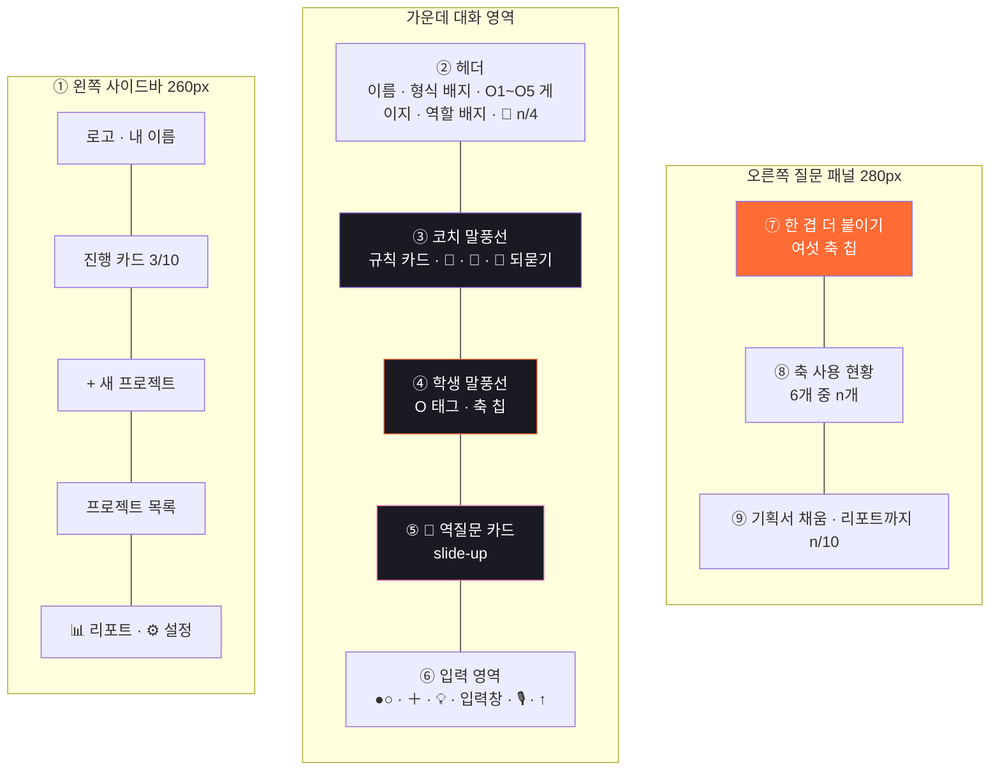

| 번호 | 조각 | 설계서 | 관련 미션 |
| ---: | --- | --- | --- |
| ① | 왼쪽 사이드바 (모바일에선 ☰ 서랍) | 2-2 | 공통 |
| ② | 헤더 — 열림 게이지 · 역할 배지 · 🧩 | 3-4 | 🟡 |
| ③④ | 코치 / 학생 말풍선 | 3-4 | 🟡 |
| ⑤ | 🧭 역질문 카드 | 3-5 | 🔴 E |
| ⑥ | 입력 영역 | 3-4 | 🟡 D |
| ⑦⑧ | 여섯 축 칩 · 축 사용 현황 | 3-4 | 🟡 D |
| ⑨ | 기획서 채움 · 리포트 진행 | 3-4 | 🔴 F |

```text
이 대화 화면에서 ①~⑨ 조각이 각각 어느 파일(컴포넌트)에 있는지 표로 알려 줘.
아직 고치지는 마.
```

### 6-6. 미션 고르기

| 레벨 | 미션 | 설계서 | 예상 | 완성 기준 (이게 되면 끝) |
| --- | --- | --- | --- | --- |
| 🟢 A | 첫 화면(`/`)을 **내 페르소나에 맞게** | 3-1 | 15분 | 3초 안에 시작 버튼이 보인다 |
| 🟢 B | `/start` 이름·학년 입력 화면 | 3-2 | 15분 | 이름이 비면 "다음"이 꺼진다 |
| 🟡 C | `/new` 형식 카드 5개 | 3-3 | 20분 | hover 반응 + 모바일 1열 / 넓으면 2열 |
| 🟡 D | ⑦ **여섯 축 칩** (누르면 빈칸 문장 추가) | 3-4 | 20분 | 칩 6개 색이 다르고, 누르면 문장이 붙는다 |
| 🔴 E | ⑤ 🧭 **역질문 카드** — 질문 2개마다 | 3-5 | 25분+ | 정답/오답에 따라 테두리 색이 바뀐다 |
| 🔴 F | 📊 **리포트** — O1~O5 그래프 | 3-6 | 25분+ | 막대 5개 + 목표 배합 점선이 보인다 |

내가 고른 미션: ________________  내 페르소나: ________________

> 💡 처음이면 🟢, 실행이 바로 됐으면 🟡, 🟡를 끝냈으면 시간이 남을 때 🔴에 도전해요.

### 6-7. 요청하는 4단계

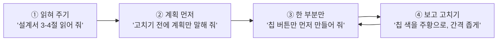

아래 미션 카드의 요청문은 모두 이 4단계를 따라요. `{페르소나}` 자리에는 내가 고른 사람을 넣으세요.

### 6-8. 미션 카드

<details open>
<summary><b>🟢 A · 첫 화면 — "3초 안에 시작"</b></summary>

**완성 기준**
- [ ] 제목 → 시작 버튼 순서로 눈이 간다 (👁 위계)
- [ ] 부제 문구가 내 페르소나의 말투다
- [ ] 375px 폭에서 버튼 두 개가 세로로 쌓이고, 손가락으로 누르기 충분히 크다
- [ ] 저장된 이름이 있으면 "○○, 다시 왔구나! 🔥" 가 보인다

```text
① @docs/5일차_틴스파크AI_v0_페이지설계.md 의 "3-1" 과 지금 첫 화면을 비교해서
   다른 점을 3개만 알려 줘. 고치지는 마.
```
```text
② {페르소나}가 처음 들어와서 3초 안에 "🚀 시작하기"를 찾게 하고 싶어.
   버튼을 더 크게, 주황 글로우를 은은하게, 제목과 버튼 사이 간격은 좁게.
   문구는 바꾸지 말고, 어떤 파일을 고칠지 먼저 말해 줘.
```
```text
③ 부제를 {페르소나} 말투로 바꾼 후보 3개만 보여 줘. 고르는 건 내가 할게.
```
</details>

<details>
<summary><b>🟢 B · /start — "가입이 아니라 이름표"</b></summary>

**완성 기준**
- [ ] 이름이 비어 있으면 "다음 →" 버튼이 회색(비활성)
- [ ] 10자를 넘기면 입력칸 아래 빨간 안내 "10자까지 쓸 수 있어"
- [ ] 선택한 학년 칩이 주황으로 확실히 구분된다 (👆 피드백)
- [ ] 초5·초6을 고르면 "✅ 간편 모드가 켜져요" 안내가 나타난다

```text
① 설계서 "3-2" 의 상태별 화면 표를 읽고, 지금 /start 에서 빠진 상태를 알려 줘.
```
```text
② 빠진 상태 중 "이름 비면 버튼 비활성" 하나만 먼저 만들어 줘.
```
```text
③ 학년 칩 9개가 모바일 폭에서 줄바꿈이 어색해. 3개씩 3줄로 정렬하고,
   선택된 칩은 주황 배경 + 흰 글자로 바꿔 줘.
```
</details>

<details>
<summary><b>🟡 C · /new — 형식 카드 5개</b></summary>

**완성 기준**
- [ ] 카드 5개가 각자 다른 은은한 색 (청록·파랑·주황·초록·보라)
- [ ] 마우스를 올리면 살짝 떠오르고 테두리가 주황
- [ ] 375px에서 1열, 768px 이상에서 2열
- [ ] 카드를 누르면 아래에서 확인 시트가 올라온다

```text
① 설계서 "3-3" 의 카드 표(이름 · 만들어지는 것 · 알고리즘 · 카드 색)를 읽고,
   지금 카드와 다른 칸만 표로 정리해 줘.
```
```text
② {페르소나}가 크롬북에서 다섯 개를 한눈에 비교할 수 있게 하고 싶어.
   카드 안 글자 위계를 "이모지 > 이름 > 만들어지는 것 > 알고리즘" 순으로 정리하고,
   알고리즘 줄은 작은 회색 글씨로. 카드 클릭 동작은 아직 건드리지 마.
```
```text
③ hover 효과를 넣어 줘: 0.2초 동안 위로 4px, 테두리 주황.
   모션 감소 설정인 사람에겐 움직임 없이 테두리만 바뀌게.
```
</details>

<details>
<summary><b>🟡 D · ⑦ 여섯 축 칩 — "지금 질문에 한 겹 더"</b></summary>

**완성 기준**
- [ ] 칩 6개가 각자 고유 색 (6-4 토큰 표)
- [ ] 누르면 입력창 내 문장 **뒤에** 빈칸 문장이 붙는다 (덮어쓰지 않는다)
- [ ] 보낸 질문에 쓴 축은 ⑧ "6개 중 n개 써 봤어"에서 색이 채워진다
- [ ] 모바일 폭에서는 칩이 가로로 스크롤된다

| 칩 | 붙는 문장 |
| --- | --- |
| ❓ 왜 | " 이걸 하려는 이유는 ___ 이야." |
| 📍 맥락 | " ___가 ___ 상황에서 쓸 거야." |
| 🧱 제약 | " 내가 쓸 수 있는 건 ___ 뿐이야." |
| 📏 기준 | " ___ 하면 성공이야." |
| ⚖ 검증 | " ___ 해서 맞는지 확인할래." |
| ✂️ 버릴 것 | " ___ 은 이번엔 안 만들 거야." |

```text
① 설계서 "3-4" 의 오른쪽 질문 패널 부분을 읽고, ⑦ 칩을 넣을 파일을 찾아 줘.
   계획만 3줄로.
```
```text
② 칩 버튼 6개만 먼저 만들어 줘. 색은 설계서 2-1의 여섯 축 색.
   누르면 입력창 내용 뒤에 위 표의 문장이 붙게. 진짜 AI 연결은 하지 마.
```
```text
③ (화면 캡처 붙여 넣기)
   모바일 폭에서 칩이 두 줄로 넘쳐. 가로 스크롤로 바꾸고,
   이번 질문에 이미 붙인 칩은 색을 채워서 표시해 줘.
```
**한 걸음 더:** "칩을 누르면 커서가 `___` 위치로 가서 바로 타이핑할 수 있게 해 줘."
</details>

<details>
<summary><b>🔴 E · ⑤ 🧭 역질문 카드</b></summary>

**완성 기준**
- [ ] 화면 전체를 가리는 팝업이 아니라 **대화 맨 아래에서 올라오는 카드**
- [ ] 분홍 `#f472b6` 테두리 + 관문 라벨(🔲 순서도 / 🎯 핵심 / ⚡ 차별점 / 💥 실패 조건)
- [ ] 보기 ①~④, ④는 항상 "잘 모르겠어"
- [ ] 정답이면 초록 테두리 해설, 오답이면 주황 테두리 + "다시 해 볼래?"
- [ ] 오른쪽 위 [나중에] 를 누르면 카드가 접힌다

```text
① 설계서 "3-5" 를 읽고, 역질문 카드에 필요한 상태(처음 · 정답 · 오답 · 잘 모르겠어 · 나중에)를
   표로 정리해 줘. 아직 만들지 마.
```
```text
② 설계서의 JSON 예시(💥 실패 조건) 하나만 mock 데이터로 써서 카드 UI만 먼저 만들어 줘.
   질문 2개마다 뜨는 로직은 다음에. 지금은 대화 아래에 항상 보이게.
```
```text
③ 정답/오답 해설이 나타날 때 0.3초 펼쳐지는 애니메이션을 넣고,
   정답이면 헤더 🧩 숫자 옆에 작은 도장 효과를 넣어 줘.
```
</details>

<details>
<summary><b>🔴 F · 📊 리포트 — 질문의 넓이 그래프</b></summary>

**완성 기준**
- [ ] O1~O5 막대 5개 + 지금 국면 목표 배합이 **점선**으로 겹쳐 보인다
- [ ] 여섯 축 레이더 차트, 축마다 고유 색
- [ ] 축을 하나도 안 썼을 때 빈 상태 문구가 나온다
- [ ] 넓은 화면 2열, 모바일 1열 카드 격자

```text
① 설계서 "3-6" 의 8칸 중 "2 질문 유형" 과 "4 실은 것" 두 칸만 만들 거야.
   지금 프로젝트에 차트 라이브러리(recharts 등)가 있는지 먼저 확인해 줘.
```
```text
② 설계서 mock 데이터(O5 2 · O2 2 · O3 4 · O4 2)로 O1~O5 막대 차트를 만들어 줘.
   설계 국면 목표(O2 20% · O3 40% · O4 40%)는 회색 점선으로 겹쳐서.
```
```text
③ 축을 하나도 안 쓴 경우를 볼 수 있게 mock을 바꿔 보고,
   그때는 레이더 대신 "아직 한 겹도 안 붙였어. 칩 하나만 눌러 볼래?" 를 보여 줘.
```
</details>

### 6-9. 상태 5종 점검 — UI는 "평소 모습"만이 아니에요

잘 만든 앱과 그냥 만든 앱의 차이는 **평소가 아닐 때** 드러나요. 내가 고친 화면에서 다섯 가지를 확인해 보세요.

| 상태 | 언제 | 틴스파크AI 예시 | ✔ |
| --- | --- | --- | :-: |
| 🟢 기본 | 데이터가 있을 때 | 대화가 몇 개 쌓인 화면 | ☐ |
| ⚪ 비어 있음 | 처음 들어왔을 때 | 코치 첫 인사 + 예시 질문 버튼 3개 | ☐ |
| ⏳ 기다리는 중 | 코치가 답하는 중 | 말풍선 자리에 점 3개 깜빡임 | ☐ |
| 🔴 잘못됨 | 입력이 틀렸을 때 | 이름 10자 초과 → 빨간 안내 | ☐ |
| 👆 선택·hover | 마우스를 올리거나 눌렀을 때 | 선택된 칩 · 떠오르는 카드 | ☐ |

```text
지금 고친 화면의 "비어 있음 / 기다리는 중" 상태를 내가 눈으로 볼 수 있게,
개발할 때만 보이는 작은 상태 전환 버튼을 화면 오른쪽 아래에 임시로 달아 줘.
```

> 💡 이 버튼은 확인이 끝나면 "임시 상태 버튼 지워 줘"로 꼭 지워요.

### 6-10. 모바일 폭 · 쓰기 편한지 점검 (3분)

틴스파크AI는 **크롬북·태블릿**이 주 기기, 스마트폰이 보조예요. 세 가지 폭에서 확인해요.

1. 브라우저에서 개발자 도구 열기 — Windows `F12` / macOS `Cmd + Option + I`
2. 기기 모양 아이콘(📱) 누르기 — Windows `Ctrl + Shift + M` / macOS `Cmd + Shift + M`
3. 폭을 **375 (폰) → 768 (태블릿) → 1280 (크롬북)** 으로 바꿔 가며 보기

| 점검 | 확인 방법 | ✔ |
| --- | --- | :-: |
| 가로 스크롤이 안 생긴다 | 375px에서 좌우로 밀어 보기 | ☐ |
| 버튼이 손가락으로 누를 만하다 | 버튼 높이가 대략 44px 이상 | ☐ |
| 글자가 잘 읽힌다 | 회색 글씨가 배경에 묻히지 않는지 | ☐ |
| 키보드로도 쓸 수 있다 | `Tab` 키로 이동할 때 테두리가 보이는지 | ☐ |
| 움직임이 과하지 않다 | 애니메이션이 내용을 가리지 않는지 | ☐ |

```text
(375px 화면 캡처 붙여 넣기)
폰 폭에서 이 부분이 깨져. 원인을 한 줄로 먼저 설명하고, 이 부분만 고쳐 줘.
768px 이상 화면은 지금 그대로 두고.
```

### 6-11. 에러가 났을 때

```text
화면에 이 에러가 떠. 원인을 먼저 한 줄로 설명하고 고쳐 줘.
(에러 문구 그대로 붙여 넣기)
```

> 화면이 엉망이 됐다면? "방금 바꾼 것만 되돌려 줘"라고 말하면 돼요. 한 번에 한 부분만 바꿨기 때문에 되돌리기도 쉬워요.

### 6-12. 스스로 점검하기

- [ ] **Before 캡처**를 먼저 찍었나요?
- [ ] 한 번에 **한 페이지 / 한 부분**만 요청했나요?
- [ ] "예쁘게" 대신 **UI 단어장**의 말로 요청했나요?
- [ ] Claude가 바꾸려는 내용을 **읽고 나서** 승인했나요?
- [ ] 바꾼 뒤 **브라우저에서 직접 눌러** 봤나요?
- [ ] **상태 5종** 과 **375px 폭**을 확인했나요?
- [ ] 후보 중 **고르는 건 내가** 했나요?

### 📝 내 요청 기록

| # | 내가 한 요청 | 붙인 축 | 무엇이 바뀌었나 | 다음에 고칠 점 |
| ---: | --- | --- | --- | --- |
| 1 | | | | |
| 2 | | | | |
| 3 | | | | |

### 📸 Before / After

| Before | After |
| --- | --- |
| (캡처 붙이기) | (캡처 붙이기) |
| 문제였던 점 — 다섯 눈 중: ______ | 바꾼 이유 — 내 말로: ______ |

---

## 7. Claude Desktop 잘 쓰는 법

### 7-1. 좋은 요청 vs 나쁜 요청

| ❌ 나쁜 요청 (O5, 너무 열림) | ✅ 좋은 요청 (O3, 조건 있는 열린 질문) |
| --- | --- |
| "앱 예쁘게 만들어 줘" | "서연이(중2)가 크롬북에서 쓰는 첫 화면이야. 시작 버튼이 3초 안에 눈에 띄게 바꿔 줘" |
| "에러 고쳐" | "`npm run dev` 후 이 에러가 떠(붙여 넣기). 원인 먼저 설명하고 고쳐 줘" |
| "다 만들어 줘" | "설계서 3-3절만 먼저. 카드 5개 UI만, 클릭 동작은 다음에" |

> 💡 틴스파크AI에서 배운 **여섯 축**(왜·맥락·제약·기준·검증·버릴 것)을 **Claude에게 요청할 때도 그대로** 써요. 틴스파크AI의 원리 = 오늘 우리가 Claude를 쓰는 원리!

### 요청에 여섯 축 붙이기

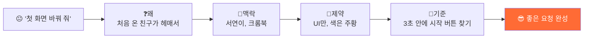

| 축 | Claude에게 붙일 말 예시 |
| --- | --- |
| ❓ 왜 | "처음 온 친구가 어디를 눌러야 할지 헤매서" |
| 📍 맥락 | "서연이(중2)가 학교 크롬북에서 써" |
| 🧱 제약 | "UI만 바꿔. 다른 파일은 건드리지 마" |
| 📏 기준 | "3초 안에 시작 버튼이 눈에 띄면 성공" |
| ⚖ 검증 | "모바일 폭에서도 확인해 줘" |
| ✂️ 버릴 것 | "애니메이션은 이번엔 빼고" |

### 7-2. 꼭 기억할 7가지 습관

| # | 습관 | 한 줄 설명 |
| ---: | --- | --- |
| 1 | **폴더부터 정확히** | 작업 폴더를 잘못 열면 엉뚱한 파일을 고쳐요 |
| 2 | **CLAUDE.md에 규칙** | 매번 말할 규칙은 한 번만 적어 둬요 |
| 3 | **`@파일명`으로 가리키기** | "그 파일" 대신 `@page.tsx`처럼 정확히 |
| 4 | **계획 먼저, 실행은 나중** | 큰 변경은 "계획만 말해 줘" → 확인 → "진행해" |
| 5 | **작게 쪼개기** | 한 번에 한 화면, 한 기능 |
| 6 | **스크린샷 붙여 넣기** | 말로 설명하기 어려운 건 사진으로 |
| 7 | **승인 전에 읽기** | 바뀌는 내용을 읽고 나서 승인 |

### 7-3. 자주 쓰는 명령

| 입력 | 하는 일 |
| --- | --- |
| `/init` | 프로젝트를 읽고 CLAUDE.md 만들기 |
| `@파일명` | 특정 파일을 대화에 붙이기 |
| `/clear` (또는 새 세션) | 대화가 길어져 헷갈릴 때 새로 시작 |
| `Esc` | Claude가 엉뚱한 방향으로 갈 때 멈추기 |

### 7-4. 이런 건 Claude에게 시키지 마세요

- 비밀번호·API 키·개인정보 붙여 넣기
- "알아서 다 해 줘" → 내가 **설명 못 하는 코드**가 생겨요
- 바뀐 내용 확인 없이 승인만 계속 누르기

---

## 8. 마무리

### 제출

1. **Before / After 캡처** 2장 (6절 Before / After 표)
2. 내가 Claude에게 한 요청문 3개 (6절 기록표)
3. 한 줄 소감: 내가 고친 부분을 **내 말로** 설명하면?

> ________________________________________________

### 정리하기

- [ ] 터미널에서 `Ctrl + C` 로 `npm run dev` 끄기
- [ ] 프로젝트 폴더를 USB나 개인 클라우드에 백업
- [ ] **Claude Desktop 로그아웃** (강사 계정)

> 오늘 우리는 코드를 외우지 않았어요. 대신 **무엇을, 누구를 위해, 어떻게 바꿀지** 정확히 말했어요.
> 그게 AI 시대의 개발 실력이에요. 다음 시간엔 오늘 만든 UI에 **진짜 AI 코치**를 연결해 봐요.

---

## 📎 시간이 남으면 도전!

- 🔴 도전 미션 (역질문 카드, 리포트 그래프)
- "모바일 폭에서 깨지는 곳 찾아서 고쳐 줘"
- 내 버전에 이름을 붙이고, 첫 화면 문구를 내 페르소나에 맞게 다시 쓰기
