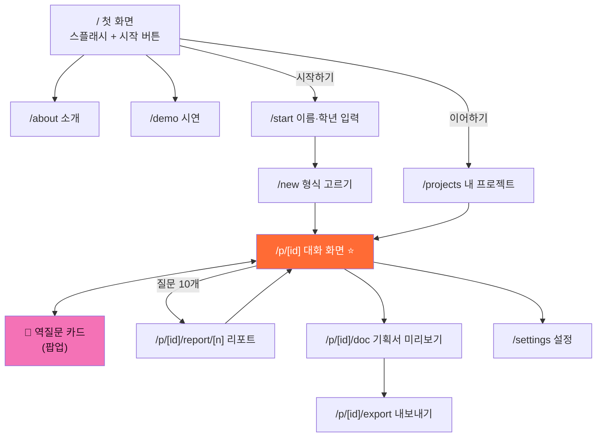
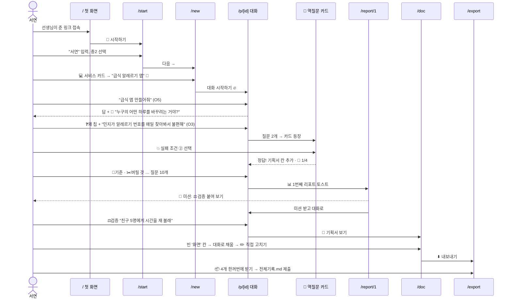

# 5일차 · 틴스파크AI v0 제작용 페이지 설계서

> **이 문서의 목적**
> v0(v0.dev)에서 **페이지를 하나씩** 만들어 틴스파크AI를 완성할 수 있도록,
> 사이트 맵 → 페이지별 서술형 설명 → v0에 붙여 넣을 프롬프트 순서로 정리했습니다.
>
> 참고: https://askback-omega.vercel.app/ · `5일차_틴스파크AI_유저시나리오.md` · 작성일 2026-11-05

---

## 0. 먼저 읽어 주세요 — v0로 만드는 방법

### v0를 쓸 때 지킬 다섯 가지

1. **한 번에 한 페이지만** 만듭니다. 앱 전체를 한 번에 시키면 화면이 엉키고 고치기 어렵습니다.
2. **공통 디자인(1절)을 먼저** 만들고, 그다음 페이지를 만들 때마다 "앞에서 만든 디자인을 그대로 써 줘"라고 덧붙입니다.
3. **진짜 AI 연결은 맨 나중에** 합니다. 처음에는 **가짜 데이터(mock)** 로 화면만 완성합니다. 코치의 답도 미리 적어 둔 문장으로 보여 줍니다.
4. 저장은 **localStorage**(내 브라우저 저장소)만 씁니다. 회원가입·로그인·서버는 V0 범위가 아닙니다.
5. 각 페이지 설명 끝의 **📋 v0 프롬프트**를 복사해서 붙여 넣고, 결과를 보면서 한 줄씩 고쳐 달라고 요청합니다.

### 기술 조건 (모든 프롬프트에 공통)

| 항목 | 내용 |
| --- | --- |
| 프레임워크 | Next.js (App Router) + TypeScript |
| 스타일 | Tailwind CSS + shadcn/ui |
| 아이콘 | lucide-react + 이모지 |
| 저장 | localStorage (가입 없음) |
| 화면 | 크롬북·태블릿 우선, 스마트폰에서도 깨지지 않게 |
| 언어 | 모든 문구는 한국어, 반말 코치 말투 ("~해 볼래?") |

### 만드는 순서 (추천)

| 순서 | 페이지 | 중요도 | 이유 |
| ---: | --- | --- | --- |
| 1 | 공통 레이아웃·디자인 | ⭐⭐⭐ | 모든 페이지가 이걸 씀 |
| 2 | `/` 첫 화면 | ⭐⭐ | 가장 단순, 연습용 |
| 3 | `/start` 이름 입력 | ⭐⭐ | 프로젝트가 만들어지는 시작점 |
| 4 | `/new` 형식 고르기 | ⭐⭐⭐ | 이후 화면 내용이 여기서 결정됨 |
| 5 | `/p/[id]` 대화 화면 | ⭐⭐⭐ | **앱의 심장.** 시간을 가장 많이 씀 |
| 6 | 역질문 카드 (대화 화면 안의 팝업) | ⭐⭐⭐ | 틴스파크AI만의 기능 |
| 7 | `/p/[id]/report` 리포트 | ⭐⭐ | 질문 10개마다 보상 |
| 8 | `/p/[id]/doc` 기획서 미리보기 | ⭐⭐ | 결과물 확인 |
| 9 | `/p/[id]/export` 내보내기 | ⭐⭐ | .md 다운로드 |
| 10 | `/projects` 내 프로젝트 | ⭐ | 이어하기 |
| 11 | `/about` 소개 · `/demo` 시연 | ⭐ | 선생님·발표용 |
| 12 | `/settings` 설정 | ⭐ | 마지막 |

---

## 1. 사이트 맵



### 페이지 목록

| URL | 페이지 이름 | 한 줄 설명 | 누가 주로 보나 |
| --- | --- | --- | --- |
| `/` | 첫 화면 | 서비스 첫인상과 "시작하기" 버튼 | 처음 온 학생 |
| `/about` | 소개 | 왜 필요한지, 어떻게 작동하는지 설명 | 선생님·학부모 |
| `/demo` | 시연 | 예시 프로젝트 대화 20개를 펼쳐 보기 | 선생님·처음 온 학생 |
| `/start` | 이름 입력 | 이름과 학년을 받아 프로젝트를 만듦 | 처음 온 학생 |
| `/new` | 형식 고르기 | 논문·리서치·캠페인·서비스·제품 중 선택 | 학생 |
| `/projects` | 내 프로젝트 | 저장된 프로젝트와 예시 프로젝트 목록 | 다시 온 학생 |
| `/p/[id]` | 대화 화면 | 코치와 대화하며 설계도를 채움 | 학생 (90% 시간) |
| `/p/[id]/report/[n]` | 리포트 | n번째 리포트 (질문 10개마다) | 학생·선생님 |
| `/p/[id]/doc` | 기획서 미리보기 | 지금까지 채워진 기획서·설계도 | 학생 |
| `/p/[id]/export` | 내보내기 | .md 4종 다운로드·복사 | 학생 |
| `/settings` | 설정 | 이름·학년·간편 모드·데이터 초기화 | 학생 |

### 화면 사이를 오가는 주요 흐름 (요약)

- **처음 온 학생:** `/` → `/start` → `/new` → `/p/[id]` → (질문 10개) → `/p/[id]/report/1` → `/p/[id]/doc` → `/p/[id]/export`
- **다시 온 학생:** `/` → `/projects` → `/p/[id]` (이어서 대화)
- **선생님:** `/` → `/about` → `/demo` → 학생에게 링크 공유

---

## 2. 공통 디자인과 레이아웃

### 2-1. 디자인 규칙

| 항목 | 값 | 설명 |
| --- | --- | --- |
| 메인 색 (불꽃 주황) | `#FF6B35` | 버튼, 강조, 코치 이름 |
| 그라데이션 | `#FF4D00 → #FF6B35 → #FFA35C` | 로고, 큰 버튼 |
| 배경 (짙은 남색) | `#111119` | 우주 느낌의 어두운 배경 |
| 카드 배경 | `#1a1a22` | 말풍선, 카드 |
| 글자 | 흰색 / 회색 `#b7b3d6` | 본문 / 보조 |
| 여섯 축 색 | 왜 `#a78bfa` · 맥락 `#60a5fa` · 제약 `#34d399` · 기준 `#fbbf24` · 검증 `#67e8f9` · 버릴 것 `#f472b6` | 축 칩마다 고유 색 |
| 글꼴 | 영문 Space Grotesk, 한글 Pretendard | |
| 로고 | 소문자 `teensparkai` — teen(흰색) + spark(주황) + ai(흐리게) + 🔥 불꽃 아이콘 | |
| 모서리 | 둥글게 (rounded-2xl) | 친근한 느낌 |

### 2-2. 공통 레이아웃 서술

앱 안쪽 화면(`/p/[id]` 아래 모든 페이지)은 **왼쪽 사이드바 + 오른쪽 본문** 두 칸 구조입니다.

**왼쪽 사이드바**(폭 약 260px)는 위에서부터 이렇게 쌓입니다. 맨 위에 `teensparkai` 로고와 "🧑‍🚀 ○○의 프로젝트"라는 이름이 있고, 오른쪽 끝에 작은 "✨ 소개" 버튼이 있습니다. 그 아래 **진행 카드**가 하나 있는데, "다음 리포트까지 3/10"처럼 별 아이콘과 함께 진행 막대가 보입니다. 그 아래 주황 테두리의 **"+ 새 프로젝트"** 버튼이 있고, 그 밑으로 **내 프로젝트 목록**(아이콘, 이름, 질문 개수)이 나옵니다. 지금 열려 있는 프로젝트는 주황 테두리로 강조됩니다. 그 아래 접을 수 있는 **"📂 예시 프로젝트"** 묶음이 있습니다. 사이드바 맨 아래에는 **📊 리포트**, **⚙️ 설정** 두 메뉴가 고정되어 있습니다.

스마트폰처럼 화면이 좁으면 사이드바는 숨겨지고, 왼쪽 위 ☰ 버튼을 누르면 서랍처럼 열립니다.

> 📋 **v0 프롬프트 — 공통 레이아웃**
> ```
> Next.js App Router + TypeScript + Tailwind + shadcn/ui로 "틴스파크AI"라는 청소년 AI 기획 코치 앱의 공통 레이아웃을 만들어 줘.
> - 다크 테마. 배경 #111119, 카드 #1a1a22, 메인 강조색 #FF6B35(불꽃 주황), 보조 글자 #b7b3d6.
> - 글꼴: 영문 Space Grotesk, 한글 Pretendard.
> - 왼쪽 사이드바(260px): 맨 위 로고(소문자 teensparkai, 'spark'만 주황, 앞에 🔥) + "🧑‍🚀 {이름}의 프로젝트" + 우측 작은 "✨ 소개" 버튼.
>   그 아래 진행 카드("⭐ 다음 리포트까지 {n}/10" + 진행 막대), 주황 점선 테두리 "+ 새 프로젝트" 버튼,
>   내 프로젝트 목록(이모지 아이콘, 이름, "질문 n개"; 선택된 항목은 주황 테두리),
>   접을 수 있는 "📂 예시 프로젝트" 목록(🌱 스마트 화분 / 🐢 거북목 감시 웹캠 / 🐶 반려동물 이상행동 일지 / 🚸 위험 등굣길 지도),
>   맨 아래 고정 메뉴 "📊 리포트", "⚙️ 설정".
> - 오른쪽 본문 영역은 children.
> - 모바일(768px 미만)에서는 사이드바를 숨기고 왼쪽 위 ☰ 버튼으로 Sheet(서랍)로 연다.
> - 데이터는 지금은 mock 배열로. 모든 문구는 한국어.
> ```

### 2-3. 공통 데이터 모양 (localStorage에 저장)

v0에 "이 모양으로 저장해 줘"라고 알려 주면 페이지끼리 데이터가 이어집니다.

```ts
// 사용자
type User = { name: string; grade: string; simpleMode: boolean };

// 프로젝트 하나
type Project = {
  id: string;                 // "prj_abc123"
  title: string;              // "급식 알레르기 앱"
  emoji: string;              // "🍱"
  format: "paper" | "research" | "campaign" | "service" | "product";
  messages: Message[];        // 대화 전체
  axesUsed: Axis[];           // 써 본 여섯 축
  gates: { flow: boolean; core: boolean; diff: boolean; fail: boolean }; // 화이트보드 4관문
  doc: Record<string, string>; // 기획서 칸 채움 내용
  reports: Report[];
  createdAt: string;
};

type Axis = "why" | "context" | "limit" | "criteria" | "verify" | "drop";

type Message = {
  role: "student" | "coach";
  text: string;
  openness?: "O1" | "O2" | "O3" | "O4" | "O5"; // 학생 질문의 열림 정도
  axes?: Axis[];                               // 이 질문에 붙인 축
  askBack?: string;                            // 코치 답 끝의 🙋 되묻기
  decided?: string[];                          // 🫵 학생이 정한 것
  assumed?: string[];                          // 📌 AI가 가정한 것
};
```

---

## 3. 페이지별 설계

각 페이지는 **① 이 페이지는 왜 있나 → ② 화면 서술 → ③ 사용자가 하는 일 → ④ 상태별 화면 → ⑤ 이동 → 📋 v0 프롬프트** 순서로 적었습니다.

---

### 3-1. `/` 첫 화면 (스플래시)

**① 왜 있나**
처음 들어온 학생에게 "이게 뭐 하는 곳인지"를 3초 안에 느끼게 하고, 바로 시작하게 만드는 문입니다.

**② 화면 서술**
화면 전체가 짙은 남색 우주 배경이고, 작은 별과 행성이 천천히 떠다닙니다. 정가운데에 둥근 사각형 안의 🔥 불꽃 아이콘이 은은하게 빛나며 커졌다 작아졌다 합니다. 그 아래 큰 글씨로 **"아이디어에 불꽃, 설계는 내가"** 가 나오고, 한 줄 아래 작은 글씨로 **"✦ 열린 질문 하나가 제품의 설계도로 ✦"** 가 보입니다.

그 아래 버튼이 두 개 나란히 있습니다. 왼쪽은 주황 그라데이션의 큰 버튼 **"🚀 시작하기"**, 오른쪽은 테두리만 있는 버튼 **"📂 이어하기"** 입니다. 저장된 프로젝트가 없으면 "이어하기" 버튼은 보이지 않습니다.

화면 맨 아래에는 작은 글씨 링크 두 개 **"틴스파크AI가 뭐예요? →"** (`/about`), **"예시 먼저 볼래요 →"** (`/demo`) 가 있습니다.

**③ 사용자가 하는 일**
- 처음 온 학생은 "시작하기"를 누릅니다.
- 다시 온 학생은 "이어하기"를 누릅니다.
- 선생님은 아래 링크로 소개나 시연을 봅니다.

**④ 상태별 화면**
| 상태 | 화면 |
| --- | --- |
| localStorage에 사용자 없음 | "시작하기"만 크게 보임 |
| 사용자·프로젝트 있음 | "○○, 다시 왔구나! 🔥" 인사 + 두 버튼 모두 보임 |

**⑤ 이동**
시작하기 → `/start` (이미 이름이 있으면 `/new`) · 이어하기 → `/projects`

> 📋 **v0 프롬프트**
> ```
> 앞에서 만든 틴스파크AI 디자인(다크 #111119, 주황 #FF6B35)을 그대로 써서 "/" 첫 화면을 만들어 줘. 사이드바는 없음.
> - 전체 화면 우주 배경: 작은 별 점들과 행성 2~3개가 천천히 떠다니는 CSS 애니메이션.
> - 가운데: 둥근 사각형(rounded-3xl, #111119, 주황 글로우) 안 🔥 아이콘, 숨 쉬듯 scale 애니메이션.
> - 제목 "아이디어에 불꽃, 설계는 내가"(크게, '불꽃'만 주황 그라데이션), 부제 "✦ 열린 질문 하나가 제품의 설계도로 ✦".
> - 버튼 2개: "🚀 시작하기"(주황 그라데이션, 큼) / "📂 이어하기"(테두리만). localStorage에 projects가 없으면 이어하기 숨김.
> - 저장된 user가 있으면 제목 위에 "{이름}, 다시 왔구나! 🔥" 표시.
> - 맨 아래 작은 링크 "틴스파크AI가 뭐예요? →"(/about), "예시 먼저 볼래요 →"(/demo).
> - 시작하기: user 없으면 /start, 있으면 /new 로 이동. 이어하기: /projects.
> ```

---

### 3-2. `/start` 이름·학년 입력

**① 왜 있나**
코치가 학생 이름을 불러 주면 대화가 훨씬 친근해집니다. 학년에 따라 설명 난이도(간편 모드)도 정합니다. **가입이 아니라 이름표 달기**입니다.

**② 화면 서술**
가운데에 카드 하나가 떠 있습니다. 카드 위쪽에 코치 아바타(🧑‍🚀)와 말풍선 **"안녕! 나는 네 기획 코치야. 뭐라고 부르면 될까?"** 가 있습니다. 그 아래 이름 입력칸이 하나 있고(placeholder: "예: 서연"), 그 아래 학년을 고르는 칩 버튼들이 한 줄로 있습니다: **초5·초6·중1·중2·중3·고1·고2·고3·선생님**. 초등학생 칩을 고르면 카드 아래에 작게 **"✅ 간편 모드가 켜져요 — 짧은 질문과 고르기 위주로 도와줄게"** 안내가 나타납니다.

맨 아래에 **"다음 →"** 버튼이 있고, 이름과 학년을 모두 입력해야 활성화됩니다. 버튼 아래 작은 회색 글씨로 **"🔒 이름은 이 기기에만 저장돼. 가입은 필요 없어."** 라고 안심 문구가 적혀 있습니다.

**③ 사용자가 하는 일**
이름 입력 → 학년 칩 선택 → 다음

**④ 상태별 화면**
| 상태 | 화면 |
| --- | --- |
| 이름 비어 있음 | "다음" 버튼 회색(비활성) |
| 초5·초6 선택 | 간편 모드 안내 표시, `simpleMode: true` |
| 이름이 10자 초과 | 입력칸 아래 빨간 글씨 "10자까지 쓸 수 있어" |

**⑤ 이동**
다음 → `/new`

> 📋 **v0 프롬프트**
> ```
> 틴스파크AI 디자인 그대로 "/start" 페이지를 만들어 줘. 사이드바 없음, 화면 가운데 카드 하나.
> - 카드 상단: 🧑‍🚀 아바타 + 말풍선 "안녕! 나는 네 기획 코치야. 뭐라고 부르면 될까?"
> - 이름 Input(placeholder "예: 서연", 최대 10자, 넘으면 빨간 안내).
> - 학년 선택 칩(ToggleGroup 단일 선택): 초5 초6 중1 중2 중3 고1 고2 고3 선생님.
>   초5/초6 선택 시 아래에 "✅ 간편 모드가 켜져요 — 짧은 질문과 고르기 위주로 도와줄게" 표시.
> - "다음 →" 버튼: 이름+학년 모두 있어야 활성. 누르면 localStorage "user"에 {name, grade, simpleMode} 저장 후 /new 이동.
> - 버튼 아래 작은 회색 글씨 "🔒 이름은 이 기기에만 저장돼. 가입은 필요 없어."
> ```

---

### 3-3. `/new` 형식 고르기

**① 왜 있나**
무엇을 만드느냐에 따라 **채울 칸, 질문 버튼, 코치가 되묻는 내용**이 달라집니다. 여기서 고른 형식이 이후 모든 화면의 내용을 결정합니다.

**② 화면 서술**
맨 위에 코치 말풍선이 있습니다: **"○○, 무엇으로 만들 거야? — 하나를 골라줘"**. 그 아래 작은 설명 **"어느 형식이든 코드보다 설계 먼저 — 기획 · 알고리즘 · 전체 구조를 네가 정해. 나중에 바꿀 수 있어."**

그 아래 큰 카드 5개가 세로로(넓은 화면에서는 2열로) 쌓여 있습니다. 카드마다 색이 조금씩 다릅니다. 각 카드 안에는 왼쪽에 큰 이모지, 오른쪽에 **형식 이름(굵게)**, 그 아래 **"만들어지는 것"** 한 줄, 맨 아래 작은 🔀 아이콘과 함께 **"이 형식의 알고리즘"** 한 줄이 들어 있습니다.

| 카드 | 이름 | 만들어지는 것 | 🔀 알고리즘 | 카드 색 |
| --- | --- | --- | --- | --- |
| 🤖 | 제품 (하드웨어) | 동작 시나리오 + 부품 목록 + 구조 스케치 | 입력(센서) → 판단(기준) → 출력(구동) | 청록 |
| 💻 | 서비스 (웹·앱) | 핵심 기능 3개 + 화면 흐름 + 만들 범위 | 무엇이 들어오면 → 어떤 조건으로 → 무엇을 보여줄지 | 파랑 |
| 🎬 | 캠페인 (AI 영상) | 메시지 한 줄 + 30초 콘티 + 배포 계획 | 붙잡기 → 공감 → 메시지 → 행동 요청 | 주황 |
| 🔬 | 리서치 | 조사 설계 + 데이터 항목 + 리포트 구성 | 수집 → 정리 → 비교 | 초록 |
| 📄 | 논문 | 연구 질문 + 목차 + 자료 수집 계획 | 바꾸는 것 → 재는 것 → 비교 기준 | 보라 |

카드를 누르면 아래에서 **확인 시트**가 올라옵니다. 시트에는 "💻 서비스로 시작할게!"라는 제목과, **프로젝트 이름 입력칸**(placeholder "예: 급식 알레르기 앱")과 이모지 고르기(🍱🌱🐶🚸📱 등 8개)가 있고, 맨 아래 **"대화 시작하기 🔥"** 버튼이 있습니다.

**③ 사용자가 하는 일**
형식 카드 선택 → 프로젝트 이름 입력(비워도 됨) → 대화 시작하기

**④ 상태별 화면**
| 상태 | 화면 |
| --- | --- |
| 카드에 마우스 올림 | 카드가 살짝 떠오르고 테두리가 주황으로 |
| 이름 비워 둠 | "새 서비스 프로젝트" 같은 기본 이름으로 생성 |
| 간편 모드 | 카드 설명이 한 줄로 짧아짐 ("앱이나 웹을 만들어요") |

**⑤ 이동**
대화 시작하기 → 새 Project 생성 후 `/p/[새id]`

> 📋 **v0 프롬프트**
> ```
> 틴스파크AI 디자인 그대로 "/new" 형식 고르기 페이지를 만들어 줘. 공통 사이드바 레이아웃 안에 들어감.
> - 상단 코치 말풍선: "{이름}, 무엇으로 만들 거야? — 하나를 골라줘" + 보조 설명 "어느 형식이든 코드보다 설계 먼저 — 기획 · 알고리즘 · 전체 구조를 네가 정해. 나중에 바꿀 수 있어."
> - 형식 카드 5개(모바일 1열, md 이상 2열). 각 카드: 큰 이모지, 굵은 이름, "만들어지는 것" 한 줄, 🔀 아이콘+알고리즘 한 줄. 카드마다 다른 은은한 배경색.
>   1) 🤖 제품(하드웨어) / 동작 시나리오 + 부품 목록 + 구조 스케치 / 입력(센서) → 판단(기준) → 출력(구동) / 청록
>   2) 💻 서비스(웹·앱) / 핵심 기능 3개 + 화면 흐름 + 만들 범위 / 무엇이 들어오면 → 어떤 조건으로 → 무엇을 보여줄지 / 파랑
>   3) 🎬 캠페인(AI 영상) / 메시지 한 줄 + 30초 콘티 + 배포 계획 / 붙잡기 → 공감 → 메시지 → 행동 요청 / 주황
>   4) 🔬 리서치 / 조사 설계 + 데이터 항목 + 리포트 구성 / 수집 → 정리 → 비교 / 초록
>   5) 📄 논문 / 연구 질문 + 목차 + 자료 수집 계획 / 바꾸는 것 → 재는 것 → 비교 기준 / 보라
> - hover 시 살짝 위로 + 주황 테두리.
> - 카드 클릭 → shadcn Sheet(아래에서)로 "프로젝트 이름" Input + 이모지 8개 선택 + "대화 시작하기 🔥" 버튼.
> - 버튼 클릭 시 localStorage projects 배열에 새 Project(id "prj_"+랜덤, format, title, emoji, messages: [], axesUsed: [], gates 모두 false, doc: {}, reports: []) 추가하고 /p/{id}로 이동.
> ```

---

### 3-4. `/p/[id]` 대화 화면 ⭐ (앱의 심장)

**① 왜 있나**
학생이 시간의 대부분을 보내는 곳입니다. 여기서 **질문 → 코치의 답 + 🙋 되묻기 → (2번마다) 🧭 역질문 카드** 가 반복되고, 그 결과로 기획서 칸이 하나씩 채워집니다.

**② 화면 서술**
화면은 **왼쪽 공통 사이드바 / 가운데 대화 영역 / 오른쪽 질문 패널** 세 칸입니다.

**가운데 위쪽 헤더**에는 왼쪽에 프로젝트 이모지와 이름("🍱 급식 알레르기 앱"), 그 옆에 형식 배지("💻 서비스")가 있습니다. 오른쪽에는 세 가지 작은 표시가 나란히 있습니다.
- **열림 게이지**: O1부터 O5까지 다섯 칸짜리 막대. 학생의 마지막 질문이 어느 칸인지 불이 들어오고, O3 칸 위에는 작은 ⭐ "스위트 스팟" 표시가 있습니다.
- **AI 역할 배지**: 마지막 질문에 따라 "⌨️ 받아쓰기 / 👨‍💻 코더 / 🛠 엔지니어 / 🏛 아키텍트 / 📚 백과사전" 중 하나가 보입니다.
- **🧩 n/4**: 화이트보드 4관문 통과 개수.

**가운데 대화 영역**은 채팅 앱처럼 위에서 아래로 쌓입니다. 처음 들어오면 코치의 첫 인사가 있습니다: **"안녕, ○○! 뭐든 물어봐. 먼저 최선의 답을 줄게. 그리고 두 번 묻고 나면 내가 한 번 되물을게 — 입력창 옆 점 ●○ 이 그 리듬이야."**

- **학생 말풍선**은 오른쪽 정렬, 주황 테두리입니다. 말풍선 아래에 작게 **열림 태그(O3)** 와 **붙인 축 칩**(❓왜 📍맥락)이 달립니다.
- **코치 말풍선**은 왼쪽 정렬, 어두운 카드입니다. 본문 안에는 글뿐 아니라 **규칙 카드**(회색 박스에 "들어오면 → 확인해서 → 한다"), **비교표**, **순서도**가 들어갈 수 있습니다. 코치 말풍선 맨 아래에는 노란 배경의 **🙋 되묻기 한 줄**이 꼭 붙어 있습니다. 되묻기 아래에는 작은 버튼 **[이 질문에 답하기]** 가 있어 누르면 입력창에 그 되묻기가 인용됩니다.
- 코치 답 안에서 학생이 정해야 할 것은 **🫵 네가 정할 것**, AI가 임시로 가정한 것은 **📌 내가 가정한 것** 이라는 작은 상자로 구분됩니다.

**가운데 아래 입력 영역**은 화면 바닥에 고정됩니다. 왼쪽부터 **＋**(사진 첨부), **💡**(힌트) 버튼, 넓은 입력창(placeholder "✨ 무엇이든 물어봐"), **🎙**(음성), 주황 원형 **↑**(보내기) 버튼이 있습니다. 입력창 왼쪽 위에는 **리듬 점 ●○** 이 있어서, 질문 한 번을 하면 ●○, 두 번 하면 ●● 가 되고 곧 역질문 카드가 나온다는 걸 알려 줍니다.

**오른쪽 질문 패널**(폭 약 280px, 접을 수 있음)에는 위에서부터:
1. **"한 겹 더 붙이기"** 제목과 **여섯 축 칩** 6개(각자 고유 색). 칩을 누르면 입력창 내 문장 뒤에 그 축의 빈칸이 덧붙습니다.
   - ❓왜 → "… 이걸 하려는 이유는 ___ 이야."
   - 📍맥락 → "… ___가 ___ 상황에서 쓸 거야."
   - 🧱제약 → "… 내가 쓸 수 있는 건 ___ 뿐이야."
   - 📏기준 → "… ___ 하면 성공이야."
   - ⚖검증 → "… ___ 해서 맞는지 확인할래."
   - ✂️버릴 것 → "… ___ 은 이번엔 안 만들 거야."
2. **축 사용 현황**: "6개 중 4개 써 봤어" + 써 본 축은 색이 채워지고 안 써 본 축은 회색 테두리만.
3. **기획서 채움 현황**: 형식별 4칸(서비스라면 사용자 · 핵심 기능 · 흐름 · 화면)이 체크리스트로 보이고, 채워진 칸은 ✅. 맨 아래 **"📝 기획서 보기 →"** 버튼.
4. **다음 리포트까지 n/10** 진행 막대.

**③ 사용자가 하는 일**
1. 입력창에 평소 말로 질문을 씁니다.
2. (선택) 오른쪽 축 칩을 눌러 한 겹 더 붙입니다.
3. 보내면 코치가 답하고, 끝에 🙋 되묻기가 붙습니다.
4. 되묻기에 답하거나, 새 질문을 합니다.
5. 질문이 2개 쌓이면 🧭 역질문 카드가 뜹니다 (3-5 참고).
6. 질문이 10개 쌓이면 "📊 리포트가 나왔어!" 토스트가 뜨고 리포트로 갈 수 있습니다.

**④ 상태별 화면**
| 상태 | 화면 |
| --- | --- |
| 대화 0개 | 코치 인사 + 예시 질문 버튼 3개("이 아이디어 괜찮을까?", "어떤 기능부터 만들어?", "비슷한 게 이미 있을까?") |
| 코치가 답하는 중 | 코치 말풍선 자리에 점 3개 깜빡임 |
| 학생이 O5 질문 | 코치 답 위에 작은 안내 "지금 — 질문이 넓어서 누구에게나 같은 답이 나와 / 다음 — ○○로 좁히면 네 것이 돼" |
| 💡 힌트 누름 | 입력창 위에 힌트 → 예시 → 코치의 생각 3단 카드 (한 단계씩 열림) |
| 간편 모드 | 코치 답이 3줄 이내로 짧고, 되묻기는 ①~③ 고르기 버튼으로 |
| 질문 10개 달성 | 상단 토스트 "📊 1번째 리포트가 나왔어! [보러 가기]" |

**⑤ 이동**
기획서 보기 → `/p/[id]/doc` · 리포트 토스트 → `/p/[id]/report/[n]` · 사이드바 → 다른 프로젝트·설정

**V0 단계의 코치 답 만들기 (가짜 AI)**
처음에는 진짜 AI 대신 아래처럼 **규칙으로 정해진 답**을 보여 줍니다.
- 학생 질문 글자 수가 15자 이하이고 축이 0개 → O5로 판단, "질문이 넓다"는 안내 + 되묻기 "누구의 어떤 하루를 바꾸려는 거야?"
- 축이 1개 → O3, 되묻기는 **아직 안 쓴 축** 중 하나에서 고름 (예: 기준을 안 썼으면 "잘 됐다는 건 뭘로 알 수 있어?")
- "대안", "다른 방법", "말고" 가 들어가면 → O4
- "코드", "짜줘", "만들어줘" 로 끝나면 → O1

> 📋 **v0 프롬프트 (1/2) — 화면 뼈대**
> ```
> 틴스파크AI 디자인 그대로 "/p/[id]" 대화 화면을 만들어 줘. 공통 사이드바 + 가운데 대화 + 오른쪽 질문 패널(280px, 접기 가능) 3단 구조.
> [헤더] 프로젝트 이모지+이름, 형식 배지. 오른쪽에 ① 열림 게이지 O1~O5 다섯 칸(현재 칸 주황, O3 위에 작은 ⭐) ② AI 역할 배지(O1 ⌨️받아쓰기, O2 👨‍💻코더, O3 🛠엔지니어, O4 🏛아키텍트, O5 📚백과사전) ③ "🧩 n/4".
> [대화] 학생 말풍선 오른쪽(주황 테두리, 아래에 O태그와 축 칩), 코치 말풍선 왼쪽(#1a1a22). 코치 말풍선 맨 아래에는 노란 배경 "🙋 {되묻기}" 줄과 작은 [이 질문에 답하기] 버튼.
>   코치 답 안에 "🫵 네가 정할 것"과 "📌 내가 가정한 것" 작은 박스를 넣을 수 있게.
>   대화가 없으면 코치 첫 인사 "안녕, {이름}! 뭐든 물어봐. 먼저 최선의 답을 줄게. 그리고 두 번 묻고 나면 내가 한 번 되물을게 — 입력창 옆 점 ●○ 이 그 리듬이야." + 예시 질문 버튼 3개.
> [입력] 바닥 고정. ＋ 💡 버튼, 입력창(placeholder "✨ 무엇이든 물어봐"), 🎙, 주황 원형 ↑ 보내기. 입력창 왼쪽 위 리듬 점 ●○ (질문 수 %2 표시).
> [오른쪽 패널] "한 겹 더 붙이기" 여섯 축 칩(❓왜 #a78bfa, 📍맥락 #60a5fa, 🧱제약 #34d399, 📏기준 #fbbf24, ⚖검증 #67e8f9, ✂️버릴 것 #f472b6) → 클릭 시 입력창 텍스트 뒤에 빈칸 문장 추가
>   (왜: " 이걸 하려는 이유는 ___ 이야." / 맥락: " ___가 ___ 상황에서 쓸 거야." / 제약: " 내가 쓸 수 있는 건 ___ 뿐이야." / 기준: " ___ 하면 성공이야." / 검증: " ___ 해서 맞는지 확인할래." / 버릴 것: " ___ 은 이번엔 안 만들 거야.").
>   그 아래 "6개 중 n개 써 봤어"(쓴 축은 색 채움), 기획서 4칸 체크리스트, "📝 기획서 보기 →" 버튼, "다음 리포트까지 n/10" 진행 막대.
> 데이터는 localStorage projects에서 id로 읽고, 보낼 때마다 저장.
> ```

> 📋 **v0 프롬프트 (2/2) — 가짜 코치 로직**
> ```
> 대화 화면에 진짜 AI 대신 mock 코치 함수를 넣어 줘. 학생 메시지를 받으면 1초 뒤(점 3개 로딩) 코치 답을 추가해.
> - 열림 판정: "짜줘|만들어줘|코드"로 끝나면 O1 / "대안|다른 방법|말고|각각"이 있으면 O4 / 축 칩을 1개 이상 썼으면 O3 / 15자 이하이고 축 0개면 O5 / 나머지 O2.
> - O5면 답 위에 "지금 — 질문이 넓어서 누구에게나 같은 답이 나와 / 다음 — 누구·언제·어디로 좁히면 네 것이 돼" 안내 박스.
> - 되묻기: 이 프로젝트에서 아직 안 쓴 축을 하나 골라 그 축의 되묻기 문장을 붙임
>   (왜 "그걸 하고 나면, 누가 무엇을 다르게 하게 돼?" / 맥락 "그 사람은 언제, 어디서 이걸 써?" / 제약 "쓸 수 있는 것 중 하나를 못 쓰게 되면, 뭘 먼저 포기할래?" / 기준 "잘 됐다는 건 숫자로 뭘 보면 알 수 있어?" / 검증 "그게 맞는지 누구에게 어떻게 확인해 볼래?" / 버릴 것 "이번에 일부러 안 만들 건 뭐야?").
> - 답 본문은 형식별 mock 문장 배열에서 순서대로.
> - 학생 질문이 2개 쌓일 때마다 역질문 카드 모달을 연다(다음 단계에서 만들 컴포넌트, 지금은 자리만).
> - 질문 10개마다 상단 토스트 "📊 {n}번째 리포트가 나왔어! [보러 가기]" → /p/{id}/report/{n}.
> ```

---

### 3-5. 🧭 역질문 카드 (대화 화면 안의 팝업)

**① 왜 있나**
선생님이 화이트보드 앞에서 하던 검사를 **대화 중 5~30초 퀴즈**로 바꾼 것입니다. 학생이 자기 설계를 진짜 이해했는지 확인하고, 맞히면 **기획서에 규칙이 한 줄 추가**됩니다. 틴스파크AI만의 기능입니다.

**② 화면 서술**
학생이 질문을 두 번 보내면, 대화 아래에서 분홍 테두리의 카드가 **스르륵 올라옵니다**(화면 전체를 가리는 팝업이 아니라 대화 흐름 안의 카드). 카드 맨 위에 작은 라벨 **"🧭 돌아보기 · 🔀 알고리즘"** 처럼 어떤 관문인지 표시됩니다. 관문은 네 가지입니다: 🔲 순서도 · 🎯 핵심 · ⚡ 차별점 · 💥 실패 조건.

그 아래 굵은 글씨로 **질문**이 있고, 한 줄 아래 회색으로 **"이게 보이면 네 기획서에 규칙 한 줄이 더 생겨."** 같은 이유 설명이 있습니다. 그 아래 **보기 4개**가 ①②③④ 버튼으로 세로로 있고, 4번은 항상 **"잘 모르겠어"** 입니다. 카드 오른쪽 위에는 **[나중에]** 작은 버튼이 있습니다.

보기를 고르면 카드 아래에 코치 해설이 펼쳐집니다. 맞으면 초록 테두리와 함께 "정확히 그게 문제야. … **기획서 5번 칸에 넣었어.** 하던 거 계속해도 돼." 틀리면 주황 테두리와 "그럼 이런 일이 생겨… 한 번만 다시 볼까?" 그리고 같은 관문의 쉬운 버전을 한 번 더 냅니다. 통과하면 헤더의 🧩 숫자가 하나 올라가며 작은 도장 애니메이션이 나옵니다.

간편 모드가 아니고 이미 고르기를 통과했다면, 같은 관문의 **30초 서술 버전**("화면 닫고, 알림이 울리기까지 순서를 세 칸으로 써 봐")이 입력창 형태로 나올 수도 있습니다.

**③ 사용자가 하는 일**
보기 고르기(5초) → 해설 읽기 → 대화로 돌아가기 / 또는 [나중에]

**④ 상태별 화면**
| 상태 | 화면 |
| --- | --- |
| ④ 잘 모르겠어 | 탓하지 않고 "괜찮아, 더 작게 물어볼게" + 쉬운 질문 |
| [나중에] | 카드가 접히고 사이드바 "🧺 복기함 1"에 저장 |
| 4관문 모두 통과 | 🧩 4/4 + "화이트보드 테스트 통과! 🎉" 축하 |

**예시 데이터 (서비스 형식, 급식 알레르기 앱)**

```json
{
  "gate": "fail",
  "label": "💥 실패 조건",
  "question": "민지의 알레르기 정보가 비어 있으면, 화면에 뭐가 떠야 할까?",
  "why": "이게 보이면 네 앱이 조용히 틀리는 일을 막을 수 있어.",
  "choices": [
    "모든 메뉴를 초록색(안전)으로 보여 준다",
    "\"알레르기 정보를 먼저 입력해 줘\" 안내를 띄운다",
    "아무것도 안 띄운다",
    "잘 모르겠어"
  ],
  "answer": 1,
  "explainRight": "맞아. 1번이면 위험한 메뉴를 안전하다고 알려 주게 되거든. 기획서 '실패 조건' 칸에 넣었어.",
  "explainWrong": "그럼 민지가 땅콩이 든 메뉴를 안전하다고 믿게 돼. 한 번만 다시 볼까?",
  "docKey": "fail",
  "docLine": "알레르기 정보가 비어 있으면 → 판정하지 않고 입력 안내를 띄운다"
}
```

> 📋 **v0 프롬프트**
> ```
> 대화 화면 안에 들어갈 "역질문 카드" 컴포넌트를 만들어 줘(모달 아님, 대화 맨 아래에 slide-up으로 나타나는 카드).
> - 분홍(#f472b6) 테두리, 상단 라벨(관문: 🔲 순서도 / 🎯 핵심 / ⚡ 차별점 / 💥 실패 조건), 오른쪽 위 [나중에] 버튼.
> - 굵은 질문, 회색 이유 한 줄, 보기 4개 버튼(①~④, ④는 항상 "잘 모르겠어").
> - 정답 선택: 초록 테두리 해설 + 프로젝트 doc[docKey]에 docLine 추가 + gates[gate]=true + 헤더 🧩 숫자 증가 도장 애니메이션.
> - 오답: 주황 테두리 해설 + "다시 해 볼래?" 버튼. ④: "괜찮아, 더 작게 물어볼게" 문구.
> - [나중에]: 카드 접고 localStorage review 배열에 저장, 사이드바에 "🧺 복기함 n" 표시.
> - 4관문 모두 true가 되면 confetti와 "화이트보드 테스트 통과! 🎉".
> 위 JSON 예시를 mock 데이터로 쓰고, 관문별 예시 1개씩 총 4개를 만들어 순서대로 출제해 줘.
> ```

---

### 3-6. `/p/[id]/report/[n]` 리포트

**① 왜 있나**
질문 10개마다 **"내 질문이 얼마나 넓어졌나"** 를 보여 주는 성적표입니다. 진도가 아니라 질문의 넓이를 칭찬하고, **다음 미션 하나**를 줍니다. 선생님은 이 화면만 보고도 학생의 과정을 알 수 있습니다.

**② 화면 서술**
맨 위에 큰 제목 **"🍱 급식 알레르기 앱 · 1번째 리포트"** 와 날짜, 그리고 "질문 1~10번" 범위가 표시됩니다. 그 아래 **8개의 칸**이 카드 격자(넓은 화면 2열)로 나옵니다.

1. **한눈에** — 한 문장 요약. 예: "처음엔 '급식 앱 만들어줘'였는데, 지금은 '민지가 3초 안에 확인'까지 왔어."
2. **질문 유형** — O1~O5 다섯 막대 그래프. 그 옆에 회색 점선으로 **지금 국면의 목표 배합**(예: 설계 국면 O3 40% · O4 40%)을 겹쳐 보여 줍니다.
3. **질문 길이** — 질문 1번부터 10번까지 글자 수 꺾은선. 점점 길어지면 "질문이 자라고 있어 📈".
4. **실은 것** — 여섯 축을 육각형 레이더 차트로. 많이 쓴 축일수록 바깥쪽.
5. **되묻기** — "코치가 되물은 10번 중 6번에 답했어. 그중 2번은 직접 잰 숫자를 들고 왔어!"
6. **걸린 곳** — 역질문에서 틀렸거나 [나중에]로 미룬 관문.
7. **⭐ 베스트 질문** — 축이 가장 많이 붙은 질문 하나를 큰 따옴표 카드로.
8. **🚩 다음 미션** — 아직 안 써 본 축 하나. 예: "다음 10문 안에 **⚖ 검증**을 한 번 붙여 봐." 아래 **[미션 받고 대화로 →]** 버튼.

맨 아래에는 **[📄 리포트 .md로 저장]** 과 **[← 대화로 돌아가기]** 버튼이 있습니다.

**③ 사용자가 하는 일**
훑어보기 → 베스트 질문 확인 → 미션 받고 대화로 돌아가기

**④ 상태별 화면**
| 상태 | 화면 |
| --- | --- |
| 리포트가 2장 이상 | 상단에 "1번째 · 2번째" 탭, 지난 리포트와 비교 화살표(O3 비율 ↑15%p) |
| 축을 하나도 안 씀 | 레이더 대신 "아직 한 겹도 안 붙였어. 칩 하나만 눌러 볼래?" |

**⑤ 이동**
미션 받고 대화로 → `/p/[id]` (입력창 위에 미션 배너 고정)

> 📋 **v0 프롬프트**
> ```
> 틴스파크AI 디자인 그대로 "/p/[id]/report/[n]" 리포트 페이지를 만들어 줘. recharts 사용.
> - 상단: "{이모지} {프로젝트명} · {n}번째 리포트", 날짜, "질문 {시작}~{끝}번".
> - 8칸 카드 그리드(md 2열):
>   1 한눈에(한 문장) / 2 질문 유형(O1~O5 막대 + 목표 배합 점선 오버레이) / 3 질문 길이(10개 꺾은선)
>   4 실은 것(여섯 축 레이더 차트, 축별 고유색) / 5 되묻기(답한 비율, 직접 잰 값 개수) / 6 걸린 곳(못 통과한 관문 목록)
>   7 ⭐ 베스트 질문(큰 인용 카드) / 8 🚩 다음 미션(안 쓴 축 하나 + "미션 받고 대화로 →" 버튼, 주황 강조)
> - 하단: "📄 리포트 .md로 저장", "← 대화로 돌아가기".
> - 리포트 2장 이상이면 상단 탭으로 전환, 이전 대비 증감 표시.
> - mock 데이터: 급식 알레르기 앱, O5 2개·O2 2개·O3 4개·O4 2개, 축 사용 왜3 맥락2 제약1 기준1 버릴것1 검증0.
> ```

---

### 3-7. `/p/[id]/doc` 기획서·설계도 미리보기

**① 왜 있나**
대화하는 동안 조금씩 채워진 내용을 **한 장의 문서**로 모아 보는 곳입니다. 학생은 "따로 정리하지 않아도 이미 기획서가 있네!"를 확인합니다.

**② 화면 서술**
종이 문서처럼 보이는 밝은 카드가 가운데 있습니다(다크 배경 위의 흰 종이 느낌). 맨 위에 **제목, 만든 사람(○○ · 중2), 형식, 날짜**가 있습니다.

그 아래 **설계도 세 칸**이 차례로 나옵니다.
- **🧭 기획** — "이건 ___의 ___ 문제를 풀어" 문장이 학생의 말로 채워져 있습니다.
- **🔀 알고리즘** — "___가 들어오면 → ___를 확인해서 → ___한다" 규칙 카드들과, 그걸 이은 **간단한 순서도**(박스와 화살표).
- **🏗 전체 구조** — 블록(데이터 · 판단 · 화면)이 선으로 이어진 그림.

그 아래 **형식별 4칸**(서비스라면 사용자 · 핵심 기능 · 흐름 · 화면)이 표로 이어집니다. 채워지지 않은 칸은 점선 테두리에 회색으로 **"아직 비어 있어 — 대화에서 채워 볼래? →"** 링크가 있고, 누르면 그 칸에 맞는 질문이 입력창에 들어간 채로 대화 화면으로 갑니다.

문서 맨 아래에는 **"내가 정한 것 🫵 / AI가 가정한 것 📌"** 두 열 표가 있습니다. 이게 AI 활용 표기의 근거가 됩니다.

오른쪽 위에는 **[✏️ 직접 고치기]** 토글이 있어서, 켜면 각 칸을 학생이 직접 수정할 수 있습니다. 그 옆 **[⬇️ 내보내기]** 버튼.

**③ 사용자가 하는 일**
훑어보기 → 빈칸 찾아 대화로 돌아가기 → 직접 다듬기 → 내보내기

**⑤ 이동**
빈칸 링크 → `/p/[id]` · 내보내기 → `/p/[id]/export`

> 📋 **v0 프롬프트**
> ```
> 틴스파크AI 디자인 위에 "/p/[id]/doc" 기획서 미리보기 페이지를 만들어 줘. 어두운 배경 가운데 흰 종이 느낌 문서 카드(max-w-3xl).
> - 머리: 제목, "{이름} · {학년}", 형식 배지, 날짜.
> - 설계도 3칸: 🧭 기획(한 문장), 🔀 알고리즘(규칙 카드 목록 "A가 들어오면 → B를 확인해서 → C한다" + 박스·화살표 순서도), 🏗 전체 구조(블록 3~4개를 선으로 연결한 간단한 다이어그램, SVG 또는 flex).
> - 형식별 4칸 표(서비스: 사용자 / 핵심 기능 / 흐름 / 화면). 빈 칸은 점선 회색 + "아직 비어 있어 — 대화에서 채워 볼래? →" 링크(/p/{id}?fill={칸키}).
> - 하단 2열 표: "🫵 내가 정한 것" / "📌 AI가 가정한 것".
> - 우상단 "✏️ 직접 고치기" 토글(켜면 각 칸 textarea로 바뀌고 저장), "⬇️ 내보내기" 버튼(/p/{id}/export).
> - mock: 급식 알레르기 앱 (사용자: 견과류 알레르기 중2 민지 / 핵심: 오늘 메뉴와 내 알레르기 비교해 빨강·초록 표시 / 흐름: 앱 열기→오늘 메뉴→판정 / 화면: 비어 있음).
> ```

---

### 3-8. `/p/[id]/export` 내보내기

**① 왜 있나**
수업이 끝나면 결과물을 **파일로 가지고 나가는** 곳입니다. 특히 **전체 기록.md**는 수행평가의 "AI 활용 표기" 증빙으로 그대로 낼 수 있습니다.

**② 화면 서술**
제목 **"무엇을 가져갈래?"** 아래 큰 카드 4개가 2×2로 있습니다. 각 카드에는 아이콘, 파일 이름, 무엇이 들어 있는지 한 줄, 어디에 쓰는지 한 줄, 그리고 **[⬇️ 다운로드]**, **[📋 복사]** 버튼이 있습니다.

| 카드 | 파일 | 들어 있는 것 | 어디에 쓰나 |
| --- | --- | --- | --- |
| 📄 | 기획서.md | 설계도 3칸 + 형식별 4칸 | 발표, 수행평가 제출 |
| 🗺 | 유저시나리오.md | 사용자 · 흐름 · 화면 · 실패 상황 | 팀원과 공유 |
| 💻 | 코딩프롬프트.md | 기획서를 코딩 도구용 명령으로 정리 | Cursor · Claude Code · v0에 붙여 넣기 |
| 📁 | 전체기록.md | 모든 질문 · 되묻기 답 · 역질문 · 🫵/📌 구분 | **AI 활용 표기 증빙**, 과정 평가 |

카드를 누르면 오른쪽(모바일은 아래)에 **미리보기 창**이 열려 .md 내용이 그대로 보입니다. 맨 아래에는 **[📦 4개 한꺼번에 받기]** 버튼이 있고, 그 아래 작은 글씨로 **"💡 이 기기에만 저장돼 있어. 수업 끝날 때마다 받아 두는 걸 추천해!"** 안내가 있습니다.

**③ 사용자가 하는 일**
미리보기 → 다운로드 또는 복사 → (코딩 프롬프트는 v0·Cursor에 붙여 넣기)

> 📋 **v0 프롬프트**
> ```
> 틴스파크AI 디자인 그대로 "/p/[id]/export" 내보내기 페이지를 만들어 줘.
> - 제목 "무엇을 가져갈래?". 카드 4개(2x2): 📄 기획서.md / 🗺 유저시나리오.md / 💻 코딩프롬프트.md / 📁 전체기록.md. 각 카드: 아이콘, 파일명, 들어 있는 것 한 줄, 쓰는 곳 한 줄, [⬇️ 다운로드](Blob로 .md 저장) [📋 복사](clipboard + 토스트 "복사했어!").
> - 카드 클릭 시 오른쪽 패널(모바일은 아래)에 마크다운 미리보기(react-markdown).
> - localStorage의 project 데이터로 각 .md 문자열을 만드는 함수 4개를 작성:
>   기획서: 제목/설계도 3칸/형식 4칸/🫵📌 표.
>   전체기록: 날짜·도구명("틴스파크AI")·질문 번호별로 "학생 질문(O태그, 축) → 코치 답 요약 → 되묻기 → 학생 답", 역질문 결과, 🫵/📌 목록.
>   코딩프롬프트: "다음 기획서대로 만들어 줘" + 목적/사용자/핵심 기능/규칙/만들지 않을 것/성공 기준.
> - 하단 "📦 4개 한꺼번에 받기"(jszip) + 안내 "💡 이 기기에만 저장돼 있어. 수업 끝날 때마다 받아 두는 걸 추천해!"
> ```

---

### 3-9. `/projects` 내 프로젝트

**① 왜 있나**
다시 온 학생이 **하던 프로젝트를 이어 가거나**, 예시 프로젝트를 구경하는 곳입니다.

**② 화면 서술**
위쪽 **"내 프로젝트"** 영역에 카드들이 격자로 있습니다. 카드마다 이모지, 이름, 형식 배지, "질문 14개 · 🧩 2/4 · 축 4/6", 마지막 대화 날짜가 있고, 아래에 기획서 채움 진행 막대가 있습니다. 카드를 누르면 그 대화로 이어집니다. 카드 오른쪽 위 ⋯ 메뉴에는 이름 바꾸기·삭제가 있고, 삭제는 꼭 **"정말 지울까? 되돌릴 수 없어"** 확인을 거칩니다. 맨 앞에는 점선 카드 **"+ 새 프로젝트"**.

아래쪽 **"📂 예시 프로젝트"** 영역에는 4개의 예시가 있습니다: 🌱 스마트 화분(민준 중3) · 🐢 거북목 감시 웹캠(서연 중2) · 🐶 반려동물 이상행동 일지(다온 중2) · 🚸 위험 등굣길 지도(서윤 중1). 예시는 **"새 프로젝트로 복사해서 열기"** 방식이라 내 기록을 덮어쓰지 않습니다. *(실제 사이트는 예시를 열면 현재 기록을 덮어쓰는 확인 창이 떠서, V0에서는 이 부분을 개선합니다.)*

> 📋 **v0 프롬프트**
> ```
> 틴스파크AI 디자인 그대로 "/projects" 페이지를 만들어 줘.
> - "내 프로젝트" 그리드: 첫 칸은 점선 "+ 새 프로젝트"(/new). 프로젝트 카드: 이모지, 이름, 형식 배지, "질문 n개 · 🧩 n/4 · 축 n/6", 마지막 날짜, 기획서 채움 진행 막대. 클릭 → /p/{id}. ⋯ 메뉴: 이름 바꾸기, 삭제(AlertDialog "정말 지울까? 되돌릴 수 없어").
> - "📂 예시 프로젝트" 그리드 4개(🌱 스마트 화분 민준 중3 / 🐢 거북목 감시 웹캠 서연 중2 / 🐶 반려동물 이상행동 일지 다온 중2 / 🚸 위험 등굣길 지도 서윤 중1), 각 "질문 20개". 클릭 시 내 기록을 덮어쓰지 말고 새 id로 복사한 프로젝트를 만들어 연다.
> - 프로젝트가 없으면 "아직 프로젝트가 없어. 첫 불꽃을 붙여 볼까? 🔥" + 시작 버튼.
> ```

---

### 3-10. `/about` 소개

**① 왜 있나**
선생님·학부모에게 **"왜 이게 필요한지"** 를 설득하는 페이지입니다. 학생에게는 앱 사용법 설명서 역할도 합니다.

**② 화면 서술 (위에서 아래로 스크롤)**
1. **첫 화면(히어로)** — 큰 제목 "열린 질문 하나가, 내가 설명할 수 있는 설계도로." 부제 "답은 끝까지 받고, 질문하는 법은 코칭받는다." 버튼 "가입 없이 바로 시작".
2. **O1~O5 다이얼 체험** — "얼마나 열어서 묻고 있나요? · 칸을 옮겨 보세요". 슬라이더를 O1~O5로 옮기면 아래에 같은 빵집 질문의 예문과 돌아오는 답, 얻는 것/잃는 것이 바뀝니다. 아래 한 줄 "더 열수록 좋은 게 아닙니다."
3. **STAGE 01 · 문제** — "AI, 몰래 쓰지 마세요. 설명할 수 있으면, 당당하게." 지금 학생들이 겪는 ✕ 세 가지(의심받아서 숨긴다 / 떳떳하게 말할 기준이 없다 / 출처 칸이 비어 있다).
4. **화이트보드 검문** — 특성화고 사례 인용 박스. "한 명씩 검문하면 한 반에 2시간." 그리고 4관문 탭(누르면 선생님 질문 ↔ 앱의 질문이 바뀌어 보임).
5. **다섯 칸 흐름** — ① 질문 → ② 답+되묻기 → ③ 역질문 → ④ 리포트 → ⑤ .md, 각 칸에 예시 문장. ②③은 주황으로 "틴스파크AI만 하는 일".
6. **손에 남는 두 장** — 리포트 · .md 문서 그림.
7. **"당신 아이템은 어디서 막혀 있나요?"** — 버튼 3개(아직 아이템이 없다 / 다음에 뭘 물을지 모르겠다 / 만들었는데 설명을 못 하겠다). 누르면 각각 `/new`, `/demo`, `/start`로 안내.

> 📋 **v0 프롬프트**
> ```
> 틴스파크AI 디자인으로 "/about" 랜딩 페이지를 만들어 줘(사이드바 없음, 세로 스크롤 섹션 7개, 섹션마다 fade-in).
> 1 히어로: "열린 질문 하나가, 내가 설명할 수 있는 설계도로." / "답은 끝까지 받고, 질문하는 법은 코칭받는다." / 버튼 "가입 없이 바로 시작"(/start)
> 2 O1~O5 슬라이더 체험: 단계별 {이름, 예시 질문, 돌아오는 것, AI 역할} 카드 전환. 예: O1 "빵 남으면 30분 전에 알림 보내는 코드 짜줘"→받아쓰기 / O3 "마감 전에 빵을 덜 버리게 하고 싶어. 사장님 혼자 쓰고 서버는 없어. 어떤 방법이 좋을까?"→엔지니어(⭐) / O5 "빵집 앱 어떻게 만들어?"→백과사전. 하단 "더 열수록 좋은 게 아닙니다."
> 3 STAGE 01 "AI, 몰래 쓰지 마세요. 설명할 수 있으면, 당당하게." + ✕ 3개 리스트
> 4 화이트보드 검문 인용 박스 + 4관문 Tabs(선생님 질문 / 앱의 질문)
> 5 다섯 칸 흐름 가로 스텝(②③ 주황 강조 "틴스파크AI만 하는 일")
> 6 손에 남는 두 장(리포트 카드, .md 카드 일러스트)
> 7 "당신 아이템은 어디서 막혀 있나요?" 버튼 3개 → /new, /demo, /start
> ```

---

### 3-11. `/demo` 시연

**① 왜 있나**
가입도, 입력도 없이 **"완성된 대화가 어떻게 생겼는지"** 를 보여 주는 견본 페이지입니다. 선생님이 수업 1차시에 화면에 띄우기 좋습니다.

**② 화면 서술**
맨 위에 **"예시 고르기"** 카드 4개(스마트 화분 · 거북목 웹캠 · 반려동물 일지 · 위험 등굣길)가 가로로 있습니다. 각 카드에는 한 줄 줄거리와 태그(아두이노, Teachable Machine, 공유 등)가 있습니다.

예시를 고르면 아래에 **보기 방식 버튼 3개**가 나옵니다: **📜 한꺼번에**(질문 20개를 쭉 펼침) · **▶ 한 걸음씩**(다음 버튼으로 하나씩) · **자동 시연**(몇 초마다 자동 진행). 그 아래 대화가 대화 화면과 같은 모양으로 보이고, 오른쪽에는 **📝 기획서.md가 한 칸씩 자라는 모습**이 함께 보입니다. 화면 위쪽 안내 박스에는 "볼 곳은 네 가지예요 — ① 답마다 붙은 🙋 되묻기 ② 두 질문마다 나오는 🧭 역질문 ③ 📝 기획서가 한 칸씩 자라는 것 ④ 10번째 · 20번째 답의 리포트"라고 적혀 있습니다.

> 📋 **v0 프롬프트**
> ```
> 틴스파크AI 디자인으로 "/demo" 시연 페이지를 만들어 줘. 입력창 없음, 읽기 전용.
> - 상단 예시 카드 4개(제목, 한 줄 줄거리, 태그 칩).
> - 선택 후 보기 방식 ToggleGroup: 📜 한꺼번에 / ▶ 한 걸음씩(이전·다음 버튼, "n/20") / 자동 시연(3초 간격, 일시정지).
> - 안내 박스: "볼 곳은 네 가지예요 — ① 🙋 되묻기 ② 🧭 역질문 ③ 📝 기획서가 자라는 것 ④ 10·20번째 리포트".
> - 좌: 대화(대화 화면과 같은 말풍선·역질문 카드 컴포넌트 재사용). 우: 기획서 4칸이 진행에 맞춰 채워지는 패널.
> - 데이터는 /data/scenarios/smartpot.json 형식의 mock(질문 6개 정도만 먼저).
> ```

---

### 3-12. `/settings` 설정

**② 화면 서술**
간단한 목록형 페이지입니다. **이름·학년 바꾸기**, **간편 모드 켜기/끄기** 스위치(설명: "짧은 답과 고르기 위주"), **역질문 빈도**(2문마다 / 3문마다), **글자 크기**(보통/크게), 그리고 맨 아래 빨간 글씨 **"모든 기록 지우기"**(두 번 확인). 마지막에 "🔒 모든 기록은 이 기기에만 있어요"라는 개인정보 안내가 있습니다.

> 📋 **v0 프롬프트**
> ```
> 틴스파크AI 디자인으로 "/settings" 페이지. shadcn Card 목록: 이름·학년 수정, 간편 모드 Switch, 역질문 빈도 RadioGroup(2문마다/3문마다), 글자 크기(보통/크게), 위험 영역 "모든 기록 지우기"(AlertDialog 두 번 확인 후 localStorage clear). 하단 "🔒 모든 기록은 이 기기에만 있어요".
> ```

---

## 4. 페이지를 따라가는 유저 시나리오

> 아래는 **서연(중2)** 이 처음 접속해서 기획서를 내보내기까지, **어떤 페이지를 어떤 순서로 지나가는지**를 이야기로 쓴 것입니다. v0로 만든 뒤 이 순서대로 직접 눌러 보며 테스트하세요.



### 장면별 이야기

**장면 1 · 첫 만남 (`/` → `/start`)**
정보 시간, 선생님이 칠판에 링크를 적어 줍니다. 서연이가 크롬북으로 접속하자 별이 떠다니는 어두운 화면 가운데 불꽃 아이콘이 깜빡입니다. "아이디어에 불꽃, 설계는 내가." 서연이는 "🚀 시작하기"를 누르고, 코치가 "뭐라고 부르면 될까?"라고 묻자 "서연"을 입력하고 중2를 고릅니다. 가입하라는 말이 없어서 마음이 편합니다.

**장면 2 · 무엇을 만들지 고르기 (`/new`)**
카드 다섯 장 중 "💻 서비스(웹·앱)"를 누릅니다. 아래에서 시트가 올라오고, 서연이는 "급식 알레르기 앱"이라고 적고 🍱 이모지를 고른 뒤 "대화 시작하기 🔥"를 누릅니다.

**장면 3 · 첫 질문과 되묻기 (`/p/[id]`)**
습관처럼 "급식 앱 만들어줘"라고 칩니다. 헤더의 열림 게이지가 O5에 불이 들어오고, 배지는 "📚 백과사전"이 됩니다. 코치는 급식 앱의 흔한 기능을 표로 다 알려 준 뒤, 노란 줄로 묻습니다. **"🙋 그런데 누구의 어떤 하루를 바꾸려는 거야?"** 서연이는 오른쪽 패널의 **❓왜** 칩을 누르고, 입력창에 붙은 빈칸을 채웁니다. "우리 반 민지가 견과류 알레르기인데, 매일 급식표에서 번호를 하나하나 찾아봐. **이걸 하려는 이유는 민지가 덜 불안했으면 해서야.**" 게이지가 O3로 옮겨 가고 배지는 "🛠 엔지니어"로 바뀝니다. 오른쪽 패널의 ❓왜 칩에 색이 채워집니다.

**장면 4 · 역질문 카드 (`🧭`)**
입력창 옆 점이 ●●가 되자, 대화 아래에서 분홍 카드가 올라옵니다. "💥 실패 조건 — 민지의 알레르기 정보가 비어 있으면, 화면에 뭐가 떠야 할까?" 서연이는 잠깐 생각하고 ②번 "입력 안내를 띄운다"를 고릅니다. 초록 테두리와 함께 "맞아. 기획서 '실패 조건' 칸에 넣었어." 헤더의 🧩가 1/4로 바뀌며 도장이 찍힙니다.

**장면 5 · 한 겹씩 넓히기 (`/p/[id]`)**
서연이는 이제 칩을 누르는 게 재밌습니다. **📏기준**: "민지가 3초 안에 먹어도 되는지 알면 성공이야." **✂️버릴 것**: "급식 평가 기능은 이번엔 안 만들 거야." 코치는 "버린 덕분에 화면이 한 장으로 줄었어"라며 화면 흐름 그림을 보여 줍니다. 오른쪽 패널의 기획서 체크리스트가 ✅ 3개가 됩니다.

**장면 6 · 첫 리포트 (`/report/1`)**
열 번째 질문을 보내자 위에서 "📊 1번째 리포트가 나왔어!" 알림이 뜹니다. 리포트에는 O5에서 O3로 옮겨 간 막대그래프, 4개 축이 채워진 육각형, 그리고 베스트 질문으로 서연이의 "민지가 3초 안에…" 문장이 큰 따옴표로 걸려 있습니다. 맨 아래 미션은 **"⚖ 검증을 한 번 붙여 봐."** "미션 받고 대화로 →"를 누릅니다.

**장면 7 · 기획서 확인과 다듬기 (`/doc`)**
검증까지 붙인 뒤 "📝 기획서 보기"를 누르니 흰 종이 같은 문서가 나옵니다. "이건 **견과류 알레르기가 있는 민지**의 **매일 급식표를 뒤지는** 문제를 풀어." 직접 쓴 적은 없는데 다 서연이가 한 말입니다. "화면" 칸만 회색 점선으로 비어 있어서 "대화에서 채워 볼래? →"를 눌러 두 번 더 대화한 뒤, ✏️ 직접 고치기로 문장 하나를 다듬습니다.

**장면 8 · 가지고 나가기 (`/export`)**
"📦 4개 한꺼번에 받기"를 누릅니다. 수행평가 AI 활용 표기란에는 **전체기록.md**를, 다음 시간 구현용으로는 **코딩프롬프트.md**를 v0에 붙여 넣을 생각입니다. 수업 종이 울립니다.

---

## 5. 테스트 체크리스트 (v0로 만든 뒤 확인)

| # | 확인할 것 | 통과 |
| ---: | --- | :---: |
| 1 | 처음 접속 시 "이어하기"가 안 보이고, 프로젝트를 만든 뒤에는 보인다 | ☐ |
| 2 | `/start`에서 초5를 고르면 간편 모드 안내가 뜬다 | ☐ |
| 3 | `/new`에서 고른 형식에 따라 대화 화면 오른쪽 기획서 4칸 이름이 바뀐다 | ☐ |
| 4 | 축 칩을 누르면 입력창에 빈칸 문장이 붙는다 | ☐ |
| 5 | 짧은 질문은 O5, 축을 붙이면 O3로 게이지가 움직인다 | ☐ |
| 6 | 코치 답 끝에 항상 🙋 되묻기가 붙고, 아직 안 쓴 축에서 고른다 | ☐ |
| 7 | 질문 2개마다 역질문 카드가 나오고, 정답이면 🧩 숫자가 오른다 | ☐ |
| 8 | [나중에]를 누르면 복기함 숫자가 오른다 | ☐ |
| 9 | 질문 10개에서 리포트 토스트가 뜨고, 미션이 안 쓴 축이다 | ☐ |
| 10 | 기획서 빈칸 링크를 누르면 대화 화면으로 간다 | ☐ |
| 11 | .md 4개가 다운로드되고, 전체기록에 모든 질문이 순서대로 있다 | ☐ |
| 12 | 예시 프로젝트를 열어도 내 기록이 지워지지 않는다 | ☐ |
| 13 | 새로고침해도 대화가 그대로 남아 있다 (localStorage) | ☐ |
| 14 | 스마트폰 폭에서 사이드바가 서랍으로 바뀌고 글자가 잘리지 않는다 | ☐ |

---

## 6. V0 이후 (다음 버전에서 할 것)

| 버전 | 추가할 것 |
| --- | --- |
| V1 | 가짜 코치 → **진짜 Claude API** 연결 (Next.js API Route, 역할 4개 구조화 출력) |
| V1 | 사진 첨부(손그림 순서도 업로드) |
| V2 | 계정·클라우드 저장 (Supabase) |
| V2 | `/teacher` 교사 대시보드 — 학생별 O1~O5 분포, 축 사용 수, 🧩 n/4 한눈에 |

---

> ⚡ 틴스파크AI · 답은 끝까지, 질문은 넓게 · Design before code
