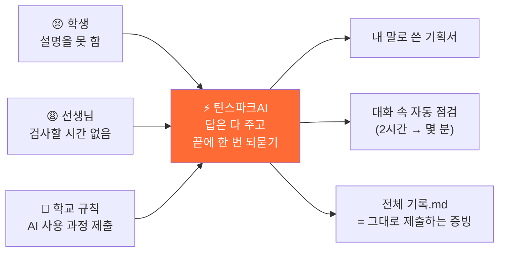
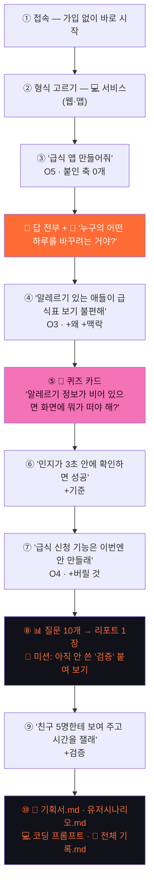
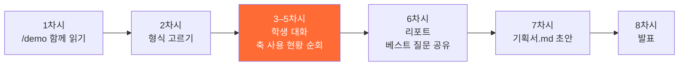
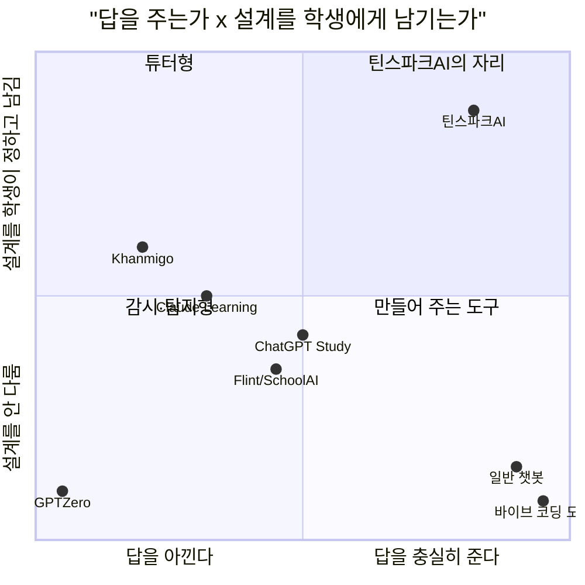

# 5일차 · 틴스파크AI 유저 시나리오

> **답은 끝까지, 질문은 넓게**
> AI한테 시키기 전에, 한 겹만 더 물어보기
>
> 분석한 웹사이트: https://askback-omega.vercel.app/ (`/` 메인 · `/about` 소개 · `/demo` 시연)
> 참고 자료: 틴스파크AI 기획문서 v2 · 투자제안서 · 사업계획서 · 작성일 2026-11-05

---

## 🎬 시작하기 전에 — 발표장에서 생긴 일

> 중학교 2학년 **서연**이는 정보 시간에 "급식 알레르기 알림 앱"을 만들었습니다.
> 사실 코드는 ChatGPT에 **"급식 앱 코드 짜줘"** 한 줄을 쳐서 받은 거예요. 앱은 멀쩡히 돌아갑니다.
>
> 발표 날, 선생님이 물었습니다.
>
> 👩‍🏫 "이 앱을 **누가** 쓰는 거야?"
> 🧑‍🎓 "어… 학생들이요."
> 👩‍🏫 "학생 **누구**? 알레르기 있는 학생은 우리 반에 몇 명이야?"
> 🧑‍🎓 "……"
> 👩‍🏫 "알레르기 정보가 **비어 있으면** 화면에 뭐가 떠?"
> 🧑‍🎓 "……그건 AI가 만들어서 잘 모르겠어요."
>
> 앱은 있는데, **설명은 하나도 못 했습니다.** 서연이는 정말로 이 앱을 "만든" 걸까요?

틴스파크AI는 바로 이 장면에서 출발했습니다.
**"AI로 만들어도 괜찮아. 대신 네 입으로 설명할 수 있게 해 줄게."**

---

## 1. 틴스파크AI를 한 줄로 말하면

> **AI가 답을 다 알려 주면서, 끝에 "너라면?"이라고 한 번 더 물어봐 주는 기획 코치**

### 비유로 이해하기 — 수학 문제를 풀 때

| | 📕 답지 | 👨‍🏫 엄한 과외 선생님 | ⚡ 틴스파크AI |
| --- | --- | --- | --- |
| 하는 일 | 정답과 풀이를 바로 보여 줌 | 답은 안 알려 주고 "다시 생각해 봐"만 함 | 풀이를 **다 보여 준 뒤** "이 공식은 왜 여기서 쓴 걸까?"라고 물음 |
| 좋은 점 | 빠르다 | 생각하는 힘이 생긴다 | 빠르면서 생각하는 힘도 생긴다 |
| 아쉬운 점 | 시험장에서는 못 푼다 | 막히면 하루 종일 제자리 | — |
| AI로 치면 | ChatGPT 같은 일반 챗봇 | 칸미고(Khanmigo) 같은 튜터 | **틴스파크AI** |

### 무엇을 만들어 주나? → "코드" 말고 "설계도"

집을 지을 때 벽돌 쌓기(=코딩)는 이제 AI가 금방 해 줍니다. 그런데 **어떤 집을, 누구를 위해, 왜 이렇게** 지을지는 아무도 대신 정해 줄 수 없죠. 틴스파크AI가 같이 만드는 건 그 **설계도**예요.

| 설계도의 세 칸 | 쉬운 뜻 | 서연이의 급식 앱이라면 |
| --- | --- | --- |
| 🧭 **기획** | 누구의 무엇을 왜 바꾸나 | "견과류 알레르기가 있는 민지가 매일 아침 급식표를 일일이 확인하는 불편을 없앤다" |
| 🔀 **알고리즘** | 어떤 순서와 규칙으로 도나 | "오늘 메뉴가 들어오면 → 민지의 알레르기 목록과 비교해서 → 겹치면 빨간색으로 표시한다" |
| 🏗 **전체 구조** | 무엇이 무엇과 이어지나 | 급식표 데이터 ↔ 내 알레르기 정보 ↔ 알림 화면 |

---

## 2. 왜 만들었을까? — 세 사람의 속마음

### 😣 학생: "만들긴 했는데, 설명을 못 해요"

- 요즘은 **바이브 코딩**(말로 시키면 AI가 코드를 짜 주는 방식)으로 중학생도 앱을 만들어요. 3주 걸리던 게 3시간이면 됩니다.
- 그런데 빨라진 건 **만드는 속도**뿐이에요. **왜 그렇게 만들었는지 설명하는 힘**은 그대로입니다.
- 그래서 포트폴리오에 "이건 진짜 내가 한 거예요"라고 보여 줄 증거가 없어요.

> **예시 —** 민준이가 만든 스마트 화분은 흙이 마르면 물을 줍니다. 코드에는 `if 습도 < 400` 이라고 적혀 있어요.
> 심사위원: "왜 하필 **400**이에요?" → 민준: "AI가 그렇게 짜 줬어요." 😶
> 민준이가 직접 흙을 재 봤다면 "마른 흙은 320, 젖은 흙은 610이라서 그 사이로 정했어요"라고 말할 수 있었겠죠.

### 😩 선생님: "한 명씩 검사할 시간이 없어요"

- AI를 **금지**하면 → 학생들은 몰래 씁니다.
- AI를 **허용**하면 → 누가 진짜 이해했는지 평가할 방법이 없습니다.
- 한 명씩 불러서 "화이트보드에 순서도 그려 봐"라고 하면? **한 반에 2시간**이 걸려요.

### 📜 학교 규칙: "이제 AI 쓴 과정을 적어 내야 해요"

- **2026년부터** 수행평가에서 AI를 쓰면 **어떤 도구를, 어떤 질문(프롬프트)으로, 어떻게 고쳐 가며** 썼는지 적어 내야 합니다.
- 즉, "AI랑 나눈 대화 기록"이 이제 **숙제의 일부**가 된 거예요. 그런데 ChatGPT 대화 기록은 정리가 안 돼 있어서 그대로 내기 어렵습니다.

### 💡 그래서 생각한 해결책



> 소개 페이지의 첫 문장이 이걸 잘 보여 줍니다.
> **"AI, 몰래 쓰지 마세요. 설명할 수 있으면, 당당하게."**

---

## 3. 꼭 알아야 할 네 가지 개념 (예시로 배우기)

### ① 🙋 되묻기 — 답 끝에 붙는 질문 하나

AI가 답을 **다 준 다음**, 마지막에 딱 하나만 되물어요. 억지로 묻지 않고, 답을 인질로 잡지도 않습니다.

> 🧑‍🎓 동네 빵집을 앱으로 만들고 싶어요.
> 🤖 (예약 기능, 남은 빵 할인 알림, 단골 쿠폰… 방법을 쭉 알려 준 뒤)
> 🙋 **"그럼 단골과 처음 온 손님 중, 누구의 하루를 먼저 바꾸고 싶어?"**

이 질문 하나 때문에 학생은 "누구를 위한 앱인지"를 스스로 정하게 됩니다.

### ② 🎚 질문의 열림 O1~O5 — 너무 닫아도, 너무 열어도 안 돼요

같은 빵집 얘기라도 **어떻게 묻느냐**에 따라 AI가 하는 일이 달라져요.

| 단계 | 이렇게 물으면 | AI는 이렇게 변해요 | 결과 |
| --- | --- | --- | --- |
| O1 지시 | "빵 남으면 30분 전에 알림 보내는 코드 짜줘" | ⌨️ 받아쓰기 | 시킨 대로만. *왜 30분인지는 아무도 안 물어봄* |
| O2 좁은 질문 | "알림 보내는 함수 어떻게 짜?" | 👨‍💻 코더 | 함수 하나 정확히. *설계가 틀려도 그대로 만듦* |
| **O3 조건 있는 열린 질문** ⭐ | "마감 전에 빵을 덜 버리게 하고 싶어. 사장님 혼자 쓰고 서버는 없어. 어떤 방법이 좋을까?" | 🛠 엔지니어 | **나한테 딱 맞는 방법 + 이유** |
| O4 대안 질문 | "그 방법 말고 두 개만 더. 각각 뭘 포기해야 해?" | 🏛 아키텍트 | 선택지와 장단점 |
| O5 맨 열린 질문 | "빵집 앱 어떻게 만들어?" | 📚 백과사전 | 누구한테나 똑같은 개요. *내 빵집 얘기는 0줄* |

> **포인트:** 무조건 넓게 묻는 게 좋은 게 아니에요. 라디오 볼륨처럼 **가운데(O3)가 가장 잘 들려요.**

### ③ 🧩 질문을 넓히는 여섯 축 — 질문에 "한 겹"만 더 붙이기

순서 없음 · 아무 때나 · **딱 하나만** 붙이면 돼요.

| 축 | 스스로 물어볼 말 | 붙이기 전 | 한 겹 붙인 후 |
| --- | --- | --- | --- |
| ❓ **왜** | 이걸 왜 하려는 거야? | "급식 앱 만들어줘" | "알레르기 있는 친구가 급식표 확인하기 불편해서 만들고 싶어" |
| 📍 **맥락** | 누가, 어디서, 어떤 상황에서? | "알림 보내줘" | "민지는 아침 등굣길에 폰을 10초밖에 못 봐" |
| 🧱 **제약** | 뭘 쓸 수 있고 뭘 못 써? | "제일 좋은 방법으로" | "서버 없이, 학교 크롬북으로, 다음 주 발표까지" |
| 📏 **기준** | 잘 됐다는 건 뭘로 알아? | "편한 앱으로" | "민지가 **3초 안에** 먹어도 되는지 알면 성공" |
| ⚖ **검증** | 맞는지 어떻게 확인해? | "이러면 되지?" | "친구 5명한테 써 보게 하고 시간을 재 볼래" |
| ✂️ **버릴 것** | 일부러 안 할 건 뭐야? | "기능 다 넣어줘" | "급식 신청 기능은 이번엔 안 만들 거야" |

> **실제 화면에서는** 입력창 옆 칩을 누르면 내 문장 뒤에 빈칸이 붙어요.
> 예: `🧱 제약` 클릭 → "급식 앱 만들고 싶어. **내가 쓸 수 있는 건 ___ 뿐이야.**"

### ④ 🧭 화이트보드 테스트 — 두 번 물으면 한 번 점검

질문을 2번 할 때마다 코치가 **퀴즈 카드**를 하나 내요. 5초면 고르고, 길어도 30초면 답합니다. 선생님이 물어볼 네 가지를 앱이 대신 물어요.

| 관문 | 코치의 질문 예시 |
| --- | --- |
| 🔲 순서도 | "화면 닫고, 알림이 울리기까지 순서를 세 칸으로 말해 봐" |
| 🎯 핵심 | "이 규칙에서 **한 줄만** 남긴다면 어느 줄이야? 왜?" |
| ⚡ 차별점 | "학교 홈페이지 급식표랑 뭐가 달라?" |
| 💥 실패 조건 | "알레르기 정보가 **비어 있으면** 화면에 뭐가 떠야 해?" |

네 관문을 모두 지나면 화면 위에 **🧩 4/4** 도장이 찍혀요.

---

## 4. 같은 질문, 다른 대답 — 직접 비교해 보기

**질문:** "AI로 식물 병 알아낼 수 있어?" (실제 `/demo` 스마트 화분 예시)

| 💬 일반 챗봇 | ⚡ 틴스파크AI |
| --- | --- |
| "네, 가능합니다. 이미지 분류 모델을 쓰면 됩니다. 1) 데이터 수집 2) 학습 3) 배포… (긴 설명)" | ① 일단 **다 알려 줌** — 잎 사진을 '정상/병든 잎'으로 나눠 학습, 코딩 없이 Teachable Machine으로 가능, 빛·각도가 바뀌면 자주 틀림 |
| (끝) | ② **솔직하게 짚어 줌** — "이 질문엔 누구한테 물어도 같은 답밖에 못 해. **네 화분 얘기가 하나도 없거든.**" |
| | ③ **좁힐 거리 3개 제시** — 무엇을 알아챌래?(노란 잎? 벌레? 고양이?) / 사진은 어디서 얼마나 자주? / 틀려도 괜찮은 쪽은?(괜히 울리는 알림 vs 놓치는 병) |
| | ④ 🙋 **되묻기** — "셋 중에 지금 바로 답할 수 있는 건 어느 거야? 하나만 정해도 내 답이 달라져." |

**또 다른 예 — 역질문 카드 (실제 `/demo` 화면)**

> 🧭 전송 규칙을 '값이 변할 때만 보내기' 하나로 정했다고 해 보자.
> 서버에 **30분째 아무 값도 안 온다면**, 그건 어느 쪽일까?
>
> ① 화분이 멀쩡해서 보낼 게 없는 것
> ② **멀쩡한 건지 고장 난 건지 구분이 안 된다** ✅
> ③ 문제가 생기면 서버가 알아서 알려 줄 것
> ④ 잘 모르겠어
>
> 🧭 "정확히 그게 문제야. 그래서 평소에도 1분마다 보내고, 10분 넘게 소식이 없으면 '📵 연락 끊김' 알림을 보내게 하자. **기획서 5번 칸에 넣었어.**"

→ 퀴즈 하나를 풀었더니 **내 설계도에 규칙이 한 줄 늘었어요.** 이게 틴스파크AI의 방식입니다.

---

## 5. 웹페이지 둘러보기 — 실제 화면 구성

```
askback-omega.vercel.app
├── /            첫 화면 "아이디어에 불꽃, 설계는 내가" → 내 프로젝트
│   ├── 왼쪽 메뉴
│   │   ├── 레벨 배지 (Lv.1 질문 씨앗 · 다음 리포트까지 0/10)
│   │   ├── + 새 프로젝트 / 💬 자유 질문
│   │   ├── 📂 예시 프로젝트 4개
│   │   │    🌱 스마트 화분(민준 중3) · 🐢 거북목 감시 웹캠(서연 중2)
│   │   │    🐶 반려동물 이상행동 일지(다온 중2) · 🚸 위험 등굣길 지도(서윤 중1)
│   │   └── 📊 리포트 · ⚙️ 설정
│   └── 대화 화면
│       ├── 코치 인사: "먼저 최선의 답을 줄게. 두 번 묻고 나면 내가 한 번 되물을게 — ●○"
│       ├── "무엇으로 만들 거야?" 형식 카드 5개
│       └── 입력창 (＋ 첨부 · 💡 힌트 · 🎙 음성 · ↑ 보내기)
├── /about       소개 페이지 (O1~O5 다이얼 체험 · 화이트보드 4관문 · "어디서 막혀 있나요?")
└── /demo        시연 페이지 (예시 질문 20개를 한눈에 · 한 걸음씩 보기)
```

### 무엇을 만들 거야? — 형식 5가지

| 형식 | 이런 친구에게 | 예시 주제 | 만들어지는 것 |
| --- | --- | --- | --- |
| 🤖 제품(하드웨어) | 아두이노·센서 좋아하는 친구 | 스마트 화분 | 동작 시나리오 + 부품 목록 + 구조 스케치 |
| 💻 서비스(웹·앱) | 앱·웹 만들고 싶은 친구 | 급식 알레르기 앱 | 핵심 기능 3개 + 화면 흐름 + 만들 범위 |
| 🎬 캠페인(AI 영상) | 영상·홍보에 관심 있는 친구 | 학교 앞 무단횡단 줄이기 30초 영상 | 메시지 한 줄 + 30초 콘티 + 배포 계획 |
| 🔬 리서치 | 조사·통계가 좋은 친구 | 우리 반 수면 시간 조사 | 조사 설계 + 데이터 항목 + 리포트 구성 |
| 📄 논문 | 탐구 보고서를 쓰는 친구 | 화분 흙 종류별 수분 유지 실험 | 연구 질문 + 목차 + 자료 수집 계획 |

---

## 6. 주요 고객 페르소나

> **페르소나**란? 우리 앱을 쓸 "대표 손님"을 실제 사람처럼 구체적으로 상상해 만든 인물이에요.

### 👧 페르소나 ① 서연 — 메인 사용자 (중2, 14세)

| 항목 | 내용 |
| --- | --- |
| 하루 | 아침에 급식표 확인 → 정보 시간 프로젝트 → 집에서 유튜브로 코딩 영상 시청 |
| AI 사용 | ChatGPT로 숙제 도움, 코드는 "짜줘" 한 줄 |
| 속마음 | "코드는 AI가 짜 줬는데, 핵심 기능이 뭐냐고 물어보면 말문이 막혀요." |
| 원하는 것 | 안내받으면서 빈칸을 채워 **내 말로 된 기획서** 완성하기 |
| 걱정 | "AI 썼다고 하면 선생님이 의심할까 봐 숨겨요." |
| 기기 | 학교 크롬북, 집에서는 스마트폰 |
| 성공하면 | 발표에서 "왜?"라는 질문에 3번 연속 대답할 수 있다 |

### 👦 페르소나 ② 도윤 — 대회 준비생 (고2, 17세)

| 항목 | 내용 |
| --- | --- |
| 상황 | 학생 발명대회 출전 준비. 아이디어는 많다 |
| 속마음 | "기능은 10개인데, 심사위원이 '그래서 핵심이 뭐예요?' 하면 할 말이 없어요." |
| 원하는 것 | **차별점 한 문장** + 실패했을 때 대책까지 들어간 기획서 |
| 약점 | "뭘 **안** 만들지"를 정해 본 적이 없다 |
| 자주 쓸 기능 | ✂️ 버릴 것 칩, 화이트보드 테스트, 코딩 프롬프트 복사 |

### 🧒 페르소나 ③ 하린 — 초등 메이커 (초5, 11세)

| 항목 | 내용 |
| --- | --- |
| 상황 | 방과후 메이커 수업. 긴 글 쓰기가 어렵다 |
| 속마음 | "뭘 써야 할지 모르겠어요…" |
| 원하는 것 | 쓰기 대신 **①~④ 고르기**로 답하기 |
| 도움 방법 | 💡 힌트 → 📎 예시 → 🤖 코치의 생각, 3단계로 조금씩 |

### 👨‍🏫 페르소나 ④ 김 선생님 — 도입을 결정하는 사람 (중학교 정보 교사)

| 항목 | 내용 |
| --- | --- |
| 상황 | 한 반 28명의 프로젝트를 8차시 동안 지도 |
| 속마음 | "수십 명을 한 명씩 붙잡고 기획이 맞는지 검사할 시간이 없습니다." |
| 원하는 것 | 학생별 진행 상황 + **AI를 어떻게 썼는지 투명하게 남는 평가 근거** |
| 보는 것 | 진도가 아니라 **질문의 넓이** — 여섯 축 중 몇 개를 써 봤는지, 🧩 n/4 도장 |
| 결정 순서 | 무료 체험 → 한 반에서 시험 사용 → 학교 전체 도입 |

> **누가 무엇을 하나?** 학생은 **쓰고**, 학부모는 **결제하고**, 선생님은 **도입을 결정해요.**

---

## 7. 유저 시나리오

> **유저 시나리오**란? 페르소나가 앱을 처음 열고 목표를 이룰 때까지, 무엇을 보고 누르고 느끼는지 순서대로 적은 이야기예요.

### 시나리오 A · 서연의 첫 수업 45분 — "급식 앱"이 설계도가 되기까지



**실제 대화로 보기**

> **⏱ 0~5분 · 시작**
> 🤖 안녕, 서연! 뭐든 물어봐. 먼저 최선의 답을 줄게. 두 번 묻고 나면 내가 한 번 되물을게.
> 🤖 무엇으로 만들 거야? → 서연이 **💻 서비스(웹·앱)** 카드를 누름
>
> **⏱ 5~15분 · 질문 1~2**
> 🧑‍🎓 급식 앱 만들어줘.
> 🤖 급식 앱이라면 이런 기능들이 흔해: 오늘 메뉴 보기, 영양 정보, 알레르기 표시, 급식 평가… *(표로 정리)*
> 🙋 **그런데 누구의 어떤 하루를 바꾸려는 거야?**
> 🧑‍🎓 *(`❓왜` 칩 클릭)* 우리 반 민지가 견과류 알레르기인데, 매일 급식표에서 알레르기 번호를 하나하나 찾아봐서 불편해 보여.
> 🤖 그럼 핵심은 "메뉴 보기"가 아니라 "**먹어도 되는지 바로 알기**"네. 방법은 세 가지야… *(비교표)*
> 🙋 **민지는 그걸 언제, 어디서 확인해?**
>
> **⏱ 15~20분 · 🧭 퀴즈 카드 (질문 2개마다)**
> 🧭 민지의 알레르기 정보가 **비어 있으면** 화면에 뭐가 떠야 할까?
> ① 모든 메뉴를 초록색(안전)으로 ② **"정보를 먼저 입력해 줘" 안내** ③ 아무것도 안 띄움 ④ 잘 모르겠어
> 🧑‍🎓 ②번!
> 🧭 맞아. ①번이면 위험한 메뉴를 안전하다고 알려 주게 되거든. **기획서 '실패 조건' 칸에 넣었어.** 🧩 1/4
>
> **⏱ 20~35분 · 질문 3~9**
> 🧑‍🎓 *(`📏기준` 칩)* 민지가 **3초 안에** 먹어도 되는지 알면 성공이야.
> 🧑‍🎓 *(`✂️버릴 것` 칩)* 급식 평가랑 신청 기능은 이번엔 안 만들래.
> 🤖 좋아. 버린 덕분에 화면이 한 장으로 줄었어. *(화면 흐름 그림)*
>
> **⏱ 35~40분 · 📊 리포트**
> 질문 10개를 채우자 리포트가 나옴 → "처음엔 O5(맨 열린 질문)였는데 지금은 O3로 이동했어. 여섯 축 중 4개 사용! 🚩 **다음 미션: 아직 안 쓴 '검증'을 붙여 봐.**"
>
> **⏱ 40~45분 · 마무리**
> 🧑‍🎓 *(`⚖검증` 칩)* 친구 5명한테 써 보게 하고, 확인하는 데 몇 초 걸리는지 재 볼게.
> → **기획서.md**와 **전체 기록.md**를 내려받아 선생님께 제출 ✅

| 단계 | 서연이가 하는 일 | 앱이 하는 일 | 남는 것 |
| ---: | --- | --- | --- |
| 1 | 링크 클릭 | 가입 없이 프로젝트 자동 생성 | 기기에 자동 저장 |
| 2 | 💻 서비스 선택 | 서비스용 질문 버튼·체크 칸으로 바뀜 | 기획서 틀 |
| 3 | "급식 앱 만들어줘" | 답 전부 + 🙋 되묻기 1개 | 질문 기록 (O5) |
| 4 | `❓왜` 칩 누르고 이유 쓰기 | 답이 "민지 맞춤"으로 좁혀짐 | +왜 +맥락 |
| 5 | 퀴즈 ② 고르기 | 정답이면 기획서에 규칙 추가 | 🧩 1/4 |
| 6~7 | 기준·버릴 것 추가 | 🫵 내가 정한 것 / 📌 AI가 가정한 것 구분 | 기획서 칸 채움 |
| 8 | 질문 10개 달성 | 리포트 8칸 + 다음 미션 | 리포트 1장 |
| 9 | 미션 수행 | 축 5/6 달성 | 검증 계획 |
| 10 | 내보내기 | .md 파일 4종 생성 | 제출·발표 자료 |

### 시나리오 B · 막혔을 때 — 코치는 화내지 않아요

| 이런 순간 | 학생의 말 | 코치의 반응 (예시) |
| --- | --- | --- |
| 빈칸 앞에서 5분째 멈춤 | (아무 입력 없음) | 💡 힌트 "민지가 아침에 제일 바쁜 순간은 언제일까?" → 📎 예시 "등굣길 버스 안" → 🤖 코치의 생각 "나라면 '교실 들어가기 전 10초'로 정할래" |
| 모르겠음 | "몰라요" / ④ 잘 모르겠어 | "괜찮아. 더 작게 물어볼게 — 민지는 폰을 써, 크롬북을 써?" |
| 대신 써 달라고 함 | "그냥 기획서 써 줘" | "세 가지 버전을 보여 줄게. **고르는 건 네가** 해 줘." (대신 고르지 않음) |
| 퀴즈 틀림 | ①번 선택 | "그럼 위험한 메뉴도 초록색이 되네. 그 관문만 다시 해 보자." (벌점 없음) |
| 시간이 급함 | [나중에] 클릭 | 🧺 복기함에 보관, 다음 시간에 이어서 |

### 시나리오 C · 도윤의 대회 준비 — "기능 10개"에서 "핵심 1개"로

> 🧑‍🎓 도윤: 반려동물 앱인데, 산책 기록, 사료 알림, 병원 예약, SNS, 쇼핑, 일기, 체중 그래프, 훈련 영상, 동네 친구 찾기, 이상행동 감지까지 넣고 싶어.
> 🤖 *(10개 기능을 다 정리해 준 뒤)* 🙋 **이 중 하나를 빼면 가장 아쉬워할 사람은 누구야? 그리고 그 사람은 나머지 9개도 쓸까?**
> 🧑‍🎓 *(`✂️버릴 것`)* …사실 우리 집 콩이가 갑자기 밥을 안 먹은 게 시작이었어. 이상행동 감지만 남길래.
> 🧭 ⚡ 차별점 관문: "그냥 일기장 앱이랑 뭐가 달라?"
> 🧑‍🎓 '콩이의 평소 7일 평균'과 비교해서 다를 때만 알려 줘.
> 🧭 💥 실패 조건 관문: "가족 중 한 명이 기록을 안 하면?"
> 🧑‍🎓 3일 동안 기록이 없으면 가족 단톡방에 알림!
> → 🧩 4/4 도장 → **코딩 프롬프트 복사** → Cursor에 붙여 넣어 구현 → 대회 서류에 **전체 기록.md** 첨부

### 시나리오 D · 김 선생님의 8차시 수업



- **전에는:** 28명을 한 명씩 불러 화이트보드 검사 → 2시간
- **이제는:** 교실을 돌며 화면 위 🧩 n/4 도장과 10문 리포트만 확인 → 몇 분
- **6차시 팁:** 반 전체에서 "베스트 질문"을 뽑아 칠판에 적으면, 다른 친구들도 질문을 넓히는 법을 배워요.

### 시나리오 E · 이럴 땐 어떻게 되나요? (예외 상황)

| 상황 | 앱의 동작 |
| --- | --- |
| 예시 프로젝트를 열려는데 내 기록이 있음 | "지금 기록이 지워지고 '민준'의 데이터로 바뀌어" 확인 창이 뜸 → 취소 가능 *(실제 화면에서 확인)* |
| 브라우저 기록을 지움 | 지금은 기기에만 저장 → 기록이 사라짐. **수업 끝날 때마다 .md로 내려받기** 권장 |
| 장난·부적절한 입력 | 안전 장치가 막고, 프로젝트 이야기로 돌아오게 함 |
| 인터넷·AI 서버 문제 | 서버 없이 도는 예시(로컬 엔진)로 체험 계속 가능 |
| "코드 짜줘"만 계속 입력 | 막지 않음. 만드는 단계에서는 그런 질문이 많은 게 정상이라고 리포트에서 설명 |

---

## 8. 주요 경쟁 앱 — 쉬운 비유로 비교

| 종류 | 대표 앱 | 비유하면 | 잘하는 것 | 아쉬운 점 |
| --- | --- | --- | --- | --- |
| 범용 챗봇 | ChatGPT, Claude, Gemini | 📕 **답지** | 뭐든 빠르게 답함 | 생각이 답에서 멈춤. 과정이 안 남음 |
| 학습 모드 | ChatGPT 공부 모드, Claude 학습 모드 | 📘 **해설지 + 질문** | 차근차근 유도 | 과목 공부용. 프로젝트 **설계도**는 안 만들어 줌 |
| 튜터형 | 칸미고(Khanmigo) | 👨‍🏫 **엄한 과외 선생님** | 스스로 생각하게 함 | 답을 아껴서, 막히면 진도가 안 나감 |
| 교실 관리형 | Flint, SchoolAI | 📹 **교실 CCTV** | 선생님이 학생 대화를 다 봄 | 감시받는 느낌. 기록이 학생 것이 아님 |
| AI 탐지기 | GPTZero, 턴잇인 | 🚨 **금속 탐지기** | AI 쓴 글을 찾아냄 | "쓰지 마"라는 신호. 잘 쓰는 법은 안 알려 줌 |
| 바이브 코딩 | Cursor, Replit, Lovable | 🧱 **대신 지어 주는 건설업자** | 말만 하면 앱 완성 | 설계는 안 물어봄 → 설명 못 하는 앱 |

### 한눈에 보는 위치



> 오른쪽 위 칸 — **답도 충분히 주고, 설계도 학생에게 남기는** 자리 — 가 비어 있어요. 틴스파크AI는 그 자리를 노립니다.

---

## 9. 차이점 — 틴스파크AI만 하는 것

| # | 차이점 | 다른 앱은 | 틴스파크AI는 | 예시 |
| ---: | --- | --- | --- | --- |
| 1 | **답은 끝까지 + 되묻기 하나** | 답만 주거나, 답을 아낌 | 먼저 다 주고 끝에 하나만 물음 | "누구의 하루를 먼저 바꿀래?" |
| 2 | **질문 볼륨 O1~O5** | 질문 수준을 신경 안 씀 | 가운데(O3)로 가게 코칭 | O5 "빵집 앱 어떻게 만들어?" → O3 "서버 없이 사장님 혼자 쓸 방법은?" |
| 3 | **한 겹 더 붙이는 여섯 축** | — | 칩을 누르면 내 문장에 빈칸이 붙음 | `🧱제약` → "내가 쓸 수 있는 건 ___ 뿐이야" |
| 4 | **2문 1역 퀴즈 카드** | 선생님이 직접 검사 | 대화 중 5~30초 퀴즈로 자동 점검 | "정보가 비어 있으면 화면에 뭐가 떠?" |
| 5 | **코드 대신 설계도** | 코드부터 줌 | 규칙 카드·순서도·비교표 위주 | "흙 습도 < 400이면 물 주기" 규칙 카드 |
| 6 | **과정이 곧 문서** | 대화가 흩어짐 | 기획서·시나리오·프롬프트·전체 기록 자동 정리 | 수업 끝나면 .md 4장 |
| 7 | **🫵 내가 정한 것 / 📌 AI가 가정한 것** | 구분 없음 | 둘을 나눠 표시 → AI 사용 표기에 그대로 사용 | 🫵 "3초 안에" / 📌 "크롬북 사용 가정" |
| 8 | **형식 5가지** | 코딩 또는 한 과목만 | 논문·리서치·영상·앱·하드웨어 | 과학 탐구, 사회 캠페인까지 |
| 9 | **내 기록은 내 것** | 선생님이 다 봄 | 가입 없이 내 기기에 저장, 선생님은 요약만 | 감시가 아니라 코칭 |

---

## 10. 직접 해 보기 — 5일차 활동

**활동 1. 질문 볼륨 바꾸기** — 아래 O5 질문을 O3로 바꿔 보세요. (여섯 축 중 2개 이상 붙이기)

| O5 질문 | 내가 바꾼 O3 질문 | 붙인 축 |
| --- | --- | --- |
| "환경 보호 앱 만들어줘" | | |
| "공부 도와주는 로봇 어떻게 만들어?" | | |
| "학교 문제 해결하는 아이디어 줘" | | |

> **모범 예시 —** "환경 보호 앱 만들어줘" → "우리 학교 급식실에서 버려지는 잔반을 **한 달 안에 20% 줄이고** 싶어(❓왜·📏기준). **크롬북으로만** 쓸 수 있어(🧱제약). 어떤 방법이 좋을까?"

**활동 2. 내가 코치가 되어 보기** — 친구의 아이디어를 듣고, 아래 퀴즈 카드를 하나씩 만들어 물어보세요.

| 관문 | 내가 만든 질문 |
| --- | --- |
| 🔲 순서도 | "○○가 들어오면 → ___를 확인해서 → ___한다. 맞아?" |
| 🎯 핵심 | |
| ⚡ 차별점 | |
| 💥 실패 조건 | |

**활동 3. 앱 써 보기** — https://askback-omega.vercel.app/ 에서 형식 하나를 골라 질문 10개를 하고, 리포트에 나온 **🚩 다음 미션**을 적어 오세요.

---

## 11. 웹페이지에서 발견한 개선점

| 발견 | 위치 | 제안 |
| --- | --- | --- |
| 기획문서 v2에서 없앤 "🔥 7단계 기획 가이드"와 "Lv.1 불씨 → Lv.4 봉화"가 아직 보임 | `/demo` | 여섯 축 사용 현황으로 바꾸기 |
| 왼쪽 메뉴에 "Lv.1 질문 씨앗" 레벨 배지 | 메인 | "축 n/6 · 다음 리포트까지 n/10"으로 바꾸기 |
| 아이콘이 사업계획서는 **번개**, 웹은 **불꽃** | 사업계획서 표지 | 불꽃으로 통일 |
| 예시 프로젝트가 웹은 4개, 투자제안서는 6개 | 왼쪽 메뉴 | 개수를 맞추거나 2개 추가 |
| 예시를 열면 내 기록을 덮어씀 | 메인 | "새 프로젝트로 열기" 옵션 추가 |

---

> ⚡ 틴스파크AI · 답은 끝까지, 질문은 넓게 · Design before code
> **"AI한테 시키기 전에, 한 겹만 더 물어보기"**
