# 5일차 · 틴스파크AI 유저 시나리오

> **답은 끝까지, 질문은 넓게**
> AI한테 시키기 전에, 한 겹만 더 물어보기
>
> 분석한 웹사이트: https://askback-omega.vercel.app/ (`/` 메인 · `/about` 소개 · `/demo` 시연)
> 참고 자료: 틴스파크AI 기획문서 v2 · 투자제안서 · 사업계획서 · 작성일 2026-11-05


https://teenspark.vercel.app/
---

## 🎬 시작하기 전에 — 발표장에서 생긴 일

> 중학교 2학년 **서연**이는 정보 시간에 "급식 알레르기 알림 앱"을 만들었습니다.
> 사실 코드는 ChatGPT에 **"급식 앱 코드 짜줘"** 한 줄을 쳐서 받은 거예요. 앱은 멀쩡히 돌아갑니다.
>
> 발표 날, 선생님이 물었습니다.
>
> 👩‍🏫 "이 앱을 **누가** 쓰는 거야?"
> 🧑‍🎓 "어… 학생들이요."
> 👩‍🏫 "학생 **누구**? 알레르기 있는 학생은 우리 반에 몇 명이야?"
> 🧑‍🎓 "……"
> 👩‍🏫 "알레르기 정보가 **비어 있으면** 화면에 뭐가 떠?"
> 🧑‍🎓 "……그건 AI가 만들어서 잘 모르겠어요."
>
> 앱은 있는데, **설명은 하나도 못 했습니다.** 서연이는 정말로 이 앱을 "만든" 걸까요?

틴스파크AI는 바로 이 장면에서 출발했습니다.
**"AI로 만들어도 괜찮아. 대신 네 입으로 설명할 수 있게 해 줄게."**

---

## 1. 틴스파크AI를 한 줄로 말하면

> **AI가 답을 다 알려 주면서, 끝에 "너라면?"이라고 한 번 더 물어봐 주는 기획 코치**

### 비유로 이해하기 — 수학 문제를 풀 때

| | 📕 답지 | 👨‍🏫 엄한 과외 선생님 | ⚡ 틴스파크AI |
| --- | --- | --- | --- |
| 하는 일 | 정답과 풀이를 바로 보여 줌 | 답은 안 알려 주고 "다시 생각해 봐"만 함 | 풀이를 **다 보여 준 뒤** "이 공식은 왜 여기서 쓴 걸까?"라고 물음 |
| 좋은 점 | 빠르다 | 생각하는 힘이 생긴다 | 빠르면서 생각하는 힘도 생긴다 |
| 아쉬운 점 | 시험장에서는 못 푼다 | 막히면 하루 종일 제자리 | — |
| AI로 치면 | ChatGPT 같은 일반 챗봇 | 칸미고(Khanmigo) 같은 튜터 | **틴스파크AI** |

### 무엇을 만들어 주나? → "코드" 말고 "설계도"

집을 지을 때 벽돌 쌓기(=코딩)는 이제 AI가 금방 해 줍니다. 그런데 **어떤 집을, 누구를 위해, 왜 이렇게** 지을지는 아무도 대신 정해 줄 수 없죠. 틴스파크AI가 같이 만드는 건 그 **설계도**예요.

| 설계도의 세 칸 | 쉬운 뜻 | 서연이의 급식 앱이라면 |
| --- | --- | --- |
| 🧭 **기획** | 누구의 무엇을 왜 바꾸나 | "견과류 알레르기가 있는 민지가 매일 아침 급식표를 일일이 확인하는 불편을 없앤다" |
| 🔀 **알고리즘** | 어떤 순서와 규칙으로 도나 | "오늘 메뉴가 들어오면 → 민지의 알레르기 목록과 비교해서 → 겹치면 빨간색으로 표시한다" |
| 🏗 **전체 구조** | 무엇이 무엇과 이어지나 | 급식표 데이터 ↔ 내 알레르기 정보 ↔ 알림 화면 |

---

## 2. 왜 만들었을까? — 세 사람의 속마음

### 😣 학생: "만들긴 했는데, 설명을 못 해요"

- 요즘은 **바이브 코딩**(말로 시키면 AI가 코드를 짜 주는 방식)으로 중학생도 앱을 만들어요. 3주 걸리던 게 3시간이면 됩니다.
- 그런데 빨라진 건 **만드는 속도**뿐이에요. **왜 그렇게 만들었는지 설명하는 힘**은 그대로입니다.
- 그래서 포트폴리오에 "이건 진짜 내가 한 거예요"라고 보여 줄 증거가 없어요.

> **예시 —** 민준이가 만든 스마트 화분은 흙이 마르면 물을 줍니다. 코드에는 `if 습도 < 400` 이라고 적혀 있어요.
> 심사위원: "왜 하필 **400**이에요?" → 민준: "AI가 그렇게 짜 줬어요." 😶
> 민준이가 직접 흙을 재 봤다면 "마른 흙은 320, 젖은 흙은 610이라서 그 사이로 정했어요"라고 말할 수 있었겠죠.

### 😩 선생님: "한 명씩 검사할 시간이 없어요"

- AI를 **금지**하면 → 학생들은 몰래 씁니다.
- AI를 **허용**하면 → 누가 진짜 이해했는지 평가할 방법이 없습니다.
- 한 명씩 불러서 "화이트보드에 순서도 그려 봐"라고 하면? **한 반에 2시간**이 걸려요.

### 📜 학교 규칙: "이제 AI 쓴 과정을 적어 내야 해요"

- **2026년부터** 수행평가에서 AI를 쓰면 **어떤 도구를, 어떤 질문(프롬프트)으로, 어떻게 고쳐 가며** 썼는지 적어 내야 합니다.
- 즉, "AI랑 나눈 대화 기록"이 이제 **숙제의 일부**가 된 거예요. 그런데 ChatGPT 대화 기록은 정리가 안 돼 있어서 그대로 내기 어렵습니다.

### 💡 그래서 생각한 해결책

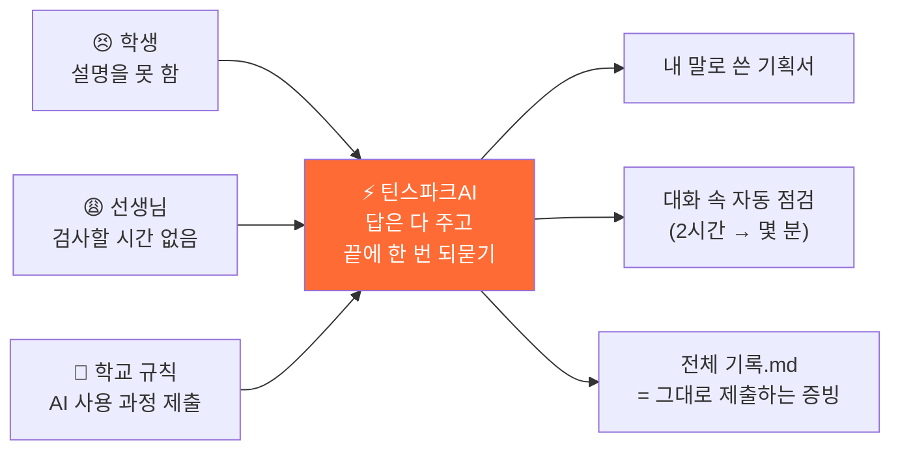

> 소개 페이지의 첫 문장이 이걸 잘 보여 줍니다.
> **"AI, 몰래 쓰지 마세요. 설명할 수 있으면, 당당하게."**

---

## 3. 꼭 알아야 할 네 가지 개념 (예시로 배우기)

### ① 🙋 되묻기 — 답 끝에 붙는 질문 하나

AI가 답을 **다 준 다음**, 마지막에 딱 하나만 되물어요. 억지로 묻지 않고, 답을 인질로 잡지도 않습니다.

> 🧑‍🎓 동네 빵집을 앱으로 만들고 싶어요.
> 🤖 (예약 기능, 남은 빵 할인 알림, 단골 쿠폰… 방법을 쭉 알려 준 뒤)
> 🙋 **"그럼 단골과 처음 온 손님 중, 누구의 하루를 먼저 바꾸고 싶어?"**

이 질문 하나 때문에 학생은 "누구를 위한 앱인지"를 스스로 정하게 됩니다.

### ② 🎚 질문의 열림 O1~O5 — 너무 닫아도, 너무 열어도 안 돼요

같은 빵집 얘기라도 **어떻게 묻느냐**에 따라 AI가 하는 일이 달라져요.

| 단계 | 한 줄 정의 (`/about`) | 이렇게 물으면 | AI는 이렇게 변해요 | ➕ 얻는 것 | ➖ 잃는 것 |
| --- | --- | --- | --- | --- | --- |
| O1 지시 | 무엇을 어떻게 바꿀지 다 정해서 시킨다 | "빵 남으면 30분 전에 알림 보내는 코드 짜줘" | ⌨️ 받아쓰기 | 속도 | **AI의 판단 전부** |
| O2 좁은 질문 | 설계는 내가 끝냈고 구현만 묻는다 | "알림 보내는 함수 어떻게 짜?" | 👨‍💻 코더 | 정확한 구현 | 내 설계가 틀렸어도 그대로 만든다 |
| **O3 조건 있는 열린 질문** ⭐ | 목표·제약·기준을 주고 방법을 묻는다 | "마감 전에 빵을 덜 버리게 하고 싶어. 사장님 혼자 쓰고 서버는 없어. 어떤 방법이 좋을까?" | 🛠 엔지니어 | **맞춤형 설계 + 이유** | — (스위트 스팟) |
| O4 대안 질문 | 다른 길과 그 대가를 묻는다 | "그 방법 말고 두 개만 더. 각각 뭘 포기해야 해?" | 🏛 아키텍트 | 선택지와 판단 근거 | 시간 (구현 중엔 과하다) |
| O5 맨 열린 질문 | 맥락 없이 크게 묻는다 | "빵집 앱 어떻게 만들어?" | 📚 백과사전 | 개요 | **나에게 맞는 답** |

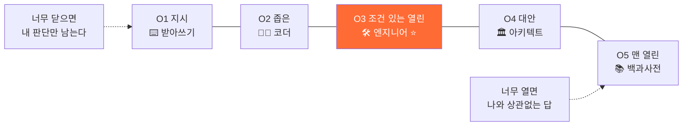

> **포인트:** 무조건 넓게 묻는 게 좋은 게 아니에요. 라디오 볼륨처럼 **가운데(O3)가 가장 잘 들려요.**
> 실제 앱에서는 답마다 `🔎 O3 열린` 태그와 `이번 답에서 나는 🛠 엔지니어로 일했어` 문장이 붙어서, **내 질문이 지금 어느 칸인지** 바로 보여요.

### ③ 🧩 질문을 넓히는 여섯 축 — 질문에 "한 겹"만 더 붙이기

순서 없음 · 아무 때나 · **딱 하나만** 붙이면 돼요.

| 축 | 스스로 물어볼 말 | 붙이기 전 | 한 겹 붙인 후 |
| --- | --- | --- | --- |
| ❓ **왜** | 이걸 왜 하려는 거야? | "급식 앱 만들어줘" | "알레르기 있는 친구가 급식표 확인하기 불편해서 만들고 싶어" |
| 📍 **맥락** | 누가, 어디서, 어떤 상황에서? | "알림 보내줘" | "민지는 아침 등굣길에 폰을 10초밖에 못 봐" |
| 🧱 **제약** | 뭘 쓸 수 있고 뭘 못 써? | "제일 좋은 방법으로" | "서버 없이, 학교 크롬북으로, 다음 주 발표까지" |
| 📏 **기준** | 잘 됐다는 건 뭘로 알아? | "편한 앱으로" | "민지가 **3초 안에** 먹어도 되는지 알면 성공" |
| ⚖ **검증** | 맞는지 어떻게 확인해? | "이러면 되지?" | "친구 5명한테 써 보게 하고 시간을 재 볼래" |
| ✂️ **버릴 것** | 일부러 안 할 건 뭐야? | "기능 다 넣어줘" | "급식 신청 기능은 이번엔 안 만들 거야" |

> **실제 화면에서는** 입력창 옆 칩을 누르면 내 문장 뒤에 빈칸이 붙어요.
> 예: `🧱 제약` 클릭 → "급식 앱 만들고 싶어. **내가 쓸 수 있는 건 ___ 뿐이야.**"

#### 축 하나가 답을 어떻게 바꾸나 — `/about`의 빵집 예시

| 축 | 이 축이 붙잡는 것 | 좁게 물으면 | ↓ 한 축을 붙이면 | 🙋 코치가 붙이는 되묻기 | 그래서 달라지는 답 |
| --- | --- | --- | --- | --- | --- |
| ❓ 왜 | 수단이 아니라 **진짜 목적** | "남은 빵 알림 기능 만들어줘" | "마감 전에 빵을 덜 버리게 하고 싶어. 알림이 맞는 방법일까?" | "알림을 받고 나면, 사장님이 무엇을 다르게 하나요?" | 알림 말고 **예약 픽업·마감 할인** 같은 길도 올라온다 |
| 📍 맥락 | 그 일이 벌어지는 **자리** | "알림 보내줘" | "사장님 혼자 쓰고, 마감 30분 전이 하루 중 제일 바빠" | "두 손이 바쁠 때도 쓸 수 있어야 하나요?" | 화면을 눌러야 하는 방법은 답에서 빠진다 |
| 🧱 제약 | **쓸 수 있는 것**과 못 쓰는 것 | "제일 좋은 방법으로 해줘" | "서버 없이, 사장님 폰 하나로, 다음 주 시연까지" | "셋 중 하나를 못 지키면, 어느 걸 먼저 놓을 거예요?" | 남은 답이 전부 **실제로 해 볼 수 있는 것**이 된다 |
| 📏 기준 | '좋다'를 **숫자**로 | "좋은 알림으로 만들어줘" | "버리는 빵이 하루 10개 → 3개면 성공이야" | "그 3개는 어디서 온 숫자예요?" | 만든 뒤에 맞았는지 **셀 수 있다** |
| ⚖ 검증 | 무엇과 무엇을 **견줄지** | "이렇게 하면 되지?" | "일주일 동안 버린 빵 수를 세서 지난주와 비교할래" | "지난주와 이번 주, 손님 수는 같았나요?" | 틀렸을 때 **알아차릴 길**이 같이 생긴다 |
| ✂️ 버릴 것 | 일부러 **긋는 줄** | "필요한 기능 다 넣어줘" | "손님용 화면은 이번엔 안 만들 거야" | "그걸 빼면 누가 아쉬워하죠? 그래도 괜찮아요?" | 만들 것 **하나가 또렷**해진다 |

> **넓히는 이유는 둘뿐이에요.**
> ① **내가 아는 것이 드러난다** — 축을 붙이려면 아는 걸 꺼내야 해요. 못 꺼내는 칸이 바로 아직 모르는 자리예요.
> ② **아이템이 단단해진다** — 목적·제약·기준이 붙은 아이템은 발표에서 흔들리지 않아요.
>
> 여섯 축을 다 쓸 필요는 없어요. **지금 막힌 자리에 맞는 하나**면 돼요. 형식(제품·서비스·캠페인·리서치·논문)이 달라도 축은 같아요.

### ④ 🧭 화이트보드 테스트 — 두 번 물으면 한 번 점검

질문을 2번 할 때마다 코치가 **퀴즈 카드**를 하나 내요. 5초면 고르고, 길어도 30초면 답합니다. 선생님이 물어볼 네 가지를 앱이 대신 물어요.

| 관문 | 코치의 질문 예시 |
| --- | --- |
| 🔲 순서도 | "화면 닫고, 알림이 울리기까지 순서를 세 칸으로 말해 봐" |
| 🎯 핵심 | "이 규칙에서 **한 줄만** 남긴다면 어느 줄이야? 왜?" |
| ⚡ 차별점 | "학교 홈페이지 급식표랑 뭐가 달라?" |
| 💥 실패 조건 | "알레르기 정보가 **비어 있으면** 화면에 뭐가 떠야 해?" |

네 관문을 모두 지나면 화면 위에 **🧩 4/4** 도장이 찍혀요.

#### 선생님의 질문 → 앱의 질문 → 무엇이 증명되나 (`/about` 스마트 화분 예시)

| 관문 | 👩‍🏫 선생님은 이렇게 물어요 | 🧭 틴스파크AI는 대화 속에서 | ✅ 증명되는 것 | 🤖 AI가 대신 못 하는 이유 |
| --- | --- | --- | --- | --- |
| 🔲 순서도 | "화면 닫고, 순서도를 그려 보세요." | "센서값이 380이 들어왔어. 네 순서도에서 어느 상자를 지나가?" | 구조를 머릿속에 갖고 있다 | 화면을 못 보는 상태에서 나오는 건 **이해뿐** |
| 🎯 핵심 | "핵심 한 곳에 동그라미. 왜 거기예요?" | "이 규칙에서 한 줄만 남긴다면 어느 줄이야? 왜?" | 무엇이 중요한지 판단했다 | "전부 중요해요"는 아무것도 모르는 것 |
| ⚡ 차별점 | "고친 곳은? 고치기 전엔 어땠어요?" | "타이머로 3초 주는 것과 뭐가 달라? 한 문장으로." | 대안을 비교하고 골랐다 | 왜 그 대안을 버렸는지는 **본인만** 안다 |
| 💥 실패 조건 | "이거 언제 안 돌아가요?" | "센서가 빠져서 0이 되면 화분에 어떤 일이 벌어질까?" | 시스템 전체를 본다 | 안 돌아가는 조건을 아는 사람이 **진짜 만든 사람** |

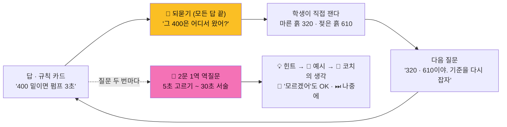

> **되묻기는 두 겹이에요.** 🙋 **열린 되묻기**는 모든 답 끝에 붙는 *대화의 다리*, 🧭 **역질문**은 질문 두 번마다 나오는 *이해의 확인*이에요.

### ⑤ 💡 자동 완성 트레이 — "___ 빈칸만 채우기"

> 뭘 물어야 할지 모를 때 입력창 옆 **💡**를 누르면, 입력창 위에 **질문 칩 줄**이 나타나요.
> 칩을 누르면 **질문 초안이 입력창에 자동으로 채워지고**, 학생은 `___` 빈칸만 자기 말로 채워서 보내면 돼요.
> 화면 아래에는 늘 이 안내가 떠요: **"___ 빈칸을 네 말로 채워서 보내봐."**

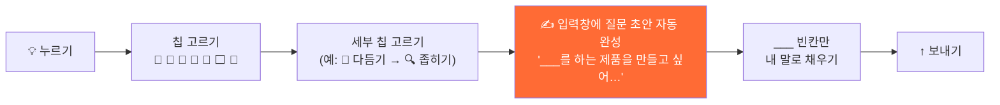

| 칩 | 하는 일 | 누르면 나오는 세부 칩 / 자동 완성 예시 |
| --- | --- | --- |
| ⬜ **동작 시나리오 묻기** (형식별) | 형식에 맞는 첫 질문 틀을 바로 채움 | `___를 하는 제품을 만들고 싶어. "___하면 ___한다" 식의 동작 시나리오로 정리해줘. 쓰는 곳은 ___야.` |
| 📐 **설계 묻기** | 코드보다 먼저 — 설계도 세 칸 묻기 | 🧭 기획(누구의 무엇을 왜) · 🔀 알고리즘(어떤 순서와 규칙으로) · 🏗 전체 구조(무엇이 무엇과 이어지나) · 🔁 설계로 돌아가기(코드로 달려가기 전에) |
| 🤖 **형식 질문** | 이 형식에서 **자주 막히는 곳** | 제품이라면 🔌 회로·전원 · 🐞 안 움직여 · 📐 값 정하기 |
| 🚀 **확장** | 한 단씩 키우기 | 🔧 메이커 · 📡 공유·서버 · ⚙️ AI·자동화 · 🧠 AI·추론 · 👁 AI·컴퓨터 비전 · 🤝 협력 |
| 🧭 **다듬기** | 방금 답을 넓히고 · 좁히고 · 되묻기 | 🌅 넓히기 · 🔍 좁히기 · 🔀 대안 · 💡 왜 이렇게? · 🙋 나한테 물어봐 |
| 🔭 **심화** | 렌즈를 바꿔 한 번 더 깊게 | 🧭 철학 "이게 정말 풀어야 할 문제일까?" · 🫀 심리학 "사람은 왜 그렇게 행동할까?" · 🌍 사회학 "이게 퍼지면 누구의 무엇이 바뀔까?" |
| 🔁 **형식 바꾸기** | 같은 아이디어를 다른 형식으로 | 예: 서비스 → 캠페인 영상 |

#### 질문 넓히기와 자동 완성은 한 몸이에요

| 도구 | 언제 | 무엇을 넓히나 | 대화 기록에 남는 표시 |
| --- | --- | --- | --- |
| 여섯 축 칩 (❓📍🧱📏⚖✂️) | 내 질문에 **한 겹 더** 붙일 때 | 질문의 **넓이** (목적·자리·조건·기준·확인·버릴 것) | 말풍선 아래 축 칩 + `O3` 태그 |
| 💡 자동 완성 트레이 | **뭘 물을지 모를 때** | 질문의 **출발점** (빈칸 있는 초안) | 질문 초안이 그대로 기록됨 |
| 🧭 다듬기 → 🌅 넓히기 | 답이 **너무 좁을 때** | 같은 주제를 더 넓은 눈으로 | `🙋 내 질문 · 🌅 넓히기 칩` |
| 🧭 다듬기 → 🔍 좁히기 | 답이 **누구에게나 같은 얘기**일 때 (O5) | 내 상황으로 좁히기 | `🙋 내 질문 · 🔍 좁히기 칩` |
| 🧭 다듬기 → 🔀 대안 | 길이 **하나만** 보일 때 | 다른 길과 그 대가 (O4) | `🙋 내 질문 · 🔀 대안 묻기 칩` |
| 🔭 심화 | 다 만든 뒤 **"그래서 왜?"** | 철학·심리학·사회학 렌즈 | `나 · 🔭 심화` |

> **예시 (스마트 화분 Q7 → Q8)**
> Q7 🧑‍🎓 "AI로 식물 병 알아낼 수 있어?" → `O5 📚 백과사전` · 기획서에 보탤 게 없음
> Q8 🧑‍🎓 *(`🔍 좁히기` 칩)* "상추 잎이 노랗게 변하거나 구멍 난 걸 알아채고 싶어. 사진은 하루 3번, **틀린다면 괜히 울리는 쪽이 나아.**" → `O3 🛠 엔지니어` · 기획서 'AI 눈' 칸이 참

### ⑥ 📄 .md로 남고, 뷰로 본다 — "대화는 휘발되지만, 내 말로 채운 칸은 남는다"

틴스파크AI의 모든 결과물은 **.md(마크다운) 파일**이에요. .md는 그냥 글자 파일인데, **뷰어로 열면 제목·표·체크박스가 예쁘게 정리된 문서**로 보여요.

| 어디서 | 무엇을 누르면 | 무엇이 보이나 |
| --- | --- | --- |
| 답마다 | **✅ 초안에 적기** | 이 답에서 정한 것이 기획서 칸으로 들어감 |
| 답마다 | **📄 MD 뷰어** | 이 답이 .md로 어떻게 저장되는지 바로 미리보기 |
| 답마다 | **📝 기획서.md에 담았어 · 전체 열기 ›** | 이 답이 채운 칸 (예: "알고리즘 — 급수 규칙") |
| 화면 위 헤더 | **📝 기획서** | 지금까지 쌓인 `스마트화분_기획서.md` 전체 |
| 리포트 카드 (10문마다) | **📝 기획 .md · 열기 ›** | 무엇을 만들기로 했나 — "질문이 정한 것만 들어 있어" |
| 리포트 카드 | **🔎 질문 분석 .md · 열기 ›** | 내가 어떻게 물었나 — 프롬프트 전문 · 질문별 분석 · 📊 전체 통계 · 되묻기 횟수 |
| 리포트 카드 | **📄 리포트 자체도 .md로 보기** | 8칸 리포트 원문 |
| 헤더 | **⬇️ 내보내기** | .md 파일 내려받기 |

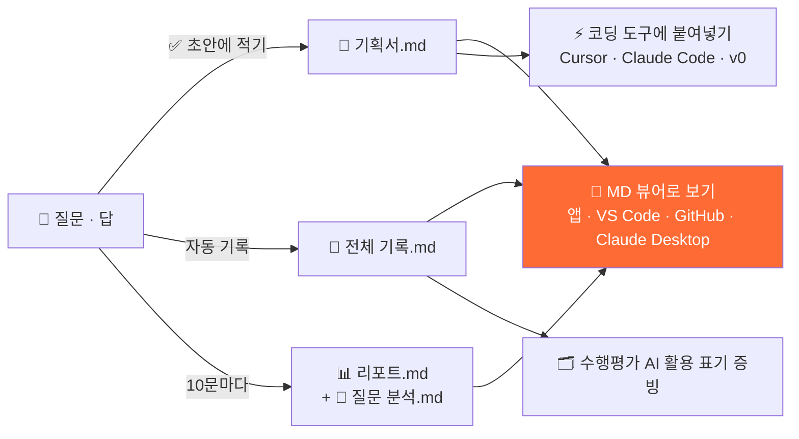

**왜 .md로 관리할까?**

| 이유 | 설명 |
| --- | --- |
| 👀 **어디서나 같은 뷰** | 앱의 MD 뷰어, VS Code 미리보기, GitHub, Claude Desktop 어디서 열어도 표·체크박스·순서도가 그대로 보여요 |
| ✍️ **바로 고칠 수 있다** | 특별한 프로그램 없이 메모장으로도 열고 고칠 수 있어요 |
| ⚡ **AI의 입력값이 된다** | 기획서.md를 그대로 Claude Code·v0에 붙여 넣으면 화면이 나와요 (오늘 실습이 바로 이것!) |
| 🗂 **과정이 증빙이 된다** | 전체 기록.md = "어떤 도구를, 어떤 질문으로, 어떻게 고쳐 가며" 썼는지 그대로 |
| 🔁 **주고받고 이어간다** | 친구·선생님과 주고받고, 다음 시간에 그 자리에서 이어서 해요 |

> 📝 **기획서.md는 이렇게 생겼어요** (`/about` 예시)
> ```markdown
> # 🌱 스마트 화분 · 기획서
> - [x] 동작 시나리오 — 흙이 400보다 마르면 550이 될 때까지, 길어도 5초만 물을 준다
> - [x] 부품 목록 — 5V 펌프 · 흙 센서
> - [ ] 구조 스케치
> - [ ] 만드는 순서
> ## 🫵 내가 정한 것
> - 마른 흙 320 · 젖은 흙 610 (직접 잼)
> ## 📌 AI가 가정한 것
> - 펌프가 도는 동안은 흙을 안 본다
> ```
> → 뷰어로 열면 체크박스와 제목이 정리된 **한 장짜리 문서**로 보여요. 이 문서 자체도 .md라서 지금 여러분이 같은 방식으로 보고 있는 거예요!

---

## 4. 같은 질문, 다른 대답 — 직접 비교해 보기

**질문:** "AI로 식물 병 알아낼 수 있어?" (실제 `/demo` 스마트 화분 예시)

| 💬 일반 챗봇 | ⚡ 틴스파크AI |
| --- | --- |
| "네, 가능합니다. 이미지 분류 모델을 쓰면 됩니다. 1) 데이터 수집 2) 학습 3) 배포… (긴 설명)" | ① 일단 **다 알려 줌** — 잎 사진을 '정상/병든 잎'으로 나눠 학습, 코딩 없이 Teachable Machine으로 가능, 빛·각도가 바뀌면 자주 틀림 |
| (끝) | ② **솔직하게 짚어 줌** — "이 질문엔 누구한테 물어도 같은 답밖에 못 해. **네 화분 얘기가 하나도 없거든.**" |
| | ③ **좁힐 거리 3개 제시** — 무엇을 알아챌래?(노란 잎? 벌레? 고양이?) / 사진은 어디서 얼마나 자주? / 틀려도 괜찮은 쪽은?(괜히 울리는 알림 vs 놓치는 병) |
| | ④ 🙋 **되묻기** — "셋 중에 지금 바로 답할 수 있는 건 어느 거야? 하나만 정해도 내 답이 달라져." |

**또 다른 예 — 역질문 카드 (실제 `/demo` 화면)**

> 🧭 전송 규칙을 '값이 변할 때만 보내기' 하나로 정했다고 해 보자.
> 서버에 **30분째 아무 값도 안 온다면**, 그건 어느 쪽일까?
>
> ① 화분이 멀쩡해서 보낼 게 없는 것
> ② **멀쩡한 건지 고장 난 건지 구분이 안 된다** ✅
> ③ 문제가 생기면 서버가 알아서 알려 줄 것
> ④ 잘 모르겠어
>
> 🧭 "정확히 그게 문제야. 그래서 평소에도 1분마다 보내고, 10분 넘게 소식이 없으면 '📵 연락 끊김' 알림을 보내게 하자. **기획서 5번 칸에 넣었어.**"

→ 퀴즈 하나를 풀었더니 **내 설계도에 규칙이 한 줄 늘었어요.** 이게 틴스파크AI의 방식입니다.

---

## 5. 웹페이지 둘러보기 — 실제 화면 구성

```
askback-omega.vercel.app
├── /            첫 화면 "아이디어에 불꽃, 설계는 내가" → 내 프로젝트
│   ├── 왼쪽 메뉴
│   │   ├── 레벨 배지 (Lv.1 질문 씨앗 · 다음 리포트까지 0/10)
│   │   ├── + 새 프로젝트 / 💬 자유 질문
│   │   ├── 📂 예시 프로젝트 4개
│   │   │    🌱 스마트 화분(민준 중3) · 🐢 거북목 감시 웹캠(서연 중2)
│   │   │    🐶 반려동물 이상행동 일지(다온 중2) · 🚸 위험 등굣길 지도(서윤 중1)
│   │   └── 📊 리포트 · ⚙️ 설정
│   └── 대화 화면
│       ├── 코치 인사: "먼저 최선의 답을 줄게. 두 번 묻고 나면 내가 한 번 되물을게 — ●○"
│       ├── "무엇으로 만들 거야?" 형식 카드 5개
│       └── 입력창 (＋ 첨부 · 💡 힌트 · 🎙 음성 · ↑ 보내기)
├── /about       소개 페이지 (O1~O5 다이얼 체험 · 화이트보드 4관문 · "어디서 막혀 있나요?")
└── /demo        시연 페이지 (예시 질문 20개를 한눈에 · 한 걸음씩 보기)
```

### 무엇을 만들 거야? — 형식 5가지

| 형식 | 이런 친구에게 | 예시 주제 | 만들어지는 것 |
| --- | --- | --- | --- |
| 🤖 제품(하드웨어) | 아두이노·센서 좋아하는 친구 | 스마트 화분 | 동작 시나리오 + 부품 목록 + 구조 스케치 |
| 💻 서비스(웹·앱) | 앱·웹 만들고 싶은 친구 | 급식 알레르기 앱 | 핵심 기능 3개 + 화면 흐름 + 만들 범위 |
| 🎬 캠페인(AI 영상) | 영상·홍보에 관심 있는 친구 | 학교 앞 무단횡단 줄이기 30초 영상 | 메시지 한 줄 + 30초 콘티 + 배포 계획 |
| 🔬 리서치 | 조사·통계가 좋은 친구 | 우리 반 수면 시간 조사 | 조사 설계 + 데이터 항목 + 리포트 구성 |
| 📄 논문 | 탐구 보고서를 쓰는 친구 | 화분 흙 종류별 수분 유지 실험 | 연구 질문 + 목차 + 자료 수집 계획 |

---

## 6. 주요 고객 페르소나

> **페르소나**란? 우리 앱을 쓸 "대표 손님"을 실제 사람처럼 구체적으로 상상해 만든 인물이에요.

### 👧 페르소나 ① 서연 — 메인 사용자 (중2, 14세)

| 항목 | 내용 |
| --- | --- |
| 하루 | 아침에 급식표 확인 → 정보 시간 프로젝트 → 집에서 유튜브로 코딩 영상 시청 |
| AI 사용 | ChatGPT로 숙제 도움, 코드는 "짜줘" 한 줄 |
| 속마음 | "코드는 AI가 짜 줬는데, 핵심 기능이 뭐냐고 물어보면 말문이 막혀요." |
| 원하는 것 | 안내받으면서 빈칸을 채워 **내 말로 된 기획서** 완성하기 |
| 걱정 | "AI 썼다고 하면 선생님이 의심할까 봐 숨겨요." |
| 기기 | 학교 크롬북, 집에서는 스마트폰 |
| 성공하면 | 발표에서 "왜?"라는 질문에 3번 연속 대답할 수 있다 |

### 👦 페르소나 ② 도윤 — 대회 준비생 (고2, 17세)

| 항목 | 내용 |
| --- | --- |
| 상황 | 학생 발명대회 출전 준비. 아이디어는 많다 |
| 속마음 | "기능은 10개인데, 심사위원이 '그래서 핵심이 뭐예요?' 하면 할 말이 없어요." |
| 원하는 것 | **차별점 한 문장** + 실패했을 때 대책까지 들어간 기획서 |
| 약점 | "뭘 **안** 만들지"를 정해 본 적이 없다 |
| 자주 쓸 기능 | ✂️ 버릴 것 칩, 화이트보드 테스트, 코딩 프롬프트 복사 |

### 🧒 페르소나 ③ 하린 — 초등 메이커 (초5, 11세)

| 항목 | 내용 |
| --- | --- |
| 상황 | 방과후 메이커 수업. 긴 글 쓰기가 어렵다 |
| 속마음 | "뭘 써야 할지 모르겠어요…" |
| 원하는 것 | 쓰기 대신 **①~④ 고르기**로 답하기 |
| 도움 방법 | 💡 힌트 → 📎 예시 → 🤖 코치의 생각, 3단계로 조금씩 |

### 👨‍🏫 페르소나 ④ 김 선생님 — 도입을 결정하는 사람 (중학교 정보 교사)

| 항목 | 내용 |
| --- | --- |
| 상황 | 한 반 28명의 프로젝트를 8차시 동안 지도 |
| 속마음 | "수십 명을 한 명씩 붙잡고 기획이 맞는지 검사할 시간이 없습니다." |
| 원하는 것 | 학생별 진행 상황 + **AI를 어떻게 썼는지 투명하게 남는 평가 근거** |
| 보는 것 | 진도가 아니라 **질문의 넓이** — 여섯 축 중 몇 개를 써 봤는지, 🧩 n/4 도장 |
| 결정 순서 | 무료 체험 → 한 반에서 시험 사용 → 학교 전체 도입 |

> **누가 무엇을 하나?** 학생은 **쓰고**, 학부모는 **결제하고**, 선생님은 **도입을 결정해요.**

---

## 7. 유저 시나리오

> **유저 시나리오**란? 페르소나가 앱을 처음 열고 목표를 이룰 때까지, 무엇을 보고 누르고 느끼는지 순서대로 적은 이야기예요.

### 시나리오 A · 서연의 첫 수업 45분 — "급식 앱"이 설계도가 되기까지

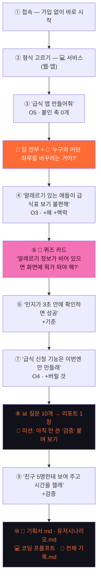

**실제 대화로 보기**

> **⏱ 0~5분 · 시작**
> 🤖 안녕, 서연! 뭐든 물어봐. 먼저 최선의 답을 줄게. 두 번 묻고 나면 내가 한 번 되물을게.
> 🤖 무엇으로 만들 거야? → 서연이 **💻 서비스(웹·앱)** 카드를 누름
>
> **⏱ 5~15분 · 질문 1~2**
> 🧑‍🎓 급식 앱 만들어줘.
> 🤖 급식 앱이라면 이런 기능들이 흔해: 오늘 메뉴 보기, 영양 정보, 알레르기 표시, 급식 평가… *(표로 정리)*
> 🙋 **그런데 누구의 어떤 하루를 바꾸려는 거야?**
> 🧑‍🎓 *(`❓왜` 칩 클릭)* 우리 반 민지가 견과류 알레르기인데, 매일 급식표에서 알레르기 번호를 하나하나 찾아봐서 불편해 보여.
> 🤖 그럼 핵심은 "메뉴 보기"가 아니라 "**먹어도 되는지 바로 알기**"네. 방법은 세 가지야… *(비교표)*
> 🙋 **민지는 그걸 언제, 어디서 확인해?**
>
> **⏱ 15~20분 · 🧭 퀴즈 카드 (질문 2개마다)**
> 🧭 민지의 알레르기 정보가 **비어 있으면** 화면에 뭐가 떠야 할까?
> ① 모든 메뉴를 초록색(안전)으로 ② **"정보를 먼저 입력해 줘" 안내** ③ 아무것도 안 띄움 ④ 잘 모르겠어
> 🧑‍🎓 ②번!
> 🧭 맞아. ①번이면 위험한 메뉴를 안전하다고 알려 주게 되거든. **기획서 '실패 조건' 칸에 넣었어.** 🧩 1/4
>
> **⏱ 20~35분 · 질문 3~9**
> 🧑‍🎓 *(`📏기준` 칩)* 민지가 **3초 안에** 먹어도 되는지 알면 성공이야.
> 🧑‍🎓 *(`✂️버릴 것` 칩)* 급식 평가랑 신청 기능은 이번엔 안 만들래.
> 🤖 좋아. 버린 덕분에 화면이 한 장으로 줄었어. *(화면 흐름 그림)*
>
> **⏱ 35~40분 · 📊 리포트**
> 질문 10개를 채우자 리포트가 나옴 → "처음엔 O5(맨 열린 질문)였는데 지금은 O3로 이동했어. 여섯 축 중 4개 사용! 🚩 **다음 미션: 아직 안 쓴 '검증'을 붙여 봐.**"
>
> **⏱ 40~45분 · 마무리**
> 🧑‍🎓 *(`⚖검증` 칩)* 친구 5명한테 써 보게 하고, 확인하는 데 몇 초 걸리는지 재 볼게.
> → **기획서.md**와 **전체 기록.md**를 내려받아 선생님께 제출 ✅

| 단계 | 서연이가 하는 일 | 앱이 하는 일 | 남는 것 |
| ---: | --- | --- | --- |
| 1 | 링크 클릭 | 가입 없이 프로젝트 자동 생성 | 기기에 자동 저장 |
| 2 | 💻 서비스 선택 | 서비스용 질문 버튼·체크 칸으로 바뀜 | 기획서 틀 |
| 3 | "급식 앱 만들어줘" | 답 전부 + 🙋 되묻기 1개 | 질문 기록 (O5) |
| 4 | `❓왜` 칩 누르고 이유 쓰기 | 답이 "민지 맞춤"으로 좁혀짐 | +왜 +맥락 |
| 5 | 퀴즈 ② 고르기 | 정답이면 기획서에 규칙 추가 | 🧩 1/4 |
| 6~7 | 기준·버릴 것 추가 | 🫵 내가 정한 것 / 📌 AI가 가정한 것 구분 | 기획서 칸 채움 |
| 8 | 질문 10개 달성 | 리포트 8칸 + 다음 미션 | 리포트 1장 |
| 9 | 미션 수행 | 축 5/6 달성 | 검증 계획 |
| 10 | 내보내기 | .md 파일 4종 생성 | 제출·발표 자료 |

### 시나리오 B · 막혔을 때 — 코치는 화내지 않아요

| 이런 순간 | 학생의 말 | 코치의 반응 (예시) |
| --- | --- | --- |
| 빈칸 앞에서 5분째 멈춤 | (아무 입력 없음) | 💡 힌트 "민지가 아침에 제일 바쁜 순간은 언제일까?" → 📎 예시 "등굣길 버스 안" → 🤖 코치의 생각 "나라면 '교실 들어가기 전 10초'로 정할래" |
| 모르겠음 | "몰라요" / ④ 잘 모르겠어 | "괜찮아. 더 작게 물어볼게 — 민지는 폰을 써, 크롬북을 써?" |
| 대신 써 달라고 함 | "그냥 기획서 써 줘" | "세 가지 버전을 보여 줄게. **고르는 건 네가** 해 줘." (대신 고르지 않음) |
| 퀴즈 틀림 | ①번 선택 | "그럼 위험한 메뉴도 초록색이 되네. 그 관문만 다시 해 보자." (벌점 없음) |
| 시간이 급함 | [나중에] 클릭 | 🧺 복기함에 보관, 다음 시간에 이어서 |

### 시나리오 C · 도윤의 대회 준비 — "기능 10개"에서 "핵심 1개"로

> 🧑‍🎓 도윤: 반려동물 앱인데, 산책 기록, 사료 알림, 병원 예약, SNS, 쇼핑, 일기, 체중 그래프, 훈련 영상, 동네 친구 찾기, 이상행동 감지까지 넣고 싶어.
> 🤖 *(10개 기능을 다 정리해 준 뒤)* 🙋 **이 중 하나를 빼면 가장 아쉬워할 사람은 누구야? 그리고 그 사람은 나머지 9개도 쓸까?**
> 🧑‍🎓 *(`✂️버릴 것`)* …사실 우리 집 콩이가 갑자기 밥을 안 먹은 게 시작이었어. 이상행동 감지만 남길래.
> 🧭 ⚡ 차별점 관문: "그냥 일기장 앱이랑 뭐가 달라?"
> 🧑‍🎓 '콩이의 평소 7일 평균'과 비교해서 다를 때만 알려 줘.
> 🧭 💥 실패 조건 관문: "가족 중 한 명이 기록을 안 하면?"
> 🧑‍🎓 3일 동안 기록이 없으면 가족 단톡방에 알림!
> → 🧩 4/4 도장 → **코딩 프롬프트 복사** → Cursor에 붙여 넣어 구현 → 대회 서류에 **전체 기록.md** 첨부

### 시나리오 D · 김 선생님의 8차시 수업

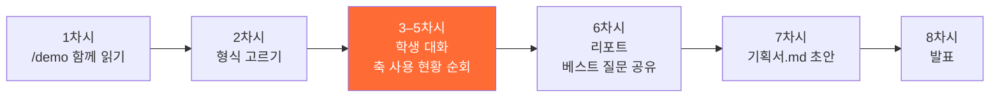

- **전에는:** 28명을 한 명씩 불러 화이트보드 검사 → 2시간
- **이제는:** 교실을 돌며 화면 위 🧩 n/4 도장과 10문 리포트만 확인 → 몇 분
- **6차시 팁:** 반 전체에서 "베스트 질문"을 뽑아 칠판에 적으면, 다른 친구들도 질문을 넓히는 법을 배워요.

### 시나리오 E · 이럴 땐 어떻게 되나요? (예외 상황)

| 상황 | 앱의 동작 |
| --- | --- |
| 예시 프로젝트를 열려는데 내 기록이 있음 | "지금 기록이 지워지고 '민준'의 데이터로 바뀌어" 확인 창이 뜸 → 취소 가능 *(실제 화면에서 확인)* |
| 브라우저 기록을 지움 | 지금은 기기에만 저장 → 기록이 사라짐. **수업 끝날 때마다 .md로 내려받기** 권장 |
| 장난·부적절한 입력 | 안전 장치가 막고, 프로젝트 이야기로 돌아오게 함 |
| 인터넷·AI 서버 문제 | 서버 없이 도는 예시(로컬 엔진)로 체험 계속 가능 |
| "코드 짜줘"만 계속 입력 | 막지 않음. 만드는 단계에서는 그런 질문이 많은 게 정상이라고 리포트에서 설명 |

---

## 8. 주요 경쟁 앱 — 쉬운 비유로 비교

| 종류 | 대표 앱 | 비유하면 | 잘하는 것 | 아쉬운 점 |
| --- | --- | --- | --- | --- |
| 범용 챗봇 | ChatGPT, Claude, Gemini | 📕 **답지** | 뭐든 빠르게 답함 | 생각이 답에서 멈춤. 과정이 안 남음 |
| 학습 모드 | ChatGPT 공부 모드, Claude 학습 모드 | 📘 **해설지 + 질문** | 차근차근 유도 | 과목 공부용. 프로젝트 **설계도**는 안 만들어 줌 |
| 튜터형 | 칸미고(Khanmigo) | 👨‍🏫 **엄한 과외 선생님** | 스스로 생각하게 함 | 답을 아껴서, 막히면 진도가 안 나감 |
| 교실 관리형 | Flint, SchoolAI | 📹 **교실 CCTV** | 선생님이 학생 대화를 다 봄 | 감시받는 느낌. 기록이 학생 것이 아님 |
| AI 탐지기 | GPTZero, 턴잇인 | 🚨 **금속 탐지기** | AI 쓴 글을 찾아냄 | "쓰지 마"라는 신호. 잘 쓰는 법은 안 알려 줌 |
| 바이브 코딩 | Cursor, Replit, Lovable | 🧱 **대신 지어 주는 건설업자** | 말만 하면 앱 완성 | 설계는 안 물어봄 → 설명 못 하는 앱 |

### 한눈에 보는 위치

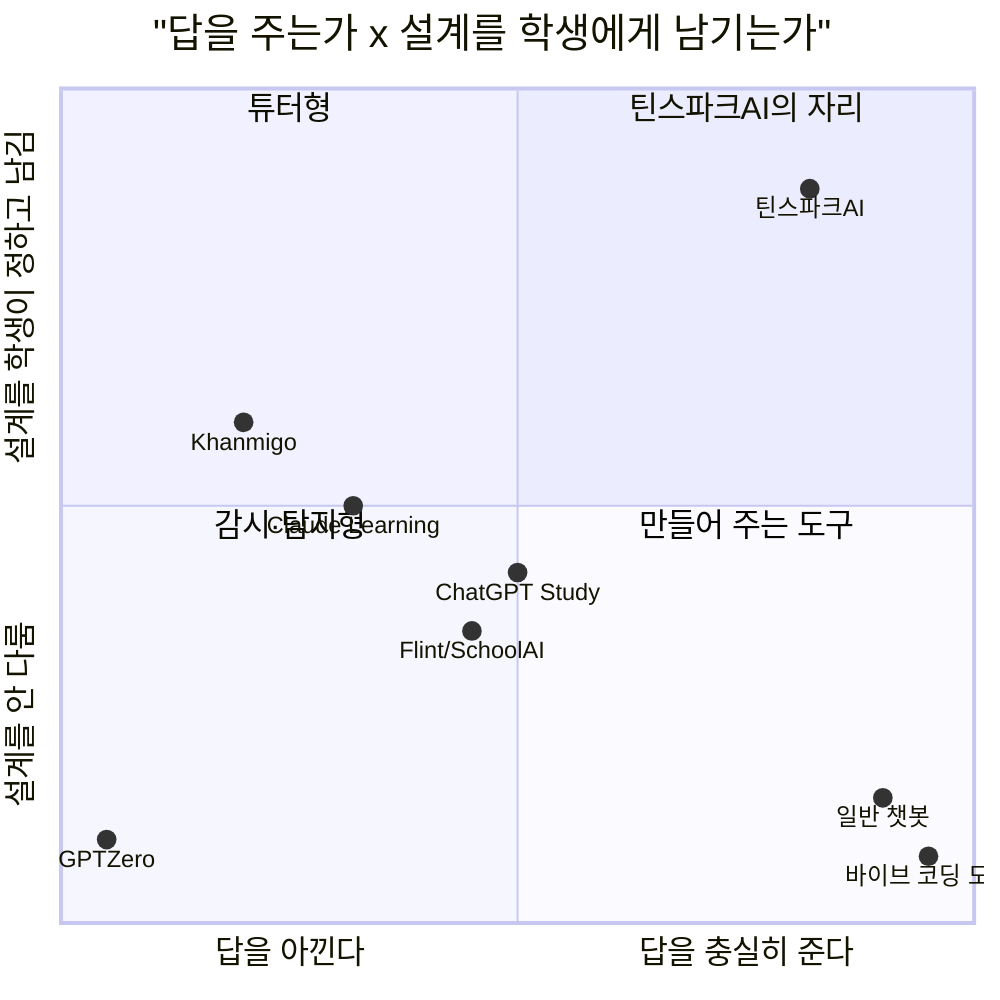

> 오른쪽 위 칸 — **답도 충분히 주고, 설계도 학생에게 남기는** 자리 — 가 비어 있어요. 틴스파크AI는 그 자리를 노립니다.

---

## 9. 차이점 — 틴스파크AI만 하는 것

| # | 차이점 | 다른 앱은 | 틴스파크AI는 | 예시 |
| ---: | --- | --- | --- | --- |
| 1 | **답은 끝까지 + 되묻기 하나** | 답만 주거나, 답을 아낌 | 먼저 다 주고 끝에 하나만 물음 | "누구의 하루를 먼저 바꿀래?" |
| 2 | **질문 볼륨 O1~O5** | 질문 수준을 신경 안 씀 | 가운데(O3)로 가게 코칭 | O5 "빵집 앱 어떻게 만들어?" → O3 "서버 없이 사장님 혼자 쓸 방법은?" |
| 3 | **한 겹 더 붙이는 여섯 축** | — | 칩을 누르면 내 문장에 빈칸이 붙음 | `🧱제약` → "내가 쓸 수 있는 건 ___ 뿐이야" |
| 4 | **2문 1역 퀴즈 카드** | 선생님이 직접 검사 | 대화 중 5~30초 퀴즈로 자동 점검 | "정보가 비어 있으면 화면에 뭐가 떠?" |
| 5 | **코드 대신 설계도** | 코드부터 줌 | 규칙 카드·순서도·비교표 위주 | "흙 습도 < 400이면 물 주기" 규칙 카드 |
| 6 | **과정이 곧 문서** | 대화가 흩어짐 | 기획서·시나리오·프롬프트·전체 기록 자동 정리 | 수업 끝나면 .md 4장 |
| 7 | **🫵 내가 정한 것 / 📌 AI가 가정한 것** | 구분 없음 | 둘을 나눠 표시 → AI 사용 표기에 그대로 사용 | 🫵 "3초 안에" / 📌 "크롬북 사용 가정" |
| 8 | **형식 5가지** | 코딩 또는 한 과목만 | 논문·리서치·영상·앱·하드웨어 | 과학 탐구, 사회 캠페인까지 |
| 9 | **내 기록은 내 것** | 선생님이 다 봄 | 가입 없이 내 기기에 저장, 선생님은 요약만 | 감시가 아니라 코칭 |

---


## 10. 설계도를 따라 단계별로 만들기 — 5일차 실습

> 지금까지는 **"무엇을, 누구를 위해"** 를 정했어요. 이제 이미 만들어 둔 설계도
> **`5일차_틴스파크AI_v0_페이지설계.md`** 를 한 칸씩 따라가며 화면을 만듭니다.
>
> - **설계서 = 정답지** (화면이 어떻게 생겼나, 무엇을 요청할까)
> - **이 시나리오 = 채점표** (서연이가 실제로 그렇게 쓸 수 있나)
> - 오늘 범위는 **UI만** — 가짜 코치(mock) + localStorage. 진짜 AI 연결은 다음 버전(V1)에서.

> 🎯 **오늘의 목표 = UI 완성**
> 버튼을 누르면 **화면이 바뀌고, 칩을 누르면 문장이 채워지고, .md가 뷰로 보이면** 성공이에요.
> 진짜 AI가 똑똑하게 대답할 필요는 없어요. 대답은 **미리 적어 둔 가짜 문장**이면 충분해요.

#### UI 완성 체크 — 이 화면 요소가 모두 보이면 완성

| 영역 | 꼭 보여야 하는 UI | 3절 개념 | STEP |
| --- | --- | --- | :-: |
| 첫 화면·시작 | 🚀 시작하기 · 이름/학년 · 형식 카드 5개 | — | 2~4 |
| 대화 헤더 | O1~O5 게이지 · AI 역할 배지 · 🧩 n/4 · 📝 기획서 · ⬇️ | ② 열림 · ④ 화이트보드 | 5 |
| 대화 말풍선 | 🙋 되묻기 줄 · 🫵 정할 것 · 📌 가정한 것 · `🔎 O3` 태그 · **✅ 초안에 적기 · 📄 MD 뷰어** 버튼 | ① 되묻기 · ⑥ .md | 5 |
| 입력 영역 | ＋ · **💡** · 입력창 · 🎙 · ↑ · 리듬 점 ●○ | — | 5 |
| **💡 자동 완성 트레이** | 칩 줄(🔭 ⬜ 📐 🤖 🚀 🧭 🔁) → 세부 칩 → **입력창에 빈칸 질문 자동 채움** | ⑤ 자동 완성 | **5-6** |
| **질문 넓히기** | 오른쪽 패널 여섯 축 칩 + 🧭 다듬기(🌅 넓히기 · 🔍 좁히기 · 🔀 대안) | ③ 여섯 축 | **5-4 · 5-6** |
| 역질문 카드 | ①~④ 선택 · 💡 힌트 3단 · [나중에] | ④ 화이트보드 | 7 |
| 리포트 | 8칸 + **📝 기획 .md · 🔎 질문 분석 .md 카드** | ⑥ .md | 8 |
| **MD 뷰어** | 기획서·리포트·전체 기록을 **.md 원문 ↔ 뷰** 전환해서 보기 | ⑥ .md | **9** |

### 10-1. 두 문서가 이어지는 방식

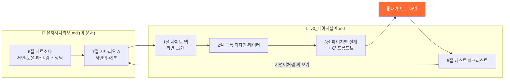

### 10-2. 전체 로드맵

| STEP | 만들 것 | 설계서에서 볼 곳 | 시나리오 A의 어느 장면? | 난이도 | 소요 |
| ---: | --- | --- | --- | :-: | :-: |
| 0 | 준비 (폴더·CLAUDE.md·실행) | 0절 기술 조건 | — | 🟢 | 10분 |
| 1 | 공통 레이아웃 · 디자인 · 데이터 모양 | 2-1 · 2-2 · 2-3 | 모든 장면의 바탕 | 🟡 | 10분 |
| 2 | `/` 첫 화면 | 3-1 | ① 접속 | 🟢 | 5분 |
| 3 | `/start` 이름·학년 | 3-2 | ① 가입 없이 바로 시작 | 🟢 | 5분 |
| 4 | `/new` 형식 고르기 | 3-3 | ② 💻 서비스 선택 | 🟡 | 10분 |
| 5 | `/p/[id]` 대화 화면 뼈대 ⭐ + **💡 자동 완성 · 질문 넓히기 칩** | 3-4 (프롬프트 1/2) + 3절 ③⑤ | ③ 첫 질문 · ④ 한 겹 | 🟡 | 20분 |
| 6 | 가짜 코치 로직 (열림 판정·되묻기) | 3-4 (프롬프트 2/2) | ③④⑥⑦ 되묻기·축 붙이기 | 🔴 | 15분 |
| 7 | 🧭 역질문 카드 | 3-5 | ⑤ 퀴즈 카드 | 🔴 | 10분 |
| 8 | 📊 리포트 | 3-6 | ⑧ 질문 10개 → 리포트 | 🔴 | 10분 |
| 9 | 기획서 미리보기 · **📄 MD 뷰어** · 내보내기 | 3-7 · 3-8 + 3절 ⑥ | ⑩ .md 내려받기 | 🟡 | 10분 |
| 10 | (선택) 내 프로젝트 · 소개 · 시연 · 설정 | 3-9 ~ 3-12 | 다시 온 학생 · 선생님 | 🟢 | 남는 시간 |

> 💡 **수업 시간 안에 목표:** STEP 0~5 (모두, **💡 트레이·축 칩까지**) → STEP 9의 MD 뷰어 (모두) → STEP 6~8 (가능한 사람) → STEP 10 (과제)

```mermaid
flowchart LR
  S0["0 준비"] --> S1["1 공통 레이아웃"] --> S2["2 /"] --> S3["3 /start"] --> S4["4 /new"] --> S5["5 /p/[id] 뼈대 ⭐"]
  S5 --> S6["6 가짜 코치"] --> S7["7 🧭 역질문"] --> S8["8 📊 리포트"] --> S9["9 기획서·내보내기"]
  S9 -.-> S10["10 나머지 페이지"]
  style S5 fill:#FF6B35,color:#fff
  style S6 fill:#2a2a35,color:#fff
  style S7 fill:#f472b6,color:#2a0a1c
```

### 10-3. 모든 STEP에 쓰는 요청 공식

매 STEP마다 Claude에게 **같은 4단계**로 요청해요. 한 번에 다 시키지 않아요.

| 순서 | 요청 | 예시 문장 |
| ---: | --- | --- |
| ① 읽히기 | 설계서의 해당 절을 읽게 하기 | "`@docs/5일차_틴스파크AI_v0_페이지설계.md` 의 **3-2절**을 읽어 줘. 아직 고치지 마." |
| ② 비교하기 | 지금 코드와 설계서의 차이 찾기 | "지금 화면과 설계서 내용이 **다른 점**을 표로 정리해 줘." |
| ③ 한 부분 만들기 | 차이 중 하나만 고치기 | "표의 1번만 고쳐 줘. UI만, 다른 파일은 건드리지 마." |
| ④ 채점하기 | 시나리오로 확인 | "서연이(중2, 크롬북)가 이 화면을 처음 본다고 생각하고 헷갈릴 곳을 찾아 줘." |

> 클론한 뼈대(teenspark.vercel.app)가 이미 있으니, **0부터 만들기보다 "설계서와 다른 점 고치기"** 가 훨씬 빨라요.

---

### STEP 0 · 준비

| 할 일 | 확인 |
| --- | :-: |
| 압축 푼 `teenspark` 폴더를 Claude Desktop Code 탭에서 열기 | ☐ |
| `docs/` 폴더에 이 문서와 설계서 두 개 넣기 | ☐ |
| `/init` 으로 CLAUDE.md 만들고 "UI만 · mock · localStorage · 한국어 반말 코치" 규칙 추가 | ☐ |
| `npm install` → `npm run dev` → `localhost:3000` 첫 화면 확인 | ☐ |

---

### STEP 1 · 공통 레이아웃 · 디자인 · 데이터 모양

**🎯 목표** 모든 화면이 같은 옷(색·글꼴·사이드바)을 입고, 같은 데이터 모양으로 저장되게 하기

| 설계서에서 볼 것 | 핵심 내용 |
| --- | --- |
| 2-1 디자인 규칙 | 배경 `#111119` · 카드 `#1a1a22` · 주황 `#FF6B35` · 여섯 축 고유 색 |
| 2-2 공통 레이아웃 | 왼쪽 사이드바 260px (로고 → 진행 카드 → + 새 프로젝트 → 내 프로젝트 → 📂 예시 → 📊·⚙️) / 모바일은 ☰ 서랍 |
| 2-3 데이터 모양 | `User` · `Project` · `Message` · `Axis` 타입 → localStorage |

```text
@docs/5일차_틴스파크AI_v0_페이지설계.md 의 2-1, 2-2, 2-3절을 읽고
지금 프로젝트의 색·사이드바·데이터 타입이 설계서와 다른 점을 표로 정리해 줘. 아직 고치지 마.
```

```text
2-3절의 타입(User, Project, Message, Axis)을 lib/types.ts 에 만들고,
localStorage 읽기·쓰기 함수를 lib/storage.ts 에 만들어 줘. 화면은 아직 건드리지 마.
```

**✅ 완료 체크**
- [ ] 사이드바 맨 위 로고 `teensparkai` 에서 **spark만 주황**
- [ ] 스마트폰 폭에서 사이드바가 ☰ 서랍으로 바뀜 (설계서 5절 체크 #14)
- [ ] `lib/types.ts` 에 여섯 축 `why · context · limit · criteria · verify · drop` 이 있음

---

### STEP 2 · `/` 첫 화면 — 시나리오 ① 접속

**🎯 목표** 서연이가 **3초 안에** "여기서 뭘 하는지" 알고 시작 버튼을 누르게 하기

| 상태 (설계서 3-1 ④) | 화면 |
| --- | --- |
| 저장된 사용자 없음 | "🚀 시작하기"만 크게 |
| 사용자·프로젝트 있음 | "○○, 다시 왔구나! 🔥" + 시작하기 / 이어하기 |

```text
설계서 3-1절의 "④ 상태별 화면"대로 동작하는지 확인해 줘.
localStorage에 projects가 없으면 "이어하기" 버튼을 숨기고, user가 있으면 "{이름}, 다시 왔구나! 🔥"를 보여 줘.
```

**✅ 완료 체크**
- [ ] 처음 접속하면 "이어하기"가 안 보임 (체크 #1)
- [ ] 시작하기 → 이름이 없으면 `/start`, 있으면 `/new`

---

### STEP 3 · `/start` 이름·학년 — 시나리오 ① "가입 없이 바로 시작"

**🎯 목표** 가입이 아니라 **이름표 달기**. 하린(초5)을 위해 간편 모드 켜기

| 상태 (설계서 3-2 ④) | 화면 |
| --- | --- |
| 이름 비어 있음 | "다음" 버튼 회색 |
| 초5·초6 선택 | 간편 모드 안내 + `simpleMode: true` |
| 이름 10자 초과 | "10자까지 쓸 수 있어" 빨간 글씨 |

```text
설계서 3-2절대로 /start 페이지를 맞춰 줘. 코치 말풍선 "안녕! 나는 네 기획 코치야. 뭐라고 부르면 될까?",
이름 입력, 학년 칩, "🔒 이름은 이 기기에만 저장돼. 가입은 필요 없어." 문구까지. 저장은 STEP 1의 storage 함수를 써.
```

**✅ 완료 체크**
- [ ] 초5를 고르면 간편 모드 안내가 뜸 (체크 #2)
- [ ] 새로고침해도 이름이 남아 있음

---

### STEP 4 · `/new` 형식 고르기 — 시나리오 ② 💻 서비스 선택

**🎯 목표** 고른 형식에 따라 **이후 화면의 칸 이름이 바뀌게** 하기

| 카드 | 만들어지는 것 | 🔀 알고리즘 | 기획서 4칸 (대화 화면 오른쪽) |
| --- | --- | --- | --- |
| 🤖 제품 | 동작 시나리오 + 부품 목록 + 구조 스케치 | 입력 → 판단 → 출력 | (설계서 3-3 참고) |
| 💻 서비스 | 핵심 기능 3개 + 화면 흐름 + 만들 범위 | 들어오면 → 조건 → 보여 줌 | 사용자 · 핵심 기능 · 흐름 · 화면 |
| 🎬 캠페인 | 메시지 + 30초 콘티 + 배포 계획 | 붙잡기 → 공감 → 메시지 → 행동 | (설계서 3-3 참고) |
| 🔬 리서치 | 조사 설계 + 데이터 항목 + 리포트 구성 | 수집 → 정리 → 비교 | (설계서 3-3 참고) |
| 📄 논문 | 연구 질문 + 목차 + 자료 수집 계획 | 바꾸는 것 → 재는 것 → 비교 기준 | (설계서 3-3 참고) |

```text
설계서 3-3절대로 형식 카드 5개를 만들어 줘(모바일 1열, 넓은 화면 2열).
카드를 누르면 확인 시트가 올라오고 프로젝트 이름·이모지를 고른 뒤 "대화 시작하기"를 누르면
새 Project를 localStorage에 저장하고 /p/{새id} 로 이동해 줘.
```

**✅ 완료 체크**
- [ ] 이름을 비워 두면 "새 서비스 프로젝트" 같은 기본 이름
- [ ] 고른 형식에 따라 대화 화면 오른쪽 기획서 4칸 이름이 바뀜 (체크 #3 — STEP 5 후 확인)

---

### STEP 5 · `/p/[id]` 대화 화면 뼈대 ⭐ — 시나리오 ③ 첫 질문

**🎯 목표** 앱의 심장. **사이드바 / 대화 / 질문 패널** 3칸을 먼저 **모양만** 완성하기

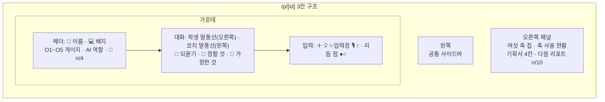

**나눠서 요청하기 (한 번에 하나씩)**

| 순서 | 요청할 부분 | 설계서 3-4의 어디 |
| ---: | --- | --- |
| 5-1 | 3칸 구조 + 헤더 | ② 가운데 위쪽 헤더 |
| 5-2 | 말풍선 2종 + 🙋 되묻기 줄 | ② 가운데 대화 영역 |
| 5-3 | 바닥 고정 입력 영역 + 리듬 점 | ② 가운데 아래 입력 영역 |
| 5-4 | 오른쪽 패널 + **여섯 축 칩** | ② 오른쪽 질문 패널 |
| 5-5 | 대화 0개일 때 코치 인사 + 예시 질문 3개 | ④ 상태별 화면 |
| **5-6** | **💡 자동 완성 트레이** (칩 줄 → 세부 칩 → 입력창 자동 채움) | 이 문서 3절 ⑤ |
| **5-7** | 코치 말풍선 아래 **✅ 초안에 적기 · 📄 MD 뷰어** 버튼 (모양만) | 이 문서 3절 ⑥ |

**5-4 질문 넓히기 — 여섯 축 칩**

```text
설계서 3-4절 "오른쪽 질문 패널"만 만들어 줘.
여섯 축 칩을 누르면 입력창 내용 뒤에 아래 빈칸 문장이 붙게 해 줘:
❓왜 " 이걸 하려는 이유는 ___ 이야." / 📍맥락 " ___가 ___ 상황에서 쓸 거야." / 🧱제약 " 내가 쓸 수 있는 건 ___ 뿐이야."
📏기준 " ___ 하면 성공이야." / ⚖검증 " ___ 해서 맞는지 확인할래." / ✂️버릴 것 " ___ 은 이번엔 안 만들 거야."
칩 색은 설계서 2-1의 여섯 축 색을 써 줘. 코치 답 로직은 아직 만들지 마.
```

**5-6 💡 자동 완성 트레이 — 질문 초안 채우기**

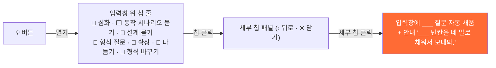

```text
대화 화면 입력창 왼쪽에 💡 버튼을 만들어 줘. 누르면 입력창 바로 위에 칩 줄이 가로로 나타나.
칩: 🔭 심화 / ⬜ 동작 시나리오 묻기 / 📐 설계 묻기 / 🤖 형식 질문 / 🚀 확장 / 🧭 다듬기 / 🔁 형식 바꾸기
- 칩을 누르면 같은 자리에 세부 칩 패널로 바뀌고, 왼쪽 ‹ 뒤로, 오른쪽 ✕ 닫기가 있어.
  📐 설계 묻기 → 🧭 기획 · 🔀 알고리즘 · 🏗 전체 구조 · 🔁 설계로 돌아가기
  🧭 다듬기 → 🌅 넓히기 · 🔍 좁히기 · 🔀 대안 · 💡 왜 이렇게? · 🙋 나한테 물어봐
  🚀 확장 → 🔧 메이커 · 📡 공유·서버 · ⚙️ AI·자동화 · 🧠 AI·추론 · 👁 AI·컴퓨터 비전 · 🤝 협력
  🔭 심화 → 🧭 철학 · 🫀 심리학 · 🌍 사회학
- 세부 칩을 누르면 입력창에 ___ 빈칸이 있는 질문 초안을 채우고,
  입력창 아래에 작은 글씨로 "___ 빈칸을 네 말로 채워서 보내봐."를 보여 줘.
- ⬜ 동작 시나리오 묻기는 바로 채워: "___를 하는 제품을 만들고 싶어. '___하면 ___한다' 식의 동작 시나리오로 정리해줘. 쓰는 곳은 ___야."
- 질문 초안 문장은 lib/promptTemplates.ts 에 모아 줘. 진짜 AI 연결은 하지 마.
```

**✅ 완료 체크**
- [ ] 축 칩을 누르면 입력창에 빈칸 문장이 붙음 (체크 #4)
- [ ] 💡 → 칩 → 세부 칩을 누르면 **입력창에 질문 초안이 자동으로 채워짐**
- [ ] 🧭 다듬기 → 🔍 좁히기로 보낸 질문 말풍선 아래에 `🔍 좁히기 칩` 표시가 붙음
- [ ] ‹ 뒤로 · ✕ 닫기가 동작하고, 폰 폭에서 칩 줄이 가로 스크롤됨
- [ ] 보낸 메시지가 새로고침 후에도 남아 있음 (체크 #13)
- [ ] 크롬북 폭(약 1366px)에서 3칸이 모두 보이고, 폰 폭에서는 패널이 접힘

---

### STEP 6 · 가짜 코치 로직 — 시나리오 ③④⑥⑦ 되묻기와 축 붙이기

**🎯 목표** 진짜 AI 없이도 **"답 끝에 되묻기 하나"** 리듬이 느껴지게 하기

| 학생 질문 | 판정 (설계서 3-4 "가짜 AI") | 게이지 · 역할 | 코치의 되묻기 |
| --- | --- | --- | --- |
| "급식 앱 만들어줘" | `짜줘·만들어줘·코드`로 끝남 | O1 ⌨️ 받아쓰기 | 아직 안 쓴 축 하나 |
| "급식 앱?" (15자 이하, 축 0개) | 너무 넓음 | O5 📚 백과사전 + "질문이 넓어" 안내 | "누구의 어떤 하루를 바꾸려는 거야?" |
| "…민지가 불편해 보여 ❓왜" | 축 1개 이상 | **O3 🛠 엔지니어 ⭐** | 안 쓴 축 (예: 📏기준) |
| "다른 방법 두 개만 더" | `대안·다른 방법·말고` | O4 🏛 아키텍트 | 안 쓴 축 |
| 그 외 | — | O2 👨‍💻 코더 | 안 쓴 축 |

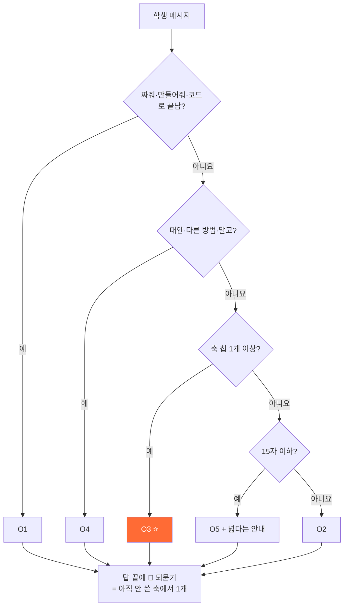

```text
설계서 3-4절의 "v0 프롬프트 (2/2) — 가짜 코치 로직"대로 mock 코치 함수를 lib/mockCoach.ts 에 만들어 줘.
진짜 AI 연결은 하지 마. 1초 로딩(점 3개) 뒤 코치 답을 붙이고, 되묻기는 이 프로젝트에서 아직 안 쓴 축에서 골라 줘.
```

**✅ 완료 체크** — 시나리오 A 대사 그대로 넣어 보기
- [ ] "급식 앱 만들어줘" → 게이지가 O1, 답 끝에 🙋 (체크 #5·#6)
- [ ] `❓왜` 칩 붙여 다시 질문 → 게이지가 **O3**로 이동
- [ ] 되묻기가 매번 **아직 안 쓴 축**에서 나옴

---

### STEP 7 · 🧭 역질문 카드 — 시나리오 ⑤ 퀴즈 카드

**🎯 목표** 질문 2개마다 **5초면 고를 수 있는** 퀴즈 카드 띄우기

| 관문 | 시나리오 A 예시 질문 | 정답이면 |
| --- | --- | --- |
| 💥 실패 조건 | "민지의 알레르기 정보가 **비어 있으면** 화면에 뭐가 떠야 할까?" ① 모두 초록 ② **입력 안내** ③ 아무것도 ④ 모르겠어 | 기획서 '실패 조건' 칸 채움 · 🧩 +1 |
| 🔲 순서도 | "알림이 울리기까지 순서를 세 칸으로" | 알고리즘 칸 채움 · 🧩 +1 |
| 🎯 핵심 | "한 줄만 남긴다면?" | 기획 칸 채움 · 🧩 +1 |
| ⚡ 차별점 | "학교 홈페이지 급식표랑 뭐가 달라?" | 차별점 채움 · 🧩 +1 |

```text
설계서 3-5절대로 역질문 카드 모달을 만들어 줘. 질문 2개마다 열리고, ①~④ 선택지와 [나중에] 버튼이 있어.
정답이면 헤더의 🧩 숫자를 올리고 기획서 해당 칸에 문장을 넣어 줘. 틀려도 벌점 없이 "그 관문만 다시 해 보자".
예시 데이터는 설계서의 "서비스 형식, 급식 알레르기 앱"을 써 줘.
```

**✅ 완료 체크**
- [ ] 질문 2개마다 카드가 뜨고, 정답이면 🧩 숫자가 오름 (체크 #7)
- [ ] [나중에] → 복기함 숫자가 오름 (체크 #8)
- [ ] 틀렸을 때 코치가 화내지 않음 (시나리오 B)

---

### STEP 8 · 📊 리포트 — 시나리오 ⑧ 질문 10개 → 리포트

**🎯 목표** 질문 10개마다 **"내 질문이 어떻게 자랐는지"** 보여 주는 8칸 리포트

| # | 칸 | 무엇을 보여 주나 |
| ---: | --- | --- |
| 1 | 한눈에 | "처음엔 '급식 앱 만들어줘' → 지금은 '민지가 3초 안에'" |
| 2 | 질문 유형 | O1~O5 막대 그래프 |
| 3 | 질문 길이 | 1~10번 글자 수 꺾은선 |
| 4 | 실은 것 | 여섯 축 레이더 차트 |
| 5 | 되묻기 | 10번 중 몇 번 답했나 |
| 6 | 걸린 곳 | 틀렸거나 미룬 관문 |
| 7 | ⭐ 베스트 질문 | 축이 가장 많이 붙은 질문 |
| 8 | 🚩 다음 미션 | **아직 안 쓴 축** 하나 |

```text
설계서 3-6절대로 /p/[id]/report/[n] 페이지를 만들어 줘. 8칸을 넓은 화면 2열 카드로.
그래프는 지금 프로젝트의 messages 데이터로 계산하고, 다음 미션은 아직 안 쓴 축에서 골라 줘.
먼저 1·2·8번 칸만 만들고 멈춰 줘.
```

**✅ 완료 체크**
- [ ] 질문 10개에서 "📊 1번째 리포트가 나왔어!" 토스트 (체크 #9)
- [ ] 🚩 미션이 아직 안 쓴 축 (시나리오 A: ⚖ 검증)

---

### STEP 9 · 기획서 미리보기 · 내보내기 — 시나리오 ⑩ .md 내려받기

**🎯 목표** 대화가 **설계도 3칸 + .md 4종**으로 정리되어 그대로 제출 가능하게

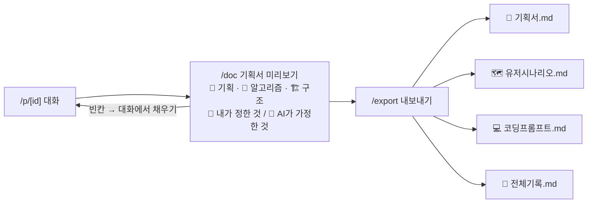

```text
설계서 3-7절대로 /p/[id]/doc 기획서 미리보기를 만들어 줘(다크 배경 위 흰 종이 카드).
비어 있는 칸은 "아직 비어 있어 — 대화에서 채워 볼래? →" 링크로 대화 화면에 돌아가게 해 줘.
```

```text
설계서 3-8절대로 /p/[id]/export 를 만들어 줘. 카드 4개(기획서·유저시나리오·코딩프롬프트·전체기록),
각 카드에 [⬇️ 다운로드] [📋 복사], 아래 [📦 4개 한꺼번에 받기]. 파일 내용은 localStorage 프로젝트 데이터로 만들어 줘.
```

**📄 MD 뷰어 — .md로 관리하면 화면에서 바로 본다**

> 저장은 **.md 한 장**, 보기는 **예쁜 뷰**. 같은 파일을 앱 안에서도, VS Code·GitHub·Claude Desktop에서도 똑같이 볼 수 있어요.

| 뷰어를 여는 곳 | 보여 줄 .md |
| --- | --- |
| 코치 말풍선 아래 `📄 MD 뷰어` | 이 답 하나의 .md |
| 헤더 `📝 기획서` | `{프로젝트}_기획서.md` 전체 |
| 리포트 카드 `📝 기획 .md · 열기 ›` / `🔎 질문 분석 .md · 열기 ›` | 기획서 / 질문 분석 |
| 리포트 카드 `📄 리포트 자체도 .md로 보기` | 리포트 원문 |
| `/export` 카드 클릭 | 내보낼 4개 파일 미리보기 |

```text
.md 문자열을 받아서 보여 주는 MdViewer 컴포넌트를 만들어 줘(react-markdown + remark-gfm).
- 오른쪽에서 열리는 Sheet(모바일은 아래에서). 위쪽에 탭 [👀 뷰 | 📝 .md 원문].
- 뷰 탭: 제목·표·체크박스(- [x])가 정리된 문서처럼. 원문 탭: 고정폭 글꼴 그대로.
- 맨 아래 [📋 복사] [⬇️ .md 받기] 버튼.
- 코치 말풍선의 "📄 MD 뷰어", 헤더 "📝 기획서", 리포트 카드의 ".md 열기"에서 모두 이 컴포넌트를 써 줘.
```

**✅ 완료 체크**
- [ ] 기획서 빈칸 링크 → 대화 화면으로 이동 (체크 #10)
- [ ] .md 4개 다운로드, 전체기록에 모든 질문이 순서대로 (체크 #11)
- [ ] **📄 MD 뷰어에서 [👀 뷰] ↔ [📝 원문] 전환**이 되고, 체크박스·표가 뷰에서 정리돼 보임
- [ ] 내려받은 .md를 **VS Code 미리보기(또는 GitHub)에서 열어도 같은 모양**

---

### STEP 10 · (선택) 나머지 페이지

| 페이지 | 설계서 | 누구를 위해 | 한 줄 요청 |
| --- | --- | --- | --- |
| `/projects` 내 프로젝트 | 3-9 | 다시 온 학생 | "예시 프로젝트를 열어도 **내 기록이 지워지지 않게**" (체크 #12) |
| `/about` 소개 | 3-10 | 김 선생님 · 학부모 | "O1~O5 다이얼 체험을 넣어 줘" |
| `/demo` 시연 | 3-11 | 선생님 · 처음 온 학생 | "예시 대화 20개를 한 걸음씩 보기" |
| `/settings` 설정 | 3-12 | 학생 | "이름·학년·간편 모드·데이터 초기화(확인 창 필수)" |

---

### 10-4. 최종 채점 — 서연이가 되어 시나리오 A 따라가 보기

내가 만든 앱에서 **7절 시나리오 A의 대사를 그대로** 입력해 보세요. 모두 ✅면 완성!

| 시나리오 A | 내가 할 일 | 어느 STEP | 기대하는 화면 | 통과 |
| --- | --- | :-: | --- | :-: |
| ① 접속 | `localhost:3000` 열기 | 2 | "🚀 시작하기"만 크게 | ☐ |
| ① 시작 | 이름 "서연", 중2 | 3 | 다음 → `/new` | ☐ |
| ② 형식 | 💻 서비스 · "급식 알레르기 앱" | 4 | `/p/[id]`, 헤더에 🍱 · 💻 | ☐ |
| ③ 첫 질문 | "급식 앱 만들어줘" | 5·6 | O1, 🙋 되묻기 | ☐ |
| ④ 한 겹 | `❓왜` 칩 + "민지가 불편해 보여" | 6 | O3 ⭐, 축 2/6 | ☐ |
| ④' 자동 완성 | 💡 → 🧭 다듬기 → 🔍 좁히기, 빈칸 채워 보내기 | 5-6 | 입력창 자동 채움 · `🔍 좁히기 칩` 표시 | ☐ |
| ⑤ 퀴즈 | ② "정보를 먼저 입력해 줘" 선택 | 7 | 🧩 1/4, 실패 조건 칸 ✅ | ☐ |
| ⑥⑦ 기준·버릴 것 | `📏기준` "3초 안에", `✂️버릴 것` "신청 기능" | 6 | 축 4/6 | ☐ |
| ⑧ 리포트 | 질문 10개 채우기 | 8 | 🚩 미션: ⚖ 검증 | ☐ |
| ⑨ 미션 | `⚖검증` "친구 5명 시간 재기" | 6 | 축 5/6 | ☐ |
| ⑩ 뷰로 보기 | 헤더 📝 기획서 → [👀 뷰] ↔ [📝 원문] | 9 | 체크박스·표가 정리된 기획서 | ☐ |
| ⑩ 내보내기 | 📦 4개 받기 | 9 | .md 4개 다운로드 | ☐ |

> 하나라도 ☐ 로 남으면 → 그 STEP의 설계서 절로 돌아가 **"설계서와 다른 점"** 부터 다시 물어보세요.

---

## 11. 직접 해 보기 — 활동

**활동 1. 내 STEP 기록표** — 내가 진행한 STEP과 Claude에게 한 요청을 적어요. (= AI 활용 표기 증빙)

| STEP | 내가 한 요청 (그대로 복사) | 결과 · 내가 직접 고친 것 | 🫵 내가 정한 것 |
| :-: | --- | --- | --- |
| | | | |
| | | | |
| | | | |

**활동 2. 요청 볼륨 바꾸기** — 아래 O5 요청을 O3로 바꿔 보세요. (여섯 축 중 2개 이상 붙이기)

| O5 요청 | 내가 바꾼 O3 요청 | 붙인 축 |
| --- | --- | --- |
| "대화 화면 만들어 줘" | | |
| "예쁘게 해 줘" | | |
| "리포트 페이지 추가해" | | |

> **모범 예시 —** "대화 화면 만들어 줘" → "설계서 3-4절의 **오른쪽 패널만**(🧱제약) 만들어 줘. 서연이가 **크롬북에서**(📍맥락) 칩 6개를 **한 줄에 다 볼 수 있으면 성공**(📏기준)이야."

**활동 3. 내가 코치가 되어 보기** — 짝의 화면을 보고 화이트보드 4관문으로 물어보세요.

| 관문 | 짝에게 할 질문 |
| --- | --- |
| 🔲 순서도 | "칩을 누르면 → ___ → ___ 순서로 바뀌는 거 맞아?" |
| 🎯 핵심 | "이 화면에서 **하나만** 남긴다면 뭐야?" |
| ⚡ 차별점 | "그냥 채팅 앱이랑 뭐가 달라?" |
| 💥 실패 조건 | "localStorage가 비어 있으면 이 화면엔 뭐가 떠?" |

---

## 부록 · 웹페이지에서 발견한 개선점 (만들 때 반영하기)

| 발견 | 위치 | 제안 | 반영할 STEP |
| --- | --- | --- | :-: |
| 기획문서 v2에서 없앤 "🔥 7단계 기획 가이드"와 "Lv.1 불씨 → Lv.4 봉화"가 아직 보임 | `/demo` | 여섯 축 사용 현황으로 바꾸기 | 10 |
| 왼쪽 메뉴에 "Lv.1 질문 씨앗" 레벨 배지 | 메인 | "축 n/6 · 다음 리포트까지 n/10"으로 바꾸기 | 1 |
| 아이콘이 사업계획서는 **번개**, 웹은 **불꽃** | 사업계획서 표지 | 불꽃으로 통일 | 1 |
| 예시 프로젝트가 웹은 4개, 투자제안서는 6개 | 왼쪽 메뉴 | 개수를 맞추거나 2개 추가 | 1 |
| 예시를 열면 내 기록을 덮어씀 | 메인 | "새 프로젝트로 열기" 옵션 추가 | 10 |

---

> ⚡ 틴스파크AI · 답은 끝까지, 질문은 넓게 · Design before code
> **"AI한테 시키기 전에, 한 겹만 더 물어보기"**
